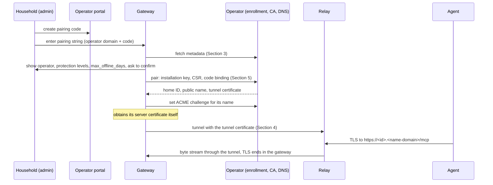

<!-- SPDX-License-Identifier: CC-BY-4.0 -->

# Home-Mandate Relay Specification v0 (Draft)

Status: **Skeleton of a working draft. Not part of `v0.1.0` of the Home-Mandate
Specification**; the freeze of Section 14 of SPEC-v0 does not cover this document, its schema
or its examples. Sections marked *To be specified* hold the agreed outline only.
License of this document: CC BY 4.0 (`LICENSE-docs`). Schema and examples: Apache 2.0
(`LICENSE`).

The key words "MUST", "MUST NOT", "SHOULD", "SHOULD NOT" and "MAY" in this document are to be
interpreted as described in BCP 14 (RFC 2119, RFC 8174) when, and only when, they appear in
all capitals.

## 1. Goal

A gateway in a home is usually behind NAT and cannot be reached by cloud agents. A **relay**
makes it reachable under a public name: the gateway connects outbound to the relay, and the
relay passes the agents' TLS connections through to the gateway without terminating them.

Relays MAY be run by anyone. This document defines what a gateway and a relay operator need
to work together without knowing each other in advance, and what an operator MUST do so that
a household can trust a relay it does not control:

| Part | Contents |
|---|---|
| Tunnel protocol (Section 4) | how the gateway and the relay connect and how agent connections are passed through |
| Pairing and issuance (Section 5) | how a gateway is paired with an operator, obtains and renews its certificates, and is unpaired |
| Names and certificates (Section 6) | public names, protection levels, Certificate Transparency monitoring, pinning of the relay |
| Operator obligations (Section 7) | what a conforming operator MUST do and MUST NOT do |

The specification builds on existing standards:

| Purpose | Standard |
|---|---|
| Transport | TLS 1.3 (RFC 8446) |
| Identity of the gateway towards the relay | SPIFFE X.509-SVID |
| Requests of the gateway to the operator | JSON Web Signature (RFC 7515), patterns of ACME (RFC 8555) |
| Certificate requests | PKCS #10 (RFC 2986) |
| Public certificate of the home | ACME (RFC 8555) with the `dns-01` challenge, CAA (RFC 8659, RFC 8657), Certificate Transparency (RFC 6962 and the logs that browsers accept, whatever interface they offer) |
| Errors | Problem Details (RFC 9457) |

### 1.1 What a relay can and cannot do (informative)

The TLS connection of an agent ends in the gateway, with a key that never leaves the home.
The relay sees the server name, the agent's address, the time and the number of bytes, not
the content. OAuth, the evaluation of mandates and approvals take place in the home
(SPEC-v0).

The remaining risk is the operator's control over the DNS of the public name: whoever
controls it can obtain a second certificate for the name and open the TLS connection at the
relay. This specification therefore defines two protection levels (Section 6), both
mandatory for every operator:

- **Standard** (`<id>.<name-domain>`): the operator cannot read **unnoticed**. Every
  certificate for the name appears in Certificate Transparency logs, and the gateway MUST
  watch them and raise an alarm.
- **Own domain** (a name of the household): the operator **cannot** obtain a certificate
  for the name, because a CAA record of the household binds issuance to the gateway's own
  ACME account.

### 1.2 Overview (informative)



## 2. Terminology

- **Gateway:** the implementation in the home (SPEC-v0) that serves agents and connects to the
  relay.
- **Operator:** whoever runs a relay together with its portal, enrollment endpoint, CA and
  DNS zones.
- **Relay:** the server of the operator that accepts tunnel connections of gateways and
  agent connections, and passes the latter through.
- **Enrollment endpoint:** the operator's HTTPS interface for the requests of the gateway
  (Section 5).
- **Portal:** the operator's user interface where a household creates pairing codes, sees and
  unpairs its installations.
- **Operator domain:** the DNS domain under which the operator publishes its metadata
  (Section 3).
- **Name domain:** the DNS domain under which homes get their public names at the protection
  level Standard. It is not the operator domain and serves nothing but homes (Section 7).
- **Trust domain:** the SPIFFE trust domain of the operator's tunnel certificates.
- **Home ID** (`<id>`): the identifier the operator assigns to a paired gateway: 26 characters
  of lower-case base32 `[a-z2-7]` (130 random bits).
- **Public name:** the DNS name under which agents reach the gateway; `<id>.<name-domain>` or a
  name in the household's own domain.
- **Installation key:** a long-lived key pair generated by the gateway at pairing; it signs the
  gateway's requests to the operator.
- **Tunnel certificate:** the short-lived X.509-SVID with which the gateway authenticates to
  the relay.
- **Server certificate:** the publicly trusted certificate of the public name; it is presented
  to agents and obtained by the gateway itself through ACME.
- **ACME account key:** the gateway's own key for its account at the public CA.
- **Pairing code:** a single-use secret that the portal shows and the household enters into
  the gateway.
- **Pairing string:** the operator domain and the pairing code in one string, for typing or as
  a QR code.
- **Protection level:** Standard or Own domain (Sections 1.1 and 6).

## 3. Operator metadata

An operator publishes its parameters as a JSON document at

```
https://<operator-domain>/.well-known/home-mandate-relay
```

The document MUST validate against `relay/schema/metadata-v0.schema.json`; an example is
`relay/examples/metadata.json`. A gateway MUST fetch it over HTTPS with a certificate that is
valid for the operator domain under the gateway's ordinary trust store, MUST NOT follow
redirects, and MUST reject a document larger than 16 KiB. The document is closed: a member that
the schema does not list makes it invalid. New members come with a new `type`; until this
specification is released, the schema can still change under the same `type`.

| Member | Meaning |
|---|---|
| `type` | `https://home-mandate.org/relay-metadata/v0` |
| `operator_domain` | MUST equal the host from which the document was fetched |
| `name_domain` | domain of the public names at the protection level Standard; MUST NOT be the operator domain |
| `trust_domain` | SPIFFE trust domain of the tunnel certificates |
| `enrollment` | HTTPS URL of the enrollment directory (Section 5.1); its host MUST be the operator domain or a subdomain of it |
| `relay` | `host` and `port` of the relay |
| `relay_pins` | SHA-256 digests (base64url) of the SubjectPublicKeyInfo the gateway pins for the relay; at least two (Section 6) |
| `max_offline_days` | how long after the expiry of its last tunnel certificate a gateway can still obtain a new one with its installation key; 7 to 90, RECOMMENDED 30 (Section 5.4) |
| `protection_levels` | MUST list `standard` and `own-domain` (Section 7) |
| `portal` | HTTPS URL of the portal, shown to the household |
| `privacy_policy` | HTTPS URL of the operator's privacy policy, shown to the household |

Before it completes a pairing, the gateway MUST show the household the operator domain, the
protection levels and `max_offline_days`. A change of the document applies to an existing
pairing from its next renewal on (Section 5.4); the gateway MUST tell the household when
`max_offline_days` or `protection_levels` changed. Changes of `relay_pins` follow Section 6.

## 4. Tunnel protocol

*To be specified.* The starting point is the Home-Mandate tunnel protocol v1
(`docs/tunnel-protocol-v1.md` in `github.com/home-mandate/relay`): one control connection and
one mutually authenticated connection per agent connection. This section will take it over with
the name domain and the trust domain as parameters of the operator (Section 3) and the tunnel
certificate of Section 5.3; the CA that issues tunnel certificates belongs to the operator and
is not published. Until this section is specified, no interoperability between independent
gateways and operators is claimed.

## 5. Pairing and issuance

The gateway talks to the operator's **enrollment endpoint** over HTTPS (TLS 1.2 or later with a
certificate valid for its host under the gateway's ordinary trust store). All messages are
described by `relay/schema/enrollment-v0.schema.json`; examples are in `relay/examples/`.
Section 1.2 shows the flow.

### 5.1 Directory, nonces and requests

**Directory.** The URL `enrollment` of the metadata (Section 3) returns, on `GET`, a JSON object
with the URLs `new_nonce`, `pair` and `key_change` (`$defs/directory`). Every URL in the
directory and in responses MUST be an HTTPS URL on the host of `enrollment`; a gateway MUST NOT
send a request to any other host.

**Nonces.** Every response of the enrollment endpoint, including errors, carries a fresh nonce
in the header `Replay-Nonce`: base64url without padding, at least 128 random bits. `HEAD` or
`GET` on `new_nonce` returns one without a body. The operator accepts every nonce once, MAY let
unused nonces expire, and answers an unknown, used or expired nonce with the error `bad-nonce`
and a fresh nonce; the gateway then repeats the request once with it.

**Requests.** Every request except to the directory and to `new_nonce` is a `POST` with the
content type `application/jose` whose body is a JWS (RFC 7515) in compact serialization:

- The protected header (`$defs/protected_header`) has exactly `alg`, `nonce`, `url` and one of
  `jwk` and `kid`. `alg` is `EdDSA` (Ed25519, RFC 8037) or `ES256`; an operator MUST accept
  both. `url` MUST equal the URL the request was sent to, byte for byte. `jwk` is the public
  installation key and appears only in a pairing request (Section 5.2); every other request
  carries `kid`, the installation URL (Section 5.3). Any other header member, and a `jwk` with
  a private part, make the request invalid.
- The spelling rules of SPEC-v0 Section 7.1 apply: base64url without padding, case-sensitive
  member names, and for ES256 only the lower `s`.
- The payload is a JSON object of the type the URL expects, or empty for a read ("POST-as-GET",
  RFC 8555 Section 6.3). Objects are closed: an operator MUST reject a request with a member the
  schema does not list.

The operator checks, in this order: header and signature, nonce, `url`, then the installation
named by `kid` and its state (Section 5.7), then the payload. A request that fails a check has
no effect.

**Responses and errors.** Successful responses are JSON (`application/json`). Errors are Problem
Details (RFC 9457, `application/problem+json`) whose `type` is
`https://home-mandate.org/relay/errors/` followed by one of the names in the table. A response
that is not one of these is treated by the gateway as `server-internal`. In responses, a
gateway MUST ignore members it does not know.

| Error | Status | Meaning |
|---|---|---|
| `malformed` | 400 | the request does not match this section or the schema |
| `bad-nonce` | 400 | nonce unknown, used or expired; repeat with the fresh nonce |
| `bad-signature` | 401 | the JWS does not verify, or `kid` names no installation |
| `pairing-refused` | 403 | the pairing code is wrong, expired, used or not for this operator; the operator does not say which |
| `bad-csr` | 400 | the certificate request breaks Section 5.4 |
| `offline-too-long` | 403 | re-issuance is no longer allowed (Section 5.5); only a new pairing helps |
| `blocked` | 403 | the operator blocked the installation (Section 5.7) |
| `unpaired` | 410 | the installation was unpaired (Section 5.7) |
| `rate-limited` | 429 | too many requests; the response carries `Retry-After` |
| `server-internal` | 500 | anything else |

### 5.2 Pairing

**Pairing code and pairing string.** The portal creates a pairing code for the account of the
household: 16 characters from `A–Z 2–7` (80 random bits), shown in four groups of four separated
by `-`. It is single-use, valid for at most 10 minutes and bound to that account. The operator
MUST limit failed attempts per source address and per account, and answer a wrong, expired, used
and foreign code alike (`pairing-refused`), in the same time. The portal shows the **pairing
string** `<operator-domain>/<code>`, as text and as a QR code, for example
`relay-operator.example/ABCD-EFGH-IJKL-MNOP` (`$defs/pairing_string`). A gateway accepts the
code in either case and with or without the hyphens, and sends it in upper case without them.

**At the gateway.** Only a local administrator of the gateway can start a pairing, and only
while the gateway is not paired with any operator. The gateway

1. fetches the metadata from the operator domain of the pairing string (Section 3);
2. shows the household the operator domain, the protection levels and `max_offline_days`, and
   asks for confirmation; without it, nothing is sent;
3. generates four separate key pairs, none of which ever leaves the gateway: the installation
   key, the tunnel key, the ACME account key and the server key. The installation key MUST NOT
   be used for anything but the requests of this section;
4. fetches the directory and a nonce, and sends a pairing request to `pair`, signed with the
   installation key and carrying it as `jwk`. The payload (`$defs/pair_request`) holds the code
   and a certificate request for the tunnel key (Section 5.4). Because the code is inside the
   signed payload, it is bound to this installation key; a pairing code that has been used
   cannot be used again with any key.

**At the operator.** The operator checks the request (Section 5.1), redeems the code, checks the
certificate request, and creates the installation:

- a new **home ID** (Section 2) that it has never assigned before and MUST NOT assign again,
  also not after unpairing;
- the **installation URL**, which is the `kid` of all later requests;
- the public name `<home ID>.<name_domain>`;
- the first tunnel certificate (Section 5.4).

It answers `201 Created` with the installation URL in `Location` and a body
(`$defs/pair_response`) with the installation (Section 5.3) and the tunnel certificate. The
gateway MUST check that the public name is the home ID followed by `.` and the `name_domain`
of the metadata, and that the certificate matches Section 5.4 and its own tunnel key. The
operator MUST notify the household of every new installation and show it in the portal.

**Pairing again.** A gateway is paired with at most one operator at a time; to change the
operator it is unpaired first (Section 5.7). A new pairing gives a new home ID, a new public
name and therefore a new OAuth issuer; agents must be connected again.

An operator MAY offer, in its portal, a pairing code **for an existing installation**, for a
gateway that lost its keys (reinstallation, restored backup, `offline-too-long`). Pairing with
such a code keeps the home ID and the public name and replaces the installation key; the
operator then MUST block the old installation key, deny all tunnel certificates issued under it
and close their connections. Because whoever controls the household's account can thereby move
the public name to another gateway, the operator MUST require a fresh authentication of the
person for such a code, MUST notify the household on all its channels, and SHOULD delay the
replacement by an announced waiting time that the household can cancel. The new gateway's
first server certificate for the name appears in Certificate Transparency, and the old gateway,
if it still runs, raises its alarm (Section 6).

### 5.3 Installation

The installation URL returns, on POST-as-GET, the installation (`$defs/installation`):

| Member | Meaning |
|---|---|
| `status` | `active`, `paused` (the household paused remote access; the relay passes no agent connections, renewals continue), `blocked` (Section 5.7) |
| `home_id`, `public_name` | as assigned at pairing |
| `max_offline_days` | the value in force for this installation (Section 5.5) |
| `certificate` | URL for tunnel certificates (Section 5.4) |
| `acme_challenge` | URL for the ACME challenge record (Section 5.6) |
| `acme_account` | the ACME account URI the gateway reported (Section 5.6), if any |

A gateway SHOULD read its installation at least with every renewal and show the status to the
household.

A `POST` to the installation URL with a payload (`$defs/installation_update`) changes it:
`{"acme_account": "<URI>"}` reports the gateway's ACME account (Section 5.6), and
`{"status": "unpaired"}` unpairs the installation (Section 5.7). The operator answers with the
installation.

### 5.4 Tunnel certificate

A `POST` to `certificate` with a payload `{"csr": …}` (`$defs/certificate_request`) asks for a
tunnel certificate; the pairing request carries the same member. `csr` is a PKCS #10 request
(RFC 2986) in DER, base64url without padding. The operator MUST refuse it with `bad-csr` unless

- its signature verifies with the public key it contains;
- the key is ECDSA P-256 or Ed25519 (an operator MUST accept both);
- the key differs from the installation key and from the key of every tunnel certificate the
  operator issued to this installation before.

Everything else in the request (subject, extensions, requested names) is ignored. The operator's
CA issues a certificate that

- contains exactly one subject alternative name, the URI
  `spiffe://<trust_domain>/home/<home ID>/gateway`, and an empty subject;
- is valid for at most 24 hours, starting no earlier than 5 minutes before issuance;
- has `cA=false`, key usage `digitalSignature` only (critical), and extended key usage
  `serverAuth` and `clientAuth`, as X.509-SVID recommends;
- has a serial number with at least 64 random bits;
- contains no other information about the household.

The CA that issues tunnel certificates MUST carry a URI name constraint that permits only
`spiffe://<trust_domain>/`, and MUST NOT issue anything else.

The response (`$defs/certificate_response`) holds `chain`, the certificate and its intermediate
CA certificates, each in DER and base64url without padding, the issued certificate first, and
`not_after`, its expiry (RFC 3339, UTC, `Z`).

### 5.5 Renewal and re-issuance

A gateway SHOULD ask for a new tunnel certificate when two thirds of the validity of the current
one have passed, always with a new tunnel key, and SHOULD retry with exponential backoff. It
uses the new certificate for new connections and MUST reconnect with it before the old one
expires (tunnel protocol, Section 4).

A request after the current certificate expired is a **re-issuance**. It is authenticated by
the installation key alone, and the operator MUST grant it only while the time since the expiry
of the installation's last tunnel certificate is at most `max_offline_days`. The value that
counts is the one in force at the last successful issuance; a lower value in the metadata applies
from the next issuance on. While an installation is `blocked`, this time does not run. After
that time the operator answers `offline-too-long`. A gateway MAY apply a shorter limit of its
own; when it passes, it deletes its installation key and needs a new pairing.

The operator MUST show the household each issuance (time and source address) in the portal,
SHOULD notify the household of a re-issuance, and SHOULD limit issuances per installation (for
example to six per day).

**Key change.** A gateway replaces its installation key as in RFC 8555 Section 7.3.5: it sends to
`key_change` a request signed with the old key (`kid`), whose payload is a JWS in compact
serialization signed with the new key, with the protected header members `alg`, `jwk` (the new
key) and `url` (the same URL), no `nonce`, and the payload `{"installation": <installation
URL>, "old_key": <old public key as JWK>}` (`$defs/key_change`). The operator checks both
signatures, that `old_key` is the key of the installation and that the new key belongs to no
other installation, and replaces the key. The new key MUST differ from all keys of the
installation's tunnel certificates.

### 5.6 ACME support

The gateway obtains its server certificate itself, with ACME (RFC 8555), its own account and
the `dns-01` challenge, and renews it using ACME Renewal Information (RFC 9773). The operator
never sees the server key or the ACME account key.

For a public name in the name domain, the gateway sets the challenge through the operator: a
`POST` to `acme_challenge` with `{"values": […]}` (`$defs/acme_challenge_request`) makes the
operator publish exactly these values as TXT records at `_acme-challenge.<public name>`,
replacing earlier ones; an empty list removes them. A value is the key authorization digest of
RFC 8555 Section 8.4 (43 characters, base64url); at most two values are allowed. The operator
answers `200` with the same object once the records are served by all its authoritative name
servers. It MUST NOT publish TXT records for any other name on behalf of an installation, and
SHOULD remove records after one hour.

After creating or changing its ACME account, the gateway reports the account URI
(`{"acme_account": …}`, Section 5.3). What the operator does with it, and how names in the
household's own domain are handled, is part of Section 6.

### 5.7 Unpairing, blocking and the gateway's state

**Unpairing** ends an installation for good. It starts in the portal (the household, or the
deletion of its account) or in the gateway (`{"status": "unpaired"}`, Section 5.3). The
operator then

- refuses every further request of the installation with `unpaired`;
- adds the serial numbers of all unexpired tunnel certificates of the installation to the
  relay's denylist and closes their connections (tunnel protocol, Section 4);
- removes every DNS record of the public name, including challenge and CAA records;
- keeps the home ID reserved (Section 5.2).

The gateway, when it unpairs or learns of it (`unpaired` on any request), MUST close the tunnel,
delete its installation key and tunnel key, revoke its server certificate and deactivate its
ACME account (RFC 8555 Sections 7.6 and 7.3.6) when the name is in the name domain, and show the
household that remote access through this operator has ended.

**Blocking** is an operator measure against abuse. A blocked installation gets no certificates
(`blocked`); its tunnel certificates are denied and their connections closed. Lifting a block
returns the installation to its previous state.

**Without the operator.** A gateway MUST let its local administrator turn remote access off at
any time without contacting the operator: it then closes the tunnel and stops renewing; its keys
are kept until the household unpairs.

**Limits of the operator.** No message of this section carries mandates, approver keys or issuer
keys, and a gateway MUST NOT accept any from an operator. An operator cannot change what a
household allows; it can only stop being the way in.

## 6. Names and certificates

*To be specified:* public names at both protection levels; CAA with `accounturi` and
`validationmethods=dns-01` (RFC 8657) and when a name counts as Own domain; the gateway itself
determines the protection level and checks it regularly, never the relay; delegation of
`_acme-challenge` by CNAME and why it gives issuance power to the target; Certificate
Transparency monitoring in the gateway with an alarm; what Own domain cannot protect against
(a household that delegates its DNS, a CA that ignores RFC 8657); pinning of the relay and rotation of the
pins; changing the public name.

## 7. Operator obligations

*To be specified:* name domain separate from the portal and the operator domain, so that a
gateway cannot set cookies for the portal (until the name domain is on the Public Suffix List,
gateways use only `__Host-` cookies); CAA for the
name domain; Certificate Transparency monitoring; both protection levels; minimal metadata and
their retention; denylists; rate limits of the public CA and the Public Suffix List;
conformance tests.

## 8. Conformance

*To be specified.* Every normative rule gets a machine-readable case; the schema of the
metadata document is `relay/schema/metadata-v0.schema.json`.

## 9. Security considerations

The rows below cover pairing and issuance (Section 5); the tunnel (Section 4) and names and
certificates (Section 6) add theirs when they are specified. Throughout, one fact limits what
an attacker on the relay side gains: an agent verifies the **server certificate** of the public
name, and its key exists only in the gateway. Whoever controls a tunnel without that key
receives agents' connections but cannot complete their TLS handshakes.

| Attacker | What the specification does | What remains |
|---|---|---|
| **Guesses a pairing code** | 80 random bits, at most 10 minutes, single use, limited attempts per address and account, one answer for all failures (Section 5.2) | – |
| **Intercepts or is shown a pairing code** before the household uses it | The code is bound to the household's account, not to a gateway; the operator notifies the household of every new installation (Section 5.2) | The attacker's gateway is paired to the household's account until the household notices and unpairs it. It does not receive the household's agents, which are configured with a different public name |
| **Lures a household to a malicious operator** (a pairing string of the attacker) | Pairing only by the local administrator, after the gateway showed the operator domain and its parameters (Section 5.2) | A household that confirms anyway uses that operator, with the protection Section 6 gives against operators |
| **Replays a request** | Single-use nonces and the signed `url` (Section 5.1) | – |
| **Steals the installation key** | Re-issuance only within `max_offline_days`; every issuance shown in the portal, re-issuances notified; unpairing blocks the key (Sections 5.5, 5.7) | Until the household unpairs, the attacker can obtain tunnel certificates and take the tunnel over. Agents' TLS still fails without the server key; the attacker can deny service and learn when agents connect |
| **Steals a tunnel key** | Tunnel certificates live at most 24 hours; a new key at every renewal; denylist (Sections 5.4, 5.7) | As above, for at most the rest of that certificate's life |
| **Takes over the household's account at the operator** | Unpairing and pairing codes stay with the account; a code for an existing installation needs a fresh authentication, notifications on all channels and a waiting time (Section 5.2) | The attacker can end remote access. Moving the public name to the attacker's gateway is announced, can be cancelled, and the attacker's new server certificate is visible in Certificate Transparency |
| **Compromises the operator's tunnel CA** | URI name constraint on the operator's trust domain; short lifetimes (Section 5.4) | Tunnel certificates for every home of that operator: denial of service and metadata, not content (see above) |
| **Operator that tries to change what the household allows** | No message carries mandates, approver keys or issuer keys; a gateway accepts none (Section 5.7) | – |

## 10. Privacy considerations

*To be specified:* what an operator learns (home ID, server name, agent address, time, byte
counts) and how long it may keep it.

## Changelog

### Unreleased

- Skeleton: goal, terminology, operator metadata with schema and example, outline of pairing
  and issuance.
- Section 5 specified: directory, nonces and signed requests, errors, pairing (including a
  pairing code for an existing installation), installation, tunnel certificate, renewal and
  re-issuance within `max_offline_days`, key change, ACME support, unpairing and blocking;
  schema `relay/schema/enrollment-v0.schema.json` with examples. Security considerations for
  Section 5.
