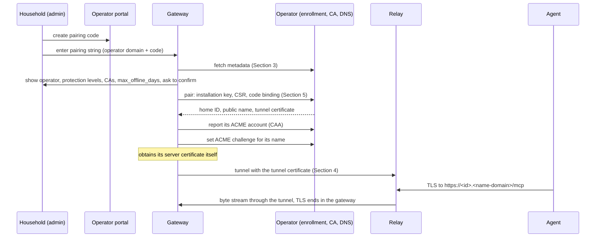
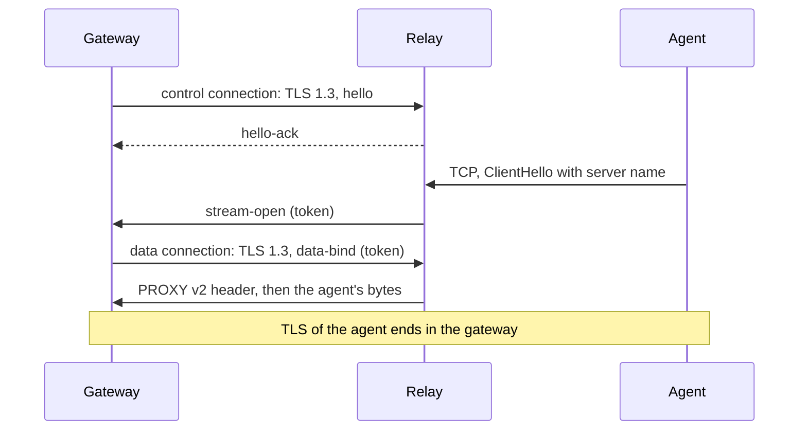

<!-- SPDX-License-Identifier: CC-BY-4.0 -->

# Home-Mandate Relay Specification v0 (Draft)

Status: **Working draft. Not part of `v0.1.0` of the Home-Mandate
Specification**; the freeze of Section 14 of SPEC-v0 does not cover this document, its schemas,
its examples or its conformance cases.
License of this document: CC BY 4.0 (`LICENSE-docs`). Schema and examples: Apache 2.0
(`LICENSE`).

The key words "MUST", "MUST NOT", "SHOULD", "SHOULD NOT" and "MAY" in this document are to be
interpreted as described in BCP 14 (RFC 2119, RFC 8174) when, and only when, they appear in
all capitals.

## 1. Goal

A gateway in a home is usually behind NAT and cannot be reached by cloud agents. A **relay**
makes it reachable under a public name: the gateway connects outbound to the relay, and the
relay passes the agents' TLS connections through to the gateway without terminating them.

Relays MAY be run by anyone. This document defines what a gateway and a relay operator need
to work together without knowing each other in advance, and what an operator MUST do so that
a household can trust a relay it does not control:

| Part | Contents |
|---|---|
| Tunnel protocol (Section 4) | how the gateway and the relay connect and how agent connections are passed through |
| Pairing and issuance (Section 5) | how a gateway is paired with an operator, obtains and renews its certificates, and is unpaired |
| Names and certificates (Section 6) | public names, protection levels, Certificate Transparency monitoring, pinning of the relay |
| Operator obligations (Section 7) | what a conforming operator MUST do and MUST NOT do |
| Conformance (Section 8) | how the conformance of an operator is tested, and the access for testing it gives |

The specification builds on existing standards:

| Purpose | Standard |
|---|---|
| Transport of the tunnel | TLS 1.3 (RFC 8446) |
| Identity of the gateway towards the relay | SPIFFE X.509-SVID |
| Requests of the gateway to the operator | JSON Web Signature (RFC 7515), patterns of ACME (RFC 8555) |
| Certificate requests | PKCS #10 (RFC 2986) |
| Public certificate of the home | ACME (RFC 8555) with the `dns-01` challenge, CAA (RFC 8659, RFC 8657), Certificate Transparency (RFC 6962 and the logs that browsers accept, whatever interface they offer) |
| Errors | Problem Details (RFC 9457) |

### 1.1 What a relay can and cannot do (informative)

The TLS connection of an agent ends in the gateway, with a key that never leaves the home.
The relay sees the server name, the agent's address, the time and the number of bytes, not
the content. OAuth, the evaluation of mandates and approvals take place in the home
(SPEC-v0).

The remaining risk is the operator's control over the DNS of the public name: whoever
controls it can obtain a second certificate for the name and open the TLS connection at the
relay. This specification therefore defines two protection levels (Section 6), both
mandatory for every operator:

- **Standard** (`<id>.<name-domain>`): the operator cannot read **unnoticed** with a
  certificate that its CA logs: the gateway MUST watch Certificate Transparency logs and raise
  an alarm. An operator that deliberately deceives, with a CA that does not log, is not stopped;
  Section 6.2 explains why.
- **Own domain** (a name of the household): the operator **cannot** obtain a certificate
  for the name, because a CAA record of the household binds issuance to the gateway's own
  ACME account.

### 1.2 Overview (informative)



## 2. Terminology

- **Gateway:** the implementation in the home (SPEC-v0) that serves agents and connects to the
  relay.
- **Operator:** whoever runs a relay together with its portal, enrollment endpoint, CA and
  DNS zones.
- **Relay:** the server of the operator that accepts tunnel connections of gateways and
  agent connections, and passes the latter through.
- **Enrollment endpoint:** the operator's HTTPS interface for the requests of the gateway
  (Section 5).
- **Portal:** the operator's user interface where a household creates pairing codes, sees and
  unpairs its installations.
- **Operator domain:** the DNS domain under which the operator publishes its metadata
  (Section 3).
- **Name domain:** the DNS domain under which homes get their public names at the protection
  level Standard. It is not the operator domain and serves nothing but homes (Section 7).
- **Trust domain:** the SPIFFE trust domain of the operator's tunnel certificates.
- **Home ID** (`<id>`): the identifier the operator assigns to a paired gateway: 26 characters
  of lower-case base32 `[a-z2-7]` (130 random bits).
- **Public name:** a DNS name under which agents reach the gateway: the **standard name**
  `<id>.<name-domain>`, or an **own-domain name** in the household's own DNS zone (Section 6.1).
- **Installation key:** a long-lived key pair generated by the gateway at pairing; it signs the
  gateway's requests to the operator.
- **Tunnel certificate:** the short-lived X.509-SVID with which the gateway authenticates to
  the relay.
- **Server certificate:** the publicly trusted certificate of the public name; it is presented
  to agents and obtained by the gateway itself through ACME.
- **ACME account key:** the gateway's own key for its account at the public CA.
- **Pairing code:** a single-use secret that the portal shows and the household enters into
  the gateway.
- **Pairing string:** the operator domain and the pairing code in one string, for typing or as
  a QR code.
- **Protection level:** Standard or Own domain (Sections 1.1 and 6).

## 3. Operator metadata

An operator publishes its parameters as a JSON document at

```
https://<operator-domain>/.well-known/home-mandate-relay
```

The document MUST validate against `relay/schema/metadata-v0.schema.json`; an example is
`relay/examples/metadata.json`. A gateway MUST fetch it over HTTPS with a certificate that is
valid for the operator domain under the gateway's ordinary trust store, MUST NOT follow
redirects, and MUST reject a document larger than 16 KiB. The document is closed: a member that
the schema does not list makes it invalid. New members come with a new `type`; until this
specification is released, the schema can still change under the same `type`.

| Member | Meaning |
|---|---|
| `type` | `https://home-mandate.org/relay-metadata/v0` |
| `operator_domain` | MUST equal the host from which the document was fetched |
| `name_domain` | domain of the public names at the protection level Standard; MUST NOT be the operator domain; neither it nor the operator domain or the host of `enrollment`, `portal`, `privacy_policy` or `relay` may be at or below the other (Section 7.1 asks for more) |
| `trust_domain` | SPIFFE trust domain of the tunnel certificates |
| `enrollment` | HTTPS URL of the enrollment directory (Section 5.1); its host MUST be the operator domain or a subdomain of it |
| `relay` | `host` and `port` where gateways open their tunnel connections |
| `relay_addresses` | the IPv4 and/or IPv6 addresses (IPv6 in the form of RFC 5952 without the mixed notation; IPv4-mapped addresses are not allowed) where agents reach the relay on port 443; standard and own-domain names point there (Sections 6.3, 6.4) |
| `relay_addresses_planned` | optional: `addresses` that replace `relay_addresses` `from` a time at least 30 days after it first appears (Section 6.4) |
| `relay_pins` | SHA-256 digests (canonical base64url, 43 characters) of the SubjectPublicKeyInfo of the keys the relay uses; the gateway pins them at pairing as active pins (Section 6.8) |
| `relay_backup_pins` | the same for the operator's offline backup keys, pinned as backup pins; no pin may appear in both lists (Section 6.8) |
| `acme_cas` | issuer domain names (`caa_identity`) of the CAs the operator allows in the CAA records of its standard names; only CAs that log every certificate and enforce RFC 8657 (Section 6.6) |
| `max_offline_days` | how long an installation can be without a valid tunnel certificate before only a new pairing helps; 7 to 90, RECOMMENDED 30 (Section 5.5) |
| `protection_levels` | MUST list `standard` and `own-domain` (Section 7) |
| `portal` | HTTPS URL of the portal, shown to the household |
| `privacy_policy` | HTTPS URL of the operator's privacy policy, shown to the household |

Before it completes a pairing, the gateway MUST show the household the operator domain, the
protection levels, `acme_cas` and `max_offline_days`. A change of the document applies to an existing
pairing from its next issuance on (Section 5.5), except the host of `enrollment` and the
`name_domain`, which stay as fixed at pairing (Sections 5.1, 7.9), and the gateway tells the household
when either differs; the gateway MUST tell the household when
`max_offline_days`, `protection_levels` or the relay addresses changed. Changes of the pins do
not change stored pins (Section 6.8); relay addresses change as in Section 6.4.

## 4. Tunnel protocol

The gateway connects outbound to the relay at `relay.host` and `relay.port` of the metadata
(Section 3). It keeps one **control connection** for signals and opens one **data connection** for
each agent connection. The relay copies the bytes of an agent connection into its data connection
without terminating them. Each agent connection is thus a TCP and TLS connection of its own, limited
and closed on its own; the tunnel does not multiplex.

The rules of this section apply to the relay as one logical service, whatever number of instances,
load balancers and regions it has. How the operator distributes connections, tokens and state among
them, how it passes an agent's bytes between its own systems (unchanged, Section 7.2, keeping the end
of each direction and the difference between a clean and an abrupt end, Section 4.5), and how it
detects a failed instance is its own matter. A data connection may reach another instance than the
control connection, and the gateway MUST NOT assume otherwise; it SHOULD open its data connections
to the address that its control connection uses. The rules on tokens, the denylist and the single
control connection hold for the logical relay: a token is consumed, and a control connection
replaced, for all instances at once, and every instance refuses a certificate, and closes its
connections, within 60 seconds after it is added to the denylist. A delay with which instances learn
of a change is harmless only for the limits of Section 4.8 and the pool of Section 4.5.

*Deployment (informative):* load balancers in front of the relay pass TCP through; whatever ends the
TLS of tunnel connections is part of the relay and follows Sections 4.1 and 4.2, which generic
TLS-terminating load balancers cannot. All homes share the `relay_addresses`, so several regions are
served through anycast or a global layer-4 front rather than through DNS answers per region. Idle
timeouts of load balancers stay above the idle time of streams (Section 4.5). An operator usually
shares one active key across a fleet or a region, within the eight pins of Section 6.8, and spreads
its `drain` messages over time. The Go package `tunnel` in
`github.com/home-mandate/relay` implements this section; it is informative, and where it differs,
this section applies.



### 4.1 Identities

**Gateway.** The gateway authenticates every connection, control and data, with its tunnel
certificate (Section 5.4). The relay accepts a certificate only if it chains to the operator's
tunnel CA, is valid now, carries the extended key usage `clientAuth`, and its subject alternative
name extension holds exactly one entry, a URI equal byte for byte to
`spiffe://<trust_domain>/home/<home ID>/gateway`, with a home ID of the form of Section 2. The
relay compares the raw bytes of the extension, not a parsed URI, because parsers normalize case and
drop an empty query or fragment. The **installation** of a connection is the one of that home ID; it
is never taken from a message.

The relay MUST check its denylist (Section 7.6) at every handshake, refuses the tunnel certificates
of an installation that is unpaired or blocked (Section 5.7), and MUST close the open connections of
a certificate when it adds the certificate to the denylist. It closes a control connection when the
`notAfter` of its certificate passes, and a data connection at most 60 seconds later.

**Relay.** The gateway authenticates the relay only by its pins (Section 6.8), on every control and
data connection. It accepts the relay's certificate if the SHA-256 digest of its
SubjectPublicKeyInfo is a stored pin, and refuses it otherwise; it checks neither a chain, nor the
validity period, nor a name, so the certificate MAY be self-signed. The pin that matched on a
control connection is its **pin of the connection**, active or backup, which Section 4.7 uses.

### 4.2 Transport

- TCP, then TLS 1.3 (RFC 8446) and nothing older. The gateway sends `relay.host` as its server name.
- The only key exchange group is `X25519MLKEM768`. Neither side offers or accepts any other group,
  so a peer that cannot use it does not connect. The gateway SHOULD send a key share for it in its
  first ClientHello.
- The keys of the relay and of the gateway are ECDSA P-256 or Ed25519, with the signature schemes
  `ecdsa_secp256r1_sha256` and `ed25519`. Both sides MUST support both.
- The relay requires a client certificate on every connection. Neither side uses session
  resumption, pre-shared keys, 0-RTT or post-handshake authentication, so that a certificate cannot
  be used again after it expired or was denied.
- Both connection kinds use the ALPN protocol `hm-tunnel/1`; a handshake without it fails. Before it
  sends or reads anything over the connection, each side checks TLS 1.3, the ALPN protocol and the
  identity of its peer (Section 4.1). The first frame tells the kinds apart: `hello` opens a control connection,
  `data-bind` a data connection.
- `relay.port` is the operator's choice. The relay MAY serve tunnel connections and agent
  connections on the same port and tell them apart by the server name `relay.host`.

### 4.3 Frames

Control messages and the single `data-bind` of a data connection are frames. Integers are big
endian.

```
+-------------+-----------------------+----------------------+
| type (u16)  | payload length (u16)  | payload (length)     |
+-------------+-----------------------+----------------------+
```

- A payload is at most 1024 bytes. A receiver checks the header before it reads the payload, and
  closes the connection on a larger length, without reading or allocating anything for it.
- Every message has exactly one valid encoding. Trailing bytes, a value out of range and a field
  that breaks its rule are errors.
- Type `0x0000` is invalid. Types `0x0001` to `0x00FF` are **core** messages of this section; an
  unassigned one is an error. Types `0x0100` to `0x7FFF` are **extensions**, each defined together
  with a capability (Section 4.4); a receiver rejects one as an error unless its capability was
  negotiated on this connection. Version 1 defines no capability. Types `0x8000` to `0xFFFF` are
  **optional**: a receiver ignores an unknown one, and none of them may change state or carry
  anything that security depends on. An optional frame before `hello-ack` is an error.
- A known type from the wrong sender or on the wrong kind of connection is an error.
- The layout of a core message never changes within a version; a new layout needs a new version.

| Type | Name | Sender | Connection |
|---|---|---|---|
| `0x0001` | `hello` | gateway | control |
| `0x0002` | `hello-ack` | relay | control |
| `0x0003` | `ping` | either | control |
| `0x0004` | `pong` | either | control |
| `0x0010` | `stream-open` | relay | control |
| `0x0011` | `stream-close` | either | control |
| `0x0012` | `error` | either | control |
| `0x0013` | `drain` | either | control |
| `0x0014` | `pins` | relay | control |
| `0x0015` | `pins-ack` | gateway | control |
| `0x0020` | `data-bind` | gateway | data, as the first and only frame; its payload is the token, exactly 32 bytes |

Strings are a length byte followed by that many printable ASCII bytes (`0x20` to `0x7E`).

### 4.4 Control connection

**Handshake.** The gateway sends `hello` within 5 seconds after the TLS handshake; the relay sends
nothing before it. The relay answers with `hello-ack` within 5 seconds, or with `error`; a gateway
that gets neither within 10 seconds closes the connection. Before `hello-ack` only `hello`,
`hello-ack` and `error` are valid, and a second `hello` or `hello-ack` is an error. The heartbeat
starts with `hello-ack`.

| `hello` | Encoding | Rule |
|---|---|---|
| min version, max version | u8, u8 | 1 ≤ min ≤ max |
| gateway software | string | 1 to 64 bytes; informative, never used for a decision |
| capabilities | u8 count, then count × u16 | at most 16, non-zero, strictly ascending |

| `hello-ack` | Encoding | Rule |
|---|---|---|
| version | u8 | the highest version in both ranges |
| relay software | string | 1 to 64 bytes; informative |
| heartbeat interval | u16 seconds | 5 to 120 |
| pool size | u8 | 0 to 16: how many warm data connections the gateway keeps (Section 4.5) |
| max streams | u16 | 1 to 256: the most simultaneous agent connections of this installation |
| capabilities | as in `hello` | those offered in `hello` that the relay supports |

If the ranges have no version in common, the relay sends `error` `unsupported-version`. The gateway
closes the connection if the selected version is not in its range or a capability was not in its
`hello`. A data connection uses the version of
the installation's control connection. This section defines version 1. A relay SHOULD keep supporting the previous version for a
while once a new one exists.

**Heartbeat.** Each side sends `ping` (a random u64) once per heartbeat interval and has at most one
unanswered; the peer answers at once with `pong` and the same value. A side that receives no
matching `pong` within one interval sends `error` `timeout` and closes; that peer has **missed its
heartbeat**. A `pong` without a `ping`, with another value or a second time is an error. Every read
has a deadline. Three intervals without any frame from the peer, or more than 5 seconds for the rest
of a frame after its first byte, end the connection, and so does a write that does not complete
within 5 seconds.

**Signals.**

| Message | Payload | Meaning |
|---|---|---|
| `stream-open` | token (32 bytes), validity (u16 milliseconds, 1 to 10000) | an agent connection waits; the gateway binds a data connection with this token within the validity (Section 4.5) |
| `stream-close` | token (32 bytes), reason (u8: 1 agent gone, 2 refused, 3 timeout, 4 internal) | from the relay, it withdraws a token; from the gateway, it refuses one. The token is void. An unknown token is ignored |
| `error` | code (u16, non-zero), text (string of 0 to 128 bytes) | fatal: the sender closes after writing it, the receiver on reading it. The text is for logs and never holds a token, a certificate or data of the peer |
| `drain` | reason (u8: 1 shutdown, 2 restart, 3 overload), grace (u16 seconds, at most 600) | the sender starts no new streams; open data connections may finish within the grace time |

Error codes: 1 `unsupported-version`, 2 `malformed`, 3 `unknown-type`, 4 `limit-exceeded`,
5 `unauthorized`, 6 `timeout`, 7 `internal`, 8 `superseded`, 9 `protocol`, 10 `session-exists`. A
receiver treats an unknown code like 7.

The relay sends `stream-open` only after `hello-ack`, never above `max streams`, no faster than its
own limit of new data connections for the installation (Section 4.8), closing surplus agent
connections instead, and not after a
`drain` in either direction. After a `drain` of the relay, the gateway opens a new control
connection, which the relay accepts on an instance that is not draining, or else answers with `error`
`internal`, after which the gateway connects again as in Section 4.9; the relay closes the drained
connection at the end of the grace time at the latest. After a `drain` of the gateway, the relay closes new agent
connections for it as in Section 4.5.

**One control connection per installation.** An installation has at most one control connection,
across all instances of the relay. A control connection on an instance that failed counts as lost, at the latest two heartbeat
intervals after its last frame.
A new control connection of an installation that already has one replaces the
existing one only if the existing one missed its heartbeat, was drained by either side, or has a
certificate with an earlier `notBefore` than the new one. Otherwise the relay sends `error`
`session-exists` on the new connection and closes it. When it replaces a connection, it sends
`error` `superseded` on the old one, closes it, voids the tokens sent on it and closes unbound data
connections as in Section 4.5; bound data connections end with their stream. This clears a connection left open by a change of
network, but a second holder of an older certificate cannot push out the gateway. The gateway
connects anew with each renewed certificate (Section 5.5), which replaces its old control
connection, and from then on binds only with data connections of the new certificate. A gateway
that keeps getting `session-exists` for six minutes, or gets
`superseded` without having connected anew, SHOULD tell its local administrator and renew its tunnel
certificate early, because another party may hold its current one.

### 4.5 Agent connections and data connections

**Routing.** Agents connect to the relay over TCP at `relay_addresses`, port 443. The relay reads
the server name from the ClientHello without terminating TLS. It MUST accept a ClientHello of up to
16384 bytes, also across several TLS records, and MAY close a connection whose ClientHello is larger
or has not arrived within 10 seconds. It compares the server name without regard to case with the
standard names and the verified own-domain names (Section 6.4). It closes a connection without a
server name, for an unknown name, for an installation without a control connection, with status
`paused` or above its `max streams` (which counts agent connections with a token and bound ones), without completing a TLS handshake (it MAY send a TLS alert
first). This version passes only TCP; it carries no QUIC.

**Binding.** For an agent connection, the relay generates a **token** of 32 random bytes, bound to
the installation and valid for at most 10 seconds, and sends `stream-open`. The gateway takes a warm
data connection or opens a new one and sends `data-bind` with the token, and nothing before it. The
relay reads at most the 36 bytes of that frame, checks the limits of the installation (Section 4.8)
and redeems the token against the installation of the data connection's own certificate. A token is
used once: its first presentation consumes it, also when the relay refuses the binding, and a token
of another installation is consumed without binding. On success the relay writes the PROXY header
(Section 4.6) and from then on copies the bytes in both directions unchanged, starting with all bytes
it has read from the agent.

The relay closes a data connection **without any answer** if its first frame is not a well-formed
`data-bind`, if the token is unknown, used, withdrawn, expired or of another installation, or if a
limit is reached, so that a closed connection does not tell which tokens exist. It also closes, in
the same way, an unbound data connection whose certificate has an earlier `notBefore` than the certificate of
the installation's control connection, and when a control connection is replaced, every unbound data
connection with such a certificate. When a token becomes void without a binding, the relay closes
the agent connection and, while the control connection is open, sends `stream-close` for it. Neither side records a token, and the relay
SHOULD store only a digest of it.

A gateway presents each token at most once. It MAY try up to three times to open a data connection
for one `stream-open` while the token has not yet been sent, and otherwise answers with
`stream-close` `refused`. A binding **failed** when the relay closed the data connection, or no PROXY
header arrived within 5 seconds after `data-bind`, unless the gateway received a `stream-close` for
that token; the gateway backs off at once and ends that backoff when such a `stream-close` arrives
within one heartbeat interval, so an agent that gives up early causes no backoff. After a failed binding, the gateway waits before its next data connection: 1 second
after the first failure, doubling up to 30 seconds while failures continue, adding random jitter of
up to one half, until a binding succeeds. A `stream-close` voids only a token of the installation of the
control connection it arrives on.

**Warm data connections.** A warm data connection has completed its TLS handshake and has not yet
sent `data-bind`. The gateway keeps at most `pool size` of them ready, besides those it opens for a
`stream-open`. The relay closes an unbound data connection that would make the unbound data
connections of the installation more than `pool size` plus its unredeemed tokens, and MAY allow a
small surplus for the delay with which its instances learn of closed connections. It closes a warm
connection that has sent nothing for three heartbeat intervals. The gateway SHOULD replace a warm
connection after two heartbeat intervals, and closes it before it opens the replacement; a warm
connection that the relay closed before `data-bind` it replaces only after 1 second, doubling up to
30 seconds while such closes continue, which does not delay data connections for a `stream-open`.
Both sides use the heartbeat interval of the installation's current control connection. A warm connection carries no token until it binds, and its certificate is checked as on
every connection (Section 4.1), so its lifetime only serves to notice connections that died
silently. Once the first byte of `data-bind` has arrived, the rest follows within
5 seconds.

**End of a stream.** On a data connection, the end of one direction is a TLS `close_notify` (RFC 8446
Section 6.1) followed by a TCP half close. The relay passes the end of each direction on: a half close
of the agent as `close_notify` towards the gateway, and a `close_notify` of the gateway as a half close
towards the agent. A connection that ends without `close_notify` ends the stream as an error. The
relay MAY close a stream without a byte in either direction for an idle time of its choice, which
SHOULD be at least 10 minutes. The control connection is not involved in the end of a stream, and
the loss of the control connection does not end bound data connections.

### 4.6 Address of the agent

As the first bytes towards the gateway on every bound data connection, the relay writes a PROXY
protocol version 2 header with the address and port of the agent. Only this form is valid:

| Offset | Size | Value |
|---|---|---|
| 0 | 12 | `0D 0A 0D 0A 00 0D 0A 51 55 49 54 0A` |
| 12 | 1 | `0x21`: version 2, command `PROXY` |
| 13 | 1 | `0x11` TCP over IPv4, or `0x21` TCP over IPv6 |
| 14 | 2 | 12 for IPv4, 36 for IPv6; there are no TLVs |
| 16 | 12 or 36 | source address, destination address, source port, destination port |

Both addresses have the same family, and an IPv4 address is never written as an IPv4-mapped IPv6
address. The source is the agent; the destination is `192.0.2.1:443` or `[2001:db8::1]:443`, so that
the header reveals nothing about the relay, and the gateway ignores it. Neither port is 0. The
gateway reads exactly the 16 fixed bytes and the announced block, and closes the connection on
anything else, or on a source that is unspecified, loopback, private (RFC 1918, `fc00::/7`),
link-local, multicast, broadcast, in `0.0.0.0/8` or an IPv4-mapped IPv6 address (`::ffff:0:0/96`).

The relay MUST write the address from which the agent's connection reached the operator. An operator
MAY run load balancers in front of the relay; how they pass that address to the relay is the
operator's matter, but the relay MUST NOT take it from anything an agent can send, such as a PROXY
header from outside.

The gateway accepts this header only on data connections that it opened itself and bound with its
own token, and on no other listener. It uses the address of the agent for limits and logs, and MUST
NOT use it for any decision about trust or locality, such as treating a request as coming from the
local network.

### 4.7 New pins

The relay announces new pins (Section 6.8) with `pins` on a control connection after `hello-ack`,
and the gateway answers with `pins-ack`, so that the operator knows which gateways have the new pins
before it rotates a key.

| Message | Payload |
|---|---|
| `pins` | sequence (u32), number of active pins (u8), number of backup pins (u8), then the active and then the backup pins, 32 bytes each (the SHA-256 digest itself, not base64url), each kind in strictly ascending byte order |
| `pins-ack` | sequence (u32) of the `pins` it answers, result (u8: 1 stored, 2 ignored) |

A `pins` that breaks this encoding is an error. The gateway applies the rules of Section 6.8 with
the pin of the connection (Section 4.1): a set that breaks them is ignored, and the stored set
stays. Otherwise the gateway stores the set, durably and as a whole, before it answers `stored`; a
set equal to the stored one is also answered `stored`. The gateway answers within one heartbeat
interval. The relay has at most one `pins` unanswered; without an answer within one interval it
counts the set as not stored, keeps the connection, and MAY send the set again later. A `pins-ack`
for no `pins` the relay sent on this connection is an error.

### 4.8 Limits

Values that the other side has to keep to are rules of this section: the frame size (Section 4.3),
the ranges of `hello-ack` and the time limits of Sections 4.4 and 4.5, the token validity and the
backoff of the gateway. Every receiver checks a limit before it allocates memory for what it
bounds.

Beyond these, the relay MUST limit what it spends on any source, installation and connection. It
chooses the values itself, so that a gateway that follows this section never reaches them, also where
many gateways share one address, MAY enforce them per instance or approximately, and
SHOULD raise an alarm in its monitoring when a limit of control connections is reached. RECOMMENDED
values:

| Limit | RECOMMENDED |
|---|---|
| new control connections per certificate serial and source address (IPv6 by /64) | 6 per minute |
| new connections, control and data, per source address (IPv6 by /64) before the TLS handshake completes | 20 per second (burst 40), at most 64 unfinished handshakes |
| new data connections per installation | 20 per second (burst 40) |
| frames per second per control connection, ignored frames included, not counting `pong`, `pins-ack` and `stream-close` that answer frames of the relay | 20 (burst 40) |
| unredeemed tokens per installation (per instance where enforced per instance), and per instance | 16, and 65536 |
| `max streams`, `pool size` | 64, 1; a `pool size` of 0 saves handshakes in large fleets, at the cost of one round trip per agent connection |

The relay counts control connections per certificate serial and source, not per installation, so
that connecting often from elsewhere cannot lock the gateway out. A peer above a limit gets `error`
`limit-exceeded` on a control connection, and a close without answer on any other connection.

### 4.9 Errors

- Whatever this section does not allow is an error. On a control connection the receiver sends
  `error` where it can, and closes; there is no recovery from a framing error. Only an unknown
  optional frame is skipped.
- When the control connection of an installation is lost, the relay voids its tokens, closes the
  unbound data connections of the installation and closes its new agent connections as in
  Section 4.5.
- The gateway keeps working locally without the tunnel. It connects again with backoff: after the
  loss of a control connection that had stayed open for 60 seconds, first after a random time
  between 0 and 10 seconds; otherwise, and after a failed attempt, 1 second, doubling up to 60
  seconds, adding random jitter of up to one half, reset once a control connection has stayed open
  for 60 seconds; after `session-exists` it waits likewise. Each control connection uses new tokens.
- A gateway whose handshakes the relay keeps refusing MAY read its installation (Section 5.3) to
  learn whether it was blocked or unpaired. When no stored pin matches, it refuses that connection,
  tells its local administrator (Section 6.8), and keeps trying with the backoff above, so that a
  relay that recovers with a backup key reaches it.
- An agent sees only a closed connection; no detail leaves the tunnel.

## 5. Pairing and issuance

The gateway talks to the operator's **enrollment endpoint** over HTTPS (TLS 1.2 or later with a
certificate valid for its host under the gateway's ordinary trust store). All messages are
described by `relay/schema/enrollment-v0.schema.json`; examples are in `relay/examples/`.
Section 1.2 shows the flow.

### 5.1 Directory, nonces and requests

**Directory.** `GET` on the URL `enrollment` of the metadata (Section 3) returns `200` with a
JSON object holding the URLs `new_nonce`, `pair` and `key_change` (`$defs/directory`). Every URL
to which the gateway sends requests (those of the directory, the installation URL and the URLs
in the installation) MUST be an HTTPS URL on the host of `enrollment`; a gateway MUST NOT send a
request to any other host.

**Nonces.** Every response of the enrollment endpoint, including errors, carries a fresh nonce
in the header `Replay-Nonce`: base64url without padding, at least 128 random bits. `HEAD` on
`new_nonce` returns `200`, `GET` returns `204`, both without a body. The operator accepts every
nonce once, MAY let unused nonces expire, and answers an unknown, used or expired nonce with the
error `bad-nonce` and a fresh nonce; the gateway then repeats the request once with it, and
after a second `bad-nonce` retries later with backoff.

**Requests.** Every request except to the directory and to `new_nonce` is a `POST` with the
content type `application/jose` whose body is a JWS (RFC 7515) in compact serialization:

- The protected header (`$defs/protected_header`) has exactly `alg`, `nonce`, `url` and one of
  `jwk` and `kid`. `alg` is `EdDSA` (Ed25519, RFC 8037) or `ES256`, matching the key; an
  operator MUST accept both. `url` MUST equal the URL the request was sent to, byte for byte.
  `jwk` is the public installation key and appears only in a pairing request (Section 5.2);
  every other request carries `kid`, the installation URL (Section 5.3). Any other header
  member, and a `jwk` with a private part, make the request invalid.
- The spelling rules of SPEC-v0 Section 7.1 apply: base64url without padding in its only canonical
  form, case-sensitive member names, and for ES256 only the lower `s`. Headers and payloads are
  I-JSON (RFC 7493): a member name that occurs twice makes the request invalid.
- The payload is a JSON object of the type the URL expects, or empty for a read ("POST-as-GET",
  RFC 8555 Section 6.3). Request objects are closed: an operator MUST reject a request with a
  member the schema does not list.

The operator processes a request in this order; a request that fails a step has no effect:

1. the spelling rules and the header against `$defs/protected_header`, including a `nonce` that is
   not base64url of at least 16 bytes, and with `jwk`, `alg` matching that key (`malformed`);
2. with `jwk`, the URL MUST be `pair`; with `kid`, it MUST NOT be `pair` (`malformed`);
3. with `kid`: the installation it names (none: `bad-signature`; unpaired or replaced:
   `unpaired`), and the URL MUST be `key_change`, the installation URL of that installation or
   a URL in it (`malformed`); one installation can never act on another;
4. `alg` matching the key of the installation (`malformed`), then the signature with that key
   (`bad-signature`); from
   here on the nonce is used up, whatever happens next; then the nonce (`bad-nonce`) and `url`
   (`malformed`);
5. the state of the installation (Sections 5.5 and 5.7); past `max_offline_days`, `offline-too-long`
   takes precedence over `blocked`;
6. the payload against the schema of the operation (`malformed`, or the error of the operation).

Some responses wait for DNS (Section 5.6); a gateway allows at least 150 seconds for a response.
The host of `enrollment` is fixed at pairing: a later change of `enrollment` in the metadata does
not apply to existing installations.

An installation URL MUST contain at least 128 random bits, so that whether an installation
exists cannot be learnt by guessing (step 3 answers before the signature is checked).

**Responses and errors.** Successful responses are JSON (`application/json`) with the status
the operation names; a gateway MAY reject a response larger than 64 KiB. Errors are Problem Details (RFC 9457, `application/problem+json`) whose
`type` is `https://home-mandate.org/relay/errors/` followed by one of the names in the table. A
gateway treats any other error response as `server-internal`, and ignores members it does not
know in every response.

| Error | Status | Meaning | Gateway |
|---|---|---|---|
| `malformed` | 400 | the request does not match this section or the schema | reports a defect, does not repeat the request (except as in Section 6.3) |
| `bad-nonce` | 400 | nonce unknown, used or expired | repeats once with the fresh nonce |
| `bad-signature` | 401 | a signature does not verify, or `kid` names no installation | except during a key change (Section 5.5): ends the pairing locally as on `offline-too-long` and tells the household (Section 5.7) |
| `pairing-refused` | 403 | the pairing code is wrong, expired, used, not yet usable or not for this operator; the operator does not say which | asks for a new code |
| `confirmation-required` | 403 | the change needs the household's confirmation in the portal (Section 5.6) | tells the household and reads its installation as in Section 5.6 |
| `offline-too-long` | 403 | the installation was without a valid tunnel certificate longer than `max_offline_days` (Section 5.5) | ends the pairing locally (Section 5.7) |
| `blocked` | 403 | the operator blocked the installation (Section 5.7) | Section 5.7 |
| `bad-csr` | 400 | the certificate request breaks Section 5.4 | creates a new tunnel key and request |
| `name-unavailable` | 409 | another installation holds the own-domain name (Section 6.4) | tells the household |
| `key-conflict` | 409 | the installation key of a pairing or the new key of a key change is already in use (Sections 5.2, 5.5) | creates a new key and repeats the request |
| `unpaired` | 410 | the installation was unpaired or replaced (Sections 5.2, 5.7) | ends the pairing locally (Section 5.7) |
| `rate-limited` | 429 | too many requests; the response carries `Retry-After` | waits at least that long, or as on `server-internal` without the header, except before a CAA alarm (Section 6.7) |
| `server-internal` | 500 | anything else | retries with exponential backoff |

### 5.2 Pairing

**Pairing code and pairing string.** The portal creates a pairing code for the account of the
household: 16 characters from `A–Z 2–7` (80 random bits), shown in four groups of four separated
by `-`. It is single-use, valid for at most 10 minutes from the moment it can be used (a code for
an existing installation: 24 hours, see below), and bound to that account. The operator MUST
limit failed attempts per source address, SHOULD detect guessing spread over many addresses
without refusing the codes of other households, and answer every code that cannot be redeemed alike (`pairing-refused`), in the same time. The
portal shows the **pairing string** `<operator-domain>/<code>`, with the operator domain in lower
case, as text and as a QR code, for example `relay-operator.example/ABCD-EFGH-IJKL-MNOP`
(`$defs/pairing_string`). A gateway accepts the code in either case and with or without the
hyphens, and sends it in upper case without them.

**At the gateway.** Only a local administrator of the gateway can start a pairing, and only
while the gateway is not paired with any operator. The gateway

1. fetches the metadata from the operator domain of the pairing string (Section 3);
2. shows the household the operator domain, the protection levels, `acme_cas` and
   `max_offline_days`, and asks for confirmation; without it, nothing is sent. If the gateway
   supports none of the `acme_cas` (Section 6.6), it does not pair;
3. generates four separate key pairs, none of which ever leaves the gateway: the installation
   key, the tunnel key, the ACME account key and the server key. The installation key MUST NOT
   be used for anything but the requests of this section;
4. fetches the directory and a nonce, and sends a pairing request to `pair`, signed with the
   installation key and carrying it as `jwk`. The payload (`$defs/pair_request`) holds the code
   and a certificate request for the tunnel key (Section 5.4). Because the code is inside the
   signed payload, it is bound to this installation key; a pairing code that has been used
   cannot be used again with any other key. If the response is lost, the gateway repeats the request
   with the same installation key and code, a fresh nonce and a certificate request for a new
   tunnel key; the operator MUST answer a pairing request whose code was redeemed by the same
   installation key, within the code's validity, like the first one, with a tunnel certificate
   for the new request, as long as that installation still has that installation key and was
   neither unpaired nor replaced, and is not blocked; otherwise it answers `unpaired`, or `blocked`
   for a blocked installation. A gateway that gets `blocked` here has no installation URL: it
   is not paired, tells the household that a pairing may exist and is blocked, and may repeat the
   request until it gets another answer. After the code's validity the operator
   answers `pairing-refused`. The gateway then tells the household that a pairing may have been
   created: after a code for a new installation, the household removes the stray installation
   in the portal; after a code for an existing installation, it creates a new such code instead,
   because unpairing would lose the standard name. An operator MAY unpair a new installation
   (not a replacing one) from which no request arrived for 24 hours after its pairing, and
   notifies the household.

**At the operator.** The operator processes the request (Section 5.1), redeems the code, checks
the certificate request, refuses an installation key that another installation already uses
(`key-conflict`), and creates the installation:

- a new **home ID** (Section 2) that it has never assigned before and MUST NOT assign again,
  also not after unpairing;
- the **installation URL**, which is the `kid` of all later requests;
- the standard name `<home ID>.<name_domain>`;
- the first tunnel certificate (Section 5.4).

From the creation of the installation until an ACME account of the gateway is in force
(Section 5.6), the operator MUST publish for the standard name a CAA record that permits no
issuance at all (`0 issue ";"`, RFC 8659). It answers `201 Created` with the installation URL,
as an absolute URL, in `Location` and a body (`$defs/pair_response`) with the installation
(Section 5.3) and the tunnel certificate. The gateway MUST check that the standard name is the
home ID followed by `.` and the `name_domain` of the metadata, and that the certificate matches
Section 5.4 and its own tunnel key; if a check fails, it MUST NOT use the pairing, ends it
locally without sending the unpairing request (so that a code for an existing installation does
not destroy the standard name), and tells the household that the operator does not conform; the
household then unpairs a new installation in the portal, or creates a new code for an existing
one. The
operator MUST notify the household of every new installation and show it in the portal. Right
after pairing, the gateway creates its ACME account and reports it (Section 5.6), and shows the
household the account URI, so that the household can compare it with what the portal shows.

**Pairing again.** A gateway is paired with at most one operator at a time; to change the
operator it is unpaired first (Section 5.7). A new pairing gives a new home ID and a new standard
name; if agents used the standard name, they get a new OAuth issuer and must be connected again
(an own-domain name can be registered again, Section 6.4).

An operator MAY offer, in its portal, a pairing code **for an existing installation**, for a
gateway that lost its keys (reinstallation, restored backup, `offline-too-long`). Pairing with
such a code keeps the home ID, the standard name and the own-domain registration, and **replaces**
the installation: it gets a
new installation URL, the old installation URL answers `unpaired`, the
operator denies their tunnel certificates and closes their connections, and the reported ACME
account and any pending report are cleared, so that the new gateway reports its own (Section 5.6), with the CAA record
that permits no issuance in force until then. The operator MUST NOT create such a code for a
`blocked` installation, and cancels a pending one when it blocks the installation. Because whoever
controls the household's account can thereby move the standard name to another gateway, the
operator MUST

- require a fresh authentication of the person before it creates such a code;
- refuse to create such a code within 72 hours after a notification channel of the household was
  added, changed or removed, notify the previous channels of every such change, and cancel a
  pending such code on every such change, and tell the household that it did;
- notify the household on all its channels when the code is created;
- make the code usable only after a waiting time of at least 24 hours, during which the
  household can cancel it in the portal and through the notification; after the waiting time
  the code stays valid for at most 24 hours, so that the household can plan when to be at the
  gateway;
- show the end of the waiting time in the installation (`replacement_pending_until`,
  Section 5.3) until the code is used, cancelled or expired.

A gateway that still holds its keys and reads `replacement_pending_until` MUST warn its local
administrator that the installation is about to be replaced, and point to the portal, where the
household can cancel the code. A running gateway that is to be replaced is suspicious: the
replacement exists for gateways that lost their keys.

A gateway does not learn from the pairing response whether it replaced an installation, so the
following holds after every pairing and has no effect on a new name. If the installation has an
own-domain name whose CAA record names another account, the gateway tells the household that this
record has to change (Section 6.5). The gateway SHOULD
revoke the unexpired server certificates for its names that it finds in Certificate Transparency,
did not obtain itself and the administrator has not acknowledged, where it can obtain
authorizations for every name in the certificate (RFC 8555 Section 7.6); for an own-domain name
that is possible only after the household changed the CAA record, and needs the administrator's
consent, because the household may have obtained that certificate itself. It does so once it has
obtained its first own server certificate for the name, and searches once more 24 hours later,
because a certificate can reach the logs with a delay.

### 5.3 Installation

A POST-as-GET on the installation URL returns `200` with the installation
(`$defs/installation`):

| Member | Meaning |
|---|---|
| `status` | `active`; `paused` (the household paused remote access in the portal; the relay passes no agent connections, all requests work); `blocked` (Section 5.7); `unpaired` (only in the answer to unpairing, Section 5.7) |
| `home_id`, `public_name` | as assigned at pairing; `public_name` is always the standard name |
| `max_offline_days` | the value in force for this installation (Section 5.5) |
| `certificate` | URL for tunnel certificates (Section 5.4) |
| `acme_challenge` | URL for the ACME challenge records (Section 5.6) |
| `acme_account`, `caa_identity` | the ACME account in force (Section 5.6), if any; a pending report does not appear here |
| `own_domain` | the registered own-domain name with its `name`, `token` and `status` (Section 6.4), if any |
| `replacement_pending_until` | while a code for this existing installation is pending: the end of its waiting time (Section 5.2) |

While it is paired, a gateway MUST read its installation at least every 12 hours; it SHOULD
read it with every renewal,
and otherwise reads it at most once an hour,
except while an ACME account change is pending (as in Section 5.6), before a CAA alarm
(Section 6.7) and while it
recovers a key change (Section 5.5); it shows the status to the household. With every renewal,
and otherwise at most once a day, it also fetches the metadata again (Section 3), besides the
fetches that Sections 6.3 and 6.4 require.

A `POST` to the installation URL with a payload (`$defs/installation_update`) changes it and is
answered with `200` and the installation: `{"acme_account": …, "caa_identity": …}` reports the
gateway's ACME account (Section 5.6), `{"own_domain": …}` registers or removes an own-domain
name (Section 6.4), and `{"status": "unpaired"}` unpairs the installation (Section 5.7).

### 5.4 Tunnel certificate

A `POST` to `certificate` with a payload `{"csr": …}` (`$defs/certificate_request`) asks for a
tunnel certificate and is answered with `200`; the pairing request carries the same member.
`csr` is a PKCS #10 request (RFC 2986) in DER, base64url without padding. The operator MUST
refuse it with `bad-csr` unless

- its signature verifies with the public key it contains;
- the key is ECDSA P-256 or Ed25519, and the request is signed with ECDSA with SHA-256 or with
  Ed25519, respectively (an operator MUST accept both);
- the key differs from the installation key and from the key of every tunnel certificate the
  operator issued to this installation before.

Everything else in the request (subject, extensions, requested names) is ignored. The operator's
CA issues a certificate that

- contains exactly one subject alternative name, the URI
  `spiffe://<trust_domain>/home/<home ID>/gateway`, in a critical extension, and an empty
  subject;
- has a `notAfter` at most 24 hours after its `notBefore`, which is no earlier than 5 minutes
  before issuance and later than the `notBefore` of every earlier tunnel certificate of the
  installation (Section 4.4);
- has `cA=false`, key usage `digitalSignature` only (critical), and extended key usage
  `serverAuth` and `clientAuth`, as X.509-SVID recommends;
- has a serial number with at least 64 random bits;
- contains no other information about the household.

The CA that issues tunnel certificates MUST carry a name constraint (RFC 5280 Section
4.2.1.10) whose permitted subtree of type URI is the host `trust_domain`. Such a constraint does
not restrict other name types, so the CA MUST NOT issue anything but tunnel certificates.

The response (`$defs/certificate_response`) holds `chain`, the issued certificate followed by the
certificates of the CA that issued it, each in DER and base64url without padding, and
`not_after`, the expiry of the issued certificate (RFC 3339, UTC, whole seconds, `Z`); at most four
certificates, and a chain with the issued certificate alone conforms. The gateway needs none of
the CA certificates to trust the relay (Section 6.8). The gateway checks what it can see: the
public key is its own tunnel key, the subject alternative name is exactly its SPIFFE ID in a
critical extension, the subject is empty, `notAfter` is in the future, `cA=false`, the key usage and extended key usages are as above, `notAfter` is at
most 24 hours after `notBefore` and equals `not_after`. It MUST NOT use a certificate that fails a
check; it tells the household that the operator does not conform and retries later.

### 5.5 Renewal, re-issuance and key change

A gateway SHOULD ask for a new tunnel certificate when two thirds of the validity of the current
one have passed, always with a new tunnel key, and SHOULD retry with exponential backoff. It
uses the new certificate for new connections and MUST reconnect with it before the old one
expires (Section 4.4).

A request after the current certificate expired is a **re-issuance**. It is authenticated by
the installation key alone. The **offline time** of an installation is the time since the expiry
of its last tunnel certificate; while it is `blocked`, the time does not run. Once the offline
time exceeds `max_offline_days`, the operator MUST answer every request of the installation
except reading it with `offline-too-long`; only the household can then unpair it, in the portal. The value that counts is the one in
force at the last successful issuance; a changed value in the metadata applies from the next
issuance on. A gateway MAY apply a shorter limit of its own; it then behaves as on
`offline-too-long` (Section 5.7).

The operator MUST show the household each issuance in the portal, with its time and, for as long
as it keeps it under Section 7.5, its source address,
MUST notify the household of a re-issuance, and SHOULD limit issuances per installation (for
example to six per day).

**Key change.** A gateway replaces its installation key as in RFC 8555 Section 7.3.5. It sends to
`key_change` a request signed with the old key (`kid`) whose payload is `{"jws": …}`
(`$defs/key_change_request`): a JWS in compact serialization, signed with the new key, whose
protected header has exactly `alg`, `jwk` (the new key) and `url` (the URL of `key_change`)
(`$defs/key_change_header`) and whose payload is `{"installation": …, "old_key": …}`
(`$defs/key_change`); the spelling rules of Section 5.1 apply to it as well (`malformed`). The operator
checks the inner signature (`bad-signature`), that `url`
matches and `installation` is the `kid` of the outer request and `old_key` its key
(`malformed`), and that the new key is neither the key of another installation nor the key of
one of this installation's tunnel certificates (`key-conflict`). It then replaces the key,
answers `200` with the installation, and MUST notify the household. The gateway keeps the old key
until a request signed with the new key succeeded; if it does not know whether a key change took
effect (the response was lost), it reads its installation with the new key, and on
`bad-signature` with the old one; if both get `bad-signature`, it tries both once more after a
minute and only then ends the pairing locally as on `offline-too-long` (Section 5.7). While a key change is in flight or being recovered, the gateway
sends no other request, and a `bad-signature` on the key change request itself does not end the
pairing.

### 5.6 ACME support

The gateway obtains its server certificate itself, with ACME (RFC 8555), its own account and
the `dns-01` challenge, and renews it using ACME Renewal Information (RFC 9773). The operator
never sees the server key or the ACME account key.

**Account.** The gateway reports its ACME account (`$defs/installation_update`): `acme_account`,
the account URI at the CA, and `caa_identity`, the issuer domain name that CA uses in CAA records
(RFC 8659 Section 4.2). The operator MUST publish for the standard name a CAA record that allows
only this account to obtain certificates (`issue` with the parameters `accounturi` and
`validationmethods=dns-01`, RFC 8657); Section 6.3 gives the details. The first report after
pairing (or after a replacement, Section 5.2) takes effect at once if it arrives within one
hour of the pairing (or the replacement); it replaces the CAA record that permits no issuance and
is answered with `200` once the new record is served by all authoritative name servers, within
120 seconds, or else with `server-internal`, while the account stays in force. A report of the
pair already in force is answered alike and is not a change. A first report after that hour,
and every later change, MUST be confirmed by the household:

- the operator answers `confirmation-required`, keeps the account already in force (or the CAA
  record that permits no issuance), stores the newly reported pair as pending (a later report
  replaces it, and a report of the pair in force withdraws it, each with a notification of the
  household), and notifies the household;
- the portal shows the pending `acme_account` and `caa_identity` next to the pair in force; the
  household compares them with the pair its gateway shows, which is that of its latest report
  (a gateway MUST show it, also while it is pending), and the
  confirmation applies to exactly the pending pair; a pair whose `caa_identity` is no longer in
  `acme_cas` can no longer be confirmed and is discarded, and the household is told; a pair
  cannot be confirmed while the installation is `blocked`;
- after the confirmation the operator puts the pair in force and publishes its CAA record, and
  the installation shows the new pair once that record is served by all authoritative name
  servers, within 120 seconds, or else the portal says that the change has not taken effect yet; the gateway sees the change when it reads its installation, which it does every five
  minutes for the first day a change is pending and every hour after that;
- the household can reject the pending pair in the portal, and a pending pair that nobody
  confirms expires after 7 days; either way the pair in force stays, and the gateway, which still
  sees the old pair after 7 days, tells its administrator that the change was not confirmed.

A gateway MUST keep the key of an account until another pair is in force and the CAA record of its
own-domain name, if any, no longer names that account, and the key of a reported account until
that report has ended, or in either case until the pairing ends. When a change
was not confirmed, it goes on using the account in force. If it has no account in force because its
report was not confirmed or it supports no listed CA (Section 6.6), or if it no longer holds the
key of the account in force, it cannot obtain a server certificate: it keeps telling its administrator so, and reports again only
when the administrator asks for it, so that the household is not notified again and again.

A gateway MUST alarm its local administrator when an `acme_account` or `caa_identity` is in force
that the gateway never reported: then another party has reported an account for its standard name.
When its first report arrives after the hour and is answered with `confirmation-required`, the
gateway also asks the household to confirm in the portal.

**Challenge.** A `POST` to `acme_challenge` with `{"values": […]}`
(`$defs/acme_challenge_request`) makes the operator publish exactly these values as TXT records
at `_acme-challenge.<standard name>`, replacing earlier ones; challenges for an own-domain name
reach these records through the household's CNAME (Section 6.4), one value per name; an empty list removes them. A value
is the key authorization digest of RFC 8555 Section 8.4 (43 characters, base64url); at most two
values are allowed. The operator refuses the request with `malformed` while no ACME account is in
force. It answers `200` with the same object once the records are served by all its
authoritative name servers, within 120 seconds, or else `server-internal`; the gateway SHOULD
check the records itself before it asks the CA to validate. The operator MUST NOT publish TXT
records for any other name on behalf of an installation, and SHOULD remove records after one
hour.

### 5.7 Unpairing, blocking and the gateway's state

**Unpairing** ends an installation for good. It starts in the portal (the household, or the
deletion of its account), at the operator for a stray new installation (Section 5.2) or after the
announced day of an end of service or a move of the name domain (Section 7.9), or in the gateway: a `{"status": "unpaired"}` update (Section 5.3),
answered with `200` and the installation with the status `unpaired`. The operator then

- answers every further request of the installation with `unpaired`;
- adds the serial numbers of all unexpired tunnel certificates of the installation to the
  relay's denylist and closes their connections (Section 4.1);
- removes every DNS record of the standard name, including challenge and CAA records, so that
  the CAA record at the apex of the name domain applies again (Section 6.3), and releases its
  own-domain name (Section 6.4);
- cancels any pending code for this installation, and keeps the home ID reserved (Section 5.2).

**Ending the pairing locally.** A gateway that unpairs or receives `unpaired` MUST close the
tunnel, delete its installation key and tunnel key, revoke its server certificate and deactivate
its ACME account (RFC 8555 Sections 7.6 and 7.3.6), and show the household that remote access
through this operator has ended. A gateway that receives `offline-too-long`, or whose own limit
passed (Section 5.5), MUST close the tunnel and delete its installation key and tunnel key, but
MUST NOT send the unpairing request: the household decides in the portal whether to unpair the
installation or to pair the gateway again with a code for the existing installation, which keeps
the standard name (Section 5.2). Either way, the gateway is then no longer paired.

**Blocking** is an operator measure against abuse. A blocked installation can read its
installation and unpair; every other request is answered with `blocked`, its tunnel certificates
are denied and their connections closed. Lifting the block returns the installation to its
previous state. A gateway that receives `blocked` keeps its keys, closes the tunnel, shows the
household the state and the portal, and reads its installation at most once an hour to learn
when the block is lifted.

**Without the operator.** A gateway MUST let its local administrator turn remote access off at
any time without contacting the operator: it then closes the tunnel and stops renewing; its keys
are kept until the household unpairs. The offline time (Section 5.5) runs meanwhile. Reading its
installation (Section 5.3) and the monitoring of Section 6.7 go on as long as it is paired.

A gateway MUST also let its local administrator **end the pairing locally** at any time, for an
operator that no longer answers or no longer knows the installation. The gateway then closes the
tunnel, sends the unpairing request if the operator answers, deletes its installation key and
tunnel key, revokes its server certificate and deactivates its ACME account where the CA answers,
and is no longer paired.

**Limits of the operator.** No message of this section carries mandates, approver keys or issuer
keys, and a gateway MUST NOT accept any from an operator. An operator cannot change what a
household allows; it can only stop being the way in.

## 6. Names and certificates

### 6.1 Public names

Every installation has its **standard name** `<home ID>.<name_domain>` (Section 5.2). It MAY
also have one **own-domain name**: a name in a DNS zone of the household, registered as in
Section 6.4. The household chooses, when it sets up remote access, which of the two names agents
use; that name is the gateway's OAuth issuer. Changing it gives a new issuer, and agents must be
connected again. The gateway keeps its standard name in either case.

Both names reach the gateway through the same relay: agents connect to port 443 of the relay,
which passes the connection to the installation whose name is in the TLS server name indication
(Section 4.5).
The relay passes a connection for an own-domain name only while that name is verified
(Section 6.4).

### 6.2 Protection levels

| Level | Name | Who controls the name | What the operator could do |
|---|---|---|---|
| Standard | standard name | the operator | obtain a certificate for the name through its own zone and open agents' TLS at the relay; Certificate Transparency makes this visible (Section 6.7) if the CA logs the certificate |
| Own domain | own-domain name with the records of Section 6.4 | the household | nothing: a CA that follows RFC 8657 issues only to the gateway's ACME account |

The gateway alone determines the protection level of its names (Section 6.5); the relay and the
operator never report it. An own-domain name that does not meet Section 6.5 has the level
Standard, and the gateway shows it so.

Own domain does not protect against a household whose DNS zone is run by the operator or
delegated to it, against a CA that ignores RFC 8657, or against a compromised CA. Certificate
Transparency monitoring therefore applies to both levels.

Certificate Transparency shows only certificates that a CA logs. Browsers accept a certificate
only with proof that it was logged, so CAs log nearly all certificates, but a CA may issue one
without logging it, and agents usually do not require that proof. At the level Standard the CAA
records of the name domain therefore allow only CAs that log every certificate (Section 6.6), and
the gateway checks them every hour (Section 6.7). This binds an operator that keeps to this
specification and reveals one that changes its records for longer than the gateway's check
interval, the re-check of Section 6.7 and the TTL of the records. It does not bind an operator that
deliberately deceives: it runs the authoritative name servers of the name domain and can give a
CA's validation another CAA answer than the gateway's queries, and then obtain a certificate from
a CA that does not log it. Against such an operator the level Standard gives no protection; the
level Own domain does not depend on logging or on the operator's DNS.

Only the agent sees such a certificate: the operator ends the agent's TLS connection at the relay
and opens a second one to the gateway, which cannot see what the agent was shown. Whether the
certificate is accepted is decided by the agent with its own trust store. The gap therefore
closes when agents require proof that a certificate was logged, as browsers do. Agents SHOULD
require such proof (signed certificate timestamps, RFC 6962) for the server certificates of
public names.

*Outlook (informative):* an agent that binds its requests to its own TLS session, for example
with a value from the TLS exporter (RFC 9266) in its DPoP proofs, would let the gateway detect a
relay that ends the agent's TLS connection, independently of Certificate Transparency. Neither
MCP nor OAuth defines such a binding today.

### 6.3 Standard names

The operator MUST publish at the apex of the name domain the CAA records `0 issue ";"` and
`0 issuewild ";"` and no other `issue` or `issuewild` record (`iodef` records are allowed), so that no name in the name domain can obtain a certificate unless a record at
the name allows it, and no wildcard certificate for the name domain can be obtained at all. For each
installation it publishes at the standard name A and AAAA records with the `relay_addresses`
(from the `from` of a planned set on, with the planned addresses), and
the CAA records of Section 5.6: `0 issue ";"` while no account is in force, then exactly one
record

```
<standard name> CAA 0 issue "<caa_identity>; accounturi=<acme_account>; validationmethods=dns-01"
```

and no `issuewild` record that permits anything; an `issuewild ";"` and `iodef` records are
allowed. A reported `caa_identity` MUST be one of the `acme_cas` in force at the time of the
report, unless the report repeats the pair already in force; the operator refuses any other one
(`malformed`). A gateway that gets `malformed` for its
report fetches the metadata again and, if its CA is no longer listed, chooses a listed CA and
reports the new account as Section 5.6 describes. When the installation is unpaired, the record at
the name is removed and the record at the apex applies again. The operator MUST NOT publish at or
below a standard name any other record that a CA uses for validation (TXT outside
`_acme-challenge`, CNAME, DNAME, NS). The A, AAAA and CAA records at a standard name and the CAA records
at the apex MUST have a TTL of at most 3600 seconds.

### 6.4 Own-domain names

**Records of the household.** For an own-domain name, here `home.example.com`, the household
publishes in its own zone:

| Record | Purpose |
|---|---|
| `home.example.com A` and/or `AAAA`, according to the address families of the `relay_addresses` of the metadata (Section 3) | agents reach the relay |
| `home.example.com CAA 0 issue "<caa_identity>; accounturi=<acme_account>; validationmethods=dns-01"` | only the gateway's ACME account can obtain certificates, and only through DNS |
| `_acme-challenge.home.example.com CNAME _acme-challenge.<standard name>` | the gateway answers ACME challenges through the operator (Section 5.6) |
| `_home-mandate-relay.home.example.com TXT "<token>"` | proves to the operator that the name belongs to this installation |

The name MUST NOT be a CNAME or DNAME: a name with a CNAME cannot carry its own CAA record, and a
CA would use the CAA record at the target, which the operator controls. A DNS provider that
answers queries for the name with A and AAAA records and serves the CAA record at the name
("flattening") meets this rule, as long as it answers CAA queries with the record at the name and
not with the record of the target. The household publishes the CAA record before, or together
with, the `_acme-challenge` CNAME, and removes the CNAME when it removes the registration. The `_acme-challenge` CNAME gives the operator no power to obtain
a certificate, because the CAA record at the name binds issuance to the gateway's account.

**Registration.** The gateway registers the name with an installation update
`{"own_domain": "<name>"}` (Section 5.3); `{"own_domain": null}` removes it. The operator answers
with the installation, whose member `own_domain` holds the name, a `token` of at least 128 random
bits for the TXT record, and a `status`:

- `pending` from the registration until the operator first finds the token; after 7 days
  without it, the registration becomes `lapsed`;
- `verified` from then on, also on days when a check misses the token;
- `lapsed` after 7 days in which every check missed the token; a later check that finds it makes
  the name `verified`, unless another installation holds it. After 30 days as `lapsed`, the
  operator removes the registration.

Registering the name already registered keeps its token and status. Only a `verified` name of an
installation that was not unpaired is **held**. An installation has
at most one own-domain name; registering another replaces it. The operator MUST refuse a name that
another installation holds (`name-unavailable`); several installations may have the same name
`pending`, and the first whose token is found holds it, while the others become `lapsed`. It
MUST refuse the name domain, the operator domain, the trust domain, the host of the relay and
names below them (`malformed`); the gateway checks this before it sends the name. Unpairing
releases the own-domain name; a blocked installation keeps holding it, without routing. The
operator MUST notify the household when the own-domain name is registered, changed or removed. A
gateway tells the household when its name is `pending` for more than a day or `lapsed`. Names are
sent as A-labels and are at most 233 characters long, so that the TXT name fits.

**Verification.** The operator looks up the TXT record when the name is registered, and then at
least once a day. It routes connections for the name to the installation only while the status
is `verified`; it MUST NOT publish any record for the name, and publishes challenge values for it
only at `_acme-challenge.<standard name>`. A change of `relay_addresses` is announced in the
metadata at least 30 days ahead (`relay_addresses_planned`, Section 3), and the relay MUST accept
agent connections at both sets of addresses from the first appearance of the planned set until at
least 30 days after its `from`. At `from`, the operator moves the planned addresses into
`relay_addresses` and into the A and AAAA records of the standard names. The gateway announces the
coming change to the household, but advises it to change its records only once the A and AAAA
records of its standard name show the new addresses, so that forged metadata alone cannot move an
own-domain name. It MUST check, through the resolvers of Section 6.5, that the addresses in force
equal the A and AAAA records of its standard name before it advises any change; if they differ on
two checks an hour apart, after fetching the metadata again, it advises nothing yet, tells its
administrator, checks again at least once a day, and gives the advice as soon as they are equal.
Its announcement and its advice name the last day on which the relay is sure to accept the old
addresses, 30 days after the `from` that it stored. A gateway that saw no announcement and stored
no `from` advises the change as soon as this check passes and says that the old addresses can stop working at any time.
It SHOULD check the A and AAAA records of its own-domain name, telling the household about any
difference.

**Help for the household.** The portal SHOULD show the records with their values and check them
live. Where the household's DNS provider supports Domain Connect, the operator MAY offer it for
the A, AAAA, TXT and CNAME records; the CAA record is shown with instructions, because providers
rarely support it there.

### 6.5 Determining the protection level

The gateway determines the protection level of an own-domain name when it is registered, before
each issuance of a server certificate for it, and at least once a day. The name has the level
Own domain only if all of these hold:

1. the queries for the name are answered without any CNAME or DNAME in the chain, also none at
   an ancestor;
2. the CAA RRset at the name contains exactly one `issue` property, with the gateway's own
   `caa_identity`, `accounturi` equal to its own ACME account and `validationmethods=dns-01` and
   no other method, and no `issuewild` property that permits anything;
3. the answers are DNSSEC-validated, or, where the zone is not signed, at least two independent
   resolvers on different networks give the same answer.

Any other result, including a failed lookup, gives the level Standard. When the level of a name
falls, the gateway MUST tell its local administrator.

The gateway keeps its ACME account: it replaces the account key by a key rollover (RFC 8555
Section 7.3.5), which keeps the account URI. If it has to create a new account, it MUST tell the
household that the CAA record of an own-domain name has to change, and the name has the level
Standard until it has.

### 6.6 Certificate authorities

A gateway MUST obtain server certificates only from a CA that

- submits every certificate it issues to Certificate Transparency logs, and
- enforces the CAA parameters `accounturi` and `validationmethods` of RFC 8657,

and reports that CA's issuer domain name as `caa_identity`. An operator lists in `acme_cas` of
its metadata (Section 3) the CAs it allows in the CAA records of its standard names; it MUST list
only CAs that meet both conditions. The gateway shows `acme_cas` at pairing and uses a CA from
that list; if it supports none of them, it does not pair. When an operator removes a CA from
`acme_cas`, existing CAA records stay until the gateway changes its account. The gateway tells its
administrator that its CA is no longer allowed and SHOULD move to a listed CA, reporting the new
account as Section 5.6 describes; if it supports no listed CA, it keeps its account, if it has one, and says so. A gateway that knows
that its CA no longer meets the conditions stops obtaining certificates from it and tells its
administrator. `relay/cas.md` lists, informatively,
CAs that meet both conditions according to public sources.

### 6.7 Certificate Transparency monitoring

A gateway MUST monitor Certificate Transparency for each of its public names, at both protection
levels, at least once an hour, through any service or log it chooses. A certificate counts for a
public name if one of its names matches it, including a wildcard that covers it (such as
`*.<name_domain>`); a search by the exact name alone does not meet this rule. The gateway recognises the
certificates it obtained itself, and their precertificates, by the public key of its current server
key, and by the public key of an earlier server key only if the certificate was logged before that
key was replaced, going by the timestamp of its log entry.
Every certificate for a public name that the gateway did not obtain itself and that was valid at any
time since the pairing raises an alarm to its local administrator
with the issuer, the names and the validity of that certificate; one that has expired is reported
as a past exposure. The administrator MAY acknowledge a certificate
(for example the household's own wildcard certificate for its zone), which ends the alarm for that
certificate only. The gateway tells its administrator that monitoring is not possible when, for 24 hours, no query
of Certificate Transparency has succeeded, or no query of the CAA records below, or no read of its
installation; each of these counts on its own.

With the same frequency, the gateway queries, through the resolvers of Section 6.5, the CAA
records of its standard name and of the apex of the name domain that this name is in, and raises an alarm when the set
of `issue` and `issuewild` properties of either differs from what Section 6.3 prescribes:

- at the standard name exactly the `issue` record for the account in force that the gateway
  reported (or, while no account is in force, `0 issue ";"`), and optionally `issuewild ";"`;
- at the apex exactly `issue ";"` and `issuewild ";"`.

Tags are compared without regard to case, as in RFC 8659 Section 4.1. A missing prescribed
property, including an empty answer, is a difference; other properties, such as `iodef`, are
ignored.

The record of a confirmed change can reach the resolvers before the gateway has read the pair. On
a difference, the gateway therefore reads its installation again and, if the records still differ
from what the pair then known prescribes, repeats both steps once after five minutes, and raises
the alarm if the records still differ. This read never delays the alarm: it is limited to
150 seconds, the gateway does not wait for a `Retry-After`, and after a failed
read, or one it cannot send during a key-change recovery (Section 5.5), it compares with the last
pair it knows. The gateway compares the answer of each resolver on its own, so resolvers that
disagree count as a difference unless every answer is what is prescribed or excused below.

A gateway starts these checks of its standard name one hour after a pairing, because resolvers can
still hold the record of a replaced gateway, which it does not know.

Resolvers can also still hold the previous record after a new pair took effect. For one hour after the
gateway first learns of a new pair in force, from the answer to its report or from its
installation, it does not raise this alarm for exactly the record that was prescribed before that
pair, if the gateway itself reported the earlier pair or none was in force. That record names the
gateway's earlier account or permits no issuance.

### 6.8 Pinning the relay

The gateway accepts a relay only if the SubjectPublicKeyInfo of the relay's certificate matches
one of its stored pins (SHA-256, base64url); a certificate that is valid under the WebPKI but
matches no pin is refused, and a matching pin is enough without validity under the WebPKI. The
gateway stores two kinds of pins: **active pins**, for the keys the relay uses, and **backup
pins**, for keys that the operator keeps offline (Section 7.7) and uses only to recover from a
lost or leaked active key or to replace a backup key, and to test this. Together there are at most eight.

- At pairing, the gateway stores `relay_pins` as active and `relay_backup_pins` as backup pins,
  from the metadata (Section 3) that it fetched under the WebPKI.
- Afterwards it takes new pins **only from the relay over a tunnel connection that was
  authenticated with a stored pin** (the message `pins`, Section 4.7), and
  only under these rules; a set that breaks them (also one with a pin in both kinds or more than
  eight pins) is ignored and the stored set kept:
  - over a connection authenticated with an **active** pin, the relay may replace the active
    pins (at least one), and the backup pins MUST stay exactly as stored;
  - over a connection authenticated with a **backup** pin, the relay may replace both kinds (at
    least one of each).

  A leaked active key can therefore replace the active pins with pins of an attacker, but never
  remove or change a backup pin; the operator undoes this by connecting once with a backup key.
- The pins in a later version of the metadata do not change the stored pins; the gateway tells
  its administrator when they share no pin with the stored set.
- When no stored pin matches, the gateway does not connect and tells its local administrator.
  Only the administrator can then take the pins of the current metadata, after a warning that a
  relay without a known key may be an attacker. There is no silent trust on first use.

An operator rotates an active key by announcing the new active pins (together with the current
ones) at least one day longer before it uses the new key than the largest `max_offline_days` in
force for any of its installations. A gateway that was offline longer, or whose installation was
blocked meanwhile, may have missed the announcement and then needs its administrator to take new
pins as above.
To recover from a lost or leaked active key, or to replace a backup key, its relay presents a
backup key and announces the complete new set (Section 4.7). A relay chooses its certificate before
it knows the gateway, so during a recovery it presents the backup key to every gateway that connects,
and every set it announces meanwhile lists that key among the active pins, so that the gateways it
recovered keep accepting it; the operator later rotates it out as an active key.

## 7. Operator obligations

A conforming operator follows Sections 3, 5 and 6 and this section. This section does not repeat
their rules. Every rule here has to be one that any operator can meet with standard tools.

### 7.1 Domains

The name domain serves nothing but homes. It MUST NOT be in the same registered domain (as the
Public Suffix List defines it) as the operator domain, the portal, the enrollment endpoint, the
relay host or any other site of the operator that uses cookies, because a page under a public name
is under the control of a gateway and could otherwise set cookies for those hosts or count as the
same site. The registered domain is determined as if the name domain had no entry of its own on that
list, so that an entry does not let the portal sit at the parent of the name domain and send its
cookies to every home.

An operator SHOULD have its name domain entered on the Public Suffix List once it meets the
conditions of that list. The list takes no entries whose only purpose is to get around the limits
of a CA, and it usually declines small projects; an operator that does not qualify still conforms.

Because a gateway cannot rely on such an entry, on pages under a public name it MUST set cookies
only with the prefix `__Host-`, MUST ignore cookies without it, and MUST protect requests from a browser that
change anything with a check of `Origin` or a token and not with `SameSite` alone, whether or not the name
domain is on the list.

The operator SHOULD sign the name domain with DNSSEC, and SHOULD publish both IPv4 and IPv6
addresses in `relay_addresses`, because agents and their networks may support only one of them.

### 7.2 What an operator does not do

An operator MUST NOT

- terminate the TLS connection of an agent, or read or change the bytes that the relay passes on,
  except that the relay reads the server name in the ClientHello to route by it (Section 6.1);
- obtain a public certificate for a public name of an installation, or let anyone else do so except
  the gateway of that installation, and MUST NOT use challenge records for anything but the requests
  of that gateway (Section 5.6);
- ask a household for a key of its gateway, or for anything that a mandate or an approval
  depends on.

### 7.3 Protection levels

An operator MUST offer both protection levels to every installation. Against abuse it blocks the
installation (Section 7.6).

### 7.4 Monitoring by the operator

An operator SHOULD monitor Certificate Transparency for its whole name domain, as a second net that
does not replace the monitoring in the gateway (Section 6.7). Only the gateway can tell its own
certificates. The operator can tell a wildcard certificate, a certificate from a CA that was not in
`acme_cas` when it was issued and is not the CA of the account in force, and a certificate for a standard name whose home ID was not assigned, or was
unpaired, when the certificate was issued; it looks into these and tells the households concerned.

### 7.5 Data of households

**Connection data** are records of connections and requests that can be linked to a household, an
installation or an address, also through a pseudonym, such as the home ID, the server name, the
address and port of the agent, the gateway or another requester, the time, the number of bytes, the
result, and the serial number of a tunnel certificate. DNS queries to its name servers, if it
records them, count as connection data. An operator MUST NOT record the bytes that it passes on, and
of the ClientHello only the server name (Section 7.2).

**Account data** are the household's account and notification channels, billing records and reports
of abuse. **Installation data** are the link between account and home ID, the ACME account, the
own-domain name, and the installation keys and public keys of tunnel certificates (or their digests).

**Retention.** Which data an operator keeps and for how long is set by the law of its jurisdiction,
which differs from country to country; this specification sets no periods. An operator MUST keep
data only as that law allows, and MUST state, in its privacy policy (`privacy_policy`) or in a
document linked from it, which data it keeps and for how long, before it creates the first account.
Except for what the next paragraph keeps, each period is a fixed length, counted from the collection or from a stated event such as the deletion of an
account; "as long as needed" is not a period. When the periods or the data it keeps change, also
because a law changed, the operator MUST tell the households concerned within 30 days after the
change.

Whatever its periods, an operator keeps what this specification requires, for as long as it
requires it: what Sections 5.2, 5.4 and 5.5 need while the installation exists, including the time
of each issuance, which it also shows (Section 5.5); the denylist entries until they end
(Section 7.6); and, without a link to a person, the reserved home ID and what Section 5.7 needs to
answer `unpaired`. The source address of an issuance is connection data.

An operator MUST use all of this only to run and secure the service, to act against abuse, to bill and as a
law requires. It MUST NOT sell them, use them for advertising or build a profile of a household
from them.

### 7.6 Denylists and abuse

The relay MUST hold a denylist of tunnel certificates as in Section 5.7, and keeps an entry until the
certificate has expired; an entry that exists only because of a block ends with the block. A home
ID stays reserved (Section 5.2).

An operator acts against abuse on the basis of connection data and reports. It MUST NOT require
access to the content of a connection for this. When it blocks an installation (Section 5.7), it
MUST tell the household the reason, unless a law forbids that, and how to object.

### 7.7 Keys and services

- **Backup keys of the relay.** An operator SHOULD hold at least two backup keys, and MUST keep every
  backup key it holds and that a paired gateway may still have pinned offline; a key used for a recovery or a replacement stays online only until the
  gateways it serves have connected or reached `max_offline_days`. It uses them only for a
  recovery or to replace a backup key (Section 6.8), and for a test of this, which runs on a system that
  has no other connection than the one to a gateway kept for this test, and that is not paired
  with a household. It MUST test each key in `relay_backup_pins` before it pairs a gateway of any household for the
  first time, after adding a key, and at least once a year. A key used outside such a test has been online
  and is replaced afterwards. When a key fails, is lost or leaks, the operator MUST tell the households
  concerned, replace the pin through another backup key if it has one, or, for a leaked key that it still holds,
  through that key itself, remove the key from `relay_backup_pins`, adding a new key in the same step if
  it was the only one, and accept new installations only once the keys listed there have passed a
  test. Without another backup key, a key that failed or was lost stays pinned: the gateways go on with the old pin and have no recovery from a lost
  active key except new pins taken by the administrator (Section 6.8).
- **Tunnel CA.** The servers that relay connections MUST NOT hold the private key of the CA. The
  operator SHOULD keep that key and the credentials for the name domain in a service of its own, apart
  from the portal. A compromised portal then cannot sign certificates or write DNS directly, but it
  can still confirm accounts and create pairing codes (Sections 5.2, 5.6).
- **Enrollment host.** The host of the enrollment endpoint is fixed at pairing (Section 5.1). An
  operator that has to move it can do so only through a new pairing of every installation, so it
  chooses a host that it can keep.
- **Notifications.** An operator MUST verify at least one notification channel of a household before
  its first pairing, and MUST NOT let the household remove its last verified one. When it knows that
  delivery to all channels fails, also for the announcement of a code, it shows this in the portal,
  cancels any pending code for an existing installation (Section 5.2), and creates no such code until a
  channel works again.

### 7.8 Limits of the CA

A public CA limits the certificates per registered domain; without an entry on the Public Suffix
List, that limit counts for all homes of an operator together. Let's Encrypt, for example, allowed
50 new certificates per registered domain in 7 days when this was written (checked 2026-11-05); renewals
coordinated by ACME Renewal Information were exempt. An operator SHOULD limit new pairings per account
and in total to what its CAs allow, SHOULD ask its CAs for a higher limit in good time, and tells a
household in the portal when a pairing has to wait. A gateway that a CA limits retries with
exponential backoff and shows the household that it is waiting.

### 7.9 Incidents and the end of a service

An operator MUST notify the households concerned, without undue delay and at most 72 hours after it
learned of it, unless a law orders a delay, when the tunnel CA, a relay key or backup key, the
portal, the enrollment service, the DNS of the name domain or the data of households was compromised, and
say what the household should do.

An operator MUST announce the end of its service at least 90 days ahead on all channels, unless
events beyond its control prevent this, and then as early as it can. Standard names cannot move to
another operator, so agents have to connect again under a new address (a new OAuth issuer). A household
with an own-domain name is told to remove the records that point to the operator.
Until the announced day it keeps running the relay, the portal, the metadata, the enrollment endpoint
and the DNS of the name domain, and after that day it unpairs the installations that remain, as far as
it still can. An operator that moves to another name domain gives the same notice. It publishes the new
`name_domain` for new pairings; an existing installation keeps its standard name in the old domain
(Section 3) until it is paired anew. Until the announced day the operator keeps serving the old name
domain as Section 6.3 requires, and after that day it unpairs the installations that remain in it, as
at the end of a service. When it announces the end or a move, it shows the announced day in the portal before every
new pairing, and cancels any pending code for an existing installation in the old name domain. During the move the operator creates no code for an
existing installation there, because such a pairing would not pass the check of Section 5.2.

An operator that gives up a name domain, from the last announced day at the latest, MUST keep control of it,
of the registration above it and of the operator domain for at least one year, with the CAA records of
Section 6.3 at the apex and no other record below the name domain except the delegation and address
records of its own name servers and the DNSSEC records that belong to them, so that nobody else can obtain a name
that agents may still use. It SHOULD pay for that time in advance when it announces the end.

### 7.10 What can be checked from outside (informative)

Section 8 turns the rules that can be checked into cases. The others remain a statement of the
operator, and a household should know the difference:

| Can be checked from outside | Only the operator's statement |
|---|---|
| separate domains and hosts (7.1), DNSSEC, addresses, CAA and TTL (6.3) | what it monitors (7.4) |
| both protection levels in the metadata; an own-domain name can be registered (7.3) | data, their periods and their use (7.5) |
| publicly logged certificates for a name (7.2) | access to the relay's bytes (7.2), offline keys and tests (7.7) |
| behaviour of the enrollment endpoint (5) | reasons for a block (7.6), notifications (7.7, 7.9) |

## 8. Conformance

An operator is conforming when a test shows it, not when it says so. The rules that can be checked
from outside (Section 7.10) are turned into machine-readable cases, and a test tool checks a live
operator against them, as SPEC-v0 Section 8 does for implementations of the specification. The
conformance of gateways to this specification gets classes of its own once gateways implement it;
this version defines the classes of operators.

### 8.1 Conformance classes

| Class | What is checked | Sections |
|---|---|---|
| `metadata` | the metadata document and how it is served | 3 |
| `enrollment` | directory, nonces, requests with their errors and the order of their checks, pairing, the installation, tunnel certificates, ACME support and unpairing | 5 |
| `dns` | the records of the name domain and of a standard name: CAA at the apex and at the name, A and AAAA, challenge records, TTL, and their removal on unpairing | 5.6, 5.7, 6.3 |
| `relay` | the tunnel: TLS parameters, frames, the control connection, tokens and data connections, routing of an agent connection by its server name, the PROXY header, `pins`, and the denylist after unpairing | 4 |

An operator **conforms** to this version if it passes all four classes. A claim of conformance
names the version (the tag of the repository of this specification), the operator domain, the
classes, the manifest of the cases (`relay/conformance/manifest.json`, by its SHA-256) and the date
of the test. The report of the test tool contains all of these and can be published. A test shows
the state of the operator at that date; Section 8.4 lets it be repeated at any time.

What only the operator can state, such as the data it keeps, its offline keys and its
notifications, is not part of a class (Section 7.10).

### 8.2 Cases

The cases are in `relay/conformance/`, each file with a JSON Schema in `relay/conformance/schema/`,
and `relay/conformance/manifest.json` lists every file with its SHA-256 and number of cases. Test
keys are in `relay/conformance/keys/`; their private parts are public and MUST NOT be used for
anything but tests.

| File | Cases |
|---|---|
| `metadata-v0.json` | metadata documents with the host they were fetched from, and whether a gateway accepts them (Section 3) |
| `jws-v0.json` | signed requests and key changes, and whether they verify, are malformed or have a bad signature (Sections 5.1, 5.5) |

The collection grows with every version; every defect found in an operator or in this text is
first added as a case.

### 8.3 Live test

The test tool `relay-conformance` (in `cmd/`) plays a gateway and an agent against a live operator.
With a pairing code of the test account (Section 8.4) it pairs a test installation, sends the
requests of the cases with their deliberate defects and compares the errors, checks the tunnel
certificates it is issued and the records in the operator's DNS, opens the tunnel, connects to the
standard name as an agent, and finally unpairs and checks that the installation, its certificates
and its records are gone. It reports an ACME account that need not exist at the CA, so the test
obtains no server certificate. A run creates at most two installations and unpairs every one it
created before it ends, also when a check fails.

### 8.4 Access for testing

An operator that claims conformance MUST, for as long as it claims it,

- give whoever tests its conformance an account in its portal (the **test account**) from which the
  tester can create pairing codes at any time, and the notifications of that account;
- handle the installations of the test account like any other: the same metadata, endpoints,
  relay, CAs, name domain and limits, without telling tests apart from real use;
- allow test runs as in Section 8.3 at least once a month.

The operator MAY limit test runs to that rate, and blocks the test account against abuse like any
other account (Section 7.6).

## 9. Security considerations

The rows below cover the tunnel (Section 4), pairing and issuance (Section 5), names and
certificates (Section 6) and what an operator owes (Section 7). Throughout, two facts limit what an
attacker on the relay side gains. An agent verifies the **server certificate** of the public
name, whose key exists only in the gateway. And a public CA that follows RFC 8657 issues a
certificate for the name only to the ACME account in its CAA record, which is the gateway's own
account (Section 5.6). Whoever controls a tunnel without the server key receives agents'
connections but cannot complete their TLS handshakes. Both facts assume an operator that follows
this specification; what an operator itself could do is in the rows below and in Section 6.2.

| Attacker | What the specification does | What remains |
|---|---|---|
| **A gateway claims to be another home** | The installation of every connection comes only from the single URI of the verified tunnel certificate, compared byte for byte; no message carries an installation (Section 4.1) | – |
| **Guesses, replays or steals a stream token** | 256 random bits, valid for at most 10 seconds, used once, bound to the installation of the redeeming certificate, never recorded; a token of another home is consumed without binding; a failed binding is closed without an answer (Section 4.5) | – |
| **Sits on the path between gateway and relay** | TLS 1.3 with mutual authentication; the gateway accepts the relay only by a stored pin (Sections 4.1, 6.8) | Denial of service; the server names and timing that the network shows anyway |
| **Records the tunnel to decrypt it later** with a quantum computer | The only key exchange group is the hybrid `X25519MLKEM768` (Section 4.2); the agents' bytes are inside their own TLS connections to the gateway | What the agents' own TLS connections leave open |
| **Downgrades the tunnel** | TLS 1.3 only and a single group; the version and capabilities are chosen inside the authenticated connection, and the gateway rejects any it did not offer (Sections 4.2, 4.4) | – |
| **Floods the relay** with connections, frames or slow handshakes | Frames bounded from their header; deadlines for every read and write; limits per source, installation and connection, checked before memory is allocated (Sections 4.3, 4.4, 4.8) | Denial of service within the operator's limits, also aimed at one home by holding its `max streams`, and for gateways that share an address with the attacker, such as behind carrier-grade NAT |
| **Forges the address of an agent** | The gateway takes the PROXY header only on data connections it opened and bound itself, in one strict form, refuses local and private sources, and never uses the address for trust (Section 4.6) | A compromised relay can forge addresses; they affect limits and logs, not authorization |
| **Guesses a pairing code** | 80 random bits, valid for at most 10 minutes (24 hours for a code for an existing installation, after its waiting time), single use, limited attempts, one answer for all failures (Section 5.2) | – |
| **Intercepts or is shown a pairing code** for a new installation before the household uses it | The code is bound to the household's account, not to a gateway; the operator notifies the household of every new installation (Section 5.2) | The attacker's gateway is paired to the household's account until the household notices and unpairs it. It gets a new standard name and does not receive the household's agents |
| **Intercepts or is shown a pairing code for an existing installation** | Created only after a fresh authentication and not within 72 hours after a change of notification channels, announced on all channels, usable only after at least 24 hours in which the household can cancel it; a gateway that still runs warns its administrator during that time (Section 5.2) | A household that ignores the announcement loses its standard name to the attacker's gateway, which then receives the household's agents and can complete their TLS for the standard name; an own-domain name stays bound to the old ACME account by the household's CAA record until the household changes it. The replaced gateway learns it (`unpaired`) and tells the household; the new server certificate appears in Certificate Transparency (Section 6.7) |
| **Lures a household to a malicious operator** (a pairing string of the attacker) | Pairing only by the local administrator, after the gateway showed the operator domain and its parameters (Section 5.2) | A household that confirms anyway uses that operator, with the protection Section 6.2 gives against operators |
| **Replays a request** | Single-use nonces and the signed `url` (Section 5.1) | – |
| **Another installation's key** (any paired gateway, also one paired to the attacker's own account) | The URL of a request must belong to the installation of its key (Section 5.1); installation URLs carry 128 random bits | – |
| **Steals the installation key** | Tunnel certificates and ACME challenge records, but no server certificate: the CAA record binds issuance to the gateway's ACME account, and changing the account needs the household's confirmation (Section 5.6). Every issuance is shown in the portal, re-issuances and key changes are notified; a key that nobody uses for `max_offline_days` can only read the installation; unpairing ends it (Sections 5.5, 5.7) | Until the household unpairs, the attacker can take the tunnel over and deny service, learn when agents connect, lock the gateway out with a key change, remove or replace the own-domain registration (the household is notified), and unpair the installation, which loses the standard name for good. A CA that ignores RFC 8657 would issue to the attacker; gateways use only CAs that enforce it (Section 6.6). A thief who acts within the hour after a pairing or replacement, before the gateway reports its account, can report an own account first; the gateway then alarms its administrator, and the portal shows the foreign account in force (Section 5.6) |
| **Steals the installation key and the ACME account key** (a compromised gateway) | – | Everything the gateway can do, until the household unpairs |
| **Steals a tunnel key** | Tunnel certificates live at most 24 hours; a new key at every renewal; denylist (Sections 5.4, 5.7). A new control connection replaces a healthy one only with a later `notBefore`; an unbound data connection with an older certificate than the control connection is closed; connects are limited per certificate serial and source; a gateway that is pushed out renews early (Sections 4.4, 4.5, 4.8) | Taking the tunnel over until the gateway renews, at most for the rest of that certificate's life |
| **Takes over the household's account at the operator** | Unpairing and pairing codes stay with the account; codes for an existing installation and changes of the ACME account need a fresh authentication or the household's confirmation and are announced (Sections 5.2, 5.6) | The attacker can end remote access, and can move the standard name as in the row above, announced and with a waiting time |
| **Compromises the operator's tunnel CA** | Name constraint on the operator's trust domain; short lifetimes (Section 5.4); the operator tells the households (Section 7.9) | Tunnel certificates for every home of that operator: denial of service and metadata, not content |
| **Operator that wants to read** agents' traffic | Standard: the operator could obtain a certificate through its own zone, but the gateway's Certificate Transparency monitoring raises an alarm, and the gateway checks the CAA records of its standard name and of the apex every hour (Sections 6.6, 6.7). Own domain: the CAA record of the household binds issuance to the gateway's account (Sections 6.2, 6.4) | Standard: reading until the household reacts to the alarm; an operator that deliberately deceives, with a CA that does not log and CAA answers for the CA that differ from those the gateway sees, reads unnoticed as long as agents do not require proof of logging (Section 6.2). Own domain: a household whose DNS the operator runs, a CA that ignores RFC 8657, a compromised CA |
| **Another household claims an own-domain name** | Only a verified name is held and routed, and only the installation whose TXT token is in the name's zone can verify it; an unverified registration lapses after 7 days and blocks nobody (Section 6.4) | – |
| **Obtains a misissued WebPKI certificate for the operator domain** and serves forged metadata | After pairing, pins change only over a tunnel authenticated with a stored pin (Section 6.8) | After pairing, forged relay addresses alone do not move an own-domain name: the gateway advises a change only when the A and AAAA records of its standard name show the new addresses (Section 6.4). A gateway that pairs while the attacker serves the metadata pairs with the attacker, which then acts as its operator: at level Standard it can read until the gateway's Certificate Transparency alarm (as for an operator that wants to read); an own-domain name stays protected by the household's CAA record |
| **Forges DNS answers to the gateway** | DNSSEC, or two independent resolvers (Section 6.5); the CA validates independently | A wrong protection level shown in the gateway, a missed CAA alarm, or advice on relay addresses that is suppressed or delayed; issuance is not affected |
| **Loses or leaks the relay key** (operator; a backup key as in Section 7.7) | Backup pins of offline keys; new pins only over a pinned tunnel; over an active key the backup pins cannot change, and only a backup key can replace the whole set (Section 6.8) | With a leaked active key and a position on the path: denial of service and tunnel metadata until the operator connects with a backup key. With a leaked backup key and a position on the path, the attacker can replace every pin, the operator's other backup pins included, and the operator loses the gateways it reaches until their administrators take new pins (still no content). With every pinned key lost, the local administrator must take new pins after a warning |
| **Another gateway in the same name domain** (a home of the same operator, in the household's browser) | The name domain is apart from the operator's other sites; gateways use only `__Host-` cookies, ignore others, and protect changes with `Origin` or a token (Section 7.1) | Without an entry on the Public Suffix List, a page of another home counts as the same site and can set cookies for the name domain; too many of them can make a browser's requests fail |
| **Compromises the portal** | CA key and DNS credentials SHOULD be kept apart from it (Section 7.7); households are told (Section 7.9) | With them apart, the attacker can confirm foreign accounts and create codes, also without waiting times or notifications if those run in the portal, and then complete agents' TLS for standard names until the Certificate Transparency alarm of a gateway that is still paired. A code for an existing installation, redeemed by the attacker's gateway, unpairs the household's gateway, which then stops monitoring: the household sees only that remote access has ended. It also gets the households' data. Without them apart, it can also change CAA records and issue tunnel certificates directly. An own-domain name stays protected by the household's CAA record |
| **Takes over a name domain that was given up** | The operator keeps control of it for a year, without records that permit issuance (Section 7.9) | After that year, or if the operator fails, agents that still use a name of that domain can reach whoever holds it, if that party obtains a certificate |
| **Exhausts the CA's limit** with many pairings or through its own ACME accounts | Limits on new pairings per account and in total (Section 7.8); renewals coordinated by ACME Renewal Information are usually exempt | New pairings wait, and so does a gateway that needs a new certificate after a replacement or a lost key; a party with many accounts can still use up the limit |
| **Operator that tries to change what the household allows** | No message of Sections 4 and 5 carries mandates, approver keys or issuer keys; optional frames carry nothing that security depends on; a gateway accepts none (Sections 4.3, 5.7) | – |

## 10. Privacy considerations

An operator that follows Section 7.2 does not see the content of a connection, what an agent asks for,
what it may do or what a household approves. All that stays inside TLS and in the home, although sizes
and timing can hint at the kind of request. Section 6.2
says what an operator that breaks this rule can do at each protection level. Which agent connects
is not protected in the same way: its address and its ClientHello can reveal its vendor.

What an operator learns:

| Data | Comes from | What it reveals |
|---|---|---|
| Account of the household, notification channels, billing | the portal | links a person to a home ID; the operator knows this link for every home |
| Address of a household's browser | the portal, and connections to a public name, such as an approval or authorization at the gateway | where its people are when they use the portal or reach their gateway from outside |
| Home ID, server name | routing of each connection | which home is reached; an own-domain name also names the household |
| Address of the agent, ClientHello, time, number of bytes | each connection | when agents act in the home and how much, from which network, and with which software |
| Address and software of the gateway | the tunnel (Section 4.4) and enrollment requests | the home's internet connection, when it is online, and which gateway software it runs |
| ACME account, issuances | Section 5 | when the gateway changes its certificates or accounts, and over the life of the installation when it was online |
| Own-domain name | Section 6.4 | a name of the household's choice |
| Queries to its name servers | DNS | which resolvers ask for a public name, and when |

Section 7.5 makes an operator publish what it keeps and limits how it uses it; only the operator's statement backs
these limits (Section 7.10).

Others learn something too:

- **Everybody:** every public name stands permanently in Certificate Transparency logs, so anyone can
  list the standard names of an operator and estimate its number of homes. A standard name is random
  and reveals nothing by itself, but an own-domain name can reveal the household. Public DNS links
  an own-domain name to its standard name through the `_acme-challenge` CNAME, and names with the same
  ACME account through their CAA records. The level Own domain therefore trades some privacy for
  protection against the operator. Every server name is also visible on the network, because the
  relay routes by it and this version does not use Encrypted Client Hello.
- **The CA:** the gateway's ACME account, its names and the address of the home.
- **The Certificate Transparency service and the resolvers that a gateway chooses:** the public
  name, the address of the home and how often it asks.

A household that wants less of this runs its gateway without a relay.

## Changelog

### Unreleased

- Section 8 specified: conformance classes of operators (`metadata`, `enrollment`, `dns`, `relay`),
  machine-readable cases in `relay/conformance/` with their own manifest, a live test of an operator
  with `relay-conformance`, and a test account that an operator claiming conformance gives for
  repeated tests.
- Section 4 specified: the tunnel protocol, with the parameters of the operator from the
  metadata, the gateway's tunnel certificate and the relay authenticated by its pins alone, TLS 1.3
  with the hybrid group `X25519MLKEM768` only, frames and message types, control connection with
  heartbeat and one connection per installation, the relay as one logical service across instances,
  load balancers and regions, data connections bound by single-use tokens, warm data connections
  kept for a few heartbeat intervals, PROXY v2 with the agent's address also behind load balancers, the
  messages `pins` and `pins-ack`, limits that the other side has to keep to and RECOMMENDED limits
  of the relay, and errors. Security considerations for the tunnel.
- Section 7 specified: separate domains, Public Suffix List where an operator qualifies, `__Host-`
  cookies, what an operator does not do, both protection levels for every installation, monitoring
  of the name domain, retention within the law of the operator's jurisdiction,
  with data and periods published and changes told within 30 days, abuse measures
  without access to content, offline backup keys with tested recovery, limits of the CA, incidents
  and the end of a service, and what can be checked from outside.
- Section 10 specified: what an operator and others learn.
- Skeleton: goal, terminology, operator metadata with schema and example, outline of pairing
  and issuance.
- Section 6 specified: standard and own-domain names, protection levels, CAA at the apex and at
  each name, registration and verification of own-domain names, determining the protection level
  in the gateway, CAs that log every certificate and enforce RFC 8657 (informative list
  `relay/cas.md`), Certificate Transparency and CAA monitoring, active and backup pins; relay
  addresses in the metadata; error `name-unavailable`.
- Section 5 specified: directory, nonces and signed requests, errors, pairing (including a
  pairing code for an existing installation), installation, tunnel certificate, renewal and
  re-issuance within `max_offline_days`, key change, ACME support with a CAA binding to the
  gateway's ACME account, unpairing and blocking;
  schema `relay/schema/enrollment-v0.schema.json` with examples. Security considerations for
  Section 5.
- Follow-ups for Sections 5 and 6 (#44): spelling-rule violations are `malformed`, response
  timeout and fixed enrollment host, stray installations after a lost pairing response, failed
  response checks do not unpair, notification-channel changes before a replacement code, the
  gateway revokes foreign certificates after a pairing and asks for a new own-domain CAA record, CSR
  algorithms and the checks a gateway makes on its tunnel certificate, rejecting and expiring a
  pending ACME account, which CAA properties count as a deviation, earlier server keys in CT
  monitoring, relay address changes advised only once visible at the standard name, rules for
  announced pin sets and the lead time of a key rotation, what a gateway does after an
  unconfirmed ACME account change, no CAA alarm for the previous record in the hour after a
  change (TTL of at most 3600 seconds), when a gateway revokes after a pairing, a read of the
  installation at least every 12 hours, a warning before a replacement that a running gateway
  MUST give, past exposures reported by Certificate Transparency monitoring.
