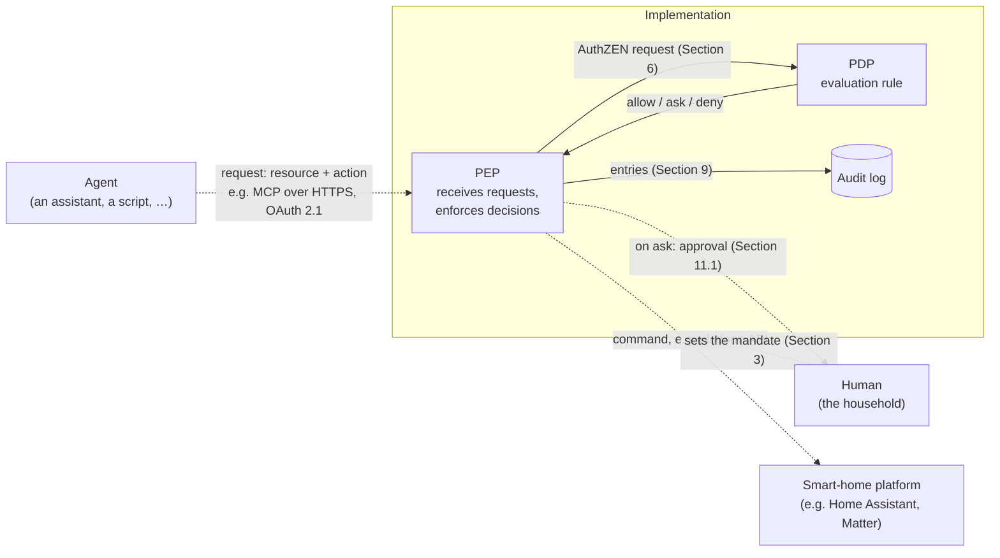

<!-- SPDX-License-Identifier: CC-BY-4.0 -->

# Home-Mandate Specification v0

Status: **Released**. The v0 formats are frozen since `v0.1.0` (2026-11-02): a document that
is valid under a released version stays valid and is evaluated the same way in every later
release; incompatible changes require a new major version (Section 14).
License of this document: CC BY 4.0 (`LICENSE-docs`). Schema, examples, conformance cases and
code: Apache 2.0 (`LICENSE`).
Reference evaluator: the code in this repository. Changes are listed in the Changelog at the end.

The key words "MUST", "MUST NOT", "SHOULD", "SHOULD NOT" and "MAY" in this document are to be
interpreted as described in BCP 14 (RFC 2119, RFC 8174) when, and only when, they appear in
all capitals.

## 1. Goal

A vendor-neutral format that describes **what a software agent may do on behalf of a
household**, and an evaluation rule that yields the same result in every implementation. The
specification builds on existing standards and defines only what is missing:

| Purpose | Standard |
|---|---|
| Decision interface | OpenID AuthZEN Authorization API 1.0 |
| Transport of the mandate in the OAuth flow | Rich Authorization Requests (RFC 9396), `authorization_details` |
| Signatures | JSON Web Signature (RFC 7515) with EdDSA (RFC 8037) or ES256, keys as JWK (RFC 7517) |
| Agent identity | OAuth 2.1 client ID (for MCP: Client ID Metadata Document) |
| Device vocabulary | own categories (`vocabulary/v0.json`); informative mappings to platforms in `profiles/` |

Newly defined are: the mandate data model, the third decision `ask`, conditions,
protection classes and the evaluation rule.

### 1.1 Overview (informative)

An agent never talks to a device directly. It sends its request to the implementation,
which decides with the household's mandate and only then passes a command on to the
smart-home platform. A human sets the mandate and confirms what the mandate leaves to a
human.



Solid lines are interfaces this specification defines. Dashed lines are left to the
implementation: the specification states what must hold there, not how it is achieved
(Section 11).

- **Agent → PEP.** This specification does not prescribe the protocol in which an agent
  sends its requests. It fixes what the agent may contribute (only the resource and the
  action, Section 4) and how the agent is named (`agent.client_id`, Section 3.3). The
  reference implementation for Home Assistant offers the Model Context Protocol (MCP): the
  agent calls tools over HTTPS and signs in with OAuth 2.1; its OAuth client ID is the
  agent identifier. Other implementations may offer a different interface.
- **PEP → PDP.** The PEP asks the PDP for a decision in the form of AuthZEN (Section 6).
  Both can run in one process; an implementation of the class `pdp` (Section 8.1) offers
  the interface over HTTP.
- **PEP → platform.** The PEP talks to the platform through the platform's own API. It
  takes category, areas and critical marking from its own resource directory, never from
  the agent (Section 4). The profiles in `profiles/` relate platform devices to the
  vocabulary (informative).
- **Human.** The household chooses the mandate (Sections 3 and 3.5), confirms `ask`
  decisions (Section 11.1) and can revoke a mandate or stop all agents at once
  (Section 11.3). How a confirmation reaches a human (an app, a notification, a dashboard)
  is left open.
- **Audit log.** Every decision and every change to a mandate is recorded (Section 9).

A mandate that leaves the implementation, for example between an issuer and a separate
PDP, travels signed (Section 7).

## 2. Terminology

- **Principal:** the household or person on whose behalf the agent acts.
- **Agent:** software that requests actions, identified by its OAuth client ID.
- **Resource:** a single device or entity, named by an identifier from the resource
  directory of the implementation.
- **Resource directory:** what the implementation knows about the resources of the
  household: for each identifier its category and, optionally, its areas (Section 3.4).
- **Action:** what is to be done with the resource, taken from the vocabulary of its category.
- **Decision:** `allow` (execute immediately), `ask` (a human must confirm), `deny` (reject).
- **PDP (policy decision point):** the part of an implementation that evaluates a request
  against the mandates (Section 4) and returns the decision.
- **PEP (policy enforcement point):** the part of an implementation that receives the
  agent's requests, asks the PDP and enforces the decision: it passes allowed commands on
  to the platform, obtains approvals and keeps the audit log (Sections 9 and 11).
- **Audit mode:** a mandate with `enforce: false` is tried, not enforced: its rules are
  evaluated and recorded, but a denial by the rules of an action that is not critical does
  not stop the agent; where a rule asks for a confirmation, a human still confirms
  (Section 4.6).
- **Reachable from outside:** an implementation that accepts connections of agents under a
  name that can be reached from the internet, through a proxy, a relay or a forwarded port
  (Section 11.7).
- **Public origin:** the origin under which agents reach such an implementation; where agents
  sign in with OAuth, it is the issuer (Section 11.7).
- **Template:** a mandate draft that an implementation stores and from which it creates
  mandates. This version defines no format for templates; the audit log records changes to
  them (Section 9.2).

## 3. Data model

Machine-readable: `schema/mandate-v0.schema.json`. The schemas in `schema/` are normative;
this text and the schemas MUST agree, and any contradiction is an error in the
specification.

**Patterns.** A `pattern` in the schemas applies to the entire string: a string matches only
if the pattern matches from its first to its last character. In particular, a trailing line
feed is not ignored. Regular expression dialects differ (ECMA-262, RE2, PCRE and others), so
the schemas use only constructs that mean the same in all of them: literal ASCII characters,
explicit character classes and ranges, groups, alternation, quantifiers, and `^` and `$` as
the first and last character. They do not use `\s`, `\d`, `\w`, `\b`, a bare `.`, flags or
lookarounds. An implementation MAY use any regular expression engine or none, as long as it
accepts exactly the strings the patterns describe.

Summary:

```
Mandate
├── type          "https://home-mandate.org/mandate/v0"
├── id            unique ID
├── name?         displayed text for interfaces, see Section 3.1 item 8
├── principal     "household:<id>" or "person:<id>"
├── agent         { client_id, display_name }   client_id: see Section 3.3
├── enforce?      only false: audit mode (Section 4.6); absent: enforced
├── rules[]       rule
│   ├── id
│   ├── resource  selector: entity_id | category | area (at least one) or any: true alone
│   │             entity_id and area are opaque identifiers, see Section 3.4
│   ├── actions[] actions from the vocabulary or "*"
│   ├── decision  allow | ask | deny
│   ├── note?     displayed text for interfaces, see Section 3.1 item 8
│   ├── conditions? { time_window, weekdays }
│   ├── constraints? { <parameter>: { min, max } or { one_of } }   only with allow, see Section 4.5
│   ├── approval?   { timeout, approvers }   only with ask
│   └── allow_critical?  true, required for allow on critical actions; not together with "*"
├── default       always "deny" in v0
├── approval      default for ask: { timeout, approvers }
├── limits        { max_actions_per_hour }
├── valid_from, expires?
├── issuer?, version?   only together, see Section 3.5
├── audience?     the verifier the mandate is for; required in a signed mandate, see Section 3.5
└── created_by, created_at
```

### 3.1 Validity of a mandate

A mandate is valid if it conforms to the schema **and** additionally:

0. all fields with `format: date-time` are valid RFC 3339 timestamps with an offset
   (implementations MUST validate `format`, not merely treat it as an annotation), written
   with an upper-case `T` and either `Z` or a numeric offset. Not permitted are: leap seconds
   (`:60`), more than 9 fractional digits, the year `0000` and the offset `-00:00`.
   Timestamps are compared as points in time with nanosecond precision;
1. it is I-JSON as defined in RFC 7493: valid UTF-8, no lone surrogates (e.g. a
   standalone `\ud800`), no noncharacters (U+FDD0 to U+FDEF and the last two code points of
   every plane) in a member name or string value, encoded directly or as an escape, no JSON
   object with a duplicate key, exactly one JSON value;
2. all rule `id`s within the mandate are distinct;
3. for every `time_window`, start and end are distinct;
4. every action of a rule is `"*"` or belongs to the vocabulary:
   - if the rule's `resource` names a category from Section 5, to that category's
     vocabulary (e.g. `unlock` with `category: light` is invalid);
   - if it names no category, to the vocabulary of at least one category from Section 5.
     A misspelled action (`unlokc`) therefore never yields a valid rule that silently
     matches nothing. Actions of an extension can only be used together with the
     extension category;
   - if it names an extension category, the actions are not checked: whether a mandate
     is valid MUST NOT depend on which extensions an implementation knows. Rules for an
     extension that the implementation does not know never match (Section 4);
5. it is at most 262 144 bytes (256 KiB) in size, counted in the UTF-8 encoding of the
   document as it is received or stored, before canonicalization. The same mandate can
   therefore be valid in its compact form and too large with added white space; a
   verifier of a signed mandate counts its canonical payload (Section 7.1). Lengths of
   strings in the schemas (`maxLength`, `minLength`) count Unicode code points, not bytes
   and not UTF-16 code units;
6. `expires`, if present, is later than `valid_from`;
7. every `approval.timeout` is between 10 seconds and 1 hour (both inclusive). A timeout
   has the form `PT[nH][nM][nS]` with at least one component, in this order, each `n` a
   decimal number of 1 to 5 digits (`PT2M`, `PT1M30S`, `PT1H`). Its value is the sum of the
   components. Different spellings of the same duration are different mandates with
   different digests;
8. `agent.display_name`, `created_by`, all `approvers`, `name` and every rule's `note` are
   **displayed text**: they are shown to humans, for example in an approval request, and
   MUST NOT be able to mislead them. `name` (1 to 64 code points) names the mandate and
   `note` (1 to 200) explains a rule, so that an interface or a confirmation can show
   something readable next to `id` and `rule_id`; neither is part of the evaluation. A
   displayed text
   - contains no code point listed under `forbidden` in
     `data/forbidden-codepoints-v0.json`. The list is normative and fixed; it was derived
     from Unicode 17.0.0 and contains the general categories Cc, Cf, Zl, Zp, Co and Cs
     (control and format characters, bidirectional controls, line and paragraph
     separators, private use, surrogates), the properties Default_Ignorable_Code_Point
     (invisible characters), White_Space except U+0020, and Noncharacter_Code_Point, and
     the blank characters U+2800 and U+FFFC; not on it are variation selectors and the
     two joiners;
   - does not begin or end with a space (U+0020), the only white space permitted;
   - does not begin with a code point listed under `not_first` (combining marks and
     variation selectors, which need a character before them);
   - contains the joiners U+200C (zero width non-joiner) and U+200D (zero width joiner)
     only between two other code points: not first, not last, and not directly after
     another joiner. Persian, Indic scripts and emoji sequences need them.

   Implementations MUST use the list, not the character tables of their runtime, so that
   validity does not change with a Unicode version. The rule cannot prevent look-alike
   letters from different scripts (homoglyphs); user interfaces SHOULD therefore show the
   `client_id` together with the `display_name`. *Informative:* the rule also lets through
   long runs of combining marks or variation selectors and strong right-to-left letters next
   to digits, which forbidding now would make valid mandates invalid. Interfaces render
   displayed text in an isolated direction context (as HTML `<bdi>` does) and cut it to a
   fixed length.

9. a rule with `allow_critical` lists its actions; it does not contain `"*"`. Whoever
   permits critical actions without an approval request names them, so that a later
   vocabulary cannot add to them silently.

10. `constraints` appear only in rules with `decision: allow` that list their actions
    (no `"*"`). For every constraint, `min` is not greater than `max`, and for **every**
    action of the rule, the named parameter is a parameter of the action that the
    constraint fits: in the vocabulary of the rule's category or, if the rule names no
    category, in at least one category from Section 5. A constraint fits a parameter if
    it gives `min` or `max` only for an integer parameter, and if every value of its
    `one_of` has the type of the parameter and, for a string parameter with permitted
    values, is one of them, compared exactly and case-sensitive (Section 4.5). Rules for
    an extension category are not checked. A constraint on a `deny` or `ask` rule would
    fail open where the parameter is not required or has alternatives: a request without
    the parameter, or with another alternative (`temperature_f` or a range setpoint
    instead of `temperature`, Section 4.5), would not match the rule. Constraints
    therefore only narrow an `allow`; on a `deny` or `ask` rule they are invalid.

11. `enforce`, if present, is `false` (audit mode, Section 4.6). A mandate that enforces
    has no `enforce` member: `true` would be a second form of the same mandate with a
    different digest, and is invalid. `enforce` is a member of the mandate, not of a rule.

All numbers in a mandate are integers whose magnitude is at most 2^53 − 1; the schema
permits nothing else.

JSON input with a nesting depth greater than 32 is not a valid mandate and has no canonical
form here (Section 3.2): implementations reject it, MAY do so before validating it against the
schema, and record no `digest` for it (Section 9.1). Valid mandates never reach this depth.

Implementations MUST reject invalid mandates when they are stored. If an invalid mandate is
nevertheless evaluated, the result MUST be `deny`.

Revocation of a mandate is not a field of the mandate but a state that the
implementation maintains and passes to the evaluation (Section 11.3).

Requirements in this document are written with the key words of BCP 14. Where a rule of
the data model, the evaluation or the audit log is stated as a fact ("the result is
`deny`", "seconds are truncated"), it is part of the definition and every conforming
implementation behaves that way.

### 3.2 Digest of a mandate

Each version of a mandate is uniquely identified by its digest:

```
digest = "sha256:" + hex(SHA-256(JCS(mandate)))
```

- `JCS` is the canonical JSON form defined in RFC 8785: sorted keys, no whitespace,
  a fixed representation of strings and numbers.
- The digest is computed over the valid mandate (Section 3.1), not over the stored
  bytes. Key order and whitespace therefore do not change the digest; any change in
  content does.
- `hex` produces lowercase letters, 64 characters.

In the audit log (Section 9), the digest refers to the version on which the decision was
based, without writing the content of the mandate to the audit log.

`enforce` is part of the content: a mandate in audit mode and the same mandate without
`enforce` have different digests, so that switching audit mode on or off is a new version
(Section 4.6) and every audit entry names the version it was decided under.

Numbers are canonicalized by their value: `10`, `10.0` and `1e1` are the same number and
yield the same digest. Because the only numbers in mandates and audit log entries are
integers, an implementation needs no floating-point serialization for the canonical form:
an integer is written in decimal notation without fraction and exponent.

### 3.3 Agent identifier

`agent.client_id` identifies the agent. It is printable ASCII, at most 512 characters, and
has one of two forms:

- an **https URL** with a lower-case host, optionally a port, a path and optionally a
  query; without userinfo (`user@`) and without a fragment (`#…`). This is the form of an
  OAuth Client ID Metadata Document URL;
- any **other URI**: a scheme of 1 to 32 characters from `a–z 0–9 + . -` that begins with
  a letter, `:`, and 1 to 256 characters from
  `A–Z a–z 0–9 . _ ~ : / -`, for example an identifier assigned by the implementation
  (`<namespace>:<id>`), a DID (`did:web:agent.example`), a SPIFFE ID
  (`spiffe://example.org/agents/voice`) or a URN. The scheme `http` is not permitted.

Neither form contains a dot segment (`/./` or `/../`). Percent-encoding is not decoded:
`%2E%2E` is three characters like any others, not a dot segment. Identifiers are compared
exactly per character, without normalization: two identifiers that differ in any character
identify different agents. How an implementation authenticates the agent behind an
identifier is outside this specification.

An https identifier names a piece of software, not an installation of it: two members of the
household who each run the same client sign in with the same metadata URL. Everything that
belongs to the identifier (mandates, the rate limit, the limit on waiting approval requests)
would then be shared, and an instance one of them runs could act under the mandate or use
up the limits of the other. An implementation SHOULD therefore give every installation it
admits an identifier of its own (`<namespace>:<id>`), or authenticate the installation behind
a shared identifier. An implementation that admits an agent by its metadata document SHOULD
keep what the document said when a human admitted the agent (the document or a digest of
it), and SHOULD ask a human to confirm again before it accepts a changed document: a domain
that expires or changes hands would otherwise give its new owner the agent and its
mandates.

### 3.4 Resource and area identifiers

`entity_id` and `area` are **opaque identifiers**: 1 to 255 (`entity_id`) or 1 to 64 (`area`)
printable ASCII characters without space (U+0021 to U+007E). The specification gives them no
structure. Whatever names a platform uses can be used directly, for example
`light.living_room`, `Kitchen_Light`, `1/2/3`, `0x00000000000004D2/1`, a UUID or a URN; a
platform whose names contain other characters maps them, for example by percent-encoding.

Identifiers are compared exactly per character, without normalization and case-sensitive:
`Kitchen_Light` and `kitchen_light` are different resources.

Implementations SHOULD use identifiers that do not change when a human renames a device.
If the identifier of a resource changes, rules that name the old identifier no longer
match: an `allow` rule stops allowing, but a `deny` or `ask` rule stops restricting, and a
broader `allow` rule may then apply. The same holds when an area of a resource changes
or is removed, or when a resource moves to another area. Implementations MUST therefore
tell the household which mandates are affected when an identifier or an area that a rule
names changes or disappears, or when a resource leaves or enters such an area; this
covers every area in the resource's set of areas. They SHOULD express restrictions by
category or by identifier, not by area alone.

The directory is fed by devices and integrations, and a resource can come under a rule
without anyone changing a mandate: a device is paired, an integration discovers one, or
the platform moves a resource to another category or set of areas after an update. When a resource
is added, or its category or set of areas changes, and a mandate that is not revoked then
allows an action on it that it did not allow before (an `allow` rule now matches, or a
`deny` or `ask` rule no longer does), an implementation MUST tell the household which
mandates now allow what for it. It SHOULD also treat the resource as critical (Section 4,
step 5) until a human has seen it: unless the household marked it already, the
implementation marks it itself and records this (`directory.changed` with
`critical_marked` and an `actor` of kind `system`, Section 9.1), and only an explicit
action of a human removes this marking (`critical_unmarked`); a marking the household set
stays as it is. This is the default; an implementation MAY let the household switch it
off. The marking does not protect `read` (Section 4, step 5) and does not stop an
`allow` rule with `allow_critical`; the notice to the household is what covers these. A
new resource is also one that takes over an identifier a mandate names (a new device
that takes the identifier of a renamed one, an integration that chooses one already in
use): an implementation SHOULD keep, for every identifier a mandate names, what tells it
which physical resource it is (a registry entry or a device of the platform), and MUST
treat the resource as new, as above, when that changes.

**Areas** are the grouping this version knows. The resource directory gives each resource
a **set of areas**: 0 to 16 area identifiers, each following the rules for `area` above,
without duplicates and without order. The set holds the room of the resource and every
location above it (for example `garage`, `ground_floor`, `home`), or several rooms side
by side where the platform places a resource in more than one. What a platform calls
room, zone, floor or group can be mapped to areas. A resource without an area has an
empty set. A rule still names exactly one `area`; it matches if that area is in the
resource's set (Section 4, step 2). `approvers` and `created_by` are identifiers from
the user management of the implementation, 1 to 128 characters each, and have no meaning
outside it; a mandate
that moves to another implementation needs them replaced, or, in a signed mandate, whose
payload cannot be changed, confirmed by a human of the household (Section 3.5).

### 3.5 Issuer and version

A mandate MAY name who issued it and which version it is:

- `issuer`: a URI with the same form as `agent.client_id` (Section 3.3), compared exactly.
- `version`: an integer of at least 1. Among the mandates with the same `id` from the same
  issuer, every change gets a higher version than every earlier one.

Both appear together or not at all. The digest (Section 3.2) says *which* version a
document is; it does not say which of two documents is newer. Without a version, an older
and more generous mandate with a valid digest cannot be told from the current one.

A mandate MAY also name the verifier it is for: `audience`, a URI with the same form as
`agent.client_id`, the identifier under which the issuer knows the implementation that is
to accept the mandate. A signed mandate MUST carry it, and a verifier accepts a signed
mandate only for its own `audience` (Section 7.1): an issuer that signs for many
households with one key could otherwise have a mandate for one of them accepted by
another whose principal and agent happen to carry the same names.

An implementation that holds a mandate under an `id` and is offered a replacement with
that `id` accepts it only if (**succession**) the offered mandate names the same agent
(`agent.client_id`) and the same `principal`, and

1. the stored mandate has no `version`, or
2. the offered mandate has the same `issuer` and a `version` greater than the stored one.

For this rule, an implementation *holds* a mandate as long as it remembers one that took
effect under the `id`, also after that mandate was revoked, removed (Section 11.3), expired
or deleted; item 1 applies only if no mandate with a `version` ever took effect under the
`id`. A mandate under an `id` the implementation does not hold is not a successor; it takes
effect at once unless it switches audit mode on or names unknown `approvers` (below). A
mandate without `version` never replaces one that has a version, and an older version is
not accepted while the newer one is known (rollback). This protection is local state: an
implementation MUST keep the highest `version` that took effect for an `issuer` and `id`
for as long as an older version could still be valid, and it MUST treat a restore from a
backup like the arrival of mandates from outside. A
revocation is local as well: a signed mandate stays verifiable until it expires, so a
revoked mandate MUST NOT be accepted again by way of its signature. A mandate from outside
that is not accepted, for succession or for any other reason, is recorded with
`mandate.rejected` (Section 9.2).

**Accepted is not in effect.** An accepted successor takes effect at once only if it
*narrows* the stored mandate or leaves it as it is. It narrows if it differs from the
stored version only in some of these ways: an `allow` rule is removed; a `deny` rule is
added; an `ask` rule without its own `approval` is added; `expires` is added or moved
earlier; `valid_from` is moved later; `limits.max_actions_per_hour` is lowered; audit mode
is switched off; `issuer`, `version`, `created_by` and `created_at` differ. Every other
difference is a **weakening**: a changed or added `allow` rule; a changed or removed `deny`
or `ask` rule; an added `ask` rule with its own `approval`; a changed `approval`, `name` or
`agent.display_name`; an `audience` added or changed; `expires` removed or moved later;
`valid_from` moved earlier; a higher rate limit; or audit mode switched on (below). Earlier
and later compare points in time (Section 3.1 item 0): the same point in time written with
another offset is not moved. Rules
are compared as wholes: a rule counts as changed when any of its members differs, `note`
included, so a rule tightened in place (a constraint added, `allow_critical` removed) needs
a confirmation too; an issuer narrows without one by removing the rule or adding a `deny`.
An added `ask` rule without its own `approval` narrows because it lets the agent ask for
more, never do more, and the approvers stay those of the mandate. A weakening successor,
and every successor of a mandate that the household revoked, MUST NOT take effect before a
human of the household has confirmed exactly this version (Section 11.6 item 4):
succession and the signature make it acceptable, not adopted, and until the confirmation
the stored mandate stays as it is, revoked if it was revoked. The issuer thus cannot expand
what an agent may do, change what a human reads, or undo a revocation, without a human.
The version the succession rule compares against is that of the mandate that took effect
or is remembered, never that of a waiting proposal; a successor that arrives while one
waits and is accepted (any version above the stored one) replaces the waiting proposal,
which is discarded (`mandate.discarded`, `cause: superseded`, Section 9.2).

The `approvers` of a mandate from outside are identifiers the issuer chose (Section 3.4).
A signed mandate whose `approvers` are not all approvers the implementation knows
(Section 11.1) takes effect only after a human of the household confirmed it as well, so
that whoever signs a mandate does not decide who confirms the agent's requests. Who counts
as such a human, and how long a proposal waits, is said in Section 11.6 item 4.

**Audit mode.** A mandate that switches audit mode on MUST NOT take effect until a human
of the household has confirmed it explicitly (Section 11.6 item 4), like a weakening. It
switches audit mode on if it has `enforce: false` (Section 4.6) and no mandate with the
same `id` in audit mode is in force: the stored mandate enforces, or it is not in force
because it is revoked, expired, not yet valid or invalid, or there is none. A mandate that
arrives without a predecessor in force, a restore from a backup included, therefore counts
as arriving from outside. The confirmation is bound to the digest (Section 3.2) of exactly
the version that is adopted; any other version needs its own. Every approver of the
mandate MUST be notified when such a mandate is proposed and when it takes effect; the
proposal is recorded with `mandate.proposed`, and a proposal that does not take effect
with `mandate.discarded` (Section 9.2). A replacement that switches audit mode off needs no
confirmation.

An issuer can end the sequence of an `id` by issuing the highest possible version; the
mandate then needs a new `id`. A mandate that leaves the implementation that
created it, signed per Section 7, MUST carry `issuer` and `version`.

## 4. Evaluation rule

Input: mandate, resource (entity ID, category, set of areas, and whether the directory marks it as
critical), action, optionally parameters of the action (Section 4.5), point in time,
household time zone, status of the mandate (`active` or `revoked`). Which mandate is evaluated is determined by Section 4.3.

**Origin of inputs:** The PEP MUST determine the category, the areas and the critical marking from its own resource
directory, the point in time from its own clock, the time zone from the household
configuration and the status from its own mandate management. It MUST NOT take any of these
from the agent; only the requested resource and action originate from the agent.

The PEP MUST resolve the resource the agent names to the identifier under which its
directory knows it, and pass that identifier to the evaluation. Because identifiers are
compared exactly (Section 3.4), passing the agent's spelling unchanged would let a
different spelling of the same device slip past a rule. A resource the directory does not
contain has no category; the result is `deny` with `unknown_resource`. A name that is an
identifier of the directory names that resource. A PEP that also resolves other names
(display names, which a device can choose itself) MUST NOT choose when such a name fits
more than one resource: the result is `deny` with `unknown_resource` as well.

0. Pre-check, each case → `deny`:
   - the mandate is invalid (Section 3.1);
   - the request is invalid: the entity ID is missing or does not match the pattern of
     `entity_id` in the schema, an area of the resource does not match the pattern of
     `area`, the resource has more than 16 areas or the same area twice, there are more
     than 16 parameters, a parameter name does not match `^[a-z][a-z0-9_]{0,63}$`, a
     parameter is neither an integer of magnitude at most 2^53 − 1 nor a string of 1 to
     64 printable ASCII characters without space, a parameter has another type than the
     action declares for it in the vocabulary of the resource's category, lies outside the
     range of an integer parameter or, for a string with permitted values, is another
     value, a parameter is one the action does not declare, a parameter the action
     requires is missing, or of the alternatives the action requires one of, none is
     present whole, more than one is, or a part of one (Sections 4.5 and 5), the point in
     time or the time zone is invalid or unknown (a point in time follows the rules of
     Section 3.1 item 0, as in a document; `0001-01-01T00:00:00Z` is a point in time like
     any other), or the status is neither `active` nor
     `revoked`. The checks against the vocabulary (declared, type, range, permitted
     values, required, alternatives) presuppose a category and an action of a vocabulary
     the implementation knows; for any other request only the number, the names and the
     values of the parameters are checked, and the result is `unknown_category` or
     `unknown_action`;
   - the category is missing: the resource is not in the directory of the PEP;
   - the category is neither listed in Section 5 nor an extension whose vocabulary
     the implementation knows;
   - the action does not belong to the vocabulary of the resource's category.
1. If the mandate is revoked, not yet valid or expired → `deny`.
   It is valid for points in time `t` with `valid_from ≤ t < expires` (without `expires`:
   `valid_from ≤ t`). Points in time are compared, not clock times.
2. Collect all rules whose `resource` matches the resource **and** whose `actions` contain the
   action **and** whose `conditions` are satisfied at the point in time **and** whose
   `constraints` are satisfied by the parameters (Section 4.5).
   - `resource` matches if **all** specified fields match
     (e.g. `category: light` and `area: living_room` = lights in the living room).
     `area` matches if it is in the resource's set of areas; a resource without areas
     matches no rule that names an `area`.
     `any: true` matches every resource. Comparison is exact per character, case-sensitive
     and without normalization.
   - `"*"` in `actions` contains every action, including critical ones.
   - `read` is an action in its own right. Write permissions do not include read permissions.
3. No rule found → `default` (`deny`).
4. Otherwise the **most restrictive** decision wins: `deny` over `ask` over `allow`.
5. Protection class: If the action is **critical** and the result is `allow`, but
   not **every** one of the matching `allow` rules carries `allow_critical: true` → the result becomes `ask`.
   For non-critical actions, `allow_critical` has no effect. An action is critical if
   - the vocabulary marks it as critical (Section 5), or
   - the resource directory marks the **resource** as critical and the action is not `read`.

   The marking of a resource lets a household protect what the vocabulary cannot know: a
   switch that drives a door opener, a ground-floor window, a heater. It can only add
   protection. An implementation MUST let the household mark resources as critical.
6. Audit mode: if the mandate carries `enforce: false`, the result of step 3 or 4 is
   `deny` and the action is not critical (step 5), the result is **not enforced**
   (Section 4.6). It stays `deny`. If one of the matching rules of step 2 decides `ask`,
   the request still needs a confirmation before it is executed: the result **requires a
   confirmation** and carries the approval settings per Section 4.1.

The rule is deliberately simple: whoever allows something broadly and denies individual items
gets the denial. Whoever sets something broadly to `ask` and allows individual items gets `ask`.
When in doubt, the safer side always wins, in audit mode as well: a `deny` that is not
enforced never takes away a confirmation that a matching `ask` rule asks for.

`limits` are not part of the evaluation. The PEP enforces the rate limit (Section 11.2).

### 4.1 Result

In addition to the decision, the evaluation returns:

- **`reason`:** exactly one reason code. If several reasons apply, the first one in
  the following order applies:

  | Code | Decision | Meaning |
  |---|---|---|
  | `no_mandate` | deny | no mandate selected for the agent and the principal (Section 4.3); not for a subject no mandate could name, which is `invalid_request` |
  | `ambiguous_mandate` | deny | several mandates for the agent and the principal (Section 4.3) |
  | `invalid_mandate` | deny | mandate invalid (Section 3.1) |
  | `invalid_request` | deny | request invalid (step 0, second item), or the subject of the request names no agent or no valid principal (Sections 4.3, 6) |
  | `unknown_resource` | deny | resource not in the directory of the PEP (no category) |
  | `unknown_category` | deny | category neither in Section 5 nor a known extension |
  | `unknown_action` | deny | action not in the category's vocabulary |
  | `revoked` | deny | mandate revoked (step 1); or, from the selection and before any evaluation, in the place of `no_mandate`: the agent and principal have only revoked mandates (Section 4.3) |
  | `not_yet_valid` | deny | point in time before `valid_from` |
  | `expired` | deny | point in time at or after `expires` |
  | `no_match` | deny | no rule matches, `default` |
  | `critical_demotion` | ask | `allow` became `ask` per step 5 |
  | `rule` | allow, ask, deny | decision of a rule per step 4 |

- **`mandate_digest`:** digest of the evaluated mandate (Section 3.2); absent for
  `no_mandate`, `ambiguous_mandate` and `invalid_mandate`, and for a `revoked` that the
  selection returns unless it names exactly one mandate (Section 4.3).
- **`rule_id`:** the first rule in document order that carries the final decision.
  For step 5, this is the first matching `allow` rule without `allow_critical`.
  For the pre-check, step 1 and step 3, there is no `rule_id`.
- **Approval settings** (only for `ask` and for a result that requires a confirmation): the
  `approval` of the first matching `ask` rule in document order that has its own
  `approval`, otherwise the `approval` of the mandate. They need not belong to the rule
  that `rule_id` names: an earlier `ask` rule without its own `approval`, or a `deny` rule
  in audit mode, can carry the decision while a later `ask` rule gives the settings.
- **`enforced`:** `false` if the result is a `deny` that is not enforced (step 6,
  Section 4.6); then `reason` is `no_match` or `rule`. Every other result is enforced and
  has no `enforced`.
- **`confirm`:** `true` if the result is a `deny` that is not enforced and requires a
  confirmation (step 6, Section 4.6); then `enforced` is `false` and `reason` is `rule`.
  Every other result has no `confirm`; for an `ask` the confirmation follows from the
  decision.

### 4.2 Conditions

All conditions of a rule MUST be satisfied. They are checked in **household local
time**: the point in time is converted to the household's time zone.

- The time zone is an identifier from the IANA time zone database, exact per character and
  case-sensitive: `UTC` or the form `Area/Location` (e.g. `Europe/Berlin`,
  `America/Argentina/Buenos_Aires`, `Etc/GMT+9`), where each part begins with an uppercase letter
  and contains only `A–Z`, `a–z`, `0–9`, `_`, `-`, `+`; at most 64 characters.
  Other names and names that the implementation does not know result in `invalid_request`.
  Other names include `Local`, `localtime`, `GMT`, abbreviations such as `CET` and every name
  without a `/` other than `UTC`, even where the database knows it (as a link in current
  releases: `EST5EDT`, `WET`, `HST`). Some time zone libraries match
  names without regard to case; an implementation that uses one MUST compare the spelling
  itself (`Europe/BERLIN` is not a name of the database); `data/timezone-names.json` (informative)
  lists the names of one release of the database in this form. Names of this form that the
  database defines as links to another zone (such as `US/Eastern`) are permitted.
  The rules of a zone change with the release of the database; implementations SHOULD keep
  it current, and two implementations can differ for points in time that a newer release
  treats differently.
- If no time zone is given, the offset with which the point in time is expressed applies.
  A PEP SHOULD always pass the household time zone; without it, whoever chooses the offset
  of the point in time chooses the local time.
- For the comparison, the hour and minute of local time are used; seconds and fractions are
  truncated (23:58:59 is 23:58).

- `time_window`: `"HH:MM-HH:MM"`, minute precision, start inclusive, end exclusive.
  `"06:00-22:00"` matches 06:00 through 21:59. If the start is greater than the end, the
  window spans midnight: `"22:00-06:00"` matches from 22:00 and before 06:00.
  During daylight saving time transitions, the clock time displayed in the household counts;
  an hour that occurs twice matches both times. Local times that are skipped do not occur: a
  window that lies entirely within them never matches on that day (`02:00-03:00` in
  `Europe/Berlin` on the last Sunday of March), and a window that begins within them matches
  from the end of the gap (`02:30-03:30` from 03:00 in the same example).
  A rule that applies at every time of day has no `time_window`; a window whose start equals
  its end makes the mandate invalid (Section 3.1 item 3).
- `weekdays`: list of `mon` … `sun`. The weekday of the point in time in local time is
  decisive, including for windows spanning midnight (Friday 22:00 to Saturday 02:00 with
  `weekdays: ["fri"]` matches only until midnight).

### 4.3 Selection of the mandate

An implementation can store several mandates. Which one is evaluated for a request is
determined by the agent (`agent.client_id`) and the principal of the request, both compared
exactly. `household:x` and `person:x` are different principals; nothing is inherited from
one to the other. The PEP determines the principal; it does not take it from the agent. It derives it from
the human who authorized the agent's credential and who may act for that principal, never
from the client alone: a `household:` principal is not implied for every user who signs in
with the same client (Section 3.3), and a guest or a child who admits an agent does not
give it the household's mandate. A
request that names no agent, or whose principal does not match the pattern of `principal`
in the schema, is `deny` with `invalid_request` before any mandate is selected, so that
`no_mandate` and `ambiguous_mandate` do not arise for a subject no mandate could name
(Section 6).

1. Candidates are the stored mandates of the agent and the principal that are not revoked.
   A stored document that is not a valid mandate (Section 3.1) is a candidate as well: for
   the agent and principal it names in `agent.client_id` and `principal`, read without
   further validation, or, if these cannot be read (the document is not I-JSON or lacks
   them), for every agent and principal, so that it is never ignored silently. A noncharacter
   alone does not stop the attribution: the document is invalid and counts for the agent and
   principal it names (correction `noncharacters`, Section 14).
2. No candidate → `deny` with `no_mandate`; but if revoked documents are stored for the
   agent and principal (attributed as in step 1), `deny` with `revoked`. A revoked mandate
   is never evaluated; the result names it (`mandate_digest`, and `selected` in the test
   interface) if exactly one revoked document is stored for them and it is a valid mandate,
   and names none otherwise. The log then shows that the agent's mandate was revoked, not
   that it never had one (Section 11.3).
3. Of the candidates, those are *current* that are valid at the point in time
   (`valid_from ≤ t < expires`); an invalid document always counts as current.
   - exactly one current candidate → it is evaluated (Section 4);
   - several current candidates → `deny` with `ambiguous_mandate`. No mandate wins, and
     mandates are never combined;
   - no current candidate: if there is exactly one candidate, it is evaluated and yields
     `not_yet_valid` or `expired`; otherwise `deny` with `no_mandate`.

An agent can therefore have mandates that follow one another in time, but never two at
the same time. Implementations SHOULD refuse to store a mandate whose validity period
overlaps with another mandate of the same agent and principal that is not revoked.

A stored document becomes invalid without anyone storing an invalid mandate: the
specification became stricter between versions, an extension vocabulary the mandate relies
on changed, or the storage was damaged. Implementations MUST reject invalid mandates when
they are stored (Section 3.1) and SHOULD show the household every stored document that is
no longer a valid mandate, because it denies every request of its agent.

### 4.4 Requests for several resources

The evaluation always concerns exactly one resource and one action. If an agent addresses
several resources at once (an area, a group, a list), the PEP resolves them with its
directory and evaluates each resource separately. The request is executed only if every
single evaluation permits it: one `deny` denies the whole request, and one `ask` requires
a confirmation that names all resources concerned. A
`deny` that is not enforced (Section 4.6) counts as permitting here, and as an `ask` if it
requires a confirmation; it is recorded as such, every resource as its own `decision`
entry, and the entries of one request SHOULD carry the same `request.group` (Section 9.1),
and MUST if one of them records the outcome of the whole request instead of its own (below).
The agent is never told which of the resources were not enforced (Section 11.6).

One confirmation covers the whole request. Its settings follow from those of the
evaluations that require one: the shortest `timeout`, and as `approvers` those that every
one of them names. If no approver is common to all of them, nobody is asked and the request
is denied by the approval (`denied_by: approval`, RECOMMENDED `error` `no_approver`): a
confirmation by someone who may not confirm one of the resources would confirm it anyway.
Every entry of the request records the same outcome: the entries whose evaluation required
the confirmation carry the same `approval` object, and every entry carries the same
`result`, also an entry whose own evaluation permitted the request and one whose `deny`
was not enforced. Only audit version 1 can record the latter, in an entry with
`request.group` (Section 9.1); an implementation that does so writes version 1
(Section 14). A verifier cannot check from one entry that the entries of a `group` agree;
the shared `group` lets a reader see them together. Every evaluation counts towards the
rate limit (Section 11.2).
The PEP MUST execute such a request on exactly the resources it evaluated, naming each of
them to the platform (for example as a list of identifiers), never the area, group or list
it resolved them from: the platform would resolve that again on its own, and a resource
added in the meantime would be acted on without an evaluation. This is the same as for
parameters, whose evaluated values are the ones executed (Section 4.5).

A confirmation for such a request covers exactly the set of resources the PEP resolved
and showed (Section 11.1 item 2). Before the execution the PEP resolves the request again;
if the set differs in any way (a resource added, removed or replaced), nothing is
executed, not even for the resources that were confirmed, and executing the new set needs
a new request and a new confirmation (Section 11.1 item 6).

A resource whose activation acts on other resources (a scene, a script, a group that the
platform executes itself) is evaluated as the resource it is; this is why `scene.activate`
and `script.run` are critical.

### 4.5 Parameters and constraints

Some actions carry a value: a temperature, a position, a volume, a mode. The vocabulary
names these **parameters** per action, each with its type (Section 5). A parameter is

- an **integer** in the unit the vocabulary gives it. The units are chosen fine enough
  that no fraction is needed (`temperature` is in hundredths of a degree Celsius, 21.5 °C
  is `2150`); there are no fractions anywhere, and the magnitude is at most 2^53 − 1. The
  vocabulary can give an integer parameter a **range** (`brightness` 0 to 100, both
  inclusive); no value outside it is valid then. `temperature` has no range;
- or a **string** of 1 to 64 printable ASCII characters without space (U+0021 to U+007E),
  the rules of an area (Section 3.4). Strings are compared exactly per character,
  case-sensitive and without normalization: `heat` and `Heat` are different values. The
  vocabulary can list the **permitted values** of a string parameter, as it does for
  `mode`; no other value is valid then.

The PEP derives the parameters from the request of the agent and expresses each in the
type and unit of its parameter in the vocabulary. It MUST execute exactly the values that
were evaluated: whatever it sends to the platform MUST NOT set a constrained quantity to
another value, by rounding or through a second, platform-specific parameter for the same
quantity, and it MUST NOT send anything the evaluation did not see (Section 12.4). A value
that cannot be expressed as an integer in the unit, or as one of the permitted values of a
string parameter, or that lies outside the range of an integer parameter, makes the
request invalid: the PEP refuses the request, and never leaves the parameter out or
evaluates without it. The type is part of the value: a request whose parameter has another
type than the vocabulary declares for the action (the integer `4` for `mode`, the string
`"50"` for `brightness`) is invalid as well (Section 4, step 0).

A request carries exactly the parameters its action declares. A parameter that the action
does not declare makes the request invalid, whatever its name and type: the evaluation
cannot judge it, and a PEP that forwarded it would let the platform act on something no
rule saw (a second target, a code, a transition). The vocabulary marks the parameters an
action **requires**; a request without one of them is invalid as well, so that a rule that
constrains the parameter can never be bypassed by leaving it out, and the PEP never
executes an action whose value nobody evaluated. Where a quantity has several forms, the
vocabulary lists **alternatives** of which a request carries exactly one (Section 5):
`climate.set_temperature` carries `temperature`, or `temperature_f`, or the pair
`temperature_low` and `temperature_high`, or that pair in degrees Fahrenheit; a request
with none of them, with a part of a pair or with two alternatives is invalid.

A quantity can have a parameter per unit: a temperature is `temperature` in hundredths of
a degree Celsius or `temperature_f` in hundredths of a degree Fahrenheit (70 °F is `7000`;
it is no integer in `temperature`, 21.111… °C). The PEP derives exactly one of them for a
request, the one in the unit in which the platform expresses the value; it never converts
into the other unit. A rule that constrains the other parameter does not match the
request, and a rule that constrains both matches no request a PEP derives this way. A
range setpoint is a form of its own: a rule that constrains `temperature` does not match a
request that sets a range (`temperature_low` and `temperature_high`, or the pair in degrees
Fahrenheit), and a household that wants to bound ranges constrains `temperature_low` and
`temperature_high`. The order of the two ends is not checked: a request whose lower end is
above its upper end is valid, the platform decides what it does with it, and a rule bounds
each end on its own.

A constraint has one of two forms:

- a **range** for an integer parameter: `min`, `max` or both. A limit that is not given
  does not restrict;
- a **list** of permitted values for an integer or a string parameter: `one_of` with 1 to
  32 distinct values of the parameter's type. It does not appear together with `min` or
  `max`.

A rule with `constraints` matches only if the request carries **every** named parameter
and each value `v` satisfies its constraint: `min ≤ v ≤ max` for a range; for a list, `v`
equals one of the values exactly (an integer never equals a string). A request without
the parameter does not match the rule. Parameters that no constraint names do not
influence the evaluation.

```json
{ "id": "r-heating", "resource": { "category": "climate" }, "actions": ["set_temperature"],
  "decision": "allow", "constraints": { "temperature": { "min": 1600, "max": 2300 } } }
{ "id": "r-heating-modes", "resource": { "category": "climate" }, "actions": ["set_mode"],
  "decision": "allow", "constraints": { "mode": { "one_of": ["heat", "auto"] } } }
```

The second rule lets the agent switch the heating to `heat` or `auto`, but never `off`.

A constraint may name values outside the range that the vocabulary gives an integer
parameter: a `one_of` value, a `min` or a `max` beyond it is valid in a mandate. Such a
value never matches, because a request with it is invalid; `{"min": 0, "max": 500}` on
`brightness` permits the same requests as no limits at all.

Constraints narrow an `allow`. Whoever wants a confirmation for values outside the limits
adds an `ask` rule for the same action without constraints; `ask` then wins inside the
limits as well, so the usual form is: `allow` with constraints, and nothing else, which
denies everything outside.

### 4.6 Audit mode

A household that tries a new mandate can first let it run in **audit mode**: the rules are
evaluated and every decision is recorded, but a denial by the rules does not stop the
agent. The audit log then shows what the mandate would deny before it does. A mandate is
in audit mode if it carries `"enforce": false`; without the member, it enforces. `enforce`
has no other value (Section 3.1 item 11).

In audit mode exactly one kind of result is not enforced: a `deny` that results from the
rules of the mandate, that is `no_match` (step 3) or a matching `deny` rule
(`reason: rule`, step 4), for an action that is **not critical** (step 5). The evaluation
returns it as `deny` with `enforced: false` (Section 4.1). The decision stays `deny`, so
that the audit log records truthfully what the mandate says. Everything else is enforced
as in a mandate without `enforce`:

- a `deny` of a critical action, whether no rule matches or a `deny` rule does: audit mode
  never unlocks a door, opens a gate or takes a snapshot that the mandate does not permit,
  and a resource the directory marks as critical stays protected in every action except
  `read`;
- `ask`, including `critical_demotion`: a human still confirms (Section 11.1), also when a
  `deny` rule matches the same request. The `deny` wins and is not enforced, but the
  result **requires a confirmation** (`confirm: true`, step 6): without the `deny` rules
  the request would be an `ask`, and a stricter rule must not leave it with less
  protection. The confirmation also shows whether the household wants the `deny`;
- `allow`: unchanged;
- every `deny` before the rules: an invalid mandate, an invalid request, an unknown
  resource, category or action, a revoked mandate and one that is not yet valid or has
  expired (steps 0 and 1), as well as `no_mandate` and `ambiguous_mandate` (Section 4.3);
- every denial outside the evaluation: the rate limit, the emergency stop, the
  authentication of the agent, and an approval that was not given (Section 11).

The PEP executes a request whose result is not enforced as it executes an `allow`, and
one that requires a confirmation only after a confirmation, as it executes an `ask`
(Section 11.6). What the evaluation does not decide stays as it is: the PEP executes
exactly the parameters that were evaluated (Section 4.5), the request counts towards the
rate limit (Section 11.2), and a confirmed request is evaluated again before it is
executed: a `deny` prevents the execution of a confirmed `ask` in audit mode as well, and
of a confirmed `deny` with `confirm: true` every result except `allow`, `ask` and another
`deny` with `confirm: true` (Section 11.1 item 6).

Audit mode belongs to the mandate, not to the implementation: one mandate can be tried
while the others enforce. Switching it on or off is a change to the mandate with a new
digest (Section 3.2), recorded with `mandate.updated` (Section 9.2). Switching it on
weakens the mandate: it takes effect only after a human of the household has confirmed it
explicitly, and every approver is notified (Sections 3.5 and 11.6). Switching it off
strengthens the mandate and needs no confirmation.

## 5. Vocabulary v0

Machine-readable and normative: `vocabulary/v0.json` (format:
`schema/vocabulary-v0.schema.json`). The table shows its content.

| Category | Actions | Critical |
|---|---|---|
| `light` | read, turn_on, turn_off, set | – |
| `switch` | read, turn_on, turn_off | – |
| `climate` | read, set_temperature, set_mode | – |
| `cover` | read, open, close, stop, set_position | – |
| `gate` | read, open, close | open |
| `lock` | read, lock, unlock, open | unlock, open |
| `alarm` | read, arm, disarm | disarm |
| `camera` | read, snapshot | snapshot |
| `media` | read, turn_on, turn_off, play, pause, set_volume | – |
| `sensor` | read | – |
| `scene` | read, activate | activate |
| `script` | read, run | run |
| `other` | read, set | set |

Parameters (Section 4.5):

| Action | Parameter | Type | Unit | Range or permitted values | Required |
|---|---|---|---|---|---|
| `light.set` | `brightness` | integer | percent | 0 to 100 | – |
| `climate.set_temperature` | `temperature` | integer | 0.01 degree Celsius | – | one alternative |
| `climate.set_temperature` | `temperature_f` | integer | 0.01 degree Fahrenheit | – | one alternative |
| `climate.set_temperature` | `temperature_low` | integer | 0.01 degree Celsius | – | one alternative |
| `climate.set_temperature` | `temperature_high` | integer | 0.01 degree Celsius | – | one alternative |
| `climate.set_temperature` | `temperature_low_f` | integer | 0.01 degree Fahrenheit | – | one alternative |
| `climate.set_temperature` | `temperature_high_f` | integer | 0.01 degree Fahrenheit | – | one alternative |
| `climate.set_mode` | `mode` | string | – | `off`, `auto`, `cool`, `heat`, `emergency_heat`, `precooling`, `fan_only`, `dry`, `sleep` | yes |
| `cover.set_position` | `position` | integer | percent open | 0 to 100 | yes |
| `media.set_volume` | `volume` | integer | percent | 0 to 100 | yes |
| `alarm.arm` | `mode` | string | – | `home`, `away`, `night`, `vacation`, `custom_bypass` | yes |

A request carries exactly the parameters its action declares (Section 4.5). **Required**
says which of them it carries at least: `yes` for a parameter the request always carries
(`required` in the file); `–` for one it may leave out (`light.set` without `brightness`
sets what else a light has, such as a colour, until the vocabulary names it);
`one alternative` for the alternatives of
`climate.set_temperature` (`required_one_of` in the file), of which a request carries
exactly one, whole: `temperature`, or `temperature_f`, or `temperature_low` with
`temperature_high` (a range setpoint, as a thermostat in `auto` keeps the temperature
between two values), or that pair in degrees Fahrenheit. An action without parameters,
such as `read` or `turn_on`, carries none.

The permitted values of `mode` for `climate.set_mode` are the values of the attribute
SystemMode of the Matter Thermostat cluster, in lower case with underscores: what the
system as a whole does, not a preset such as `eco` or `away`. The permitted values of
`mode` for `alarm.arm` are the arming modes of common alarm panels (`home`: armed with
people inside, `away`, `night`, `vacation`, `custom_bypass`: armed with some zones left
out); which of them a panel offers, and how the modes of a platform map to them, is
described in the profiles (informative). A value outside the list makes the request
invalid (Section 4.5).

`scene.activate`, `script.run` and `other.set` are critical because scenes, scripts and
unknown entities can have arbitrary consequences, including opening doors. What else is
critical in a particular household (a switch on a door opener, a ground-floor window) the
household marks in the resource directory (Section 4, step 5).

How an implementation assigns its resources to categories is its own matter and part of
its resource directory. A resource that fits no other category belongs to `other`.
`profiles/` contains informative mappings for individual platforms; they are not part of
the specification, and a platform without a profile is not at a disadvantage.

The `id` of this vocabulary, `https://home-mandate.org/vocabulary/v0`, belongs to the v0
formats (Section 14): a mandate of `https://home-mandate.org/mandate/v0` is validated
against it (Section 3.1 item 4), and a request is evaluated against it (Section 4). Its
`version` names the state of the file and changes with every change to it; the Changelog
lists the changes. A new version under this `id` only adds (Section 14): a mandate that was
valid stays valid, a rule that lists its actions means the same actions, and a request
keeps its result unless that result was a `deny` of step 0 for an unknown category or
action, for an invalid parameter value or for a parameter the action did not declare. An implementation uses the newest version it
knows, for the evaluation as for the verification of an audit log (Section 9.1), and
SHOULD record it in every `decision` entry whose evaluation used a vocabulary
(`vocabulary`, Section 9.1), so that a decision stays reproducible after an update
(Section 9.2).

### 5.1 Extensions

Extensions for other kinds of resources receive their own namespaces, e.g.
`paperless:document` with `read`, `tag`, `delete`. The namespace and the name after the
colon have at most 32 characters each, in a mandate as in a vocabulary file. An extension
defines its vocabulary and its critical actions in a file of the same format as
`vocabulary/v0.json`, with its own `id` and `version`. It declares the `type` of every
parameter: `integer` with a `unit`, or `string`, optionally with 1 to 32 permitted
`values`, as many as a `one_of` can list; `required: true` for a parameter every request
carries, and `required_one_of` for alternatives of which a request carries exactly one
(Section 5); every name in an alternative is a declared parameter of the action without
`required`, and no name appears in two alternatives. A request for an extension action
carries exactly the parameters it declares (Section 4.5); an implementation that does not
know the extension cannot check them and denies the request anyway. A vocabulary never changes under the same `id`
and `version`, and a new version under the same `id` SHOULD only add, as Section 14
requires of `vocabulary/v0.json`: an extension that removes or renames an action, changes
a critical marking or narrows a parameter publishes the result under a new `id`. Otherwise
requests that were allowed are denied, or an action runs without the confirmation it had.
If an implementation does not know the vocabulary of an extension, every request for a
resource of that category is `deny`. A registry of extensions does not exist yet.

## 6. AuthZEN mapping

The PEP queries the PDP in accordance with AuthZEN Authorization API 1.0:

```json
POST /access/v1/evaluation
{
  "subject":  { "type": "agent", "id": "https://example-agent.local/client.json",
                "properties": { "principal": "household:hm-7f3a" } },
  "action":   { "name": "unlock" },
  "resource": { "type": "lock", "id": "lock.front_door",
                "properties": { "areas": ["hallway", "ground_floor"], "critical": false } },
  "context":  { "time": "2026-10-12T21:14:03+02:00", "timezone": "Europe/Berlin" }
}
```

AuthZEN only knows `true` or `false`. The third decision is conveyed in the response
context:

```json
{ "decision": false,
  "context": { "outcome": "ask", "reason": "rule", "rule_id": "r-locks",
               "approval_timeout": "PT2M", "approvers": ["user-1"],
               "mandate_id": "m-voice-assistant", "mandate_digest": "sha256:9f2c…" } }
```

`reason` is REQUIRED, as are `mandate_id` (the `id` of the evaluated mandate, or of the
revoked mandate the result names, Section 4.3) and
`mandate_digest` unless Section 4.1 says the digest is absent: a PEP with a separate PDP
records both in the audit entry (Section 9.1) and need not resolve the `id` from the
digest. `rule_id` is included when Section 4.1 provides for it. For `outcome: ask`, `approval_timeout` and
`approvers` (the approval settings per Section 4.1) are REQUIRED, so that a PEP can obtain
the confirmation without knowing the mandate. `enforced: false` is REQUIRED for a `deny`
that is not enforced (audit mode, Section 4.6) and absent otherwise:

```json
{ "decision": false,
  "context": { "outcome": "deny", "reason": "no_match", "enforced": false,
               "mandate_id": "m-trial", "mandate_digest": "sha256:83d0…" } }
```

`confirm: true` is REQUIRED for a `deny` that is not enforced and requires a confirmation
(Section 4.1), together with `approval_timeout` and `approvers`, and absent otherwise:

```json
{ "decision": false,
  "context": { "outcome": "deny", "reason": "rule", "rule_id": "r-no-kids-room",
               "enforced": false, "confirm": true,
               "approval_timeout": "PT1M", "approvers": ["parent-1"],
               "mandate_id": "m-trial", "mandate_digest": "sha256:5b1e…" } }
```

Field mapping:

| AuthZEN | Input per Section 4 |
|---|---|
| `subject.id` | `agent.client_id`; together with `subject.properties.principal`, selects the mandate |
| `resource.id` | entity ID |
| `resource.type` | category |
| `resource.properties.areas` | set of areas, as an array (Section 3.4) |
| `resource.properties.critical` | whether the directory marks the resource as critical (Section 4 step 5): a boolean; absent is `false` |
| `action.name` | action |
| `action.properties` | parameters (Section 4.5): an object of parameter names and values, each a JSON integer or string |
| `context.time` | point in time |
| `context.timezone` | household time zone, an IANA name (Section 4.2); absent: the offset of `context.time` applies |

The PDP does not use `resource.type`, `resource.properties` and `context` without
verification, but in accordance with Section 4 "Origin of inputs": they come from the
directory, the clock and the household configuration, never from the agent. A PDP that
holds the directory, the clock and the household configuration itself ignores
`resource.type`, `resource.properties` and `context` and uses its own (as in the test
interface, Section 10.3). The mandate is selected
per Section 4.3; if there is none for the agent and principal, the result is `deny` with
`reason: no_mandate`, or `revoked` if they have only revoked mandates; `mandate_id` and
`mandate_digest` then name the revoked mandate if it is exactly one valid one.

- `outcome: allow` → `decision: true`
- `outcome: ask` → `decision: false`; the PEP MUST obtain a confirmation per Section 11.1 and
  MUST NOT execute the action unless the response is positive
- `outcome: deny` → `decision: false`; with `enforced: false`, the PEP executes the action
  as in Section 11.6, and with `confirm: true` as well only after a confirmation per
  Section 11.1

A PEP that does not know `ask` automatically treats the response as a denial, and a PEP
that does not know `enforced` enforces the denial. The extension is thus
backward-compatible and safe. A PEP that executes a `deny` with `enforced: false` MUST also
know `confirm`, because it may only execute one with `confirm: true` after a confirmation.

**Subject.** A request whose `subject.type` is not `agent`, whose `subject.id` is missing or
empty, or whose `subject.properties.principal` is missing or does not match the pattern of
`principal` in the mandate schema is answered with `deny` and `invalid_request` before any
mandate is selected (Section 4.3); `mandate_id` and `mandate_digest` are absent. Two PDPs
therefore answer alike whether or not a mandate exists for such a subject.

**Trust between PEP and PDP.** The PDP decides on the basis of the resource directory, the
clock, the household time zone and the mandate status. Whoever holds these is part of the
trusted side. If PEP and PDP are separate components, exactly one of them holds the
directory, and both MUST know which. The connection between them MUST be authenticated in
both directions and protected against modification and replay (for example TLS with
mutual authentication and without early data); a PDP MUST NOT answer callers it has not
authenticated, and it MUST NOT be reachable by agents. A PDP that serves more than one
household keeps the mandates, the directory, the clock settings and the time zone of each
apart, and MUST answer a caller only for the principals it is configured to serve for
that caller: a request for any other is refused at the transport (as for an
unauthenticated caller, for example with HTTP 403), without an evaluation and without an
AuthZEN response. It would otherwise give one household the decisions, approvers, rule
identifiers and digests of another. A PDP that does not hold the
directory itself takes `resource.type`, `resource.properties`, `context.time` and
`context.timezone` from the authenticated PEP, and only from it.

## 7. Signed mandates and transport

As long as a mandate stays inside the implementation that stores and evaluates it, it
needs no signature. A mandate that travels (between an issuer and a PDP, between
implementations, or in an OAuth flow) is signed, so that the receiver can tell who
issued it and that it was not changed.

### 7.1 Signed mandate

A **signed mandate** is a JSON Web Signature in compact serialization (RFC 7515):

```
BASE64URL(header) "." BASE64URL(JCS(mandate)) "." BASE64URL(signature)
```

- The payload is the canonical form of the mandate (Section 3.2), byte for byte. A verifier
  MUST reject a payload that is not canonical; one mandate thus has exactly one payload.
- The mandate carries `issuer`, `version` and `audience` (Section 3.5) and `expires`
  (RECOMMENDED at most one year ahead): a signed mandate stays verifiable until it expires,
  so one without an expiry would be valid forever once the verifier's memory of versions
  is lost.
- The protected header has exactly two members: `alg` and `kid`. `alg` is `EdDSA` with
  Ed25519 (RFC 8037) or `ES256`. Every implementation that verifies signed mandates MUST
  support `EdDSA` and MAY support `ES256`. Any other algorithm (in particular `none`) and
  any other header member (such as `crit`, `b64`, `jwk`, `jku`, `x5c`) make the signed
  mandate invalid: a key is never taken from the signed object itself.
- `kid` is 1 to 64 characters from `A–Z a–z 0–9 . _ -` and names a key of the issuer.
- A signed object has exactly one spelling of its segments. The three segments are base64url
  without padding and without any other character (no line breaks), and the unused bits of the
  last character of each are zero (RFC 4648 section 3.5), as for every value in base64url this
  specification reads, `x` and `y` of a key included. The JSON of the header is read as JSON:
  its members may stand in either order with white space between them, and their names and
  values are compared after their escapes are resolved (`"\u0061lg"` is `alg`); the signature
  covers the header's bytes as they are. A signer writes the header as `{"alg":…,"kid":…}`, in
  this order, without white space and without escapes: verifiers of v0.1.x accept only that. The names of the header members are case-sensitive; of the two values of `s` that verify for an ES256
  signature, only the lower one (`s` ≤ n/2) is accepted, and signers produce it; and for
  EdDSA, `S` is less than the group order `L`, and `R` and the public key are canonically
  encoded (RFC 8032 sections 5.1.3 and 5.1.7; here: the encoded y-coordinate is less than
  p = 2^255 − 19), because libraries differ on what else they accept. `alg` MUST match the
  type of the key `kid` names: `EdDSA` an Ed25519 key, `ES256` a P-256 key. A verifier
  MUST reject everything else, even if the signature would verify.
- The protected header is at most 256 bytes after base64url decoding, white space that JSON
  permits included; its two members need about a hundred. A verifier MUST reject a longer
  one. A signed mandate in compact serialization is at most 524 288 bytes (512 KiB): a mandate
  of 256 KiB (Section 3.1 item 5) takes fewer than 350 000 characters in base64url. A verifier
  MUST reject a longer one before it splits it into its parts.
- A verifier MUST check an Ed25519 signature with the equation of RFC 8032 section 5.1.7
  without the cofactor (`[S]B = R + [k]A'`), not with the cofactored one that the RFC also
  permits, so that two verifiers never disagree about a signature. Here `k` is SHA-512(R ||
  A || M) reduced modulo L, as Go, OpenSSL and libsodium compute it; RFC 8032 uses the
  unreduced hash, which gives another point for a key with a part of small order (case `g45`); a library that verifies
  with the cofactor, as those following ZIP 215 do, is not enough on its own. A key of mixed order (a point of the
  group plus a point of small order) is a key like any other; the equation without the
  cofactor decides whether a signature by it verifies. Keys A and A + T (T of small order)
  have different bytes and are different keys, although a signature can verify under both by
  chance: a key is identified by its bytes or its thumbprint (RFC 7638), never by the
  signatures it verifies. An `R` of small order (one of the
  encodings below) is rejected, even where the equation holds: some libraries reject it and
  others do not, and no honest signer produces one.
- An Ed25519 public key of small order is not a key: with it, a signature verifies for every
  message of a class, for the identity with `S` = 0 for all of them, so anyone could sign in
  the name of its holder, and the holder could deny what it signed. A verifier MUST reject
  it, whichever way it obtained the key. These are the encodings, in hexadecimal: the
  identity and order 2, each also with the sign bit set although x is 0, then order 4 and
  order 8:
  - `0100000000000000000000000000000000000000000000000000000000000000`, `0100000000000000000000000000000000000000000000000000000000000080`
  - `ecffffffffffffffffffffffffffffffffffffffffffffffffffffffffffff7f`, `ecffffffffffffffffffffffffffffffffffffffffffffffffffffffffffffff`
  - `0000000000000000000000000000000000000000000000000000000000000000`, `0000000000000000000000000000000000000000000000000000000000000080`
  - `26e8958fc2b227b045c3f489f2ef98f0d5dfac05d3c63339b13802886d53fc05`,
    `26e8958fc2b227b045c3f489f2ef98f0d5dfac05d3c63339b13802886d53fc85`
  - `c7176a703d4dd84fba3c0b760d10670f2a2053fa2c39ccc64ec7fd7792ac037a`,
    `c7176a703d4dd84fba3c0b760d10670f2a2053fa2c39ccc64ec7fd7792ac03fa`
- Keys that sign mandates MUST NOT be used to sign checkpoints (Section 9.5), and vice
  versa.

A verifier accepts a signed mandate only if

1. it holds public keys that it trusts **for the issuer the mandate names**, and the
   signature verifies with the key `kid` among them; the mandate's `audience` is the
   verifier's own identifier; and it has decided, by its own configuration, that this
   issuer may issue mandates for the `principal` and the agent the mandate names. A key
   that is trusted for one household MUST NOT be accepted for another;
2. the payload is canonical and a valid mandate (Section 3.1);
3. succession holds against what the verifier has stored (Section 3.5).

A signed mandate that fails one of these is not accepted and is recorded with
`mandate.rejected` and its `cause` (Sections 9.1 and 9.2). One that passes is accepted;
whether it takes effect at once or only after a human confirmed it is decided by
Section 3.5 (a weakening, a revoked predecessor, audit mode, unknown `approvers`).

A verifier MUST NOT take keys for an issuer from a location that an unverified mandate
names, such as a URL in its payload: the mapping from issuer to keys is configured before
any mandate is verified. A verifier remembers by which `kid` it accepted each stored
mandate; when it stops trusting a key (`issuer.changed`, Section 9.2), every mandate it
accepted only by that key MUST lose its effect or be confirmed again by a human, because a
key that was compromised may have signed it.

How a verifier comes to trust the keys of an issuer is outside this specification
(configuration, pairing, a JWK Set under the issuer's URL, …). Keys are exchanged as JWK or
JWK Set (RFC 7517): `{"kty":"OKP","crv":"Ed25519","x":…}` or
`{"kty":"EC","crv":"P-256","x":…,"y":…}`, each with a `kid`, a string of the form above; a key
without a `kid` or with a `kid` that is not such a string makes the key set verify nothing
(Section 10.2). A key set and each of its keys are I-JSON (Section 3.1 item 1): a member that
occurs twice, such as `x` in a key or `keys` in the set, makes the key set verify nothing. A
key set is at most 65 536 bytes; a verifier MUST reject a longer one. A `kid` occurs
at most once in a key set: a key set in which a `kid` repeats verifies nothing (Section 10.2),
whichever of the keys a verifier would otherwise have picked. The names of the members are
case-sensitive: `X` is not `x`, but an unknown member, and unknown members are ignored (RFC
7517 section 4), `y` of an Ed25519 key too. Three members restrict what a key is for: if
present, `use` is `sig`, `key_ops` is an array that contains `verify`, and `alg` is the
algorithm of the key's type (`EdDSA` or, fully specified as RFC 9864 names it, `Ed25519` for
an Ed25519 key; `ES256` for a P-256 key; the header of a signature names `EdDSA` in either
case, and a header with `Ed25519` is rejected); a key whose `use`,
`key_ops` or `alg` says otherwise, is `null` or of another JSON type (an element of `key_ops`
that is not a string included), cannot be used, and a key set with such a key verifies
nothing (Section 10.2). The same holds for a key of another type or curve: RFC 7517 section 5
lets a reader skip such keys, but a verifier that skipped part of a key set would trust less
or more than the household configured. An issuer whose keys share a JWK Set with keys for other
purposes publishes a set of its own for mandates. A key whose `x` and `y` decode but name no
point of the curve verifies nothing, and the key set it is in stays usable: such a key never
verifies a signature, so ignoring it changes no verdict, and most libraries accept an Ed25519
key without decoding its point. A verifier without ES256 (which is optional, above) treats a
well-formed P-256 key of a key set as a key it does not use. Well-formed means that the key
keeps every rule of this section except that its point lies on the curve: `x` and `y` are 32
octets each in base64url, and its `kid`, `use`, `key_ops` and `alg`, the absence of `d` and
the I-JSON rules hold, so that a P-256 key restricted to `"use":"enc"` makes the key set verify
nothing for every verifier (case `g104`). The key set then stays usable, and for a signature with `alg` `ES256` such a verifier answers that
it cannot check it (Section 10.2: `unsupported`). A P-256 key that is not well-formed, such as
one without `y`, makes the key set verify nothing for every verifier, with ES256 or without. `x` and
`y` are base64url without padding and without any other character.
A key with a member `d`, whatever its value, is a private key and is rejected (RFC 8037
section 2). An issuer that becomes
trusted or stops being trusted, and every key of an issuer that is added or removed, is
recorded with `issuer.changed` (Section 9.2): which mandates a verifier accepts depends on
it. A key is its bytes, not its `kid`: when the bytes under a `kid` change, the old key is
removed and the new one added (`key_removed` and `key_added`), and what a verifier remembers
it accepted by the old key (above) does not pass to the new one.

The algorithms are fixed per version of the specification. The prefix of a digest
(`sha256:`) and the `alg` of a signature name the algorithm, so that a later version can
add others without changing the format.

### 7.2 OAuth flow (informative)

A mandate can be represented as an `authorization_details` object (RFC 9396) with
`type: "https://home-mandate.org/mandate/v0"`, e.g. in token introspection or when an agent
proposes a desired mandate at sign-in. The human always chooses the mandate; a proposal by
the agent is only a pre-filled default and is never evaluated. Where the object leaves the
party that issued it, the signed form of Section 7.1 is used; how the signed form is carried
inside `authorization_details` is not defined in this version.

## 8. Conformance and certification

`conformance/cases-v0.json` contains the cases: mandate + request + expected decision.
Paths to mandates are relative to the root directory of this repository. The collection grows
with every version; every bug found is first added as a case.

Fields of a case:

| Field | Required | Meaning |
|---|---|---|
| `id` | yes | unique identifier |
| `mandate` / `mandate_inline` | one of them | path to the mandate, or the mandate inline in the case |
| `resource` | yes | `entity_id`, `category`, `areas` (an array, Section 3.4) of the resource as the PEP resolved it, and optionally `critical: true` if the directory marks it as critical; without `category` the directory does not contain it |
| `action` | yes | requested action |
| `parameters` | no | parameters of the action (Section 4.5), each an integer or a string; a value that is neither (a fraction, for example) stands for a request the PEP cannot express, the expected result is then `invalid_request` |
| `time` | yes | point in time by the rules of Section 3.1 item 0; one that does not follow them stands for a request the PEP cannot express, the expected result is then `invalid_request` |
| `timezone` | no | household time zone (IANA); if absent, the offset in `time` applies |
| `revoked` | no | `true`: status `revoked`; if the field is absent or `false`: status `active` |
| `expected` | yes | `allow`, `ask` or `deny` |
| `reason` | yes | expected reason code per Section 4.1 |
| `rule_id` | no | expected `rule_id` per Section 4.1; if the field is absent, it is not checked; `null` means: none |
| `approval_timeout` | no | expected `timeout` of the approval settings for `ask` and for a result that requires a confirmation |
| `enforced` | no | `false`: the expected result is a `deny` that is not enforced (Section 4.6); absent or `true`: the result is enforced, and an implementation that reports `enforced: false` fails the case |
| `confirm` | no | `true`: the expected result is a `deny` that is not enforced and requires a confirmation (Section 4.1); absent or `false`: it requires none, and an implementation that reports `confirm: true` fails the case |
| `why` | no | explanation for humans |

`conformance/invalid-v0.json` contains mandates that are invalid per Section 3.1 and
MUST be rejected (`mandate_inline`, or `mandate_raw` as a string if the
error cannot be represented as a JSON object, such as duplicate keys, or `mandate_base64` if
it lies in the bytes, such as bytes that are not UTF-8: the bytes in base64 with padding,
RFC 4648 section 4).

`conformance/selection-v0.json` contains cases for Section 4.3: `mandates` (the stored
mandates, each as `mandate_inline` with an optional `revoked`), `subject` (`client_id` and
`principal` of the request), the request as in `cases-v0.json`, `selected` (the `id` of the
mandate that is evaluated, or of the revoked mandate the result names, Section 4.3 step 2,
else `null`) and the expected `expected`, `reason` and optionally
`rule_id`, `approval_timeout`, `enforced` and `confirm`, as in `cases-v0.json`. A case with
`"pdp": false` has an invalid stored mandate that a PDP never stores; the class `pdp` leaves it
out (Section 8.1).

`conformance/succession-v0.json` contains cases for Section 3.5: `stored` and `offered`
(two valid mandates), optionally `stored_revoked` (the stored mandate is revoked),
`expected` (`accept` or `reject`) and, with `accept`, optionally `confirm: true`: the
successor takes effect only after a human confirmed it.

`conformance/signed-v0.json` contains cases for Section 7.1: `jws` (the signed mandate),
`keys` (path to the JWK Set the verifier trusts), `issuer` (the issuer the keys are trusted
for), `expected` (`valid` or `invalid`), for `valid` the `digest` of the mandate, and
optionally `requires`, an optional algorithm the case needs (Section 10.2). The
verifier under test counts as `hm-verifier:conf-0001`, the `audience` of the cases. The
keys in `conformance/keys/` are test keys whose private parts are public.

`conformance/digest-v0.json` contains, under `cases`, mandates (`mandate`, `mandate_inline`,
`mandate_raw` or `mandate_base64`) with their expected digest `digest` (Section 3.2).

`conformance/audit-v0.json` contains, under `logs`, audit logs: `entries` (the entries in
file order), `expected` (`valid` or `invalid`), for `invalid` the expected position
`broken_at` (Section 9.4) and optionally `entry_digests` (the digest of each entry, for
debugging). Instead of `entries`, a log can be given as `jsonl`: the exchange format
(Section 9.4) as one string, for cases about line separators. For cases about bytes, a log
is given as `entries_base64` or `jsonl_base64` instead: the same in base64 with padding
(RFC 4648 section 4). With `keys` (path to a JWK
Set) the signatures of checkpoints are verified (Section 9.5), optionally against the
expected `log_id` and the position a relying party saw last (`last_seen`); `anchored` is then
the expected `seq` up to which a verified checkpoint covers the log. Every log states the findings of Section 9.4 it has: `integrity_broken_at`,
`conformance_broken_at` and `unknown_version_at`, each absent if there is none, and a valid
log its `checkpoint_gap_at` (Section 9.5), absent if there is none. A log can
name an optional algorithm it needs in `requires` (Section 10.2).

`conformance/audit-v1.json` contains audit logs of version 1 and logs that mix versions 0 and 1
(Section 14), in the same form. Entries of version 999999999 stand for a version a verifier
does not know; the cases keep that meaning when a version 2 exists.

`conformance/origin-v0.json` contains cases for Section 11.7 items 1 and 6. A case has either a
configured `value` and whether it is a public origin (`expected`: `valid` or `invalid`), or the
`htu` of a DPoP proof and the `url` the implementation built from its public origin, and whether
they match (`expected`: `match` or `mismatch`), or the members of a DPoP `proof` that a case
needs (header `typ` and `alg`, the RFC 7638 thumbprint `jkt` of its key, and the claims `htm`,
`htu`, `iat`, `jti` and `ath`) with the `request` it came with (`method`, `url`, the time it
was `received`, and, if any, the `access_token` with the thumbprint of the key it is bound to,
or the `dpop_jkt` of the authorization request), the `jti` values accepted before (`seen`) and,
for an implementation whose memory of them does not survive a restart, the start of the process
(`started`), and whether the proof is valid (`expected`: `valid` or `invalid`). Times are in
seconds since the epoch, as `iat`.

`conformance/ct-v0.json` contains cases for Section 11.7 item 7: the names monitored
(`public_names`: the host of the public origin; a gateway paired with a relay monitors each of its
public names, RELAY-v0, section "Certificate Transparency monitoring"), the beginning of monitoring (`since`) and the time of the
check (`now`), the keys agents are shown (`server_keys`: the current one, and earlier ones with
the time each was replaced), the certificates acknowledged by digest and, optionally, the public
keys acknowledged (`acknowledged_keys`) and the key presented under the public origin at the time
of the check (`presented_key`, which recognises nothing unless it is the current key), and the
certificates found, each with its digest, its names, its
validity, the SHA-256 digest of its public key and the time of its first log entry (`logged`
as a source reports it, or else `earliest_sct` or `first_seen`); and, for each
certificate in the order given, the expected result: `alarm` (also for one that is not valid yet),
`past-exposure` or `none`. Its `monitoring` cases give the answers of the sources and the
expected state of monitoring (`ok`, `limited` or `unavailable`, the event `ct.status`), and its
`identities` give certificates in DER with their identity (Section 11.7 item 7), with the steps
in the file's `description`; for a precertificate that a precertificate signing certificate issued,
that certificate is given too (`issued_by`).

In addition to `cases` or `logs` respectively, every file has a `description`; every case has a
unique `id` and optionally `why`.

The format of each conformance file is itself described by a JSON Schema in
`conformance/schema/`, so that the files can be read and checked without the code in this
repository. `conformance/manifest.json` lists every machine-readable file of the
specification (schemas, examples, conformance files) with the SHA-256 of its bytes and, for
conformance files, the number of cases. A test report SHOULD name the manifest it was
produced with, so that it states exactly which cases were run.

### 8.1 Conformance classes

Not every implementation does everything. An evaluator library has no HTTP endpoint; a
verification tool for audit logs evaluates nothing. An implementation therefore conforms to
one or more **classes**, and it conforms to a class of a version if it passes all cases of
that class in that version.

| Class | What it does | Cases |
|---|---|---|
| `evaluator` | validates mandates, computes digests, evaluates requests (Sections 3 and 4) | `cases-v0.json`, `invalid-v0.json`, `digest-v0.json` |
| `selection` | selects the mandate among several (Section 4.3) | `selection-v0.json` |
| `signatures` | verifies signed mandates and succession (Sections 3.5 and 7) | `signed-v0.json`, `succession-v0.json` |
| `audit` | verifies the hash chain of audit logs of versions 0 and 1, the `log_id` of their checkpoints, reports the findings of Section 9.4, and computes entry digests (Sections 9.4, 9.5 condition 4 without keys, 14) | logs in `audit-v0.json` and `audit-v1.json` without `keys` |
| `audit-anchored` | additionally verifies checkpoints (Section 9.5) | logs in `audit-v0.json` and `audit-v1.json` with `keys` |
| `pdp` | answers AuthZEN requests from its own mandate store and resource directory (Sections 4.3 and 6) | the cases of `cases-v0.json` whose mandate is not revoked, and the cases of `selection-v0.json` without `"pdp": false`, which marks a case with an invalid stored mandate that a PDP never stores, over HTTP. A PDP never evaluates a revoked mandate (Section 4.3): the `revoked` cases of `cases-v0.json` test the order of the reasons in direct evaluation; the `revoked` of a PDP is covered by the selection cases |

`evaluator` is the basis: an implementation that claims any conformance to the
evaluation conforms to it. Many obligations cannot be tested from outside in this version:
those of the PEP (Section 11: approval, rate limit, revocation, and Section 11.7 if it is
reachable from outside), and those of Sections 3.1, 3.4, 3.5, 4, 4.4, 6, 7.1, 9, 10.1, 10.3 and 14 about what an
implementation stores, executes, records and shows. An implementation that claims to follow
the specification as a whole states for each of them how it meets it;
`conformance/DECLARATION.md` lists them, with the rules the test interface cannot reach. `origin-v0.json` and `ct-v0.json` state decisions of Section 11.7 for implementations
that offer them as functions; they form no class, and no implementation can claim conformance
by them in this version.

A claim of conformance names the version (the tag of this repository), the classes, the
manifest (`conformance/manifest.json`, by its SHA-256) and the optional algorithms of
Section 7.1 the implementation does not support: "conforms to `signatures` without ES256"
says what "conforms to `signatures`" alone would hide. The report of the test tool contains
the manifest, the classes and the algorithms not supported, and the release of the tool names
the version; together they can be published. A formal certification program will follow only
once the specification is frozen.

### 8.2 Ways of testing

1. **Library:** Implementations in Go can embed the reference code of this repository or
   test their own code against the cases directly.
2. **Test tool:** `mandate-conformance` (in `cmd/`) plays the cases against any
   implementation through the test interface of Section 10, independent of language and
   vendor, and writes a machine-readable report.

## 9. Audit log

Every implementation MUST maintain an audit log that shows **which agent did what, when, on the
basis of which configuration**. The format and the hash chain are fixed so that
audit logs of different implementations can be verified with the same tools.
Machine-readable: `schema/audit-v0.schema.json` and `schema/audit-v1.schema.json`, one for each
version of the format (Section 14).

**Recording comes before executing.** The log is evidence only if every execution left an
entry. A PEP therefore MUST NOT dispatch a command to the platform before it has durably
stored what it will record about the request: the `decision` entry except its `result`
(an intent), or the entry itself where the result is already known. Durably means that
the stored intent survives the end of the process, a crash included; whether it survives a
loss of power is up to the implementation, which SHOULD give the intent and the entry the
same durability (Section 12.4). The intent is stored immediately before the dispatch,
after any confirmation and after the evaluation that precedes the execution (Section 11.1
item 6); a request that waits for an approval is not an intent. It may live outside the
log, in the state that Section 11.1 item 9 asks for anyway, and it is that state; it is
not an entry and takes no part in the chain. When the execution has ended, the entry is
appended with its `result`. If the PEP cannot store the intent, or determines that it
cannot append to the log (the storage is full, read-only or gone), it does not execute:
the result is `deny` with `denied_by: audit`. Denials by authentication, by the emergency
stop and by the rate limit come before this one and keep their `denied_by`; a PEP that
finds its log unwritable MAY deny every other request this way without evaluating it or
asking anyone. The PEP records such denials as soon as the log can be written again, with
`recorded_at` the time of the recording and `request.time` that of the request; until
then it keeps them, bounded in number (RECOMMENDED: at least the newest 64). Denials that
the bound or a restart lose are the gap a failed log leaves; a PEP SHOULD tell the
household that its log failed and when. After a restart, an intent without a result is
recorded as `failed` with `error: outcome_unknown`, whether or not the action was
confirmed and whether or not the command had left the process (Section 11.1 item 9): the
command may have reached the platform. A log that fails thus stops the agents, not the
record (Section 12.2).

### 9.1 Entries

Each entry is a JSON object with the `type` of its version, `https://home-mandate.org/audit/v0` or
`https://home-mandate.org/audit/v1` (Section 14), and the members below. Version 1 is version 0
with the events, members and rules marked "(v1)" or "(version 1)"; an entry of version 0 MUST
NOT carry the events and members.

| Field | Contents |
|---|---|
| `id` | UUIDv7 (RFC 9562), a new one for every entry. Nothing refers to an entry by its `id`, and a verifier does not check that it is unique (Section 9.4) |
| `seq` | sequential number in the audit log, starting at 1, without gaps. Read by its value: `1`, `1.0` and `1e0` are the same number; writers SHOULD use the plain form |
| `recorded_at` | point in time of the entry (RFC 3339, as in Section 3.1 item 0: no leap second, like every point in time in an entry) |
| `event` | event type (Section 9.2) |
| `principal` | principal. An entry that is about one principal names it; an entry that concerns the implementation as a whole (for example `log.*`, `config.changed`, `issuer.changed`, `emergency_stop.*`, `directory.changed`, `template.changed`, `approver.changed`, `agent.registered`, `auth.rejected`, the events of Section 11.7) names the household principal (`household:…`) the implementation serves. An implementation that serves more than one household MUST keep one log for each household |
| `prev` | digest of the previous entry (Section 9.4); `null` for the first entry |

Depending on the event, the following are added:

| Field | Contents |
|---|---|
| `actor` | who triggered a change: `kind` (`user`, `agent`, `system`) and `id` |
| `agent` | `client_id`, optionally `display_name` |
| `request` | input to the evaluation: `resource` (`entity_id`, optionally `category`, `areas` as in Section 3.4 and `critical`), `action`, `time`, optionally `parameters` (each an integer or a string, Section 4.5), `timezone` and `revoked`; optionally `group`, a UUID (RFC 9562, lower case) that is the same in every `decision` entry of one request for several resources (Section 4.4) or for a renamed resource (Section 11.4) and appears in the entries of no other request |
| `mandate` | `id` and `digest`. `previous_digest`, different from `digest`: required for `mandate.updated`, the version replaced; for `mandate.proposed` the version the implementation held when it recorded the proposal, in force or not (Section 3.5), absent if it held none; a `mandate.discarded` repeats the `digest` and `previous_digest` of its proposal (Section 11.6 item 4); absent with every other event. For `mandate.removed`, `digest` is that of the last version the implementation held; for `mandate.proposed` and `mandate.discarded`, `digest` is that of the proposed version. `cause`, required with `mandate.discarded` and `mandate.rejected` and absent otherwise: for `mandate.discarded` why the proposal did not take effect (`rejected`: a human declined it, `superseded`: another version took effect or a later proposal replaced it, `revoked`: the mandate was revoked, `expired`: the proposed version, or the proposal, expired first, Section 11.6 item 4); for `mandate.rejected` why a mandate from outside was not accepted (`invalid`: not a valid mandate or not canonical, or a signed mandate without `audience` or `expires`, Sections 3.1 and 7.1; `signature`: the signature does not verify, or the header or `kid` is not acceptable; `untrusted_issuer`: no trusted key for the issuer, the issuer may not issue for this principal or agent, or the mandate names another `audience`; `succession`: Section 3.5, a rollback included; `unsupported`: the implementation does not offer what the mandate needs, such as audit mode, Section 11.6, or a format major it does not support, Section 14). With `mandate.rejected`, `digest` is present if the document was a JSON object with a canonical form (Section 3.2: it is I-JSON) and `id` if it named one; if nothing could be read, the object has only `cause` (version 0) or `cause` and `received` (version 1). `received` (version 1), required with `mandate.rejected` and absent otherwise: `sha256:` and the SHA-256 of the bytes of the document exactly as they arrived, in lower-case hexadecimal: the file, or the body of the request after its transfer and content codings are removed (HTTP chunking, `Content-Encoding`), otherwise unchanged, with a byte order mark, every line ending and a final line break; for a signed mandate the compact JWS; for a mandate inside a larger JSON text (such as `authorization_details`, Section 7.2) the bytes of the document that carried it, the body or the file, not of the value alone; for an empty document the SHA-256 of zero bytes. A document longer than its limit (Sections 3.1 item 5 and 7.1) is read up to one byte beyond the limit and no further, and `received` covers what was read. The limit counts the bytes after the content coding is removed: a decoder stops at the limit plus one byte, so that a small compressed body cannot expand without bound, and a PEP MAY refuse any `Content-Encoding`. Unlike `digest`, `received` exists for every document, JSON or not, so that a rejected document can be recognised again; it identifies bytes, never a version of a mandate: it is not a digest of Section 3.2, even where the two values are equal, and an implementation MUST NOT use it to match a mandate, a version or a confirmation. Whoever can read the log can test a guessed document against it, so `received` is as confidential as the document itself, which matters before a log is exported or shared (Section 13) |
| `vocabulary` | the vocabulary the evaluation used for the category of the resource (Section 5): `id` and `version` as in its file. Only with `decision` and `evaluation`, and not with `reason` `unknown_resource` or `unknown_category`: no vocabulary was used. For a category of Section 5, `id` is `https://home-mandate.org/vocabulary/v0`; for an extension category, the `id` of the extension (Section 5.1). The schema cannot see the vocabulary; a verifier MUST reject any other `id` for a category of Section 5, the `id` of Section 5 for an extension category and, for an extension whose vocabulary it knows, any `id` other than that vocabulary's, and an entry that violates this is invalid |
| `evaluation` | result per Section 4.1: `decision`, `reason`, `rule_id`, `approval_timeout` (the timeout of the approval settings; required for `ask` and with `confirm`, absent otherwise), `enforced` (only `false`, Section 4.6) and `confirm` (only `true`, with `enforced`) |
| `approval` | outcome of an approval request: `outcome` (`approved`, `rejected`, `timeout`, `invalid_response`, `cancelled`), `at`, `by` (who responded; required for `approved`, `rejected` and `invalid_response`, optional for `timeout`, where it names an approver whose answer arrived after the timeout, absent for `cancelled`), optionally `via` (the channel the answer came through, an implementation-defined lowercase code such as `push` or `ui`; only together with `by`); `cause` (why the request ended without an answer: `withdrawn`, `revoked`, `emergency_stop`, `interrupted`, Section 11.1) only with `cancelled` and required there |
| `result` | `status`: `executed`, `denied` (with `denied_by`: `mandate`, `approval`, `rate_limit`, `emergency_stop`, `authentication`, or `audit`: the PEP could not record the request and therefore did not execute it, Section 9) or `failed` (with `error`, a code consisting of lowercase letters, digits and `_`); `denied_by` only with `denied`; `error` is required with `failed`, MAY give the cause of a `denied` and never appears with `executed`; optionally `duration_ms`; optionally `count` (Section 11.2) |
| `truncated` | `up_to_seq`, `last_digest` (Section 9.4) |
| `exported` | `from_seq`, `to_seq`: the range of entries an export contained (Section 13), with `from_seq` ≤ `to_seq` < the entry's own `seq`. Only with `log.exported`, optional there: without it, the export contained all entries before this one |
| `checkpoint` | `log_id`, `signature` (Section 9.5); the signature also covers the entry's `recorded_at` |
| `directory` | change to the resource directory (Section 11.4): `change` (`added`, `removed`, `critical_marked`, `critical_unmarked`, `category_changed`, `areas_changed`, `renamed`, `rename_applied`, `rename_dismissed`) and `entity_id`, an identifier per Section 3.4. With `renamed`, `rename_applied` and `rename_dismissed` also `previous_entity_id`, different from `entity_id`: for `renamed`, `entity_id` is the new and `previous_entity_id` the former identifier; for `rename_applied` (a human took the rename over into the mandates) and `rename_dismissed`, `entity_id` is the current identifier and `previous_entity_id` the former one that was resolved, one entry per former identifier. With `category_changed` also `previous_category` and `category`, different from each other; with `areas_changed` also `previous_areas` and `areas`, two different sets; with `added` and `removed` optionally `category` and `areas`, the resource as it was added or last known. `category` is a category of Section 5 or an extension category, `areas` a set of up to 16 areas per Section 3.4, empty for a resource without an area. Only with `directory.changed` |
| `template` | change to a template (Section 2): `change` (`stored`: created or changed, `removed`, `hidden`: no longer offered or accepted for creating mandates without being removed, `shown`: offered and accepted again), `name` (1 to 64 characters) and `digest`; for `stored` the digest of the new content, for `removed` that of the last content, for `hidden` and `shown` optionally that of the current content. `previous_digest` only for `stored` and only if the template had content before, different from `digest`. Digests are computed as in Section 3.2 over the template as the implementation stores it. Only with `template.changed` |
| `approver` | change to the humans whom the implementation lets answer approval requests (Section 11.1): `change` (`added`, `removed`) and `id` (1 to 128 characters), the identifier of the approver in the user management, as in `approval.by`. Only with `approver.changed` |
| `issuer` | change to the issuers the implementation trusts and to their keys (Section 7.1): `change` (`trusted`, `untrusted`, `key_added`, `key_removed`), `issuer` (as a mandate names it, Section 3.5, recorded as given) and, only with `key_added` and `key_removed`, `kid` (as in Section 7.1), required there. Only with `issuer.changed` |
| `config` | change to a setting that affects every evaluation, the anchoring of the log or remote access: `setting` (`timezone`: the household time zone, Section 4.2; `clock_check`: whether the implementation denies requests while it believes its clock is wrong, Section 11.4; `checkpoint_key`: the key that signs checkpoints, Section 9.5; (v1) `public_origin`: the public origin, Section 11.7 item 1; (v1) `remote_access`: whether the implementation is reachable from outside, Section 11.7 item 8; (v1) `unbound_tokens`: whether tokens that are not bound are `allowed` or `refused`, Section 11.7 item 6; (v1) `server_key`: the key agents are shown where a proxy of the household ends TLS, as the administrator configures, confirms or accepts it, Section 11.7 item 7; (v1) `trusted_proxy`: a proxy whose forwarded addresses the implementation takes, Section 11.7 item 4, one entry for each proxy), `value` (the IANA name, `on` or `off`, the `kid` as in Section 7.1, 1 to 64 printable ASCII characters without space; or the public origin in the form of Section 11.7 item 1, or `allowed` or `refused`; for `server_key` the SHA-256 of the SubjectPublicKeyInfo, base64url without padding; for `trusted_proxy` the IP address or the prefix in CIDR notation of the proxy, in its canonical text form: IPv4 in dotted decimal without leading zeros; IPv6 as RFC 5952 Section 4 writes it, except that an IPv4-mapped address (`::ffff:0:0/96`) ends in dotted decimal as RFC 5952 Section 5 writes it (`::ffff:192.0.2.1`); a prefix without host bits; and a prefix of full length (`/32`, `/128`) written as the address alone; so that the entry that removes a proxy names it as the entry that added it did) and `previous_value` (same form, different from `value`) if the setting had a value before. (v1) A trusted proxy is added with `value` alone and removed with `previous_value` alone, one entry for each proxy; replacing one proxy with another is two entries. A new checkpoint key gets a new `kid` (Section 9.5), so that its `value` differs from the `previous_value`; where a key replaced another under the same `kid`, the change is recorded as the removal of the old key and the addition of the new one. (v1) A setting that is removed (checkpoints no longer signed, the public origin, the configured `server_key` or a trusted proxy removed) is recorded with `previous_value` and without `value`; the household time zone, the clock check, `remote_access` and `unbound_tokens` always have a value. Only with `config.changed` |
| `agent.binding` | (v1) whether the agent's tokens are bound to a key: `none` or `dpop` (Section 11.7 item 6). Optional with `agent.registered` and `agent.reconnected`, absent otherwise |
| `binding` | (v1) the key the agent's tokens are bound to from now on: `method` (`dpop`) and `jkt` (the JWK SHA-256 thumbprint of the key, RFC 7638, base64url without padding). Only with `agent.bound` |
| `credentials` | (v1) access and refresh tokens that lost their validity: `scope` (`all`: of every agent; `agent`: of the agent of the entry, which is then required) and `cause` (`emergency_stop`: with an emergency stop; `public_origin`: the public origin changed, Section 11.7 item 2; `user`: a human withdrew them; (v1) `refresh_reuse`: a refresh token was used a second time, which ends every token of its grant, Section 11.7 item 6, scope `agent`, actor of kind `system`; (v1) `bound`: the agent was bound to a key, which ends its tokens that are not bound, Section 11.7 item 6, scope `agent`, actor of kind `system`). Only with `credentials.withdrawn` |
| `auth` | (v1) why a sign-in, a token or an answer was rejected: `reason` (`unknown`: a token, code or client the implementation does not know or cannot read; `expired`: a token or code that has expired; `withdrawn`: a token that lost its validity (`credentials.withdrawn`), a replaced refresh token included, presented again; `revoked`: a credential of a revoked agent; `audience`: a token for another resource or another public origin; `client`: a sign-in whose client or redirect URI does not match its registration; `proof`: a missing or invalid DPoP proof where one is required, at the token endpoint too, and a bound token presented as a bearer token; `replay`: a DPoP proof whose `jti` was accepted before, or that an implementation which forgot its `jti` values in a restart cannot tell from one; `unbound_refused`: a token that is not bound while such tokens are refused; `second_key`: a grant with another key for an agent that is already bound, Section 11.7 item 6, with the `agent` and, in `binding`, the thumbprint of the key that was refused; `not_approver`: an answer to an approval request from someone who is not an approver of it, Section 11.1 item 5; `other`: any other reason). Required with `auth.rejected` and only with it |
| `certificate` | (v1) a certificate for the host of the public origin (Section 11.7 item 7): `digest` (SHA-256 of the DER of its TBSCertificate without the poison and the SCT list, base64url without padding) and, with `cert.unexpected`, `status` (`alarm`, `not_yet_valid` or `past_exposure`), `names` (the names of the certificate that match the host, 1 to 16; where more match, the first 16 in the order of the certificate), `issuer` (its distinguished name, 1 to 1024 code points; a longer one is cut to its first 1023 code points followed by U+2026 `…`), `public_key` (SHA-256 of its SubjectPublicKeyInfo, base64url), `not_before`, `not_after` and `logged` (its first log entry). With `cert.acknowledged` either `digest` alone, for that certificate, or `public_key` alone, for every certificate for that key (Section 11.7 item 7). Only with these two events |
| `ct` | (v1) the state of Certificate Transparency monitoring: `status` (`ok`: at least two independent sources answered within 24 hours; `limited`: only one; `unavailable`: none) and optionally `previous_status`, different from `status`. Only with `ct.status` |
| `relay` | (v1) what a gateway paired with a relay records (the Home-Mandate Relay Specification, RELAY-v0): `operator` (the operator domain as A-labels) and, depending on the event, `home_id`, `name`, `cause`, `status`, `previous_status`, `source`, `active_pins`, `backup_pins`, `level`, `previous_level`, `scope`, `account`, `caa_identity`, `change`, `check`, `reason` and `until`, as Section 9.2 lists them. RELAY-v0 maps each of these events to the gateway event that triggers it in its section "Audit events of a gateway", which also bounds how often an event the relay or the operator can trigger again and again is recorded; its values are those of this table. A value that the relay or the operator sends and that this table cannot record makes their message an error under RELAY-v0. Only with the `relay.*` events |

`request` records the input to the evaluation as the PEP determined it, also when the
evaluation found it invalid (`invalid_request`). Identifiers in it are therefore limited only
in length and number, and in their characters only by I-JSON (Section 3.1 item 1); Section 3.4
applies to mandates and to valid requests. Input that the log cannot record (a longer
identifier, more than 16 areas or areas that repeat, more than 16 parameters, a parameter name
outside `^[a-z][a-z0-9_]{0,63}$`, a parameter value that is neither an integer nor a string of
the form of Section 4.5, a value that is not I-JSON, such as a lone surrogate or a
noncharacter) is not a request: the PEP rejects it at its interface before any
evaluation (with MCP, for example, as invalid parameters), and records no `decision` entry
for it (Section 9.2). The `invalid_request` results of Section 4 for the same input exist
so that an evaluator fails closed if such input reaches it anyway.

The values of `request` are therefore not under the control of the household:
`resource.entity_id` and `action` are what the agent sent, `category` and `areas` what the
directory gave, which a device or an integration can have chosen (Section 12.2). Any of
them can contain any character: a line feed, a control character, a direction-changing
mark, a terminal escape sequence or markup, none of which can occur in an identifier that
matches anything (Section 3.4). An entry records them unchanged, so that the log shows
what was sent, and the schema does not restrict them; an export (Section 13) carries them
unchanged as well, since the digests are computed over them. Whatever renders entries for
a human (an interface, the report of a verifier, a reader of an export) MUST treat these
values as untrusted text: show them as a JSON string shows them, with every character
outside U+0020 to U+007E and every backslash in the escaped form of JSON (`\n`, `\u202e`,
`\\`), never interpret them as markup, as an escape sequence or as a line break, and keep
them from changing the direction or the layout of what surrounds them. `parameters` are
limited by Section 4.5, `timezone` comes from the PEP, and the displayed text of
Section 3.1 item 8 is restricted at the source. The same holds for the `names` and the `issuer`
of a `certificate`, which whoever obtained the certificate chose, and for the values of `relay`
that the operator sent: they are recorded unchanged, the schema does not restrict their
characters, and they are shown as untrusted text.

For `decision`, the following additionally applies:

- `executed` only with `evaluation` and `mandate`, and only if `evaluation.decision` is
  `allow`, `ask` with `approval.outcome: approved`, or `deny` with
  `evaluation.enforced: false`, and then with `evaluation.confirm: true` only with
  `approval.outcome: approved`;
- if `evaluation.decision` is `deny`, then `result` is `denied` with `denied_by: mandate`,
  unless `evaluation.enforced` is `false`: then `result` is `executed`, `failed` or
  `denied` with `denied_by: audit` (audit mode, Section 11.6; the log, Section 9), and
  with `evaluation.confirm: true` the `result` can be anything an `ask` can have;
  (v1) in an entry with `request.group`, the `result` can also be a denial other than by
  the rate limit, which comes before any evaluation: the request was denied as a whole,
  for another resource, by the approval or because its approval request was cancelled
  (Section 4.4); this holds with `confirm: true` as well, and then `denied_by: mandate`
  needs no `approval` object, because nobody was asked; an `approval` object it has is, as
  outside a group, `approved` or cancelled with `cause: revoked`;
- `evaluation.enforced` appears only in `decision` entries with `mandate` and `request`,
  only as `false`, and only with `evaluation.decision: deny` and `reason` `no_match` or
  `rule`. An `allow` or an `ask` is never marked: an allow is executed anyway, and an
  `ask` is asked in audit mode as well;
- `evaluation.confirm` appears only as `true` and only with `evaluation.enforced: false`
  and `reason: rule`: the `deny` was not enforced, and a human was asked first because a
  matching rule decides `ask` (Section 4.6). An `approval` object appears only with
  `evaluation.decision: ask` or with `evaluation.confirm: true`;
- with `evaluation.enforced: false`, `request.resource` names the `category` and
  `critical` (`true` or `false`, so that the marking cannot be left out), and the action
  is not critical: the resource is not marked `critical` unless the action is `read`,
  and the action is in the vocabulary of the category and not critical there (Section 5).
  The schema cannot see the vocabulary; a verifier MUST check it for the categories of
  Section 5 and for every extension whose vocabulary it knows, and an entry that violates
  it is invalid. A verifier without the vocabulary of an extension cannot
  tell which actions of that extension are critical, and cannot reject such an entry; a
  relying party that needs the check gives the verifier the vocabularies of the
  extensions the implementation uses;
- a confirmed `ask` that is not executed because the evaluation before the execution gave
  a `deny`, enforced or not (Section 11.1 item 6), is recorded with the `evaluation` that
  was confirmed (`ask`, without `enforced`), `approval.outcome: approved` and `result`
  `denied` with `denied_by: mandate`; the same holds for a confirmed `deny` with
  `confirm: true` whose evaluation before the execution gave a `deny` without
  `confirm: true`, recorded with the `evaluation` that was confirmed (`deny`,
  `enforced: false`, `confirm: true`). With `confirm: true`, `denied_by: mandate` appears
  only so, with `approval.outcome: cancelled` and `cause: revoked` (Section 11.6
  item 1), or (v1) without `approval` in an entry with `request.group` (Section 4.4);
- `evaluation.reason` belongs to `evaluation.decision` as in the table of Section 4.1
  (`allow` only with `rule`, `ask` only with `rule` or `critical_demotion`);
- `denied_by: audit` marks a request the PEP did not execute because it could not record
  it (Section 9). It appears only where no other denial came first: without `evaluation`
  (the PEP denied before evaluating; authentication, the emergency stop and the rate limit
  precede it and keep their `denied_by`), with `evaluation.decision: allow`, with a `deny`
  that is not enforced, or with `ask` or `confirm: true` and then either without
  `approval` (nobody was asked) or with `approval.outcome: approved`. An answer other than
  `approved` is denied by the approval and an enforced `deny` by the mandate, whatever the
  state of the log. `error` MAY name the cause, RECOMMENDED `log_unwritable` for a log
  that cannot be written and `clock_behind` for a clock behind the log (Section 11.4),
  which the PEP may not record truthfully;
- a denial with `denied_by: approval` carries the `approval` object if a request was
  made: answered, timed out or cancelled. It has none if no request was made: no approver
  could be reached, the agent already had too many requests waiting, or the request was
  tied to another one or refused to protect the approvers (Section 11.1 items 7 and 12;
  `error` names which), and none in an entry of a request for several resources whose own
  evaluation required no confirmation (Section 4.4);
- `approval.outcome: cancelled` only with `result.status: denied`, and with the `denied_by`
  that matches its `cause`: `withdrawn` and `interrupted` with `approval`, `revoked` with
  `authentication` (the agent was revoked) or `mandate` (only its mandate was), and
  `emergency_stop` with `emergency_stop`. A request that a revocation or an emergency stop
  ended while it was waiting is recorded with this outcome, not without an `approval`
  object.

A `log.truncated` or `log.exported` entry has an `actor` of kind `user` or `system`; an
agent never deletes or exports entries. The same holds for `directory.changed`,
`template.changed`, `approver.changed`, `issuer.changed`, `config.changed`,
`mandate.removed`, `agent.removed`, `mandate.proposed`, `mandate.discarded` and
`mandate.rejected`: an agent never changes the directory, a template, who may answer
approval requests, which issuers are trusted or a setting, never removes a mandate or an
agent, and never proposes, discards or delivers a mandate (`system` stands for the
implementation itself or for a mandate an issuer delivered, Section 7). An
`agent.reconnected` and an `emergency_stop.released` entry have an `actor` of kind
`user`: only a human reconnects an agent or releases the emergency stop (Section 11.3). A
`mandate.created` or `mandate.updated` entry has an `actor` of kind `user` or `system`
(`system` for a mandate an issuer delivered, Section 7): the human chooses the mandate,
never the agent (Section 7.2). An agent can withdraw, but not grant: it MAY appear as the
`actor` of `mandate.revoked` (its own mandate), `agent.revoked` (itself) and
`emergency_stop.activated`, if the implementation lets it.

(v1) An `agent.bound` entry has an `actor` of kind `agent` or `system`; a
`credentials.withdrawn` entry one of kind `user` or `system`: `user` with `cause: user`,
`system` with `cause: refresh_reuse` and `cause: bound`. Its `credentials.scope` is `all` with
`emergency_stop` and `public_origin` and `agent` with `refresh_reuse` and `bound`, and the entry names an `agent` exactly
when the scope is `agent`. A `cert.acknowledged` and a `relay.paired` entry have an `actor`
of kind `user`: only a human acknowledges a certificate or pairs with a relay.

`actor.id`, `agent.display_name`, `approval.by`, `template.name` and `approver.id` are
displayed text; Section 3.1 item 8
applies to them, and an entry that violates it is invalid.

Entries MUST NOT contain tokens, nonces, credentials or the content of a mandate or of a
template.

This version defines no format for templates (Section 2), so the digests in `template` are
computed over whatever form an implementation stores. They show that and when a template
changed and can be compared between entries of the same implementation while it stores
templates in the same form, not between implementations; the log does not reveal the
content.

### 9.2 Events

| `event` | Required | When |
|---|---|---|
| `decision` | yes | every request from an authenticated agent, even if it is rejected before evaluation (e.g. rate limit, emergency stop) or not executed because the log could not be written (`denied_by: audit`, Section 9). Input the log cannot record (Section 9.1) is not a request in the sense of this table and gets no entry |
| `mandate.created`, `mandate.updated`, `mandate.revoked` | yes | every change to a mandate, with old and new digest |
| `agent.registered`, `agent.revoked` | yes | admission and revocation of an agent |
| `emergency_stop.activated`, `emergency_stop.released` | yes | emergency stop, if the implementation has one |
| `log.truncated` | yes | before deleting old entries (Section 9.4) |
| `log.checkpoint` | no | signed statement about the log so far (Section 9.5) |
| `log.exported` | yes, if the implementation exports the log (Section 13) | every export |
| `directory.changed` | yes, if the implementation tracks the change in question: the critical marking, renamed resources, resources added or removed, a changed category or set of areas | every such change to the directory, and every rename a human resolves (Section 11.4) |
| `template.changed` | yes, if the implementation lets humans change templates | every template stored, removed, hidden or shown again |
| `approver.changed` | yes, if the implementation keeps its own list of humans who may answer approval requests | every approver added to or removed from that list (Section 11.1) |
| `issuer.changed` | yes, if the implementation accepts signed mandates (Section 7) | every issuer that becomes trusted or stops being trusted, and every key of an issuer added or removed (Section 7.1) |
| `config.changed` | yes | every change to the household time zone, to the clock check (Section 11.4) and to the key that signs checkpoints (Section 9.5), and (v1) to the public origin, to remote access, to whether tokens that are not bound are refused, to the key agents are shown, and to the proxies the implementation trusts (Section 11.7); a setting that is removed is a change too |
| `mandate.removed`, `agent.removed` | yes, if the implementation removes revoked mandates or agents | every revoked mandate or agent removed from the implementation's lists (Section 11.3) |
| `mandate.proposed`, `mandate.discarded` | yes, if the implementation offers audit mode or accepts mandates from outside | every mandate that waits for a confirmation before it takes effect (Section 3.5: audit mode, a weakening, a revoked predecessor, unknown `approvers`), and every such proposal that does not take effect, each with the digest of the proposed version and, if one is stored, that of the stored version (Section 11.6 item 4) |
| `mandate.rejected` | yes, if the implementation accepts mandates from outside (Sections 3.5 and 7) | every mandate from outside that was not accepted: invalid, not verifiable, from an untrusted issuer, against succession or unsupported. A PEP MUST limit how many documents from outside it takes for checking from each source (an issuer, a channel, an upload), RECOMMENDED at most 60 an hour; a document beyond the limit is refused before it is read and gets no entry (Section 12.2) |
| `agent.reconnected` | yes, if the implementation lets humans reconnect agents | every existing agent that receives new credentials instead of being admitted anew (Section 11.3) |
| `auth.rejected` | no; (v1) yes for a grant with another key for an agent that is already bound (Section 11.7 item 6) | rejected sign-in, invalid token, or an answer of someone who is not an approver (Section 11.1 item 5); (v1) with `auth` |
| `agent.bound` (v1) | yes, if the implementation binds tokens (Section 11.7 item 6) | every new key an agent's tokens are bound to: the first, and the first after each reconnection, with `binding` |
| `credentials.withdrawn` (v1) | yes, if the implementation withdraws credentials | access and refresh tokens that lose their validity together: with an emergency stop that withdraws them, during an active emergency stop, for a new public origin (Section 11.7 item 2), because a refresh token was used a second time or the agent was bound to a key (Section 11.7 item 6), or because a human withdraws them, with `credentials` |
| `cert.unexpected` (v1) | yes, if the implementation is reachable from outside | a certificate that raises an alarm or is reported as a past exposure (Section 11.7 item 7): once for each certificate and `status`, not at every check |
| `cert.acknowledged` (v1) | yes, if the implementation is reachable from outside | an administrator acknowledges a certificate by its `digest` or a public key by `public_key` (Section 11.7 item 7) |
| `ct.status` (v1) | yes, if the implementation is reachable from outside | every change of the state of Certificate Transparency monitoring between `ok`, `limited` and `unavailable` |
| `relay.paired`, `relay.unpaired` (v1) | yes, if the implementation can be paired with a relay | a pairing (`home_id`, `name`: the standard name) and its end (`home_id`, `cause`: `local` at the administrator's request, `operator` when the operator answered `unpaired`, which covers the household's portal, a replacement and the end of the service, `offline_too_long` or `bad_signature`) |
| `relay.status_changed` (v1) | yes, if the implementation can be paired with a relay | every change of the status of the installation the operator reports (`status`: `active`, `paused`, `blocked`), as often as RELAY-v0 bounds it |
| `relay.pins_changed` (v1) | yes, if the implementation can be paired with a relay | new pins of the relay (`source`: `relay` over a pinned tunnel, `admin` after a warning; `active_pins`, `backup_pins`: how many) |
| `relay.protection_changed` (v1) | yes, if the implementation can be paired with a relay | the protection level of a public name changes (`name`, `level`: `standard` or `own_domain`, `previous_level`) |
| `relay.caa_alarm` (v1) | yes, if the implementation can be paired with a relay | the CAA records of the standard name or of the apex of the name domain differ from what is prescribed (`name`, `scope`: `name` or `apex`), as often as RELAY-v0 bounds it |
| `relay.acme_account_changed` (v1) | yes, if the implementation can be paired with a relay | the ACME account of the gateway, as the pair of the account and its CA (`account`, `caa_identity`, `change`): reported and in force (`reported`), waiting for the household's confirmation (`pending`), confirmed and in force (`confirmed`), not confirmed in time (`not_confirmed`), or an account in force that the gateway never reported (`foreign`, an alarm) |
| `relay.monitoring_status` (v1) | yes, if the implementation can be paired with a relay | every change of whether the query of the CAA records or the read of the installation works (`check`: `caa` or `installation`; `status`: `ok` or `unavailable`, after 24 hours without success; `previous_status`) |
| `relay.key_changed` (v1) | yes, if the implementation can be paired with a relay | the gateway replaced its installation key (`home_id`) |
| `relay.replacement_pending` (v1) | yes, if the implementation can be paired with a relay | the operator reports that another gateway is about to take the installation over (`home_id`, `until`: the end of the waiting time), once for each `until`, as often as RELAY-v0 bounds it |
| `relay.pin_mismatch` (v1) | yes, if the implementation can be paired with a relay | the relay presents a key that matches no stored pin; once until a connection with a stored pin succeeds again, as often as RELAY-v0 bounds it |
| `relay.pairing_refused` (v1) | yes, if the implementation can be paired with a relay | a pairing response that fails a check of the gateway, which then does not use the pairing (`check`: `name` for the standard name, `certificate` for the tunnel certificate), as often as RELAY-v0 bounds it |
| `relay.pins_ignored` (v1) | yes, if the implementation can be paired with a relay | a set of pins that the relay announces and the gateway ignores (`reason`: `rules` when the set breaks the rules of pinning, such as a change of the backup pins over a connection with an active pin; `connection_pin` when the pin of the connection is no longer stored in its kind; `storage` when the set cannot be stored durably; `limit` when the set is over the limit for connections with an active pin), as often as RELAY-v0 bounds it |
| `relay.metadata_pins_unknown` (v1) | yes, if the implementation can be paired with a relay | a version of the operator's metadata whose pins share no pin with the stored ones, as often as RELAY-v0 bounds it |


**How the events of version 1 are written**, where two writers could otherwise differ:

- `ct.status`: the first entry is written when monitoring begins, with the state of the first
  check (`ok` within the first 24 hours) and without `previous_status`; every later entry names
  the state before.
- `cert.unexpected`: one certificate can give up to three entries, one for each `status` it
  reaches (`not_yet_valid`, then `alarm`, then `past_exposure`).
- `certificate.issuer` is the distinguished name in the string form of RFC 4514.
- `relay.status_changed` names `previous_status` whenever the gateway knew a status before.
- The `actor` of `relay.paired`, of `relay.unpaired` with `cause` `local` and of
  `relay.pins_changed` with `source` `admin` is the administrator who chose it, of kind `user`;
  that of `relay.acme_account_changed` with `change` `confirmed` is the human who confirmed the
  account, where the gateway knows who. Every other `relay.*` entry names no `actor`, whether
  the relay, the operator or the gateway itself caused it.
- Switching `unbound_tokens` to `refused` is recorded with `config.changed` alone: the tokens
  that are not bound are refused from then on, and each one presented is recorded with
  `auth.rejected` (`unbound_refused`); no `credentials.withdrawn` entry follows, because bound
  tokens stay valid.

For `decision`, `evaluation` matches the result that the evaluation (Section 4)
returns for `request` and the version `mandate.digest` under the vocabulary that
`vocabulary` names, including `enforced`, `confirm` and `approval_timeout`. This makes
every decision reproducible entry by entry, also after the implementation has updated its vocabulary
(Section 14); an implementation SHOULD therefore record `vocabulary` (Section 9.1). Without
it, the decision is reproducible under the newest version the implementation knew at the
time of the decision. A request whose outcome several entries decide together, for several
resources (Section 4.4) or for a renamed resource (Section 11.4), is reproducible from its
entries: each from its own `request`, and the request from the entries of its `group`.

The rate limit and the emergency stop are defined in Sections 11.2 and 11.3. Denials are
logged with `denied_by: rate_limit` or `emergency_stop` respectively, and the emergency stop
with the `emergency_stop.*` events. A request the PEP did not execute because it could not
record it is logged with `denied_by: audit` (Section 9).

### 9.3 Retention

- Each mandate version MUST be retained at least as long as entries that refer to its
  digest.
- How long entries are retained is determined by the implementation. Only the oldest entries
  MAY be deleted (Section 9.4).

### 9.4 Hash chain and verification

- Digest of an entry: `"sha256:" + hex(SHA-256(JCS(entry)))`, computed over the
  complete entry including `prev`. Every number in an entry is an integer of a magnitude below
  2^53, as every schema of the audit format requires.
- **An entry has no digest** if it is longer than 65 536 bytes (below), is not I-JSON (Section
  3.1 item 1), is nested deeper than 32 levels, has a number that is not an integer of a
  magnitude below 2^53 (such as `120.5` or `9007199254740992`), or is not a JSON object. A
  deviation that a correction tolerates (Section 14) does not take an entry's digest, in any
  version. An entry without a digest breaks condition 1 and takes no part in the chain: it is
  reported both as `conformance_broken_at` and as `integrity_broken_at`.
- The `prev` of each entry is the digest of its predecessor; for the entry with `seq` 1,
  `prev` is `null`.
- Before the entries up to and including `seq` n are deleted, a `log.truncated` entry
  with `truncated: { up_to_seq: n, last_digest: <digest of entry n> }` is appended.
- Exchange format: JSON Lines, UTF-8, in ascending `seq` order. Lines are separated by
  U+000A (line feed) and by nothing else: readers MUST NOT split at any other character,
  such as U+2028 inside a string. Every line is exactly one entry; white space that JSON
  permits around a value, including a carriage return before the line feed, is ignored. A
  line feed after the last entry is optional. A byte order mark is not permitted, and
  neither is a line that contains no JSON value (empty, or white space only); such a line
  counts as an entry that violates the schema.
- An entry is at most 65 536 bytes: in the exchange format the line without its line feed
  and without a carriage return before it, white space around the value included. A longer
  entry is not read: it has no digest and no readable `seq`, and the reading goes on with the
  next line.

An audit log is **valid** if, in file order:

1. every entry conforms to the schema and to the rules of Section 9.1 that the schema
   cannot express: displayed text; a former value that differs from the current one (the
   pairs `directory.entity_id` and `previous_entity_id`, `directory.category` and
   `previous_category`, `mandate.digest` and `previous_digest`, `template.digest` and
   `previous_digest`, `config.value` and `previous_value`, (v1) `ct.status` and
   `previous_status`, `relay.status` and `previous_status`, and `relay.level` and
   `previous_level`, wherever both are present); two
   different sets of areas in `areas_changed`; `enforced` against the vocabulary and
   `vocabulary` against the category; the `up_to_seq` of a `log.truncated` entry smaller
   than the entry's own `seq`; the range of a `log.exported` entry before the entry itself;
   the one form of a public origin (Section 11.7 item 1, without IDNA); (v1) the canonical form of a trusted
   proxy; and (v1) no deviation that a correction tolerates in an earlier version (Section 14);
2. the first entry either has `seq` 1, or a later `log.truncated` entry with
   `up_to_seq` = `seq` − 1 and `last_digest` = `prev` of the first entry is present;
3. every subsequent entry has the `seq` of its predecessor plus 1 and its `prev` is the
   predecessor's digest.

A new entry MUST be I-JSON (Section 3.1 item 1). An entry that is not I-JSON violates
condition 1, except for a deviation listed as a correction (Section 14), which a verifier
accepts in an existing entry of a version the correction names; in an entry of a later
version the deviation breaks condition 1, and the entry keeps its digest.

A verifier does not check what the entries alone cannot show: that an entry was recorded
before the execution (Section 9), that `evaluation` is what the mandate gives (Section 9.2),
that the entries of one `request.group` carry the same `result` and that a `group` appears in
no other request (Section 4.4), that every `id` is new, and that `recorded_at` and
`request.time` are true. These are obligations of the writer.

If an audit log is invalid, verification reports `broken_at`, determined condition by
condition in the order given:

- if any entry violates condition 1, the `seq` of the first such entry in file order, even
  if an earlier entry violates condition 2 or 3;
- otherwise, if condition 2 is violated, the `seq` of the first entry;
- otherwise the `seq` of the first entry in file order that violates condition 3 (and then
  condition 4 of Section 9.5).

If the entry that `broken_at` names has no `seq` that can be read as an integer (it has no
digest, or its `seq` is missing, not an integer or of a magnitude of 2^53 or more),
`broken_at` is `0`.

An audit log without entries is valid. Verification reports the number of entries, because
an empty log proves nothing: a log that was emptied looks the same.

**Findings.** `valid` and `broken_at` answer two questions at once: whether the log is complete
and unaltered, and whether every entry keeps every rule. A verifier therefore also reports three
findings, each the `seq` of the first entry of its kind in file order (`0` if that entry has no
readable `seq`), or nothing if there is none:

- `integrity_broken_at`: the log is not complete and unaltered from this entry on: condition 2
  (the first entry), condition 3, condition 4 of Section 9.5, or an entry that takes no part in
  the chain because it has no digest (above) or no readable `seq`. The chain is checked over every entry that takes part in it, also over
  entries that break condition 1 and entries of a version the verifier does not know; for the
  same reason, every entry with `event: log.checkpoint` is checked as a checkpoint
  (Section 9.5), and every `log.truncated` entry can account for a deleted beginning, whatever
  its version and whether or not it keeps the rules. A checkpoint that cannot be checked breaks
  the integrity: one without a `log_id` or a `signature`, with keys or without, and with keys
  one whose signature does not verify. Whether the verifier can check a checkpoint is decided by
  the key set it was given, never by the header of the checkpoint, which whoever writes the log
  chooses: a checkpoint whose `kid` names a key the verifier does not use (a well-formed P-256
  key for a verifier without ES256, Section 7.1) is no finding, and the verifier states that it
  cannot check the log (Section 10.2: `unsupported`) instead of calling it damaged. A key set
  with a key of a type that no release of this version knows verifies nothing, and the verifier
  answers with an error (Section 10.2). A checkpoint whose `alg` the verifier does not implement
  while its `kid` names a key it uses, or names no key, breaks the integrity like any signature
  that does not verify (case `v214`).
- `conformance_broken_at`: an entry of a version the verifier knows that breaks condition 1, an
  entry without a digest, an entry whose `type` names no audit version (also after an entry of
  an unknown version), and an entry of an older version after one of a newer version, whether
  the verifier knows the newer one or not (Section 14).
- `unknown_version_at`: an entry whose `type` names a version of the audit format (by the
  grammar of Section 14) that the verifier does not know.
  It checks the content of no entry from there on against condition 1, and the chain on.

A log is valid exactly if there is no finding. An entry of an unknown version breaks condition 1
for `broken_at`, as it always did, because it matches the schema of no version the verifier
knows.

**Showing the result.** The findings mean different things to a household, and a false alarm
devalues a true one. An implementation or a tool that shows the result of a verification to a
human MUST

- call a log damaged, altered or the like only for `integrity_broken_at`;
- show `conformance_broken_at` as a fault of the software that wrote the entry, among the
  details, not as damage;
- show `unknown_version_at` as "entries from this one on were written in a newer version that
  this tool cannot check; update the tool", and never as invalid or damaged, and never in a way
  that looks like a log that was checked completely.

A PEP MUST NOT refuse to start, or stop writing its log, because of `conformance_broken_at` or
`unknown_version_at` alone; what it does about `integrity_broken_at` is up to the
implementation.

**What the chain proves, and what not.** The chain is neither keyed nor signed. It shows
that the entries of a log are consistent with one another: a change, a gap or a reordering
in the middle breaks it. It does **not** show that the log is the one the implementation
wrote. Whoever can write the log can

- remove the most recent entries or change the last one;
- recompute every digest from any entry onwards;
- replace the whole log with a new one that starts at `seq` 1;
- delete a prefix and append a matching `log.truncated` entry.

A valid chain is therefore evidence only together with an anchor outside the log:
a checkpoint (Section 9.5), or a copy of the log or of its latest digest kept where the
writer of the log cannot change it.

### 9.5 Checkpoints

A checkpoint anchors the log: a signed statement that the log with a certain identifier
had a certain entry at a certain position. Where the platform offers a place for the key that
whoever can merely write the log file cannot read (a hardware or operating system keystore, a
separate process or machine), the key that signs checkpoints MUST be kept there. Where it does
not, as in a container or an add-on whose process, log and key share one disk, the
implementation MUST say so to the household: its checkpoints then show only that this process
wrote the log. The public key is kept outside the log.

A checkpoint is an entry with `event: log.checkpoint` and

```
checkpoint: { "log_id": <UUID of the log>, "signature": <JWS> }
```

It covers the log up to and including its predecessor: the entry with `seq` − 1, whose
digest is the checkpoint's `prev`. A checkpoint therefore never has `seq` 1.

- `log_id` is a UUID in lower case that the implementation chooses once per audit log.
  Every checkpoint of a log carries the same `log_id`; two logs never share one. From
  audit/v1 on it is a UUID of version 4 or 7 with the variant of RFC 9562 (the schema of
  version 1 says so). A log whose `log_id` is of another version cannot carry a checkpoint
  of version 1 that keeps the rules, because the `log_id` never changes within a log: an
  implementation that writes version 1 for such a log starts a new log with a new `log_id`,
  its first entry with `seq` 1, as after a restore (see "The signer").
- `signature` is a JWS in compact serialization with **detached payload**
  (RFC 7515 appendix F, `header..signature`), with the header and algorithms of
  Section 7.1. The payload is the canonical form (RFC 8785) of

  ```json
  { "type": "https://home-mandate.org/audit-checkpoint/v0",
    "log_id": <log_id>, "seq": <seq of the checkpoint entry − 1>, "digest": <prev of the checkpoint entry>,
    "at": <recorded_at of the checkpoint entry> }
  ```

  `at` is the `recorded_at` of the checkpoint entry, character for character. The
  signature thus covers when the checkpoint was made, not only what it covers; a verifier
  builds the payload from the entry, so nothing is repeated in `checkpoint`. The payload has
  this `type` in a log of every version of the audit format: the signed statement has not
  changed.

Verification (Section 9.4) gains a fourth condition, checked after the chain:

4. all checkpoints carry the same `log_id`, whether or not the verifier was given keys;
   and, if the verifier was given the public keys of the log, the `log_id` is the expected
   one (if the verifier expects one) and every checkpoint's signature verifies with one of
   these keys; and, if the verifier was also given the position a relying party saw covered
   by the last checkpoint it verified (its `seq` and digest, below), the log holds an entry
   with that `seq` and that digest, or a `log.truncated` entry that accounts for it (its
   `up_to_seq` is that `seq` and its `last_digest` that digest, or its `up_to_seq` is
   greater, which binds no digest: the entries it accounts for are gone) and that a verified
   checkpoint anchors (its `seq` is not greater than the anchored `seq`): anyone who can write
   the log can write a `log.truncated` entry, so one without a checkpoint after it would let a
   replaced log pass. `broken_at` is the `seq` of whichever comes first in file order: a
   checkpoint that violates this, the entry or `log.truncated` entry at that position whose
   digest differs, or a `log.truncated` entry that accounts for the position without being
   anchored; for a log that has none of them, the `seq` of its last entry, and `0` for a log
   without entries (`v229`).

A verifier that was given keys additionally reports

- up to which `seq` the log is **anchored**: the position covered by the last checkpoint,
  `0` if the log has no checkpoint whose signature verifies. Entries after it are
  consistent but not anchored;
- the `seq` of the first entry present, and, if the beginning of the log was deleted,
  whether the `log.truncated` entry that accounts for it is itself anchored (its `seq` is
  not greater than the anchored `seq`). A `log.truncated` entry after the last checkpoint
  can have been written by anyone who can write the log.

Every verifier, with keys or without, reports `checkpoint_gap_at` for a valid log that has a
checkpoint: the `seq` of the first entry at which the writer is seen not to keep the cadence of
item 3 of "The signer", counting from the first checkpoint of the log. The verifier reads the
entries in file order and does not check that their `recorded_at` values are in order. After
each checkpoint C, let n be the number of entries after C that are not checkpoints and come
before the entry E being read, and let *late* mean that a `recorded_at` lies more than 24 hours
after that of C, compared as points in time with every digit of the fraction (a verifier whose
time type keeps only milliseconds compares the digits beyond the millisecond as written). Then E is the gap if:

| E | n | The gap is at E if |
|---|---|---|
| not a checkpoint | 0 | never; but if E is late, the next checkpoint was due at once ("late start") |
| not a checkpoint | 1 or more | a late start, or E is late, or n is 1000 or more |
| a checkpoint | 1 or more | there was no late start, and E is late |
| a checkpoint | 0 | never |

Every checkpoint E becomes the new C, the gap or not. Only an entry of version 1 or later is
reported as the gap: the cadence became a MUST with the release that writes version 1, and a
log of version 0 may have been written while it was a SHOULD. For example, with a checkpoint at
`seq` 10 and every entry recorded within a minute, the first entry that is not a checkpoint
after `seq` 1010 (`seq` 1011, the 1001st) is the gap, unless `seq` 1011 is a checkpoint.

This is no finding and does not make the log invalid, but entries after a gap stayed
unanchored longer than they should. It means something only for a log whose checkpoints verify
with keys: without keys, anyone who can write the log can write a checkpoint entry. Before the
first checkpoint nothing is checked, so a log without any checkpoint has no
`checkpoint_gap_at`.

Without keys, the signatures are not checked and nothing is anchored. An implementation
MUST therefore write a checkpoint directly after every `log.truncated` entry, and a
relying party SHOULD give the verifier the `log_id` it expects: without it, the log of
another household signed with the same key would verify.

A change of the key that signs checkpoints is recorded with `config.changed` (Section 9.2)
in the log it signs. A new key gets a new `kid`: a relying party recognises a replaced key by
that entry, and two keys under one `kid` would look like one. A key that replaced another under
the same `kid` is recorded as the removal of the old one and the addition of the new one
(Section 9.1).

**The signer.** A checkpoint is only as good as what its signer agreed to sign. Whatever signs
checkpoints (a part of the implementation, a separate process, a hardware key)

1. MUST take the digest it signs from its own state: the digest of the last entry the
   implementation appended itself, as it appended it. A signer that does not append the entries
   itself receives the `seq` and digest of each entry from the writer as the writer appends it.
   It MUST NOT sign a digest it only read from the log file, nor the end of a chain it verified
   in the file: the chain has no key, so someone who can write the file but has no key could
   change the entries after the last checkpoint, recompute the chain, and have the next
   checkpoint anchor the forgery. The `seq` and digest of the last entry appended are kept
   with the state of item 2, written before the entry is appended: the digest is known before
   the write. After a restart the implementation continues the log only from that state. If the
   file ends one entry short of it and the implementation kept that entry's bytes with the
   state (a write-ahead record), the writer appends exactly those bytes again; if the last entry
   of the file has another `seq` or another digest in any other way, or the entry cannot be
   written again byte for byte, it MUST NOT sign and starts a new log with a new `log_id`, as
   after a restore (below);
2. MUST keep the highest `seq` it signed for a `log_id`, with its digest, with the key: where
   whoever can write the log cannot change it, if the platform offers such a place, and MUST
   NOT sign a `seq` that is not higher. Two signed digests for one position of one log would be
   two histories. Where key and log share one disk, a restore of the whole disk resets this
   too; only a copy outside the machine (below) shows it;
3. signs often enough: an implementation that signs checkpoints MUST append one at the latest
   after 1000 further entries and at the latest 24 hours after the previous one, if entries
   were appended since; it MAY append them more often. The part of the log that is not
   anchored stays small.

After a restore of the log from a backup that ends before the highest signed `seq`, the log
cannot be continued: entries at positions that were signed already would form a second
history. The implementation MUST then start a new log with a new `log_id`, its first entry
with `seq` 1, and keep the old log as it was restored. A signing key in a hardware or
operating system keystore is RECOMMENDED; in an installation where the process, the log and
the key share one machine, a checkpoint shows only that this process wrote the log, and a
copy of the checkpoints outside the machine (a witness) adds what the machine cannot.

What a checkpoint adds: a log that was rewritten or replaced no longer matches the
checkpoints signed before, nobody without the key can sign new ones, and the time a
checkpoint names is part of what it signs. What it does not add: it does not prevent the removal of entries after the last checkpoint, and a verifier
that does not know how far the log should reach cannot tell that the log and its last
checkpoints were removed together. Implementations SHOULD write a checkpoint at regular
intervals.

A party that relies on the log SHOULD keep, outside the machine that writes it, the `log_id`,
the public key and the position the last checkpoint it saw covers (the checkpoint's `seq` − 1
and its `prev`), and check at the next verification that the log still holds an entry with
that `seq` and that digest (or a `log.truncated` entry that accounts for it); condition 4
checks it when the verifier is given that position (`v223` to `v228`). The `seq` alone is not enough: a log rolled back
and grown again past that `seq`, with another history under the same `log_id`, keeps it. A key
that was replaced (`config.changed`, `checkpoint_key`) still verifies checkpoints that whoever
holds it signs later; a relying party SHOULD NOT accept checkpoints of a replaced key that come
after the entry recording its replacement. The conformance class `audit-anchored` tests that a
verifier checks checkpoints; where the key is kept cannot be tested through the test
interface.

## 10. Test interface

So that an implementation in any language and of any shape can be tested, the test
interface has two bindings. They are equivalent in what a passed case means; an
implementation offers the one that fits it. Neither is needed in operation.

### 10.1 Safety

The test interface lets its caller choose the mandates, the directory and the clock. An
implementation MUST NOT offer it in operation: not in a release build, or only after an
explicit start option that is off by default and that the implementation reports clearly.
State set through it MUST NOT mix with the household's real mandates and audit log.

### 10.2 Process binding

The implementation provides a program (a **harness**) that reads requests from its
standard input and writes responses to its standard output: one JSON object per line
(UTF-8, separated by line feed), one response for every request, in order. It needs no
network and no server. The harness ends when its input ends.

Mandates, audit entries, logs and key sets are passed as JSON **text inside a string**, so
that they arrive byte for byte (duplicate keys, number spellings and line separators are part
of the cases, for key sets `g97`, `g98` and `g101`): a harness that read them as part of the
request line would lose what these cases are about.

Bytes that are not UTF-8 cannot travel inside a JSON string, but Section 3.1 item 1 and
Section 9.4 make them invalid (RFC 7493 section 2.1). For these cases, the members `mandate`
(of `validate` and `evaluate`), `jsonl` and `entries` (of `verify_audit`) each have an
alternative: `mandate_base64`, `jsonl_base64` and `entries_base64` (an array of strings, one
per entry), the bytes of the document in base64 with padding (RFC 4648 section 4). The other
operations and members have no such form. The test tool sends at least one byte (an empty
document is sent as text) and canonical base64: no white space or line breaks, padding bits
zero (RFC 4648 sections 3.3 and 3.5). A request carries one form of a member, never both; a
request with both, or with a value that is not base64, is malformed and is answered with an
`error`. The implementation reads the decoded bytes as it reads a document from storage or
from the network, without decoding them in any other way first. An implementation that does
not accept the base64 form answers `{"error": "unsupported"}`; the case then counts as not
passed for its class, as for an operation it does not offer.

| `op` | Request members | Response members |
|---|---|---|
| `capabilities` | – | `name`, `version`, `ops` (the operations offered) |
| `validate` | `mandate` or `mandate_base64` | `valid`; `digest` if valid |
| `evaluate` | `mandate` or `mandate_base64`, `request` | `decision`, `reason`, `rule_id` if Section 4.1 provides one, `approval_timeout` and `approvers` for `ask` and for a result that requires a confirmation, `mandate_digest` unless absent per Section 4.1, `enforced: false` for a `deny` that is not enforced (Section 4.6), `confirm: true` for one that requires a confirmation |
| `select` | `mandates` (each `mandate`, optional `revoked`), `subject` (`client_id`, `principal`), `request` | as `evaluate`, plus `selected` (the `id` of the selected mandate, or of the revoked mandate the result names, Section 4.3) if there is one |
| `succession` | `stored`, `offered`, optionally `stored_revoked` | `accept`; with `accept`, `confirm: true` if the successor takes effect only after a human confirmed it (Section 3.5) |
| `verify_signed` | `jws`, `issuer`, `keys` (a JWK Set trusted for the issuer, as JSON text) | `valid`; `digest` if valid |
| `verify_audit` | `entries` (array of entry texts), `jsonl` (the exchange format), `entries_base64` or `jsonl_base64`; optionally `keys`, and with them `log_id` and `last_seen` (`{"seq": …, "digest": …}`, Section 9.5 condition 4; a `seq` below 1 or a digest that is not of the form of Section 9.4 is answered with an `error`) | `valid`, `entries` (their number); `broken_at` if invalid; `anchored` if valid and `keys` were given; `integrity_broken_at`, `conformance_broken_at` and `unknown_version_at` for each finding there is (Section 9.4); `checkpoint_gap_at` if valid and there is a gap (Section 9.5) |
| `entry_digest` | `entry` | `digest` |

`request` is the input of the evaluation as the PEP determines it: `resource`
(`entity_id`, optionally `category`, `areas` (an array), `critical`), `action`, optionally `parameters`
(an object of names and values, each a JSON number or string), `time`, optionally `timezone`
and `revoked`. A `time` that does not follow Section 3.1 item 0 (RFC 3339 and the narrower
rules there: no year `0000`, no offset `-00:00`, at most 9 fractional digits) or a parameter
that is neither an integer nor a string yields `deny` with `invalid_request`, as do a parameter the action
does not declare and a missing required parameter (Section 4, step 0). A string is never read as a
number: `"50"` is the string `50`. For `select`, a `subject` whose `client_id` is empty or
whose `principal` does not match the pattern of `principal` yields `deny` with
`invalid_request` and no `selected` (Section 6). A request that cannot be expressed yields
`invalid_request` after the selection (Section 4.1: `no_mandate`, `revoked` from the
selection, `ambiguous_mandate` and `invalid_mandate` come first), with `selected` and
`mandate_digest` when a mandate is
selected; a point in time that is not readable selects only a sole candidate (Section 4.3
step 3), several candidates cannot be told apart.

A request with a member that this section does not define for its operation (`op` and `id`
are defined for every one) is malformed and is answered with an `error`, so that a former
member name (such as `area`), or a member of another operation, is never evaluated as if it
were absent. A response has only the members the table names for its operation, spelled
exactly, each at most once and none of them `null`, or `error` alone; it does not repeat `id`.
The test tool reads it as strictly as a harness reads a request: a response with another
member, a member of another operation, a name in another case (`"Valid"`), a member twice or
`null`, or `error` beside other members fails the case. For an operation it does not offer, the harness answers `{"error": "unsupported"}`; the
cases of that operation then count as not passed for their class. Any other `error` is a
failed case. A `time` that does not follow Section 3.1 item 0, such as an offset of `+24:00`, a
comma before the fraction, a one-digit hour or the offset `-00:00`, is not readable.

A case can require an algorithm that Section 7.1 makes optional: its member `requires` names
it (`ES256`). Every case whose signature or checkpoint uses that algorithm carries it, valid or
not, because an implementation without the algorithm cannot tell them apart: it reads `alg`
from the header, which it has checked as Section 7.1 asks (for a checkpoint, the key its `kid`
names decides, not the header, Section 9.4), and answers the case with
`{"error": "unsupported"}`; the case then does not count for its class, and the report lists
it as not applicable. Every other case it answers so counts as not passed. `verify_signed` with a key set in which a
key cannot be used answers `{"valid": false}`; `verify_audit` answers with an `error`, because it
cannot report on the log. A key that is not a point of its curve is not such a key: it verifies
nothing, and the key set stays usable (Section 7.1).

Every request can carry `id`, the identifier of the case, for diagnostics.

```
→ {"op":"evaluate","id":"c02","mandate":"{…}","request":{"resource":{"entity_id":"lock.front_door","category":"lock","areas":["hallway","ground_floor"]},"action":"unlock","time":"2026-10-12T19:00:00+02:00"}}
← {"decision":"ask","reason":"rule","rule_id":"r-locks","approval_timeout":"PT2M","approvers":["user-1"],"mandate_digest":"sha256:…"}
```

### 10.3 HTTP binding

For the class `pdp`. The implementation offers its AuthZEN endpoint (Section 6) and one
additional **control resource** at a URL of its choice. Before every case the test tool
sets the complete state with

```
PUT <control>
{ "mandates":  [ { "mandate": "<JSON text>", "revoked": false } ],
  "directory": [ { "entity_id": "…", "category": "…", "areas": [ "…" ], "critical": false } ],
  "time": "2026-10-12T19:00:00+02:00", "timezone": "Europe/Berlin" }
```

which replaces everything set before: the stored mandates with their status, the resource
directory, the point in time the PDP uses as its clock, and the household time zone
(absent: the offset of `time` applies). The answer is a 2xx status. Then the tool sends the
request of the case to `POST <authzen>/access/v1/evaluation` with `subject` (type `agent`,
`id`, `properties.principal`), `action` (`name`, `properties` for parameters) and
`resource` with `id` and `type`, which AuthZEN requires: the category of the case, or
`unknown` for a resource the directory does not contain. Category, areas, the critical
marking and the time zone come from the state the control resource set, so the PDP ignores
`resource.type`, and `resource.properties` and `context` are not sent. The control resource
also accepts a state whose `time` does not follow Section 3.1 item 0: the PDP then answers
every request as Section 10.2 says for such a `time`, `deny` with `invalid_request`, after the
selection, which selects only a sole candidate. It compares `decision` and, in the response context, `outcome`, `reason`,
`rule_id`, `approval_timeout`, `enforced`, `confirm` and `mandate_id`: against `selected`
of a selection case, and against the `id` of the stored mandate of an evaluation case.

The tool sends the HTTP headers it was given (for example `Authorization`) with every
request; the control resource MUST require authentication, even in a test build, unless
it accepts connections only on the loopback interface of a test run, and the build that
offers it is not used in operation (Section 10.1): whoever reaches it replaces the
mandates and the directory. A test token given to the tool suffices.

### 10.4 Test tool

`mandate-conformance -exec <command>` uses the process binding,
`mandate-conformance -authzen <url> -control <url>` the HTTP binding. The tool contains the
cases of its version. Its report (`-report`) is a JSON object with `spec`, `manifest` (the
SHA-256 of `conformance/manifest.json`), `binding`, `implementation`, per class the number
of cases passed, failed and skipped and whether the implementation conforms, the cases that
were not applicable (`not_applicable_cases`, Section 10.2) and the optional algorithms the
implementation does not support (`unsupported_algorithms`), and the list of failed cases with
what was expected and what was received. `cmd/mandate-harness` is the
harness of the reference code and an example for implementers; with `-serve-authzen` and a
loopback address it offers the reference PDP over the HTTP binding, and prints the arguments
for the tool.

`implementation` names the implementation (`name`) and its release (`version`, for example
`1.4.2`), not the version of the formats, which is in `spec`. Over the process binding the
implementation names itself (`capabilities`); over the HTTP binding the tool takes both
from `-name` and `-version`.

## 11. Obligations of the PEP

The evaluation (Section 4) is a pure function. This section defines what an implementation
does around it. It states properties, not mechanisms: how a confirmation reaches a human,
which algorithm limits the rate and how the parts of an implementation talk to each other
is left open.

### 11.1 Approval

If the result of the evaluation is `ask`, or a `deny` that is not enforced and requires a
confirmation (`confirm: true`, Section 4.6), the PEP obtains a confirmation from a human
before it executes the action. What follows holds for both.

1. **Who.** A confirmation counts only if it comes from one of the `approvers` of the
   approval settings (Section 4.1), authenticated by the implementation. One approver
   suffices. An approver that the user management no longer knows does not count. If no
   approver can be reached, the result is `deny` (RECOMMENDED `error` `no_approver`).
   An implementation MUST NOT let the identifier of an approver name another person later
   (an identifier the user management gives anew, a reused account name): whoever received
   it would inherit the approvals of every stored mandate.
2. **What is confirmed.** A confirmation is bound to exactly one request: the agent, the
   resource (for a request for several resources, the set the PEP resolved, Section 4.4),
   the action, its parameters and the `mandate_digest` of the evaluation, and to the
   **credential** of the request: if the agent's tokens are bound to a key (Section 11.7
   item 6), it MUST be bound to that key (its `jkt`); otherwise it SHOULD be bound to the
   grant the token belongs to, which a refresh of the token does not change. An identical
   request of another installation with the same `client_id` (Section 3.3) then cannot use
   it. It MUST NOT be
   used for any other request, and the human MUST be shown what they confirm: the agent
   (`display_name` and `client_id`), the resource or every resource of the set, the action
   and the parameters. For a `deny` that is not enforced, the human SHOULD also be shown
   that the mandate in audit mode would deny the request, and by which rule: their answer
   then also says whether the household wants the `deny`. The agent is not told
   (Section 11.6 item 2).
   What the human is shown is taken from what the PEP itself resolved and will execute
   (Section 12.4, Parameters), never from what the agent or the way of the request supplied,
   whichever way the human is reached (Section 11.7).
   Text supplied by the agent (a reason, for example) MUST be recognizable as such: it is
   shown after the agent, the resource, the action and the parameters, in an area of its
   own that names the agent as its source, and it MUST satisfy the rules for displayed
   text (Section 3.1 item 8) or is not shown. It SHOULD be shortened to at most 200 code
   points, marked as shortened. A manipulated agent writes whatever makes a human confirm.
3. **Once.** A confirmation permits exactly one execution. A second use, a replay or a
   forged confirmation MUST be rejected; implementations use a value that cannot be
   guessed and accept it once.
4. **Independent of the agent.** The confirmation MUST reach the PEP on a path that the
   requesting agent does not control. An agent MUST NOT be able to deliver, relay or answer
   a confirmation, its own or another agent's. A voice assistant that asks "shall I
   unlock?" and reports the answer itself is not a confirmation.
5. **In time.** No answer within the `timeout` of the approval settings → `deny`
   (`timeout`). A rejection, or an answer of an approver that is invalid (wrong value,
   malformed), → `deny`. An answer of someone who is not an approver of the request is
   no answer: it is ignored, changes neither the request nor its `timeout`, and the
   request stays open until an approver answers or the `timeout` ends it; otherwise anyone
   who reaches the approval page could deny every waiting request. Such answers MAY be
   recorded with `auth.rejected` and SHOULD be limited in number. A request that ends
   earlier without an answer: item 8.
   The execution follows the confirmation without delay; a confirmation that is older
   than `timeout` when the action would be executed has expired: the action is not
   executed, and the entry records the approval as given (`approved`) and the request as
   denied by the approval, with the RECOMMENDED `error` `confirmation_expired`.
6. **Evaluated again.** After the confirmation and immediately before the execution, the
   PEP evaluates the request again. The action is executed only if the result is not
   `deny` and the `mandate_digest` is the one that was confirmed; a `deny` that is not
   enforced (Section 4.6) prevents the execution as well, and the request is recorded as
   denied by the mandate with the `ask` that was confirmed (Section 9.1). If what was
   confirmed was itself a `deny` that is not enforced (`confirm: true`), the action is
   executed only if the result is `allow`, `ask` or again a `deny` with `confirm: true`;
   any other `deny`, enforced or not, prevents the execution, and the request is recorded
   as denied by the mandate with the evaluation that was confirmed. A mandate that
   was revoked, changed or has expired in the meantime, a time window that has closed and
   an emergency stop all prevail over the confirmation. For a request for several
   resources, the PEP resolves it again and executes only if the set is the one that was
   confirmed (Section 4.4); otherwise nothing is executed and the entry is `failed`, with
   the RECOMMENDED `error` `resources_changed`.
7. **Limited.** The number of approval requests of one agent that wait for an answer at
   the same time MUST be limited (RECOMMENDED: 2), and so MUST the number of all agents
   together (RECOMMENDED: 10): many agents, or one agent admitted under many identifiers,
   would otherwise wear the approvers down past every limit of one agent. The agents of one
   OAuth client, and those of one principal, SHOULD NOT hold more than half of the limit of all
   agents, so that one of them cannot take every place. A request beyond
   either limit is `deny` without asking anyone (RECOMMENDED `error` `too_many_pending`). Requests that lead to
   `ask` count towards the rate limit (Section 11.2). Both protect the approvers from being
   worn down by repeated requests. A request the agent withdrew or an approver rejected
   SHOULD keep counting towards the limit of waiting requests for a while (RECOMMENDED: its `timeout`), since
   withdrawing and asking again would otherwise notify the approvers as often as the rate
   limit allows. An implementation MAY refuse further requests of the agent for the same
   resource for a while to protect the approvers (RECOMMENDED `error` `approval_cooldown`).
   A PEP that refuses a request for these reasons SHOULD tell the agent when it may ask
   again; how is a matter of the binding.
8. **Ended without an answer.** A request also ends before its timeout when the agent
   withdraws it, when the agent or its mandate is revoked, when the emergency stop is
   activated, or when the process that made it stops. The action is then not executed, and
   the outcome is `cancelled` with that `cause` (`withdrawn`, `revoked`, `emergency_stop`,
   `interrupted`). An agent MAY withdraw its own request; withdrawing is no answer and
   cannot lead to an execution (item 4). `cancelled` is only for a request nobody had
   answered: if an answer was accepted before the end, the outcome is that answer
   (`approved`, `rejected`, `invalid_response`), and a confirmed action that is then not
   executed is denied as in item 6. A mandate that is changed or expires while a request
   waits does not end the request; item 6 decides at the execution.
9. **Not across a restart.** An approval request does not survive the end of the process
   that made it. After a restart the implementation MUST NOT execute an action for a
   request that was waiting, and MUST NOT reopen such a request or accept an answer to
   it; it records every such request with `cancelled` and `cause: interrupted`, as soon as
   it can, with `approval.at` the time it determined that the request had ended. If the
   execution of an action was under way when the process ended and its effect is unknown,
   confirmed or not, the action MUST NOT be repeated; the entry is `failed` with
   `error: outcome_unknown` (RECOMMENDED code), completed from what the PEP stored before
   it dispatched the command (Section 9). An implementation therefore keeps enough state
   outside the process to tell these cases apart.
10. **The state that was shown.** An implementation that shows the human the state of the
   resource together with the request SHOULD execute only if the state is still the one
   shown. Otherwise the action is not executed and the entry is `failed`, with the
   RECOMMENDED `error` `already_in_state` if the state the action leads to has already
   been reached, and `state_changed` in any other case. This keeps a confirmation from
   acting twice, for example when an agent repeated a request because its own client gave
   up waiting and both requests were confirmed.
11. **What the resource can do.** An implementation that knows that the resource cannot
   carry out the action (for example because the platform reports the features of a
   device) SHOULD NOT ask anyone for it: a confirmation of an action that cannot happen
   only teaches people to confirm without reading. It then executes nothing, and the
   entry is `failed`, with the RECOMMENDED `error` `not_supported` and without an
   `approval`. It SHOULD tell an agent whose mandate allows it to `read` the resource
   which of the actions its mandate does not deny the resource can carry out, and SHOULD
   NOT tell any other agent more than that the resource cannot carry out this one
   (Section 13). An implementation that does not know what the resource can do asks as
   before.
12. **Repeated requests.** Clients give up on a call long before a `timeout` ends and make
   it again. An implementation SHOULD tie a request that repeats a waiting one of the same
   agent (same credential as in item 2, resource, action and parameters) to it instead of
   asking again, and SHOULD NOT execute again a call that repeats one it executed with a
   confirmation a short time before (RECOMMENDED: at most the `timeout`), or one with the
   same idempotency key of the binding. The agent then learns the outcome of the earlier
   request, or that it still waits; how is a matter of the binding. Such a request
   executes nothing itself; its entry is denied by the approval, without an `approval`
   object, with the RECOMMENDED `error` `approval_duplicate` (tied to the waiting request)
   or `already_executed`. A request of the agent for a resource for which another request
   of it waits (for several resources: for any of them), with another action or other parameters, is denied the same way with
   `approval_pending`, and a request that reuses an idempotency key of the binding for
   another call with `idempotency_conflict`. Every such request counts towards the rate
   limit (Section 11.2).
13. **The approval page.** A page on which a human answers approval requests MUST NOT
   let another origin embed it, MUST accept an answer only from a request it protects
   against cross-site forgery (Section 11.7 item 5), and MUST accept an answer only from an
   explicit action of the human on the page, never from opening a link. A link that leads
   to the page is used up by the first answer of an approver, not by opening it (a preview
   or a scanner opens links) and not by someone who is not an approver; once an approver
   has authenticated with it, it counts only for that approver. For a critical action (Section 4, step 5), the implementation SHOULD ask the
   approver to prove that they are present (a PIN, biometrics or signing in again), and an
   action from a notification on a locked device SHOULD NOT be enough.

**MCP elicitation (informative).** Item 4 names no mechanism. For an agent that uses MCP:

- **URL mode elicitation** (MCP `2025-11-25` and later) can be such a path. The person
  confirms on a page the PEP serves, the client opens it so that neither the client nor
  the model can see the page, and the PEP verifies who confirms. It satisfies item 4 when
  the PEP checks that the person who confirms is one of the approvers (item 1), binds
  the page to exactly one request (items 2 and 3), and the approver authenticates in a
  context the agent cannot operate: the URL reaches the client, and a client with a
  browser or a tool that operates the computer, or one that runs in the approver's
  signed-in browser, could open the page and answer. A second device, or a number that
  the approver compares between two devices, closes this path.
- **Form mode elicitation** is not a confirmation in the sense of item 4. The answer
  passes through the agent's client, and the PEP cannot tell whether a person gave it.
- In both cases the person asked is whoever sits at the client, not necessarily an
  approver. A PEP still needs a path to the approvers, for agents without a person at the
  client.

Every outcome is recorded in the audit log (Section 9.1) with `approval.outcome`, who
answered and, optionally, through which channel; a cancelled request with its `cause`.

An implementation MAY keep a list of the humans who can answer approval requests, for
example to offer them as `approvers` of a new mandate. Adding someone to that list or
removing them from it is recorded with `approver.changed` (Section 9.2). A change to the
`approvers` of a mandate is a change to the mandate (`mandate.updated`).

### 11.2 Rate limit

`limits.max_actions_per_hour` (N) bounds how often an agent can make the implementation
act or decide.

- In every period of 3600 seconds, at most N requests of the agent under the mandate
  reach the evaluation. The count belongs to the mandate (`id`), not to a version of it:
  a new version does not reset it. Further requests are denied without evaluation
  (`denied_by: rate_limit`). The mandate is selected first (Section 4.3), then the limit
  is checked, then the request is evaluated.
- Every request of the authenticated agent counts, whatever the action and whatever the
  result: `read`, requests that are denied and requests that lead to `ask`. Requests
  denied by the rate limit itself or by the emergency stop do not count. A request for
  several resources counts once for every resource it evaluates (Section 4.4); if the
  limit does not leave room for all of them, the whole request is denied by it.
- Requests for which the selection yields no single valid mandate (`no_mandate`,
  `ambiguous_mandate`, `invalid_mandate`, `revoked`) have no N of their own. They count
  against a limit of the implementation for the agent and principal, RECOMMENDED at most 60
  per hour, and for `ambiguous_mandate` at most the smallest N of the valid candidates: an
  agent without a mandate could otherwise fill the evaluation and the log. Requests within
  that limit are evaluated and recorded with their reason (`revoked` included); those
  beyond it are denied with `denied_by: rate_limit` and MAY be summarized (`result.count`).
- N is an upper bound. An implementation MAY limit more strictly, for example the number
  of requests within a minute.
- The bound is normative, the algorithm is not. A sliding window meets it; a token bucket
  that is full after an idle period does not, because it lets up to 2N requests pass
  within one hour.
- The count MUST survive a restart of the implementation; otherwise an agent that can make
  the implementation crash resets its limit. The `decision` entries of the audit log record
  the requests that count, so an implementation can count them again, for each mandate and
  each resource, from the entries whose `recorded_at` lies in the last hour (`result.count`
  included).
- A change of N applies to the next request.

So that an agent cannot fill the audit log with denials, consecutive requests of one agent
that the rate limit denies MAY be recorded as a single `decision` entry whose
`result.count` is the number of requests it stands for; `request` then describes the first
of them.

### 11.3 Revocation, emergency stop, removal and reconnection

- A revocation of a mandate or of an agent takes effect with the next evaluation: no
  request that is evaluated after the revocation was recorded is permitted. An
  implementation MUST NOT cache decisions beyond a request. Requests of an agent whose only
  mandates are revoked are denied with `revoked` (Section 4.3), so that the log shows the
  revocation. A successor of a revoked mandate that arrives from outside is accepted by
  the succession rule but takes effect only after a human confirmed it (Section 3.5).
- Approval requests of the agent that are waiting end with `deny` when the mandate or the
  agent is revoked, recorded with `approval.outcome: cancelled` and `cause: revoked`
  (Section 11.1 item 8); Section 11.1 item 6 covers a confirmation that arrives at the
  same moment.
- An emergency stop is optional. If an implementation has one, then while it is active
  every request of every agent is denied without evaluation
  (`denied_by: emergency_stop`), waiting approval requests end with `deny` (`cancelled`,
  `cause: emergency_stop`, Section 11.1 item 8), and activating
  and releasing it are recorded (`emergency_stop.*`). Only a human can release it.
- An implementation MAY let a human remove a revoked mandate or a revoked agent from its
  lists, and MAY remove them on its own under a rule the household configured, for example
  once the audit log no longer holds entries about them. Only what is revoked is removed: an implementation
  MUST NOT remove a mandate or an agent that is not revoked. An implementation that offers
  revoking and removing in one step records `mandate.revoked` or `agent.revoked` before
  `mandate.removed` or `agent.removed`. Removing an agent does not remove its mandates; an
  implementation that removes them together with the agent records a `mandate.removed` for
  each, after revoking those that are not yet revoked. Every removal is recorded
  (`mandate.removed`, `agent.removed`; Section 9.2). A removed mandate or agent stays
  revoked and never becomes active again.
- Removal does not delete audit entries and does not weaken the protection against
  rollback: mandate versions are kept as long as entries refer to their digest
  (Section 9.3), and the highest `version` accepted for an `issuer` and `id` is kept as
  Section 3.5 requires, so that an older version of a removed mandate is never accepted
  again. Beyond that, an implementation MAY delete the data of a removed mandate or agent.
- An implementation MAY let a human reconnect an agent whose credentials it withdrew
  without revoking the agent, for example when an emergency stop invalidated every token:
  it issues new credentials to the existing agent instead of admitting it as a new one. The
  agent keeps its `agent.client_id`, its mandates and its history; withdrawn credentials
  stay invalid. Only an agent that is not revoked is reconnected, and only by a human:
  an implementation MUST NOT reconnect an agent on its own, for example because a new
  sign-in comes from the same OAuth client, which several agents can share. The
  reconnection is recorded with `agent.reconnected` and the human who chose it as `actor`
  (Section 9.2); a change to the agent's mandates made at the same time is a
  `mandate.updated`.
- Credentials that lose their validity together, with an emergency stop, during one, for a
  new public origin (Section 11.7 item 2), when a refresh token is used a second time or the
  agent is bound to a key (Section 11.7 item 6), or because a human withdraws them, are recorded with
  `credentials.withdrawn` (audit version 1, Section 9.2), so that the log shows afterwards
  whether a stolen credential could still be used.

### 11.4 Clock and directory

The validity period, time windows and the audit log depend on the clock of the PEP, the
evaluation on its resource directory. An implementation SHOULD synchronize its clock and
SHOULD deny requests while it has reason to believe the clock is wrong. One such reason it
MUST act on, unless a human switched the check of the clock off: while its clock shows a
time before the **reference time**, it denies every request of an agent that reaches the
evaluation (authentication, the emergency stop and the rate limit come first, Section 9)
without evaluating it, as a request it may not record truthfully (`denied_by: audit`,
RECOMMENDED `error` `clock_behind`). A clock set back would revive expired mandates,
reopen time windows and lengthen the timeouts of approval requests. The reference time is
the latest of three times, each counted since the check was last switched on, or from the
beginning if it never was switched off:

- the latest `recorded_at` (compared as points in time) of the entries of the log;
- the `at` of the last checkpoint (Section 9.5), if the log has one; it is signed;
- a high-water mark that the implementation keeps outside the log: the latest time it has
  recorded, kept where whoever can write the log cannot lower it, if the platform offers such a
  place (as for the state of the checkpoint signer, Section 9.5, "The signer", item 2).

The log alone is not enough: whoever can roll the end of the log back, or restores a backup,
lowers its latest `recorded_at` and can then set the clock back that far. Where PEP and PDP
are separate (Section 6), the PEP applies the check with its own clock before it asks the PDP,
and a PDP that uses its own clock applies it too, with a high-water mark of its own; either
denies. The check applies to
requests only: entries a human or the implementation causes meanwhile (the switch itself,
an emergency stop, a revocation, a checkpoint) are appended with the time the clock
shows, even if that is earlier than the entries before them. The denials are kept and
recorded as Section 9 says for a log that cannot be written; the household SHOULD be told
why requests are denied, that the record of them may be incomplete, and how to end it:
correct the clock and wait, or confirm the current time by switching the check off and on
again (each recorded with `config.changed`, `clock_check`), which sets the reference time
anew. That way also ends a lock after a clock that ran forward and was corrected. An
implementation MUST let a human switch the check off and on. Timeouts (Section 11.1
item 5) and the rate limit (Section 11.2) MUST be measured with a clock that never runs
backwards, not with the time of day: they bound how long something lasts, and a clock set back
would lengthen it; so is the time against which DPoP proofs are checked (Section 11.7 item 6).
A clock that never runs backwards does not span a restart: what has to survive one, such as the
count of the rate limit, is taken up again from the `recorded_at` of the log. An implementation SHOULD
take its time from an authenticated source, such as Network Time Security (RFC 8915), where
the platform offers one: whoever can move the clock forward once stops the agents until a
human confirms the time. Changes to the directory are covered by
Section 3.4. Changes that affect the evaluation (the critical marking, renamed resources, a
resource added or removed, a changed category or set of areas) are recorded with
`directory.changed` (Section 9.2), as far as the implementation tracks them. A change of the
household time zone, and switching the check of the clock off or on, are recorded with
`config.changed` (Section 9.2): every time window and every validity period depends on
them.

When a resource is renamed, an implementation SHOULD keep applying the rules that name its
former identifier to it, together with the rules that name the new one, and take the
stricter decision (Section 4, most restrictive wins) until a human resolves the rename:
takes it over into the mandates or dismisses it. A rename then fails closed. The PEP
evaluates the request once for the current and once for every former identifier, with
the resource otherwise as the directory gives it, and records each evaluation as its own
`decision` entry with the same `request.group` (Section 9.1); each entry is reproducible
from its own `request`. The request is decided as Section 4.4 decides a request for
several resources, with one difference: the former identifier is evaluated for the
decision only. It is not shown to an approver as a resource of its own, nothing is executed
on it, and the request counts once towards the rate limit; the action is executed, if at
all, on the current identifier only. The entry of a former identifier carries the `result` of
the request like every entry of its `group` (Section 4.4), `executed` included: it records what
became of the request, not that anything ran on that identifier.

### 11.5 Telling the agent its limits

An implementation MAY tell an agent the limits of its own mandate, so that it can choose
a value that will be allowed instead of trying: for a resource and an action, the
constraints (Section 4.5) of the `allow` rules that match apart from their constraints,
for example after a request denied with `no_match` or in a list of what the agent may do.
It states them in the unit in which the agent gives the value. When it does:

- It MUST NOT name limits for a resource whose `read` the agent's mandate denies, limits
  of another agent's mandate, or anything of a `deny` or `ask` rule. Limits never reveal
  more than the values the agent could try anyway.
- It MUST NOT name limits that cannot apply: a constraint on a parameter the PEP never
  derives for the resource (a temperature in the other unit, Section 4.5).
- It SHOULD NOT name limits where rules on a former identifier of a renamed resource
  (Section 11.4) still apply: they can decide more strictly than the limits say.

The limits inform; they decide nothing. Every request is evaluated as in Section 4.

Audit mode (Section 4.6) is not part of what an agent is told. An implementation MUST NOT
tell an agent that its mandate is in audit mode or that a request was not enforced, and
MUST NOT name limits of a mandate in audit mode: an agent that succeeds with a value
outside the limits it was told would learn that the mandate does not enforce
(Section 11.6 item 2).

### 11.6 Audit mode

An implementation that offers audit mode (Section 4.6); item 4 applies to every
implementation that accepts mandates from outside (Section 7), whether or not it offers
audit mode:

1. **Executes** a request whose result is not enforced (`enforced: false`) as it executes
   an `allow`, with every obligation that applies to an `allow`, and records a `decision`
   entry whose `evaluation` is the result as returned, including `enforced: false`, with
   `result.status` `executed` or `failed`, or `denied` with `denied_by: audit` when the
   log could not be written (Sections 9 and 9.1). If the result requires a
   confirmation (`confirm: true`), it executes the request only as it executes a confirmed
   `ask`, with every obligation of Section 11.1, and the entry records the outcome of the
   approval request as for an `ask`. It never records a request whose result is not
   enforced as denied by the mandate, except a confirmed one that the evaluation before the
   execution denied (Section 11.1 item 6), one whose mandate was revoked while it waited
   (Section 11.1 item 8), or one that belongs to a request for several resources that was
   denied as a whole (Section 4.4; audit version 1, with `request.group`), and it never
   executes a `deny` that is enforced.
2. **Tells the agent nothing.** The agent receives the same response as for an `allow` of
   the same request, or, if the result requires a confirmation, as for an `ask`: no hint of
   the audit mode, of the denial or of the rule. An agent
   that learned which of its requests the mandate will deny could use the trial to act
   before audit mode ends, or adapt its requests to the trial.
3. **Shows audit mode to the household.** Wherever an implementation shows a mandate or a
   list of mandates, it MUST show clearly that a mandate in audit mode does not enforce
   its denials, and it SHOULD say so before such a mandate is stored or audit mode is
   switched on. It SHOULD let the household see the requests that were not enforced (the
   entries with `enforced: false`), so that the trial ends with a decision. Switching
   audit mode on or off is a change to the mandate and is recorded with `mandate.updated`
   and the actor (Section 9.2); no event of its own is needed, because the digest names
   the version, and the implementation keeps every version an entry refers to
   (Section 9.3). It SHOULD warn wherever it shows such a mandate if a resource the
   directory marks as critical can be read under it: `read` is never critical, so audit
   mode does not protect what such a resource shows (Section 13).
4. **Lets audit mode be switched on, and a mandate weakened from outside, only by a
   human.** A mandate that switches audit mode on (Section 3.5: no mandate with its `id` in
   audit mode is in force, which includes a mandate arriving from outside or restored from
   a backup), and likewise a successor that weakens the stored mandate, follows a revoked
   one or names `approvers` the implementation does not know (Section 3.5), MUST NOT take
   effect before a human of the household has confirmed it explicitly, in the user
   interface of the implementation and on a path the agent does not control (Section 11.1
   item 4). The confirmation names the digest of exactly the version that is adopted and
   counts for no other; a signed successor is not adopted automatically. What follows
   about proposals applies to every such mandate, not only to audit mode.
   A human of the household who may confirm is a user with administration rights in the
   implementation. A mandate that only names `approvers` the implementation does not know,
   and neither switches audit mode on, weakens the stored mandate nor follows a revoked
   one, MAY also be confirmed by an approver (Section 11.1 item 1) that both the stored and
   the proposed version name, or, if no version is stored, that the proposed version names
   and the implementation knows. Audit mode and a weakening thus always need an
   administrator, and an issuer cannot add someone who confirms its mandate. Where another
   such person exists, the confirmation SHOULD come from someone
   other than the human who proposed the mandate (the `actor` of `mandate.proposed`, if it
   is a user); an agent never confirms. When the confirmation
   arrives, the implementation checks succession (Section 3.5) again against the mandate it
   holds at that moment; a proposal that no longer passes is not adopted and is discarded
   (`superseded`), so that a confirmation never undoes a version that took effect in the
   meantime. A proposal expires after a bounded time, RECOMMENDED 24 hours, so that an old
   notification cannot adopt it later, and is discarded (`expired`). The
   implementation MUST notify every approver of the mandate when such a mandate is
   proposed, while it waits for the confirmation, and again when the mandate takes effect.
   It MUST record the proposal with
   `mandate.proposed`, with the digest of the proposed version as `digest` and that of the
   stored version, if there is one, as `previous_digest`. A proposal that does not take
   effect, because a human declined it, another version took effect or replaced it, the
   mandate was revoked, or the proposed version or the proposal expired, it MUST record with
   `mandate.discarded`, with the same `digest` and `previous_digest` as the proposal and
   with that `cause` (Section 9.1). The confirmation is recorded as
   `mandate.updated`, or as `mandate.created` if no version was stored, with the same
   `digest` and `previous_digest` as the proposal; these two name the proposal that was
   confirmed, so the entry needs no member of its own for it. Switching audit mode off
   takes effect without a confirmation.

An implementation is not required to offer audit mode. One that does not MUST refuse to
store a mandate with `enforce: false` instead of storing it and enforcing it, so that the
household never believes a mandate is being tried while it enforces, or the reverse.

### 11.7 Remote access

Agents that run in the cloud reach an implementation from the internet: through a proxy the
household runs, through a relay (the Home-Mandate Relay Specification, RELAY-v0, in the
repository home-mandate/relay-spec), or through a forwarded port. An implementation is
**reachable from outside** when it accepts connections of agents under a name
or an address that can be reached from the internet, a port forwarded to an IP address
included. This section states what holds for such an implementation,
whichever way it is reached. An implementation that only its own network can reach conforms
without it. One that is reachable from outside MUST meet it, and an implementation that does not
meet it MUST NOT offer, in its setup or its documentation, to be reached from outside. Because
an IP address is not a public origin (item 1), an implementation MUST NOT offer to be reached
from outside under an address alone.

1. **Public origin.** The **public origin** is the origin (RFC 6454) under which agents reach the
   implementation from outside. It is configured, by a human at the setup or by the way in (a relay
   names it at pairing), and never derived from a request: not from `Host`, `Forwarded`,
   `X-Forwarded-Host`, `X-Forwarded-Proto` or any other header. It is written in one form only:
   `https://`, the host, and `:` and the port only if the port is not 443, in decimal without a
   leading zero; no userinfo, path, query or fragment, not even a single `/`. The host is a DNS
   name of at least two labels without a final dot, at most 253 bytes long; each label is 1 to
   63 bytes of lower-case letters, digits and hyphens and neither begins nor ends with a hyphen, a
   label that is not ASCII is written as its A-label, and the last label contains a letter and is
   not `0x` followed by hexadecimal digits only, so that no URL parser reads the host as an IPv4
   address (WHATWG URL, "ends in a number": `https://a.0x7f000001` is not a public origin). A
   label that begins with `xn--` decodes with Punycode (RFC 3492) to a label with a character
   outside ASCII and none below U+00A0, and encoding that label gives the same `xn--` label back;
   a label that keeps this rule can still be one that IDNA refuses and no resolver finds, so the
   one form says nothing about whether the origin can be reached; an implementation MAY
   in addition check a public origin it is configured with against IDNA (UTS 46, RFC 5891) and
   refuse it if IDNA lookup does not map it to itself. A verifier of an audit log MUST NOT apply
   IDNA (Section 9.4): two verifiers would otherwise disagree about the same entry. An IP address is not a public origin. An implementation has exactly
   one public origin at a time.
2. **Issuer.** Where agents sign in with OAuth, the issuer identifier of the authorization server
   (RFC 8414) is the public origin, character for character. The authorization servers in the
   protected resource metadata (RFC 9728), the `iss` of authorization responses (RFC 9207), every
   endpoint the metadata name and the resource indicators (RFC 8707) are built from it. A new
   public origin is a new issuer: the credentials (access and refresh tokens) that the
   implementation issued under the previous one MUST lose their validity when the change takes
   effect, also those that a client could still present without naming a resource. The agents stay
   admitted, with their `agent.client_id`, their mandates and their history, and a human
   reconnects each of them (Section 11.3). Because every agent has to be connected again, the
   public origin belongs to the setup, and an implementation SHOULD tell a human so before they
   change it. The change is recorded with `config.changed` (`public_origin`) and
   `credentials.withdrawn` (`public_origin`).
3. **End of TLS.** The TLS connection of an agent MUST end in the implementation or in a proxy
   that the household runs, with a version not older than TLS 1.2 (RFC 5246); TLS 1.3 (RFC 8446)
   SHOULD be offered. A relay or a tunnel before that point only passes the bytes on (RELAY-v0
   requires this of a relay in its section "What an operator does not do"): a service that ends the agent's TLS connection itself,
   for example a tunnel or a content delivery network that presents its own certificate for the
   public origin, is not a way in under this section. Whoever ends the TLS connection can read and
   change everything that passes: credentials, sign-in, approval pages, requests and their
   results. The private key of the server certificate of the public origin SHOULD NOT leave the
   household.
4. **Forwarded requests.** An implementation takes a forwarded address of the agent
   (`Forwarded`, `X-Forwarded-For`, the PROXY protocol) only on connections from a proxy it was
   configured to trust, and ignores it on every other connection. It uses such an address only
   for limits and its logs, never to decide what a request may do. No part of a URL that the
   implementation issues or checks (its metadata, a redirect, the `htu` of item 6) is taken from a
   header of the request.
5. **Pages under the public origin.** A browser loads the sign-in, consent and approval pages and
   the user interface under the public origin, in the same site as every other host of its
   registered domain, which may be a page that someone else controls (a home of the same relay,
   for example). On pages under the public origin, an implementation MUST set cookies only with
   the prefix `__Host-`, MUST ignore cookies without it, and MUST protect every request from a
   browser that changes anything with a check of `Origin` against the public origin or with a
   token bound to the session, not with `SameSite` alone. Where the check is by `Origin`, a request
   without one counts as coming from another origin. Requests that a browser does not make, among
   them those to the token endpoint and to the endpoint of the agents' protocol (for MCP: the
   endpoint of its HTTP transport), are protected by their credentials instead.
6. **Token binding.** Where agents sign in with OAuth:
   - The implementation MUST offer DPoP (RFC 9449) with at least `ES256`, and announce it in its
     metadata. While it is reachable from outside, it MUST NOT let anyone switch the offer off.
   - A token bound to a key MUST NOT be accepted without a valid proof of that key, in particular
     not as a bearer token. An agent whose client was once bound receives only bound tokens; when
     it is bound, its credentials that are not bound lose their validity (`credentials.withdrawn`,
     `bound`, audit version 1).
   - A proof (RFC 9449 Section 4) is valid only if all of these hold:
     - its header has `typ` `dpop+jwt`, an `alg` the implementation offers for proofs (an
       asymmetric algorithm, never `none` or a MAC), and a `jwk` with a public key and no private
       part, with which the signature verifies;
     - `htm` is the method of the request, compared exactly;
     - `htu` is the URL that the implementation builds from its public origin, both compared after
       the normalization of RFC 3986 Sections 6.2.2 and 6.2.3 (scheme and host in lower case, no
       default port) and without query and fragment (RFC 9449 Section 4.3);
     - `iat` lies at most 60 seconds before and at most 10 seconds after the time the
       implementation received the request, bounds included; an implementation MAY accept a
       narrower window. That time never runs backwards: it is the time of day, but never
       earlier than the time at which the implementation received a proof it accepted before;
     - its `jti` was not accepted before. The implementation keeps each accepted `jti` until its
       `iat` lies outside the window, measured by that same time, so that a clock set back does
       not let a proof pass twice. An implementation whose memory of `jti` values does not
       survive a restart rejects every proof whose `iat` is not later than the start of the
       process plus 10 seconds: a proof received before the restart can name an `iat` up to
       10 seconds after it was received. The start is then the later of the time of day and the
       reference time of Section 11.4;
     - the request carries exactly one `DPoP` header;
     - with an access token, `ath` is the SHA-256 of that token in base64url without padding, and
       the key of the proof is the key the token is bound to (RFC 9449 Sections 4.3 and 6);
     - at the token endpoint, after an authorization request that named `dpop_jkt`, the key of the
       proof is that key (RFC 9449 Section 10).

     A token request without a valid proof is refused after an authorization request that named
     `dpop_jkt`, for an agent that is bound (below), and for a refresh token of a bound grant,
     whose proof MUST be of the key of the grant (RFC 9449 Section 5).
     `conformance/origin-v0.json` contains cases.
   - **Transition.** A client that does not support DPoP MAY receive tokens that are not bound,
     and only under these conditions: an access token is valid for at most 15 minutes; a refresh
     token is replaced at every use, and a replaced refresh token that is presented again ends
     every token descended from the same grant; and the implementation shows the household which
     agents are not bound. A client whose protocol, in the version it uses, requires DPoP MUST NOT
     receive a token that is not bound. A household MAY refuse tokens that are not bound
     altogether (`config.changed`, `unbound_tokens`). A later version of this specification
     ends the transition.
   - An agent is bound to one key at a time. A grant with another key for an agent that is
     already bound is refused until a human reconnects the agent (Section 11.3), and the refusal is
     recorded with `auth.rejected` (`second_key`, audit version 1); the key of the next grant
     after the reconnection binds it anew. Every new key of an agent, the first and
     every one after a reconnection, is recorded with `agent.bound`.
   - Where a refresh token that was replaced is presented again and ends the tokens of its grant
     (the transition below), that end is recorded with `credentials.withdrawn` (`refresh_reuse`).

   *Informative:* for MCP, DPoP is the extension SEP-1932. A bound token is of no use to whoever
   steals it later; it does not protect against whoever ends the TLS connection while it is open
   (item 3).
7. **Certificate Transparency.** The implementation MUST monitor Certificate Transparency (RFC
   6962) for the host of its public origin at least once an hour, from the time that host became
   its public origin (for a relay: from the pairing). `conformance/ct-v0.json` contains cases.
   - **What counts.** A certificate counts if one of its names matches the host, including a
     wildcard that covers it; a search by the exact name alone does not meet this item. Names are
     compared without regard to case, and a wildcard covers exactly one label, the leftmost:
     `*.example.net` covers `home.example.net` and neither `example.net` nor
     `a.home.example.net`.
   - **Own certificates.** The implementation recognises the certificates that were obtained for
     the public origin, and their precertificates, by the public key that agents are shown: the
     key of the implementation, or, where a proxy of the household ends TLS (item 3), the key of
     that proxy. The current key counts always. An earlier key counts only for a certificate that
     was logged before that key was replaced, going by the time of its first log entry: as a
     source reports it, or else the earliest timestamp of the SCTs embedded in the certificate, or
     else the time the implementation first saw the certificate; a certificate logged at the
     moment the key was replaced is not recognised. Where the implementation ends TLS itself, it
     knows its key. Where a proxy of the household ends it (item 3), the implementation learns
     the key from the certificate presented under the public origin, as an agent sees it, and
     the key counts only once the administrator confirmed it; or the administrator configures
     the key. Both are recorded with `config.changed` (`server_key`, the administrator as
     `actor`): whoever is on the path when the key is first read could otherwise plant theirs. A key the
     implementation generates for its own next certificate is current from the moment it
     requests that certificate: a certificate is logged when it is issued, before it is put to
     use. Any other key that the implementation reads under the public origin later and that
     differs from the current one, it MUST NOT take on its own: whoever controls the path between
     the implementation and its public origin can show it the key of a certificate they
     obtained. Such a key recognises no certificate. The certificate presented with it raises an
     alarm as one that is not recognised (below), with its issuer, its names and its validity,
     whether or not a source has reported it yet. The administrator either accepts the key,
     which becomes the current one (`config.changed`, `server_key`, the administrator as
     `actor`), or acknowledges the certificate, which ends the alarm and leaves the current key
     as it was. Reading the presented key again never ends an alarm. Where the
     household's proxy renews its certificate with a new key, its certificate raises an alarm
     until the administrator accepts the key; a proxy that keeps its key across renewals, or
     an acknowledgement of that key (below), avoids it. An implementation that can neither learn
     the key nor have it configured recognises no certificate as its own.
   - **Alarm.** A certificate for the host that is not recognised, and that was valid at any time
     since monitoring began or is not valid yet, raises an alarm to the local administrator with
     its issuer, its names and its validity. A validity period, bounds included, that overlaps the
     time from the beginning of monitoring to the check counts as valid since then; a certificate
     whose `notAfter` is not before the time of the check raises an alarm, also when its
     `notBefore` lies after that time, and the alarm then says that it is not valid yet. One that
     was valid since monitoring began and whose `notAfter` is before the time of the check is
     reported as a past exposure; one that expired before monitoring began raises nothing.
   - **Acknowledgement.** The administrator MAY acknowledge a certificate (for example the
     household's own wildcard certificate for its zone), which ends the alarm for that certificate
     only. A certificate is identified by the SHA-256 digest of the DER of its TBSCertificate with
     the poison and the SCT list removed, so that a precertificate and its certificate are one
     (`ct-v0.json` gives the steps and vectors). A precertificate that a precertificate signing
     certificate issued names that certificate as its issuer: its issuer and its authority key
     identifier are first replaced by the issuer and the authority key identifier of the
     precertificate signing certificate, which are those of the final certificate (RFC 6962
     Section 3.1). The precertificate signing certificate is the first certificate of the chain
     that the log returns with the precertificate (RFC 6962 Section 4.6), if that certificate
     carries the extended key usage 1.3.6.1.4.1.11129.2.4.4; the precertificate names it as its
     issuer, and its authority key identifier names that certificate's key. An implementation whose
     source reports such a precertificate without that chain reads the entry from the log. An
     acknowledgement by this digest ends the alarm
     for the certificate and its precertificate, and names nothing else (not a name, an issuer or
     a serial number). The administrator MAY instead acknowledge a public key (the SHA-256 of a
     SubjectPublicKeyInfo): every certificate for that key then counts as the household's own,
     those logged already and later ones, until the public origin changes. Whoever holds the
     private key of such a certificate can serve the public origin, so an acknowledgement by key
     is for a key the household holds, such as that of its own proxy.
   - **Sources.** The implementation queries at least two independent sources and takes every
     certificate that any of them reports. A source is a monitoring service, or the logs that the
     browsers' log lists accept, read by the implementation itself with their signed tree heads
     verified. Services of one provider count as one source. A source run by whoever runs the way
     in (the operator of a relay) does not count. The queries go directly over the household's own
     connection to the internet, never through the relay or the tunnel. A source has answered
     when a query returned a complete result for the host, an empty one included; an error, a
     timeout, a refusal or a rate limit is no answer. The implementation tells its administrator
     that monitoring is limited when, for 24 hours, only one source has answered, and that
     monitoring is not possible when none has. Monitoring fails open: while it is limited or not
     possible, remote access goes on. Alarms and the state of monitoring go to the local
     administrator, where the implementation shows its alarms. An alarm, and the state in which
     monitoring is not possible, MUST in addition reach every administrator outside the
     implementation's own pages, which nobody may open for weeks: by a push notification, a mail
     or another channel the household configured, never through the relay or the tunnel. An implementation that has no such channel
     MUST say so when remote access is switched on. An alarm stays shown, across restarts, until
     the certificate is acknowledged or recognised; recognised means here by a key the
     administrator accepted, not by a key read again. `ct-sources.md` lists services
     (informative).
   - **Record.** Alarms and past exposures are recorded with `cert.unexpected`, once for each
     certificate and status, acknowledgements with `cert.acknowledged`, and the state of
     monitoring with `ct.status` (Section 9.2). The certificate presented with a key that
     differs from the current one is recorded in the same way; its `logged` is the earliest
     timestamp of its embedded SCTs, or else the time the implementation first saw it.
8. **Turning it off.** The local administrator MUST be able to turn remote access off at any
   time without asking anyone outside the household. Monitoring (item 7) goes on while remote
   access is off, as long as the public origin is configured. Turning it on or off is recorded
   with `config.changed` (`remote_access`).

Section 11.1 holds for every way in: a confirmation reaches the PEP on a path the agent does not
control, also when the approval page is served under the public origin, and what the human is
shown is what the PEP will execute.

### 11.8 What `read` returns

`read` tells an agent the state of a resource and is never critical (Section 5). What it
returns is therefore limited, so that it neither stands in for a critical action nor hands
out access:

- A PEP MUST NOT return credentials, tokens, codes or URLs that grant access (to an image,
  a stream or an interface of the platform), media (an image, a recording, a stream), or
  anything else from which the agent could obtain them. What yields an image or a stream
  of a camera is `snapshot`, which is critical.
- A PEP SHOULD return only the state values that the profile of its platform lists for the
  category, and for each kind of platform object where a category covers several
  (`profiles/`, informative), or, for a platform without a profile, a list of its own that
  it documents; never the attributes of the platform as they are, which an integration can
  fill with anything. A kind the list does not name returns nothing.
- The state a `read` returns is not recorded (Section 13); the request is.

## 12. Security considerations

### 12.1 What the specification protects

Assets: the physical security of the home (locks, gates, alarm), the privacy of its
inhabitants (cameras, presence, habits) and the integrity of the record of what agents did.

### 12.2 Attackers

| Attacker | What the specification does | What remains |
|---|---|---|
| **Agent that is malicious or was manipulated** (prompt injection through a website, an e-mail, a document) | The decision is made outside the agent. Default `deny`, most restrictive rule wins, critical actions need `allow_critical` or a human (Section 4). The agent supplies only the resource and the action; category, areas, time and status come from the PEP. Rate limit and a limit on waiting approval requests (Section 11) | Everything the mandate allows, the agent can do. A mandate with a broad `allow` is a broad permission. An automation or a rule on the platform that reacts to an allowed action on a harmless-looking resource (a switch, a virtual datapoint) does what the household would not let the agent do directly; the PEP sees only the switch. Such a resource is marked critical (Section 12.4) |
| **Agent that tries to obtain a confirmation** | The confirmation is bound to one request and to the credential it came with, used once, comes from a named approver on a path the agent does not control, on a page that cannot be embedded or answered by opening a link, and the request is evaluated again afterwards; its own text is shown last, marked and limited; an answer of someone who is not an approver is ignored; repeated requests are tied to the waiting one and withdrawn ones keep counting (Section 11.1) | A human who confirms without reading. The implementation MUST show what is confirmed; it cannot make the human read |
| **Second installation of the same client, or new owner of its domain** (two members of the household run the same software; the domain of an https `client_id` changes hands) | One identifier per installation or an authenticated installation, a changed metadata document confirmed again (Section 3.3); the principal comes from the human who authorized the credential (Section 4.3); a confirmation is bound to the credential (Section 11.1 item 2) | An implementation that admits every installation under the metadata URL shares mandates and limits between them. A new owner of the domain who serves the unchanged document is not noticed by the document; it still needs a human to authorize a new sign-in, who sees the same agent |
| **Agent that imitates a trusted name** | Displayed text carries no invisible, blank or direction-changing characters and no white space other than the space (Section 3.1 item 8); identifiers are ASCII and compared exactly (Sections 3.3, 3.4) | Look-alike letters and names, stacked combining marks, characters that a font does not have. Interfaces SHOULD show the `client_id` next to the `display_name` |
| **Member of the household who may change the resource directory** but not the mandates | Implementations MUST report mandates affected by a renamed resource or a changed area (Section 3.4); rules that name a former identifier keep applying to a renamed resource until a human resolves the rename (Section 11.4); changes to the critical marking and renames are recorded, and so are added or removed resources and changed categories or areas, as far as the implementation tracks them (Section 9.2) | Rules by `area` stop restricting when a resource leaves the area. Restrictions SHOULD name the category or the resource. Setting a critical mark only adds protection, removing one lowers it; the audit log shows who did it, it does not prevent it |
| **Device or integration that chooses its own identifier, class or area** (a device paired, an integration that discovers devices or changes them in an update, a device that names itself like another) | A resource that newly comes under an `allow` rule is reported to the household and treated as critical until a human has seen it; an identifier a mandate names that the platform gives to another resource counts as a new resource (Section 3.4); a name that fits more than one resource is `unknown_resource` (Section 4) | A household that removes the marking without looking. The marking does not protect `read` or an `allow` rule with `allow_critical`; a new camera or presence sensor can be read at once under a `read` rule for its category. An implementation that cannot tell that the platform gave an identifier to another device |
| **Controls the clock or the time zone** (time spoofed on the network, a member of the household who may change the configuration) | A clock behind the reference time (the newest entry of the log, the last checkpoint, and a mark kept outside the log) stops every request; timeouts, the rate limit and the memory of DPoP proofs use a clock that never runs backwards (Section 11.4); a change of the time zone or of the clock check is recorded (`config.changed`) | A clock moved forward, or backward but still after the reference time, shifts validity periods and time windows within that range. A clock that ran forward stops the agents after its correction until a human confirms the time: whoever can move the clock forward once denies the agents service this way, not the household. A changed time zone moves every time window; the log shows it, it does not prevent it |
| **Attacker who can write the audit log** | Hash chain; checkpoints signed with a key the attacker does not have; verification reports how far the log is anchored and whether a deleted beginning is covered by an anchored `log.truncated` (Sections 9.4, 9.5) | Entries after the last checkpoint, and a beginning deleted with a `log.truncated` written after it; a later checkpoint anchors them only if its signer took the digest from the log file or from a chain it verified there, which Section 9.5 forbids. A signer whose stored highest `seq` was reset, together with a restored log, can sign a second history. Removal of the end of the log together with its last checkpoints, unless the relying party remembers how far the log reached. Without checkpoints, the chain proves consistency only. Entries of an invented version leave the content of the log from there on unchecked; a verifier reports this (Section 9.4) and still checks the chain, so a change before them stays visible |
| **Whoever can submit documents** (an issuer that is not trusted, an upload, a channel for mandates from outside) | Every rejected document is recorded (`mandate.rejected`), and the number of documents a PEP takes from each source is limited, so the entries do not grow without bound (Section 9.2) | A source over its limit is refused; whatever it submits then is not recorded. A household that is told of many rejections from one source learns of the attempt, not of each document |
| **Failure of the audit log** (full or read-only storage, a crash between the command and the entry, a log removed while the PEP runs) | The PEP stores what it will record before it dispatches a command and denies when it cannot (`denied_by: audit`); an execution the process did not see end is recorded as `outcome_unknown` (Sections 9, 11.1 item 9) | A full disk stops the agents, not the household: the platform itself is unaffected. Whoever can fill the storage denies service to every agent; the entries that record it are written once the log can be written again |
| **Agent, device or integration that writes into the log** (a resource, area or action name with a line feed, a control character, a direction-changing mark, a terminal escape sequence or markup) | Such a name matches nothing and is denied (Section 3.4); the entry records it as sent, and whatever renders entries for a human MUST show the values of `request` as a JSON string shows them, escapes included (Sections 9.1, 13); identifiers in mandates and in matched requests are ASCII | An interface, a consumer of an export or a verifier that ignores Section 9.1 shows a forged or hidden line, or runs an escape sequence in a terminal |
| **Attacker who replays an old mandate** | `version` and succession (Section 3.5); signature of the issuer (Section 7); a signed mandate expires and names its `audience`, so it is not replayed at another verifier (Sections 3.5, 7.1) | Mandates without `version` are not ordered. The protection is the receiver's memory of the highest version; a receiver that lost it (new installation, restored backup) accepts an old signed mandate until it expires |
| **Compromised or rotated issuer key** | Keys are configured, never fetched from a location a mandate names; the verifier remembers by which key it accepted a mandate, and a mandate accepted only by a key that is no longer trusted loses its effect or is confirmed again; a weakening successor needs a human (Sections 3.5, 7.1); every change of trust is recorded (Section 9.2) | Until the key is withdrawn, the attacker can issue narrowing successors and new mandates for the audience, within what the configuration lets the issuer issue; a new mandate takes effect without a human unless it is in audit mode or names unknown `approvers` |
| **Issuer that is trusted for something else** | A verifier decides per issuer for which principals and agents it may issue mandates (Section 7.1); a replacement keeps agent and principal, and a replacement that weakens the mandate or follows a revoked one takes effect only after a human confirmed it (Section 3.5); every change to the trusted issuers and their keys is recorded (`issuer.changed`, Section 9.2) | The specification does not define how this trust is configured |
| **Attacker between PEP and PDP** | The connection MUST be authenticated in both directions; the PDP MUST NOT be reachable by agents (Section 6) | The specification does not define the mechanism |
| **Runs the way in from outside without ending TLS** (a relay, a tunnel, a network on the path) | The agent's TLS connection ends in the implementation or the household's proxy; forwarded addresses only from a configured proxy and never for authorization (Section 11.7 items 3, 4) | Denial of service; the times, addresses and amounts of the agents' connections (RELAY-v0, section "Privacy considerations") |
| **Ends the agent's TLS connection** (the household's proxy, or a service that should not, such as a tunnel that presents its own certificate) | Only the household's own proxy may (Section 11.7 item 3) | Everything that passes: credentials, sign-in, approval pages, requests and their results. A proxy of the household is trusted (Section 12.3) |
| **Obtains a certificate for the public origin** (whoever controls its DNS, a CA that misissues) | Certificate Transparency monitoring with an alarm, from at least two independent sources (Section 11.7 item 7) | Reading until the household reacts to the alarm; a certificate that no log contains goes unnoticed. For a relay's names, RELAY-v0, section "Names and certificates", "Protection levels" |
| **Steals a token** (from a log, a backup, a client) | DPoP binds tokens to the client's key; a bound token is never accepted as a bearer token (Section 11.7 item 6) | A token that is not bound, during the transition: at most 15 minutes for an access token, and a refresh token until its next use by the client, which ends every token of the grant |
| **Another page in the same site** (another home of the same relay, another host of the household's domain) | `__Host-` cookies only, other cookies ignored, changes protected by `Origin` or a token (Section 11.7 item 5) | Cookies that the other page sets for the whole domain can make a browser's requests fail |
| **Forges `Host` or `X-Forwarded-*`** | The public origin is configured, and no URL the implementation issues or checks comes from a header (Section 11.7 items 1, 4) | – |
| **Whoever can change a mandate and switches it to audit mode** (a member of the household, a manipulated user interface, an issuer) | Critical actions, `ask` and every denial outside the rules stay enforced (Section 4.6). Switching audit mode on takes effect only after a human of the household confirmed it explicitly, also for a signed successor, and every approver is notified (Sections 3.5, 11.6). The switch is a new version with a new digest, recorded with `mandate.updated` and its actor (Sections 3.2, 9.2), and implementations MUST show audit mode wherever they show mandates (Section 11.6). In a signed mandate, `enforce` is covered by the signature (Section 7); a verifier rejects an audit entry that claims an unenforced deny of a critical action (Section 9.1) | In audit mode the agent can do every action that is not critical, including `read` of cameras and presence sensors, without asking unless a rule sets it to `ask`. Whoever can change mandates could also write a broad `allow`; audit mode gives no more power, but it looks harmless. A human who confirms without reading; the confirmation and the notice make the switch visible, they do not prevent it |
| **Agent with a path past the PEP** (another credential for the platform, for example an MCP tool that talks to the platform with its own API token, or the right to create or change scripts, automations or rules) | Nothing. The evaluation covers only the requests that reach the PEP (Section 12.3, the only path) | Whatever the agent can do on that path, no mandate limits. A script or an automation it writes can scan the network, load programs or unlock the front door |
| **Compromised PEP** | Nothing. The PEP executes; a PEP that ignores a `deny` cannot be stopped by a format | – |

### 12.3 Assumptions

The evaluation is only as trustworthy as its inputs. A conforming implementation relies on:

- **the resource directory**: it assigns category, areas and the critical marking. A wrong
  category makes the wrong vocabulary and the wrong rules apply, a wrong set of areas the
  wrong rules by `area`. Devices and integrations feed it; Section 3.4 says what happens
  when a resource comes under a rule that way;
- **the clock and the time zone**: validity periods and time windows depend on them
  (Section 11.4);
- **the user management**: it decides who an approver is and authenticates the person;
- **the approval channel**: it reaches the approver and nobody else can answer on it;
- **the authentication of the agent**: the specification assumes that the agent behind
  a `client_id` was authenticated, as an installation and not only as a piece of software
  (Section 3.3); how is outside its scope;
- **the only path**: the agent reaches the platform only through the PEP. It holds no other
  credential for the platform (an API token, a user account) and cannot create or change
  what executes on the platform: scripts, automations, rules, scenes, adapters,
  integrations, code. Whatever the agent can do past the PEP, no mandate limits;
- **the keys**: of issuers (Section 7) and of the audit log (Section 9.5);
- **the end of TLS**: for an implementation reachable from outside, whoever ends the agents' TLS
  connections, the implementation or the household's proxy, and holds the key of the public
  origin (Section 11.7).

### 12.4 Advice for implementers

`pitfalls.md` (informative) lists mistakes that implementers have made with the libraries of
their languages, each with the cases that catch it.

- **Broad mandates.** `{"any": true}` with `"*"` and no `expires` is valid. Interfaces
  SHOULD warn before such a mandate is stored, SHOULD require a separate confirmation for
  every rule with `allow_critical`, and SHOULD suggest an `expires` for mandates that allow
  critical actions without approval. `"*"` also contains every action that a later version
  of the vocabulary adds (Section 14), and a non-critical one runs without a confirmation;
  a household that wants a closed list names the actions, and interfaces SHOULD say so.
- **Indirect effects.** A resource can act on others: a switch on a door opener, a scene
  that unlocks. The vocabulary cannot know this; the critical marking of the resource
  (Section 4, step 5) is the means for it.
- **Automations that react.** An automation or a rule on the platform (a Home Assistant
  automation, a Node-RED flow, an n8n workflow) can react to a harmless-looking resource,
  a switch or a virtual datapoint, and unlock a door. An allowed command to the switch
  then starts what the household would not let the agent run directly; the PEP sees only
  the switch. A resource that automations react to SHOULD be marked critical. The critical
  marking relies on the household knowing which resources these are, so where the platform
  can tell which automations or rules react to a resource, implementations SHOULD show it
  to the household and suggest marking the resource critical. openHAB, for example,
  returns the triggers of every rule through its REST API, among them a command to an Item
  and a change of its state.
- **Platform configuration.** Writing scripts, automations, rules, scenes or integrations
  is not an action on a resource, and no mandate limits what such code does once it runs
  (Section 12.3, the only path). Implementations SHOULD NOT offer tools that write platform
  configuration through the PEP. One that does MUST keep them outside the mandate model and
  MUST NOT let a mandate `allow` them. A request for configuration is an action outside the
  vocabulary and therefore `deny` (Sections 4 and 5.1).
- **The PEP's own credential.** The credential with which the PEP acts on the platform
  SHOULD be as restricted as the platform allows (a restricted user or profile), so that the
  platform itself refuses configuration changes and the mandate narrows down what remains.
  The agent MUST NOT receive this credential.
- **Reading is not harmless.** `read` is never critical, but presence sensors, door
  contacts and cameras reveal who is at home. Mandates SHOULD allow `read` per category,
  not for `any`. What `read` returns is limited by Section 11.8.
- **Parameters.** Only parameters of the vocabulary can be constrained, and a request
  carries only those (Section 4.5). A PEP MUST send to the platform only the resource
  identifiers and the declared parameters it evaluated, and MUST NOT pass any other member
  of the agent's request: a platform fills in whatever else its command accepts (a second
  target, a code, a transition), and nothing a rule did not see may reach it. Whatever the
  PEP adds itself, such as the identifier of the resolved resource, is not the agent's.
- **Mapped values.** Where a profile maps several values of a platform to one permitted
  value (Home Assistant `heat_cool` and `auto` both to `auto`), a rule that permits the
  value permits all of them. Interfaces SHOULD show the household which platform values a
  permitted value stands for.
- **Renamed resources.** A `deny` or `ask` rule that names the former identifier of a
  renamed resource no longer protects it, and a broader `allow` rule may apply instead.
  Applying the rules of both identifiers until a human resolves the rename keeps the
  protection (Section 11.4).
- **Audit mode.** A mandate in audit mode permits every action that is not critical,
  without a confirmation unless a matching rule decides `ask` (Section 4.6).
  Interfaces SHOULD suggest a short `expires` for it, SHOULD remind the household of a
  mandate that stays in audit mode for long, and SHOULD show the requests that were not
  enforced, so that they become rules or audit mode is switched off. What must stay
  protected during a trial is marked critical in the directory (Section 4, step 5).
- **`deny` and `ask` with conditions.** A rule with conditions does not match outside them
  (Section 4.2), and that holds for `deny` and `ask` as well: `deny` with `22:00-06:00`
  does not apply by day, and `22:00-02:00` with `weekdays: ["fri"]` does not apply on
  Saturday from 00:00 to 01:59, because the weekday of the point in time decides. Other
  rules or the default decide then. This is defined behavior, not a gap in the evaluation.
  Interfaces SHOULD show, for a `deny` or `ask` rule with conditions, when it does not
  apply, and SHOULD warn when such a rule combines a window that spans midnight with
  `weekdays`.
- **Size and time.** Implementations SHOULD bound the size of inputs before parsing them
  (Section 3.1 item 5, nesting depth) and SHOULD verify signatures and schemas before any
  further processing.
- **Showing the log.** The values of `request` are not the household's (Section 9.1).
  Interfaces SHOULD show them in a field of their own that isolates the text direction,
  escaped as JSON escapes them (`\u202e` for the right-to-left override, `\\` for a
  backslash, so that a value that spells out an escape cannot pass for one), and SHOULD
  mark an entry whose identifiers no identifier of Section 3.4 could be. In a terminal, an
  entry is printed as JSON, with its escapes, or not at all. The reference verifier reports
  numbers and never prints a value of an entry.
- **Storing the log.** Section 9 and Section 11.1 item 9 ask for state that outlives the
  process. Intent and entry SHOULD be written with the same durability (a synchronized
  write, a transaction), and the storage of the log SHOULD be monitored: a PEP that denies
  because its log is full is working as specified, and the household needs to learn why.

## 13. Privacy considerations

The audit log records who caused which device to do what and when. It is a record of the
behavior of the people in a household and MUST be protected like the devices themselves.

- **Minimization.** Entries contain identifiers, not content: no tokens, no mandate text
  (Section 9.1), and no state that a `read` returned. Implementations SHOULD NOT add
  free text.
- **Retention.** How long entries are kept is up to the implementation and SHOULD be
  configurable by the household. The chain permits deletion from the oldest end
  (`log.truncated`); a checkpoint SHOULD precede it.
- **Persons.** `actor.id`, `approval.by` and `approver.id` name people. Implementations
  SHOULD use identifiers from their user management rather than names, so that a person's
  name does not have to be removed from a chained log. Removing the data of a single person
  from the middle of a log is not possible without breaking the chain; this version offers
  no remedy other than retention limits.
- **Export.** An exported log leaves the protection of the implementation. Exports SHOULD
  be created only by a human and are recorded with `log.exported` (Section 9.2), with the
  range of entries they contained. An export carries the values of `request` as the agent
  sent them; whoever reads it treats them as untrusted text (Section 9.1).
- **Digests.** Every digest in the log lets whoever reads it test a guess. `mandate.received`
  covers whatever arrived, also input that is not a mandate, such as a short secret pasted into
  the wrong field; it is as confidential as that input (Section 9.1), and an export or a shared
  log carries it.
- **Relays.** The `relay` member names the operator, the home ID and the public names of a
  pairing (Section 9.1); together they identify the household's way in and its names in
  Certificate Transparency logs.
- **Agents.** What an agent learns through `read` leaves the household with the agent.
  A mandate is also a decision about which data an agent may see.
- **Features.** What a resource can carry out is information about it, often about its
  model. An agent learns it only as far as it may `read` the resource (Section 11.1
  item 11); an agent that probes actions on resources it may not read learns little, and
  every probe counts against its rate limit, is recorded, and is executed or asked for
  whenever the resource can carry it out.
- **Remote access.** The host of the public origin is in public Certificate Transparency logs as
  soon as a certificate is issued for it, and it tells anyone that the household runs an
  implementation. Whoever runs the way in learns when agents connect, from where and how much
  they exchange (RELAY-v0, section "Privacy considerations"). The household SHOULD be told both when it sets up remote
  access (Section 11.7).
- **Audit mode.** `read` is never critical, so a mandate in audit mode lets the agent read
  whatever it asks for, unless a rule sets the `read` to `ask` (Section 4.6). A household that tries a mandate SHOULD be told that
  the agent can see more during the trial than the mandate will permit afterwards.

## 14. Versions and compatibility

- **Formats.** This section covers three formats: the mandate
  (`https://home-mandate.org/mandate/v0`), the audit entry
  (`https://home-mandate.org/audit/v0`, `https://home-mandate.org/audit/v1`) and the audit
  checkpoint (`https://home-mandate.org/audit-checkpoint/v0`, the signed payload of
  Section 9.5). The `type` of a mandate and of a checkpoint names its major version, that of an
  audit entry its version (bullet **Audit versions**). The identifiers are identifiers, not
  addresses that must resolve.
- **Releases.** Releases of this repository are tagged (`v0.1.0`, …). An implementation
  states which tag it conforms to, and `conformance/manifest.json` identifies the exact
  cases.
- **Freeze.** The v0 formats are frozen from `v0.1.0`, the first release of this
  specification without a pre-release suffix. From then on, an incompatible change to a
  format MUST NOT be made under its existing `type`; it requires a new `type` with the next
  major version (e.g. `https://home-mandate.org/mandate/v1`). A document that is valid
  under a released format stays valid, and is evaluated the same way, in every later
  release.
- **Incompatible.** A change is incompatible if a document that was valid becomes invalid,
  or if a valid document is evaluated differently: a different result of the evaluation
  rule (Section 4), except a result that replaces a `deny` of step 0 for an unknown
  category or action or for an invalid parameter value (bullet **Vocabulary**), a
  different result of succession (Section 3.5), a different digest (Sections 3.2, 9.4),
  or a different outcome of the verification of an audit log (Sections 9.4, 9.5). A change
  that only makes documents valid that were invalid before, such as a new optional member of
  a mandate, is compatible; it is listed in the Changelog and keeps the `type`. The audit
  entry is the exception: every addition comes with a new version (bullet **Audit versions**).
- **Obligations.** A release without a new major MAY ask more of implementations, as long as
  no document changes its verdict: a SHOULD that becomes a MUST, a request form that is
  narrowed (such as a `time` with `-00:00` or the year `0000`), or a check of signatures that
  rejects what only a flawed or hostile signer produces (Section 7.1). A checkpoint signature
  that an earlier release accepted and a later one rejects for such a reason was never a valid
  signature of the log. An existing value of an audit entry MAY be used for a further case
  where the verification of every existing log stays as it was (for example `denied_by: audit`
  for a clock behind the log, Section 11.4); the `error` codes that tell such cases apart are
  then RECOMMENDED. The Changelog lists these changes under "Upgrading".
- **Key sets.** A key set is configuration, not a format of this specification: the household
  or the relying party chooses it, and it is not part of a mandate or of a log. Its rules
  (Section 7.1) MAY therefore change in a minor release, in either direction, even where a
  signature or a checkpoint verified with a key set under an earlier release changes its
  verdict. The Changelog lists every such change under "Upgrading", so that whoever keeps a
  key set can check it before updating. The key set is part of the input of a verification: a
  relying party that verifies old logs or mandates again keeps a key set that the release it
  uses accepts, and a verdict names the release and the key set it was reached with.
- **Audit versions.** A reader of an audit log never skips what it does not know: an
  implementation could otherwise write anything into a log and a verifier would let it pass.
  So every addition to the audit entry (a new event, a new member, a new value of a member)
  comes with a new `type`, `https://home-mandate.org/audit/v` and the next number, never under
  an existing one. Each version is closed: its schema defines every event and member, and it
  includes every version before it. Additions are collected and released together, not one
  version per event. Version 1 adds the events of remote access, Certificate Transparency
  monitoring, token binding, withdrawn credentials and relays (Sections 9.2, 11.3, 11.7); it is
  fixed with release v0.2.0, and any later change to it is version 2. A
  verifier that meets a version it does not know reports it as such (`unknown_version_at`,
  Section 9.4), and an implementation that shows the result follows Section 9.4: the log is
  not shown as damaged. The `type` of an audit entry names a version exactly if the whole
  string matches `https://home-mandate\.org/audit/v(0|[1-9][0-9]{0,8})`, with nothing before
  or after it, not even a line feed; any other `type` names none (`…/v1234567890` included). An
  implementation **supports** a version when it writes it. Every later version keeps what a
  verifier of an earlier one reads in entries of versions it does not know, and this cannot
  change without a new major of the audit format: the exchange format (JSON Lines, UTF-8, the
  limit of 65 536 bytes per entry), I-JSON, JCS and SHA-256 as the digest of an entry, `seq`,
  `prev`, `id` as a string, the events `log.checkpoint` and `log.truncated`, the members
  `checkpoint.log_id` and `checkpoint.signature` with the payload of Section 9.5 (whose `at` is
  the entry's `recorded_at`), and `truncated.up_to_seq` and `truncated.last_digest`. Rollout:
  - An implementation MUST NOT write entries of a new version before its own verification,
    the display of its log and its export read them.
  - It SHOULD NOT write them before the reference verifiers of this repository and of
    spec-ts with that version are released, so that the tools households use can read them.
  - An implementation that signs checkpoints MUST append a `log.checkpoint` of the older
    version as the last entry before its first entry of the newer version, so that the part
    before can be verified completely by tools that know only the older version.
  - An obligation that only a newer version can record (in this release, those of Sections
    4.4, 11.3 and 11.7 that audit/v1 records) is recorded once the implementation writes that
    version; until then it records what its version can.
- **Correction.** Implementations can turn out to have been more lenient than a rule. The
  rule is then enforced without making an unaltered log invalid, and the deviation is listed
  in `data/corrections-v0.json`. From that release on, an implementation MUST NOT write an
  entry with the deviation, and a verifier MUST keep accepting it in entries of the format
  the correction names: the outcome of the verification of an existing log does not change.
  Implementations that were lenient already need no change to read such a log. Only a
  deviation that all implementations read and hash alike can be a correction, and each names
  conformance cases. The list is normative; implementations take it from the tag they conform
  to and do not fetch it at runtime, because a verdict must not depend on a remote file. A
  correction covers audit entries, the record of the past, and does not make a mandate
  valid: a mandate grants rights now. Where Section 4.3 names a correction, it only keeps
  the attribution of a stored document as it was. A correction applies to the version of the
  audit entry it names, and never to entries of a later version. The next major of a format
  drops its corrections.
- **Mixed data.** Once a newer major of a format, or a newer version of the audit entry,
  exists, data of both exist side by side:
  - An implementation that supports a newer major or version MUST still read the documents of
    the older ones it supported before, and MUST write new audit entries in the newest version
    it supports and new checkpoints in the newest major. An audit log is not rewritten; it
    continues in the newer version. An implementation that finds entries of a newer version
    in its log than it writes (it was downgraded) MUST NOT append to that log: it starts a new
    log with a new `log_id`, its first entry with `seq` 1, and keeps the old one, as after a
    restore (Section 9.5).
  - A verifier MUST accept an audit log whose earlier entries carry an older version than
    its later entries, provided every entry conforms to the schema of its own `type` and
    the chain (Section 9.4) holds across the change. An entry of an older version after an
    entry of a newer version breaks condition 1 of Section 9.4. A checkpoint is verified with
    the payload `type` of Section 9.5, which is `https://home-mandate.org/audit-checkpoint/v0`
    in a log of audit version 0 and 1 alike.
  - A mandate moves to a newer format only by succession (Section 3.5): its issuer issues
    the same `id` with a higher `version` in the newer format. A stored or signed mandate
    MUST NOT be rewritten into another format, because its digest, its signature and the
    audit entries that refer to it would no longer match.
- **Before v0.1.0.** The pre-releases (`v0.1.0-alpha.1`, …, `v0.1.0-rc.5`) were not covered
  by the freeze: until `v0.1.0`, the v0 formats could still change incompatibly under the
  same `type`, and the vocabulary under the same `id`. Every such change is listed in the
  Changelog together with what happened to documents that were valid before. A document
  from a pre-release is valid under `v0.1.0` only if it conforms to the released schemas.
- **Unknown members.** Mandates and audit entries have no extension points: a member
  that the schema does not define makes the document invalid. This is deliberate. An
  implementation that silently ignored a restriction it does not know would allow more
  than the household intended.
- **Consequence.** A newer mandate that uses a member an older implementation does not
  know, or a newer major, is invalid there and denies everything. Implementations SHOULD
  therefore state which version they support before a mandate is transferred to them, and
  issuers SHOULD NOT use members or majors the receiver does not support.
- **Vocabulary.** The vocabulary of the v0 formats is `vocabulary/v0.json` with the `id`
  `https://home-mandate.org/vocabulary/v0` (Section 5). The `id` belongs to the format
  major: a new major of the mandate format comes with a new vocabulary `id`, and a new
  version under the same `id` does not require a new `type`. Its `version` changes with every
  change to the file. Because the vocabulary decides which mandates are valid (Section 3.1
  item 4) and how requests are evaluated (Section 4), the freeze covers it: from `v0.1.0`,
  a new version under this `id` MUST only add. Compatible, and therefore permitted in a new
  version, are a new category, a new action of a category, critical or not, a new permitted
  value of a string parameter and a wider range of an integer parameter: they make mandates
  valid that were invalid, give a result to requests that were a `deny` with
  `unknown_category`, `unknown_action` or `invalid_request`, and change nothing else (a rule
  with `"*"` includes a new action, Section 12.4; a rule with `allow_critical` names its
  actions, Section 3.1 item 9), and so is a new parameter of an action that is not required
  and part of no alternative (a request that carried the name was invalid before, Section 4
  step 0). Incompatible, and therefore only under a new `id` with a new major of the
  formats, are removing or renaming a category or an action, changing whether an existing
  action is critical (removing the marking lets an `allow` run without the confirmation it
  had; adding it changes the result of valid mandates and the verification of audit logs,
  Section 9.1), requiring a parameter that was not required, adding or changing alternatives
  so that a request that was valid becomes invalid, and removing a parameter or changing its
  type, unit, range or permitted values with the same effect. A verifier whose vocabulary
  is older than the one an entry names cannot check a `deny` that was not enforced for an
  action it does not know, and rejects the entry as it rejects a member it does not know
  (Section 9.1). Extensions carry their own `id` and `version` (Section 5.1) and SHOULD
  follow the same rule.
- **Test material.** The `$id`s of the conformance schemas
  (`https://home-mandate.org/conformance/v0/…`) identify test material, not formats, and
  change independently of this section.

## Changelog

### Unreleased

- **Upgrading from v0.1.x.** No unsigned mandate and no audit log of version 0 without
  checkpoints changes its verdict (Section 14). Signed mandates and checkpoints can, in both
  directions. Signatures that only a flawed or hostile signer produces are rejected now: an
  Ed25519 `R` of small order (`g49`), a header over 256 bytes, unused bits set in base64url
  (`a242`), a compact JWS over 512 KiB. A key set is configuration (Section 14, bullet **Key
  sets**), and its rules changed in both directions, so a key set that worked under v0.1.1 can
  verify nothing now, and the other way round:
  - verifies nothing now: a key whose `use` is not `sig`, whose `key_ops` lack `verify`, or
    whose `alg` is not that of its type (`EdDSA` or `Ed25519` for an Ed25519 key, `ES256` for
    P-256), each also when `null` or of another JSON type; a key of another type or curve, such
    as an RSA or X25519 key next to the signing key (`g63` to `g65`, `g70`, `g71`, `g95`), so an
    issuer that shares a JWK Set with an identity provider's keys publishes one of its own; a
    `kid` that repeats (`g59`, `g60`); a key without a `kid` or with one that is not a string of
    the pattern (`g93`, `g94`); a key set over 65 536 bytes; a key set with a member that occurs
    twice or with a noncharacter, also in a member nobody reads;
  - usable now: a key set with a key whose point is not on its curve, which verifies nothing
    itself.

  A signed mandate whose header has its members in the other order, white space or escapes is
  accepted now and was rejected under v0.1.x (`g106`, `g107`); signers keep writing the one form
  of Section 7.1, which every release accepts.

  Whoever keeps a key set checks it against these rules before updating.

  The test interface changed (Section 10), so a harness that passed under v0.1.1 fails cases
  of v0.2.0 until it follows Section 10.2:
  - every `verify_audit` answer carries the findings of Section 9.4, and a valid log its
    `checkpoint_gap_at`; the classes `audit` and `audit-anchored` include `audit-v1.json`, so
    a verifier of version 0 alone can no longer claim them;
  - `mandate_base64`, `jsonl_base64` and `entries_base64` carry bytes; `keys` is JSON text in
    a string; `verify_audit` takes `last_seen`;
  - member names are compared exactly, a member of another operation is malformed, and the
    test tool reads responses as strictly: only the members of the operation, no `null`, no
    `id`, `error` alone; `entry_digest` answers an `error` for an entry without a digest;
  - cases with `requires` are not applicable to an implementation without that algorithm,
    and the report lists them;
  - `select` with a time that is not readable and two candidates answers `invalid_request`
    without `selected` (`s30`, `s31`);
  - the HTTP binding sends `resource.type`.

  Implementations get new obligations, which Section 14 now allows in a release
  without a new major (bullet **Obligations**): request times are narrower (`-00:00` and the
  year `0000` are not readable), signatures that only a flawed or hostile signer produces are
  rejected (Section 7.1), several SHOULDs became MUSTs, and an implementation that writes audit
  version 1 records what Sections 4.4, 11.3 and 11.7 ask. Existing values of version 0 serve
  further cases where no verification changes (`denied_by: audit` for a clock behind the log,
  `cause: expired` for a proposal, `request.group` for a renamed resource), with the `error`
  codes that tell them apart RECOMMENDED.
- Security rules before the release:
  - The checkpoint signer signs only the digest of the last entry as it was appended, never one
    it read from the log file or the end of a chain it verified there, and keeps `seq` and
    digest of that entry with its key, written before the append; after a restart it continues
    only from that state (Section 9.5).
  - Certificate Transparency: a key presented under the public origin that differs from the
    current one recognises no certificate; the certificate presented with it raises an alarm
    and is recorded with `cert.unexpected`. The key becomes the current one only when the
    administrator accepts it, a key learned behind the household's proxy counts only once the
    administrator confirmed it, and reading a key again never ends an alarm (`t47`, `t49`). A
    key the implementation generates for its next certificate is current once it requests it.
    An alarm and the state `unavailable` reach every administrator outside the
    implementation's pages, not through the relay or the tunnel, and stay shown until
    acknowledged. The identity of a
    precertificate that a precertificate signing certificate issued: steps, and vectors
    `pscpre` and `psccert` with `issued_by` (Section 11.7 item 7).
  - DPoP: a valid proof is defined in full, with `typ`, `alg`, `htm`, `htu`, `ath`, one `DPoP`
    header, the key of the token, of the grant or of `dpop_jkt`, and a window for `iat` of 60
    seconds before and 10 after the time of receipt, which never runs backwards; a `jti` is
    kept until its `iat` leaves the window, and a memory of `jti` values that does not survive a
    restart rejects proofs up to 10 seconds after the start, bounds included. A token request
    without a valid proof is refused where a bound token is due (Section 11.7 item 6; cases
    `p01` to `p21` in `origin-v0.json`).
  - Clock: the reference time is the latest of the log, the `at` of the last checkpoint and a
    high-water mark kept outside the log; with PEP and PDP apart, each that uses its own clock
    applies the check. Timeouts and the rate limit MUST use a clock that never runs backwards;
    an authenticated time source is RECOMMENDED (Section 11.4).
  - The number of approval requests that wait for all agents together is limited (RECOMMENDED:
    10, at most half of it for the agents of one client or one principal), and the count of the
    rate limit MUST survive a restart (Sections 11.1 item 7, 11.2).
- audit/v1 final before the release (it is fixed with v0.2.0; any later change is version 2):
  - `auth.rejected` carries `auth.reason`, one of twelve values; a grant with another key for
    an agent that is already bound is recorded with `second_key`, the `agent` and the refused
    key in `binding` (Section 11.7 item 6).
    `credentials.withdrawn` has the cause `bound`, for the tokens that are not bound when an
    agent is bound. `relay.acme_account_changed` records the pair with `caa_identity`.
  - A trusted proxy is added with `value` alone and removed with `previous_value` alone; an
    IPv4-mapped address ends in dotted decimal (RFC 5952 Section 5), and a prefix of full length
    is written as the address. A new checkpoint key gets a new `kid`.
  - One definition of an entry without a digest, which is reported as `conformance_broken_at`
    and `integrity_broken_at`; whether a checkpoint can be checked is decided by the key set,
    never by its header, so a checkpoint with an unknown `alg` and a known key is damaged; a `type` names a version only if the whole string
    matches; the eight pairs of a former and a current value are listed (Section 9.4).
  - `checkpoint_gap_at` is a table of states read in file order, compared with every digit of
    the fraction, and reported only at entries of version 1 or later (Section 9.5).
  - How a writer records the first `ct.status`, the stages of one certificate, the issuer's
    name, `previous_status` of a relay, and switching `unbound_tokens` to `refused` (Section
    9.2); the `actor` of each `relay.*` event, which the schema checks.
  - The rows of the repeating `relay.*` events say that RELAY-v0 bounds how often they are
    recorded, and RELAY-v0 is cited by the titles of its sections, which do not change with a
    renumbering.
  - The cases of `audit-v1.json` can carry `requires`, `entries_base64` and `jsonl_base64`.
    Cases `v182` to `v211` and `v214` to `v222`: proxies, `auth`, `bound`, `caa_identity`, the
    eight pairs, the version grammar, a checkpoint signed with ES256 and one with an unknown
    `alg`, the cadence, an anchored truncation and the `actor` of relay events.
- Before the release candidate:
  - Condition 4 of Section 9.5: a `log.truncated` entry accounts for the position a relying
    party saw last only if a verified checkpoint anchors it; otherwise a replaced log would pass
    (`v229`).
  - The checkpoint signer appends an entry again after a crash only from a write-ahead record of
    its bytes; otherwise it starts a new log (Section 9.5).
  - A certificate that expired before monitoring began raises nothing; the header of a
    signature names `EdDSA` also for a key with `alg` `Ed25519` (Sections 7.1, 11.7).
  - The cases of an unknown audit version use version 999999999 instead of 2, so that they keep
    their meaning once a version 2 exists.
- Test interface and documentation before the release:
  - `keys` travels as JSON text in a string, like a mandate, so that `g97`, `g98` and `g101`
    reach a harness byte for byte; a member of another operation is malformed; the test tool
    reads responses as strictly as a harness reads requests; `entry_digest` answers an error
    for an entry without a digest (Section 10.2).
  - The report lists the cases that were not applicable and the optional algorithms the
    implementation does not support, and a claim of conformance names them (Sections 8.1,
    10.4).
  - "Upgrading from v0.1.x" lists the changes of the test interface. Two older bullets of this
    Changelog, on a key off the curve and on the requests of package `jws`, point to the
    newer ones.
  - `DECLARATION.md` names the test interface in operation, the control resource, separate
    keys for mandates and checkpoints, the optional algorithms and the audit versions written.
    `pitfalls.md` covers reading I-JSON in JavaScript and Python, ES256 signatures in DER and
    as `r` and `s`, keys off the curve for P-256, and Ruby's `$`.
  - `timezone-names.json` moved to `data/`, so that the manifest lists it; Section 8 mentions
    `"pdp": false` of the selection cases.
- Go API before the tag:
  - `ratelimit.AllowN` counts a request for several resources all or nothing (Section 11.2);
    `Restore` takes the limit and keeps at most that many times, and expired keys are swept
    once a window has passed, not at every call.
  - `evaluator.Mandate.AcceptedKid` names the key `ParseSigned` accepted a mandate by, which a
    verifier remembers (Section 7.1).
  - `audit.Anchor.LastSeen` is the position a relying party saw last; condition 4 of Section
    9.5 checks it (`v223` to `v229`), and the test interface carries it as `last_seen`.
  - The signing functions take a `crypto.Signer` instead of `any`. The errors of
    `evaluator.Parse` are cut to 512 bytes and a mark. The documentation says what the zero value of
    `audit.Result` means, what an empty `Anchor.LogID` accepts, and when
    `ReferencePDP.Mutate` may be set. A position seen last with a `seq` below 1 or a malformed
    digest is an error of the verification, not a finding.
- Signatures, key sets and the public origin before the release:
  - Section 7.1 says that `k` is the hash reduced modulo L, as `g45` requires; that the unused
    bits of base64url are zero for segments and keys; and that the header is read as JSON, so
    its members may stand in either order and are compared after their escapes are resolved
    (`g106`, `g107`).
  - A key set is configuration (Section 14, bullet **Key sets**); "Upgrading" lists the rules
    that changed in both directions. An Ed25519 key may name its algorithm `Ed25519` (RFC 9864,
    `g103`). A key set with a noncharacter verifies nothing, as I-JSON requires (`g102`). A
    well-formed P-256 key for a verifier without ES256 keeps every rule but the curve point
    (`g104`). A key set of exactly 65 536 bytes is usable (`g105`).
  - A log verifier MUST NOT apply IDNA to a public origin, only the Punycode round trip, which
    now also refuses a decoded C1 control (`o26`, `o44`, `v212`, `v213`); the last label of a
    public origin contains a letter and is not `0x` followed by hexadecimal digits (`o39` to
    `o43`).
  - `ct-v0.json` gives a certificate's time also by its earliest SCT or by when it was first
    seen (`t50` to `t52`).
- Signatures and key sets (Section 7.1):
  - A key whose point is not on its curve verifies nothing and leaves its key set usable,
    for Ed25519 and P-256 alike; a key of another type or curve, a private key, a key a
    restriction excludes and a repeated `kid` still make the set verify nothing. One case for
    each kind of key next to the signing key (`g76` to `g100`).
  - A key needs a `kid` that is a string of the pattern (`g93`, `g94`); a key set and its
    keys are I-JSON (`g97`, `g98`) and at most 65 536 bytes (`g101`); a compact JWS is at most
    512 KiB and is rejected by its length before it is split.
  - A verifier without ES256 treats a P-256 key as one it does not use; issuers publish a key
    set of their own for mandates; a key is its bytes, not its `kid`.
- Test interface (Section 10): every case whose signature or checkpoint uses ES256 carries
  `requires: ES256` (`g12`, `g20`, `g66` to `g69`, `g72` to `g74`, `a241`), so that an
  implementation without ES256 can conform to `signatures` and `audit-anchored`. The reference
  harness compares member names exactly and refuses a member that occurs twice. The selection
  cases a PDP never stores are marked `"pdp": false`; `mandate-harness -serve-authzen` offers
  the reference PDP over the HTTP binding. `conformance/DECLARATION.md` lists the obligations
  no case can test, which Section 8.1 now asks an implementation to declare beyond Section 11.
- Go packages: `jws` keeps the building blocks of the compact serialization (`SplitCompact`,
  `DecodeSegment`, `SigningInput`, `SignCompact`, `VerifySignature`, `CanonicalSignature`,
  `KeyAlgorithm`, `SignerAlgorithm`, `MarshalJWK`, `ParseJWK`); the requests of the Relay
  Specification and their signing moved to home-mandate/relay-spec. The findings of
  `audit.Result` are pointers, nil for none; `ijson.ZeroNumbers` became internal;
  `manifest.Specification` is a function. staticcheck runs again (v0.8.2). The README says how
  the public packages are versioned.
- Audit version 1 before its release, and the text around it:
  - A request for several resources denied as a whole can record an entry with
    `confirm: true` and `denied_by: mandate` without an `approval` object; one it has is
    approved or cancelled for a revocation, as outside a group (Section 9.1; `v149`, `v150`,
    `v170`).
  - A number that is not an integer of a magnitude below 2^53 gives an entry no digest
    (Section 9.4); `duration_ms` and `count` have that maximum in the schema (`v151`,
    `v152`).
  - The correction for noncharacters applies to version 0 only: in a version 1 entry a
    noncharacter is a conformance finding, and the entry keeps its digest (`v153`).
  - A checkpoint without `log_id` or `signature` breaks the integrity, with keys or without
    (`v154`, `v155`); a verifier that lacks the algorithm of a checkpoint reports that it
    cannot check the log instead of calling it damaged (Section 9.4). (The key set decides that,
    not the header of the checkpoint, see "audit/v1 final" above.)
  - A line longer than an entry may be does not end the reading of the exchange format
    (`v156`).
  - A verifier no longer reports a repeated `id`: nothing refers to an entry by its `id`, and
    the check cost memory that grows with the log (`v139`, `v141` are valid now).
  - New values: `config.changed` can record a removed setting (without `value`), the key
    agents are shown (`server_key`) and a trusted proxy (`trusted_proxy`, in the canonical text
    form of its address or prefix, `v171` to `v175`);
    `credentials.withdrawn` the reuse of a refresh token (`refresh_reuse`); `cert.acknowledged`
    a public key instead of a certificate; `agent.bound` every new key of an agent, which a
    human must reconnect before another key binds it (Section 11.7 item 6).
  - The `relay.*` events follow what a gateway can observe under RELAY-v0, which maps each of
    them to its trigger: `relay.unpaired.cause` is `local`, `operator`, `offline_too_long` or
    `bad_signature` (a replacement cannot be told apart and is no cause any more);
    `relay.acme_account_changed.change` adds `pending`, `not_confirmed` and `foreign`; new
    events `relay.monitoring_status`, `relay.key_changed`, `relay.replacement_pending` and
    `relay.pin_mismatch` (Section 9.2; `v157`, `v158` to `v166`). Three more record what a
    gateway refuses, so that an operator that does not conform leaves a trace: a pairing response
    that fails a check (`relay.pairing_refused`), a set of pins the gateway ignores
    (`relay.pins_ignored`) and metadata whose pins share none with the stored ones
    (`relay.metadata_pins_unknown`) (`v176` to `v181`). RELAY-v0 says how often a gateway records
    the events a relay can trigger again and again.
  - Section 14 states the grammar of an audit version, what every later version keeps, what
    "supports a version" means, which version the last checkpoint before a change of version
    has, and that a downgraded writer starts a new log.
  - Section 9.4 lists every rule of Section 9.1 a verifier checks beyond the schema and those
    it cannot check.
- Checkpoints (Section 9.5): the key is kept apart from the log where the platform allows it,
  and an implementation says so where it does not; a relying party keeps the `seq` and the
  digest of the last checkpoint it saw, not the `seq` alone, and does not accept checkpoints
  of a replaced key; a verifier reports `checkpoint_gap_at` where a writer did not keep the
  cadence, without making the log invalid (Section 10.2; `v167` to `v169`).
- Section 11.7: reachable from outside includes a forwarded port to an IP address, and an
  installation under an address alone is not offered; an `xn--` label must round-trip through
  Punycode, and IDNA lookup is an option for a configured value, never for a log verifier
  (`o03`, `o25`, `o26`, and the bullet on the public origin below);
  the limits of 253 and 63 bytes are stated. Certificate Transparency behind the household's
  own proxy: a key the administrator configures or confirms, an
  acknowledgement by public key, the time of the first log entry from a source, from the
  earliest SCT or from the first sight, what "answered" means, that monitoring fails open, and
  where alarms go. `ct-v0.json` gains `acknowledged_keys` and `presented_key` (`t45` to
  `t49`), cases for the state of monitoring (`m01` to `m06`) and certificates in DER with
  their identity (`pre`, `cert`, `plain`); its description no longer claims how the test
  values of digests and keys were derived.
- `mandate.received` covers the document that carried a mandate, not the value inside a larger
  JSON text; the limit counts bytes after the content coding is removed, and a PEP may refuse
  any `Content-Encoding` (Section 9.1). A PEP limits how many documents from outside it takes
  from each source, so that rejections cannot fill the log (Sections 9.2, 12.2). Section 13
  covers `received` and the identifiers of a relay.
- Smaller clarifications: the entry of a renamed resource's former identifier records the
  result of the request (Section 11.4); a nesting depth beyond 32 has no canonical form
  (Section 3.1); long issuer names in `cert.unexpected` are cut (Section 9.1); interfaces render
  displayed text in an isolated direction context (Section 3.1 item 8); keys are identified by
  their bytes, not by the signatures they verify (Section 7.1).
- New informative files: `pitfalls.md`, mistakes implementers make with the libraries of their
  languages, and `timezone-names.json`, the time zone names of tzdata 2026c in the form of
  Section 4.2.

- Rule-by-rule pass over the RFCs the specification references (#112):
  `conformance/RFC-COVERAGE.md` lists, for RFC 7493, 8785, 3339, 9562, 7515, 7517, 7518, 8037
  and 8032 and for Section 3.1 item 8, each rule with the cases that test it, or why the test
  interface cannot test it, or why the specification deliberately does not follow it. New
  cases:
  - RFC 8785: member names in the order of their code units (`d55`), ±(2^53 − 1), the
    exponent form `E+` and `-0` (`d56` to `d58`), and every kind of escape in an audit entry
    (`a243`).
  - RFC 3339: leap years by 4, 100 and 400 (`d59`, `i191`), the year 9999 (`d60`), hour 24,
    minute 60, second 61, a decimal point without digits, an offset without a colon, a space
    instead of `T`, a five-digit year, a lower-case `z`, month 13, April 31 and offset hour
    24 (`i192` to `i202`); selection and succession compare points in time, whatever the
    offset and to the nanosecond (`s32` to `s35`, `v24` to `v28`; Section 3.5 now says so).
    RFC 9562: the `id` of an audit entry (`a244` to `a247`).
  - Section 3.1 items 5 and 8: the size limit counted in bytes (`d61`, `i203`); lengths in
    code points, not graphemes (`d62`, `i204`); the minimum and maximum of every displayed
    text (`d63`, `i205` to `i211`); the first and the last code point of every forbidden range
    (`i212` to `i289`), their neighbours (`d64`), and every `not_first` range at the beginning
    and after a letter (`i290` to `i616`, `d65`).
  - Section 7.1: keys of mixed order and `R` of mixed or small order, the cases where only
    the cofactored equation holds (`g45` to `g49`); the identity as a key written with
    y = p + 1 (`g50`); unused bits in the last character of a segment or of `x` (`g51` to
    `g54`); a repeated header member (`g55`); the `kid` pattern (`g56` to `g58`); a `kid` twice
    in a key set (`g59`, `g60`); a signature of 65 octets (`g61`); the header member `jwk`
    (`g62`); keys of the wrong curve or length, beside an RSA key or off the curve (`g63` to
    `g65`, `g70`, `g71`, `g74`); ES256 signatures with r = s = 0, of 65 and 63 octets, in DER,
    with r = n and with s = 0 (`g66` to `g69`, `g72`, `g73`); `alg` in lower case (`g75`);
    checkpoints with `none`, `crit`, the higher `s` and unused bits (`a239` to `a242`).
  - Section 7.1 gains three rules, all already followed by the Go reference except the
    first: an Ed25519 signature whose `R` is of small order is rejected (`g49`); a `kid`
    repeats in no key set; a key set with a key of another type or curve verifies nothing
    (`g70`, `g71`), where RFC 7517 section 5 would let a reader skip it. (A key off the curve
    did so at first; it now verifies nothing itself and leaves its key set usable, `g74`,
    `g99`, `g100`, see "Signatures and key sets" above.) A key of mixed order is a key; the equation without the cofactor decides, and a
    verifier MUST use it (`g45`, `g46`). For users of the Go packages: `jws` rejects an `R`
    of small order and checks that `R` is canonically encoded before the equation.

- Differences between implementations and open questions of #112, each with cases:
  - Section 4 step 0 and Section 10.2: the point in time of a request follows the rules of
    Section 3.1 item 0, as in a document, so the year `0000`, the offset `-00:00` and more than
    9 fractional digits are `invalid_request`; `0001-01-01T00:00:00Z` is a point in time like
    any other (`c257` to `c262`). Without a readable point in time, a selection with two
    candidates is `invalid_request`, not `ambiguous_mandate` (`s30`, `s31`).
  - Section 7.1: the protected header is at most 256 bytes; Ed25519 signatures are verified
    without the cofactor; `use`, `key_ops` and `alg` of a key restrict it, and `y` of an
    Ed25519 key is an unknown member (`g36` to `g44`).
  - Section 10.2: cases that need ES256, which is optional, say so in `requires` (`g02`,
    `a42`); an implementation without ES256 answers them `unsupported`, and they do not
    count.
  - Section 10.3: the test tool sends `resource.type`, which AuthZEN requires; the control
    resource accepts a state with a `time` that is not readable.
  - Section 9.1: the `digest` of a `mandate.rejected` needs a document with a canonical form.
    Section 7.2: how the signed form travels in `authorization_details` is not defined in
    this version.
  - Audit version 1, which is not released yet (Sections 9.4 and 9.5): a writer gives every
    entry a new `id`, and a verifier does not check it (`v139`, `v141`, `a237`); `log_id` is a UUID of version 4 or 7, and a log with another one starts anew
    when it switches to version 1 (`v140`); `seq` and `up_to_seq` are at most 2^53 − 1 in the
    schema, which only states what Section 9.4 says of a `seq` already; a `mandate.rejected`
    carries `received`, the SHA-256 of the bytes as they arrived, also for a document that is
    not JSON or has no canonical form and so no `digest` (`v142` to `v148`; not a member of
    version 0, `a238`). Section 9.1 defines the bytes exactly, bounds them by the limits of
    the document, forbids matching versions or confirmations by it and makes it as
    confidential as the document.
  - For users of the Go packages: `rfc3339.Parse` applies Section 3.1 item 0, so
    `audit.SignCheckpoint` and the harness refuse such times as well; `evaluator.Evaluate`
    reads the zero `time.Time` as 0001-01-01T00:00:00Z (`not_yet_valid`, before:
    `invalid_request`).

- Section 10.2: the members `mandate`, `jsonl` and `entries` of the test interface have an
  alternative in base64 (`mandate_base64`, `jsonl_base64`, `entries_base64`), for documents
  whose bytes are not UTF-8; an implementation without it answers `unsupported`, and the case
  counts as not passed. New cases for RFC 7493 section 2.1: an invalid byte, a cut-off
  sequence, overlong encodings, a code point above U+10FFFF, surrogates encoded directly
  (CESU-8), UTF-16 and UTF-32 (`i176` to `i190`, `a231` to `a236`), and valid documents in
  base64 (`d54`, `c256`, `a229`, `a230`). As for any case, an answer `unsupported`
  counts as not passed, so the classes evaluator and audit need the base64 form.

- Clarifications, none of which changes a format or a result: Section 4.2 says what skipped
  local times do to a window, that a rule for every time of day has no `time_window`, and
  that names without a `/` other than `UTC` are not time zone names here even where the
  database knows them (`EST5EDT`); Section 9.1 says that template digests can be compared
  only within one implementation; Section 9.1 names more implementation-wide events in the
  row `principal`; Section 12.4 explains `deny` and `ask` rules with conditions and
  recommends that interfaces show when they do not apply. New cases `c252` to `c255` and
  the mandate `conformance/mandates/dst-gap.json`.
- Section 3.4: a resource that newly comes under an `allow` rule because a device was
  paired or the platform changed its category or areas is reported to the household and,
  by default, treated as critical until a human has seen it; an identifier that the platform
  gives to another resource counts as a new resource. Section 4: a name that fits more than
  one resource is `unknown_resource`; marking resources as critical MUST be offered. These
  tighten obligations of implementations; no document changes meaning (Section 14).
- Section 11.4: while the clock is behind the reference time (the latest of the log's
  `recorded_at`, the `at` of the last checkpoint and a mark kept outside the log, since the
  check was last switched on), every request that reaches the evaluation is denied
  (`denied_by: audit`, `error` `clock_behind`); a human ends it by correcting the clock or
  by switching the check off and on, which an implementation MUST offer; other entries are
  appended with the time the clock shows; timeouts and the rate limit MUST use a clock that
  never runs backwards.
- New Section 11.8, what `read` returns: never credentials, tokens, URLs that grant access
  or media; SHOULD only the state values the profile lists. The Home Assistant profile lists
  them per category.
- Section 6: the connection between PEP and PDP is protected against replay as well; a PDP
  for several households answers a caller only for its own principals. Section 10.3: the
  control resource MUST require authentication unless it listens on loopback only.
- Section 12.2: rows for devices and integrations that choose their own identifiers, class
  or area, and for whoever controls the clock or the time zone; Section 12.3 adjusted.

- Section 11.1, approval: a confirmation is also bound to the credential the request came
  with (to the key of bound tokens, MUST; otherwise to the grant or session, SHOULD);
  text of the agent is shown last in an area of its own, follows Section 3.1 item 8 and
  SHOULD be at most 200 code points; an answer of someone who is not an approver is
  ignored instead of denying the request (MAY be recorded with `auth.rejected`); an expired confirmation is denied by the
  approval with `confirmation_expired`; approver identifiers are never given to another
  person; withdrawn and rejected requests keep counting towards the pending limit for a
  while, and a PEP SHOULD tell the agent when it may ask again. New item 12, repeated
  requests (tied to the waiting request, not executed twice), and item 13, the approval
  page (not embeddable, protected against forgery, an explicit action, a link used once,
  presence for critical actions SHOULD). RECOMMENDED `error` codes `no_approver`,
  `too_many_pending`, `approval_pending`, `approval_duplicate`, `already_executed`,
  `idempotency_conflict`, `approval_cooldown` and `confirmation_expired`. The note on URL
  mode elicitation says when it keeps the agent out.
- Section 4.4, several resources: always executed only if every evaluation permits it; one
  confirmation with the shortest `timeout` and the approvers common to all, none in common
  is `no_approver`; every entry of the request records the same outcome, and the entries
  MUST then carry the same `request.group`; every evaluation counts towards the rate limit. Section 4.1: the approval settings need not belong to the
  rule `rule_id` names.
- Section 11.2, rate limit: selection, then the limit, then the evaluation; requests without
  a single valid mandate count against a limit of the implementation, RECOMMENDED at most 60
  per hour; N is an upper bound and an implementation MAY limit more strictly.
- Section 11.4: a request for a renamed resource is recorded as one entry per identifier with
  the same `request.group`; the former identifier is evaluated for the decision only, never
  shown or executed, and the request counts once. Section 9.2: decisions are reproducible
  entry by entry.
- Section 11.6 item 4: who confirms a proposal (an administrator; for a mandate that only
  names unknown approvers also an approver both versions name), SHOULD not the proposer, never an agent; succession is checked again at adoption; a
  proposal expires, RECOMMENDED after 24 hours (`mandate.discarded` with `cause: expired`).
- Sections 11.5 and 11.6: no limits are named for a mandate in audit mode. The Go evaluator's
  `Mandate.Limits` returns none for such a mandate.
- Sections 3.3, 4.3, 12.2 and 12.3: an https `client_id` names software, not an installation;
  an implementation SHOULD give every installation its own identifier or authenticate it, and
  SHOULD confirm a changed metadata document again; the principal comes from the human who
  authorized the agent's credential.
- Audit version 1 (not yet released): in an entry with `request.group`, a `deny` that is not
  enforced may record the denial of the whole request, but never one by the rate limit;
  Section 11.6 item 1 names this exception. New logs `v129` to `v138` in
  `conformance/audit-v1.json`.

- Section 9.5, the signer of checkpoints: it signs the digest of the last entry as it was
  appended, never one it read from the log file or the end of a chain it verified there; it
  keeps the highest signed `seq` and never signs a position
  twice; a checkpoint follows at the latest after 1000 entries or 24 hours; a log restored
  behind the highest signed `seq` is not continued, a new log with a new `log_id` begins.
  Section 12.2 names the remaining risk.
- Section 9.1, `principal`: entries that concern the whole implementation name the household
  it serves; an implementation for several households keeps one log for each.

- **Audit version 1** (`https://home-mandate.org/audit/v1`, `schema/audit-v1.schema.json`):
  version 0 and the events `agent.bound`, `credentials.withdrawn`, `cert.unexpected`,
  `cert.acknowledged`, `ct.status` and the `relay.*` events of Section 9.2, the members
  `agent.binding`, `binding`, `credentials`, `certificate`, `ct` and `relay`, and the settings
  `public_origin`, `remote_access` and `unbound_tokens` of `config.changed` (Sections 9.1, 9.2,
  11.3, 11.7). Entries of version 0 stay valid and are verified as before.
- Section 14: every addition to the audit entry comes with a new version, never under an
  existing `type`; a correction applies only to the version it names; rules for the rollout of
  a new version (read before writing, a checkpoint before the first entry of the new version).
  The checkpoint payload stays `audit-checkpoint/v0` in every version.
- Section 9.4: a verifier reports three findings besides `valid` and `broken_at`, which keep
  their meaning: `integrity_broken_at`, `conformance_broken_at` and `unknown_version_at`.
  The chain is checked past entries that break a rule and past entries of an unknown version.
  New rules for showing the result: only a broken integrity is damage, and an unknown version
  is never shown as invalid. The test interface (Section 10) reports the findings, and the
  classes `audit` and `audit-anchored` check them.
- Conformance: `conformance/audit-v0.json` states the findings of every log; in `a07` to `a10`
  the entries after the one that breaks a rule are chained again, so that these cases test only
  that rule. New `conformance/audit-v1.json` (28 logs) with its schema.

- New Section 11.7 "Remote access", for implementations that agents reach from outside the
  household's network; one that only its own network can reach conforms without it. It fixes the
  public origin and its form, makes it the OAuth issuer where agents sign in with OAuth (a new
  origin is a new issuer and ends the credentials issued under the old one), requires that the
  agent's TLS connection ends in the implementation or the household's proxy, takes forwarded
  addresses only from a configured proxy and only for limits and logs, requires `__Host-` cookies
  and a check of `Origin` or a token on pages under the public origin, requires DPoP with a
  transition for clients without it, and requires Certificate Transparency monitoring from at
  least two independent sources. Sections 2, 8, 8.1, 11.1 item 2, 12.2, 12.3 and 13 refer to it.
  No format changes.
- Section 11.1 item 2: what the human is shown comes from what the PEP resolved and will
  execute, whichever way the human is reached.
- New conformance files `conformance/origin-v0.json` and `conformance/ct-v0.json` with their
  schemas, without a conformance class. `ct-v0.json` moves here from `relay/conformance/`, with
  `since` in place of `pairing` and the cases unchanged otherwise.
- New informative list `ct-sources.md` of Certificate Transparency services.
- Go: the packages `ijson`, `rfc3339` and `manifest` of the reference code are public (they
  were internal), so that the Relay Specification can use them from its own repository. No
  change to the specification or its formats.
- The Relay Specification (`RELAY-v0.md` and `relay/`, a draft that was never part of a
  release) moved to its own repository, home-mandate/relay-spec, with its own versions. The
  Go package `github.com/home-mandate/spec/relay` is now `github.com/home-mandate/relay-spec`.
  The cases of Certificate Transparency monitoring (`conformance/ct-v0.json`) stay here. (The
  requests of package `jws` stayed at first and moved to home-mandate/relay-spec later, see
  "Go packages" above.)

### v0.1.1 (2026-11-04)

Corrections and a security fix. The `type` of every format stays the same. Three things can
change an outcome, each named below: a noncharacter is no longer accepted in a new document,
a leap second in an audit entry stops verifying in the reference verifier, and a signature
under an Ed25519 key of small order stops verifying.

- Correction `noncharacters` (Section 14, a new kind of change, and `data/corrections-v0.json`):
  RFC 7493 forbids noncharacters in member names and string values, and Section 3.1 item 1
  refers to it, but the list in that item did not name them and the reference implementation
  accepted them. Item 1 now names them, and Section 9.1 names input that is not I-JSON among
  what the log cannot record. A new entry MUST NOT contain one. A verifier keeps accepting
  them in existing audit logs, so that no unaltered log becomes invalid; the outcome of the
  verification does not change. A stored document with a noncharacter is attributed as
  before (Section 4.3). No valid mandate changes: the free-form strings of a mandate are
  displayed text, which excludes noncharacters already, or printable ASCII. New conformance
  cases `a213` to `a220`, `i158` to `i163`, `g24`, `s29`, `d52`; beyond the correction, they
  cover duplicate names after escapes, every form of a lone surrogate, the legal pair and the
  number examples of RFC 7493.
- Audit entries: a leap second in `recorded_at`, `request.time` or `approval.at` is invalid, as
  Section 3.1 item 0 says and the schema's description already referred to. The pattern in
  both schemas now excludes it. The reference verifier accepted it; spec-ts did not. This is
  not a correction (Section 14), because implementations did not read it alike, so a log with
  such an entry stops verifying in the reference verifier. No writer I know of produces one.
- A `seq` that is no integer, however close, gives `broken_at` 0 (Section 9.4); the reference
  verifier read it through floating point. A zero is zero whatever its exponent (Section 3.2),
  also beyond the range of a machine integer: such documents become valid in the reference
  implementation, as Section 14 allows.
- Test interface: a `time` that does not fit the grammar of RFC 3339 is not readable (Section
  10.2). The reference harness and its checkpoint signing accepted offsets such as `+24:00`.
- New conformance cases `a221` to `a228`, `c243` to `c251`, `d53`, `i164` to `i175`, which also
  cover bidirectional controls and separators in displayed text, field by field.
- Security (GHSA-grm8-w7m9-fxj9), Section 7.1: an Ed25519 public key of small order is
  rejected, because with it a signature verifies for every message of a class; the member
  names of a JWK and a JWK Set are case-sensitive, `x` and `y` allow no other character, and
  a member `d` with any value is a private key. One such key makes the whole key set unusable.
  Section 10.2: `verify_signed` with such a key set answers `{"valid": false}`. This can change
  an outcome: a signed mandate or a checkpoint verified with a key of small order stops
  verifying. That is the purpose, since anyone could
  have produced those signatures. A key that combines a normal point with one of small order
  stays accepted: only its holder can sign with it, so nothing can be forged. New conformance
  cases `g25` to `g35`; checkpoints are covered by a test of the reference code.

### v0.1.0 (2026-11-02)

First release without a pre-release suffix. The v0 formats (mandate, audit entry, audit
checkpoint) and the vocabulary `v0` are frozen from this release on (Section 14). The
entries below are every change since the rename, through the pre-releases `v0.1.0-alpha.1`
to `v0.1.0-rc.5` and the changes after `v0.1.0-rc.5`; `v0.1.0` itself changes no rule, format
or conformance case (conformance manifest of commit 116d009).

Renamed: the specification formerly published as mandate-spec is now the **Home-Mandate
Specification**; repository `github.com/home-mandate/spec`, Go module
`github.com/home-mandate/spec`, root package `spec`. Versions start again at
`v0.1.0-alpha.1`. The releases of mandate-spec (up to `v0.2.0-alpha.5`) remain available
from the Go module proxy under the module path `github.com/mandate-spec/mandate-spec`; their
changes are listed below.

Audit mode (Sections 2, 3, 3.1, 3.2, 3.5, 4, 4.1, 4.4, 4.6, 6, 8, 9.1, 9.2, 9.4, 10, 11,
12, 13):
- New optional member `enforce` of the mandate, only ever `false` (`true`, a string, a
  number or `null` are invalid, and a rule has no `enforce`). A mandate with
  `enforce: false` is in audit mode: a `deny` that results from its rules (`no_match` or a
  `deny` rule) for an action that is not critical is evaluated and recorded but not
  enforced; the PEP executes the request as if it were allowed. Critical actions, `ask`,
  `allow`, every denial before the rules (invalid mandate or request, unknown resource,
  category or action, revoked, not yet valid, expired) and every denial outside the
  evaluation (rate limit, emergency stop, authentication, approval) are enforced as
  before. The mandate `type` stays `https://home-mandate.org/mandate/v0`. Compatible:
  every mandate that was valid stays valid, is evaluated the same way and keeps its
  digest.
- The result of the evaluation carries `enforced: false` for such a `deny`; the decision
  stays `deny`. In AuthZEN it is a member of the response context (Section 6); a PEP that
  does not know it enforces the denial. In the test interface it is a member of the
  `evaluate` and `select` response and compared over HTTP (Section 10); the conformance
  cases have the new field `enforced`.
- Audit entry: `evaluation.enforced` (only `false`, only for a `decision` with
  `evaluation.decision: deny` and reason `no_match` or `rule`); only with it may a `deny`
  be `executed` or `failed`, and it is never `denied` unless it also carries `confirm`
  (see "Audit mode and `ask`" below). The audit `type` stays
  `https://home-mandate.org/audit/v0`. Compatible for logs: every entry that was valid
  stays valid. A verifier that does not know the member rejects a log that contains it
  (Section 14, unknown members).
- With `evaluation.enforced: false`, an entry names `request` with the `category` of the
  resource; it is invalid for a resource marked `critical` (except for `read`), and a
  verifier MUST reject it for an action that is critical in the vocabulary or not in it
  (Sections 9.1, 9.4); `request.resource.critical` is then required, `true` or `false`, so
  that the marking cannot be left out. The reference verifier (`audit`) checks this
  against vocabulary v0 and against extension vocabularies it is given
  (`audit.Options.Vocabularies`, `audit.VerifyWith`, `audit.VerifyJSONLinesWith`); without
  the vocabulary of an extension, a verifier cannot check its critical actions.
- Obligations of the PEP (Section 11.6): the agent is told nothing about audit mode, nor
  which resources of a request for several were not enforced (Section 4.4);
  implementations MUST show audit mode wherever they show mandates and SHOULD warn when a
  resource marked critical can be read under it; switching it is a `mandate.updated`. An
  implementation that does not offer audit mode MUST refuse to store a mandate with
  `enforce: false`.
- Switching audit mode on (a mandate with `enforce: false` while no mandate with its `id`
  in audit mode is valid, active and in force, which includes a predecessor that is
  revoked, expired or not yet valid, a mandate from outside and a restore from a backup)
  MUST be confirmed explicitly by a human of the household before it takes effect, also
  for a signed successor. The confirmation is bound to the digest of the version that is
  adopted. Every approver MUST be notified when the switch is proposed and when it takes
  effect (Sections 3.5, 4.6, 11.6). Switching it off needs no confirmation.
- A confirmed `ask` is not executed if the evaluation before the execution yields any
  `deny`, enforced or not; it is recorded with the confirmed `ask`, `approved` and
  `denied_by: mandate` (Sections 9.1, 11.1 item 6).
- Conformance cases `c174`–`c192` (new mandate `conformance/mandates/audit-mode.json`),
  `i144`–`i148`, `d43`–`d44`, `a111`–`a125`.
- Reference evaluator (Go): `Result.NotEnforced`, `Mandate.Enforce` and
  `EntersAuditMode` (whether adopting a mandate switches audit mode on, compared with the
  stored mandate only if it is valid, active and in force).

Permitted values and string parameters (Sections 3, 3.1, 3.2, 4, 4.5, 5, 6, 8, 9.1, 10, 12):
- A parameter is an integer or a string. The vocabulary declares the type of every
  parameter (`type`: `integer` with a `unit`, or `string`, optionally with permitted
  `values`); strings follow the rules of an area: 1 to 64 printable ASCII characters
  without space, compared exactly and case-sensitive. There are still no fractions.
  Incompatible for extension vocabularies (before `v0.1.0`): they must declare the `type`
  of every parameter and list at most 32 permitted values; mandates stay valid.
- New constraint `one_of`: a list of 1 to 32 distinct permitted values of the parameter's
  type, for integer and string parameters; not together with `min` or `max`, which exist
  only for integer parameters. A rule with `one_of` matches only if the request carries
  the parameter with one of the values. A constraint that does not fit the declared type,
  or a string value outside the permitted values of the vocabulary, makes the mandate
  invalid (Section 3.1 item 10). Every mandate that was valid stays valid: a constraint
  with `min` or `max` on a parameter of the vocabulary was on an integer before as well.
- `climate.set_mode` gets the string parameter `mode` with the permitted values of the
  Matter Thermostat SystemMode: `off`, `auto`, `cool`, `heat`, `emergency_heat`,
  `precooling`, `fan_only`, `dry`, `sleep`. A household can now allow heating modes but
  never `off`. The vocabulary keeps `v0`: it changes before the formats are frozen with
  `v0.1.0`. `other.set` stays critical and without parameters.
- A request is invalid (`invalid_request`) if a parameter is neither an integer nor such a
  string, if a parameter the action declares has another type (`"50"` for `brightness`,
  `4` for `mode`), if a string is not among the permitted values, or if an integer lies
  outside the range of the vocabulary (`brightness`, `position` and `volume` 0 to 100;
  `temperature` and `temperature_f` have none). Before, the range was informative, and
  `brightness: 101` was evaluated like any other value. Constraints beyond the range stay
  valid but never match. Before, `set_mode`
  had no parameters, and a PEP could pass any value without effect.
- In the test interface (Section 10), in AuthZEN (`action.properties`) and in the audit
  entry (`request.parameters`), a parameter value is a JSON integer or, new, a JSON
  string. Incompatible: a string is never read as a number; the harness of the reference code
  formerly accepted `"50"` as the integer 50. The audit `type` stays
  `https://home-mandate.org/audit/v0`: the change comes before the formats are frozen.
  The audit log `a37` carries a boolean instead of the string `"40"` (a string is now a
  valid value) and is chained anew; its expected result is unchanged.
- Numbers are read by their exact value: a fraction is never rounded to an integer, however
  small it is (`50.00000000000000000001`, `1e-400`). The reference code formerly read
  request parameters through floating point and took such values for integers.
- Conformance cases `c152`–`c173` (new mandate `conformance/mandates/one-of.json`),
  `i129`–`i143`, `d41`–`d42`, `a109`–`a110`.
- Profiles: Home Assistant and Matter map their climate modes to the values of `mode`;
  Home Assistant `heat_cool` and `auto` both map to `auto` (Section 12.4).
- Reference evaluator (Go), before `v0.1.0`: `Request.Parameters` is a
  `map[string]Value`; `Value` is an integer or a string (`IntegerValue`, `StringValue`)
  and reads and writes itself as JSON; `Limit.OneOf` holds the permitted values of a
  constraint.

Sets of areas (Sections 1.1, 2, 3.4, 4, 6, 8, 9.1, 10, 12):
- A resource has a set of 0 to 16 areas instead of at most one: its room and every
  location above it (for example garage, ground floor, home), or several rooms side by
  side. A rule still names exactly one `area` and matches if that area is in the set; the
  mandate format does not change, and every mandate that was valid stays valid. A request
  with more than 16 areas, the same area twice or an area that is no identifier is
  invalid (`invalid_request`). The duty to report affected mandates covers every area in
  the set.
- Incompatible: in the request of the test interface, in the directory of the HTTP binding,
  in AuthZEN (`resource.properties.areas`) and in the audit entry
  (`request.resource.areas`), `area` (a string) became `areas` (an array). An audit entry
  with `request.resource.area` is invalid. The audit `type` stays
  `https://home-mandate.org/audit/v0`: the change comes before the formats are frozen
  with `v0.1.0`. The audit logs in `conformance/audit-v0.json` carry `areas` and are
  chained anew; every expected result is unchanged.
- Conformance cases `c140`–`c151` (new mandate `conformance/mandates/areas.json`) and
  `a106`–`a108`.
- Test interface (Section 10): a request with a member the section does not define is
  malformed, so that a former `area` is not evaluated as if it were absent.

Temperatures in degrees Fahrenheit (Sections 4.5, 5):
- New parameter `temperature_f` of `climate.set_temperature` in hundredths of a degree
  Fahrenheit, next to `temperature` in hundredths of a degree Celsius, so that households
  whose platform uses °F can constrain temperatures exactly. The PEP derives exactly one of
  the two, in the platform's unit, and never converts. Compatible for implementations that
  load the vocabulary: a constraint on `temperature_f` was invalid before. The vocabulary keeps `v0`: the parameter is added
  before the formats are frozen with `v0.1.0`; from then on Section 5.1 holds without
  exception. Conformance cases `c133`–`c139`, `i128`.
- Section 4.5 says plainly that a value that cannot be expressed as an integer in the unit
  makes the PEP refuse the request; it never leaves the parameter out.
- Section 11.5 (new): a PEP MAY tell an agent the limits of its own mandate (the
  constraints of the `allow` rules that match apart from them, in the agent's units), but
  never for a resource the agent may not read, of another mandate, of `deny` or `ask`
  rules, in a unit it never derives, or while rules on a former identifier still apply.
  The reference evaluator (Go) offers `Mandate.Limits` for it; it decides nothing.

Overview (Sections 1.1 and 2, informative, no change to any rule):
- Section 1.1 (new) shows in a diagram how agent, implementation (PEP, PDP, audit log),
  smart-home platform and human work together, which of these interfaces the specification
  defines and which it leaves open. It names MCP as the agent interface of the reference
  implementation, as an example.
- Section 2 defines PDP and PEP.

The only path to the platform (Sections 12.2, 12.3, 12.4, text only, no change to any rule
or format):
- Section 12.3: new assumption that the agent reaches the platform only through the PEP,
  holds no other credential for it and cannot create or change scripts, automations, rules
  or other code that executes on it. Section 12.2: new row for an agent with a path past
  the PEP.
- Sections 12.2 and 12.4: automations and rules that react to a harmless-looking resource;
  such a resource is marked critical, and interfaces show the household which resources
  automations react to where the platform can tell (openHAB as the example).
- Section 12.4: no tools that write platform configuration through the PEP (a request for
  configuration is `deny`); the PEP's own platform credential is as restricted as the
  platform allows and never given to the agent.

MCP elicitation (Section 11.1, informative, no change to any rule):
- Note after the list of Section 11.1: URL mode elicitation (MCP `2025-11-25` and later)
  can be a confirmation path in the sense of item 4 when the PEP checks that the person who
  confirms is an approver and binds the page to exactly one request; form mode elicitation
  cannot, because the answer passes through the agent's client. In both cases a PEP still
  needs a path to the approvers.

Confirmations for several resources (Sections 4.4, 11.1):
- A confirmation for a request that the PEP resolves into several resources covers exactly
  the resolved set; the human is shown every resource of it (Section 11.1 item 2).
- Before the execution the PEP resolves the request again and executes only if the set is
  unchanged; a resource added, removed or replaced in the meantime prevents the execution
  for the whole set, also when the mandate is unchanged and every resource still evaluates
  to `ask` or `allow` (Section 11.1 item 6). New RECOMMENDED code `resources_changed`
  (`failed`). No change to any format.
- The PEP executes a request for several resources on exactly the resources it evaluated
  and names each of them to the platform, never the area, group or list it resolved them
  from, so that the platform cannot add a resource that was not evaluated (Section 4.4).

Versions (Section 14, rewritten):
- The v0 formats (mandate, audit entry, audit checkpoint) are frozen from `v0.1.0`, the first
  release without a pre-release suffix. After that, every incompatible change requires a new
  `type` with the next major version; a document that was valid stays valid and is
  evaluated the same way. Until `v0.1.0`, incompatible changes remain possible and are
  listed here.
- Defined what is incompatible: a valid document becomes invalid, or a valid document is
  evaluated differently (result, succession, digest, verification of an audit log).
- Rule for mixed data: implementations read the older major and write the newer one; a
  verifier accepts an audit log whose earlier entries carry an older major; mandates move
  to a newer format only by succession and are never rewritten.
- The vocabulary (Section 5.1) and the `$id`s of the conformance schemas are versioned
  independently of the formats.

Incompatible:
- `type` of mandates, audit entries and checkpoints and the schema `$id` moved from
  `https://mandate-spec.org/…` to `https://home-mandate.org/…`, e.g.
  `https://home-mandate.org/mandate/v0`. Mandates with the old identifier are invalid
  (conformance case `i127`). Data model and evaluation are otherwise unchanged.
- Because the `type` is part of every digest and signed payload, all digests, audit chains,
  checkpoint signatures and signed mandates in `conformance/` are new. Cases that are
  invalid on purpose keep their defect.

New:
- Audit log: event `template.changed` with the member `template` records changes to
  templates, the stored mandate drafts from which an implementation creates mandates
  (Section 2): stored, removed, hidden and shown again, with the name and digests but never
  the content. Event `approver.changed` with the member `approver` records humans added to
  or removed from the implementation's list of approvers (Section 11.1). Both have an actor
  of kind `user` or `system`; `template.name` and `approver.id` are displayed text, and a
  `previous_digest` equal to `digest` makes an entry invalid (Sections 9.1, 9.2).
  Compatible for logs: every entry that was valid remains valid. A verifier that does not
  know the events rejects a log that contains them (Section 14, unknown members).
  Conformance cases `a58`–`a76` in `conformance/audit-v0.json`.
- Audit log: events `mandate.removed` and `agent.removed` record that a revoked mandate or
  a revoked agent was removed from the implementation's lists, with the existing members
  `mandate` (`id` and the digest of the last version) and `agent`; their `actor` is of kind
  `user` or `system`. Event `agent.reconnected` with the member `agent` records that a
  human gave new credentials to an existing agent that is not revoked, for example after an
  emergency stop; its `actor` is of kind `user` (Sections 9.1, 9.2, 11.3). Only revoked
  mandates and agents are removed; removal deletes no audit entries and keeps the
  protection against rollback (Section 3.5).
  Compatible for logs: every entry that was valid remains valid. A verifier that does not
  know the events rejects a log that contains them (Section 14, unknown members).
  Conformance cases `a77`–`a88` in `conformance/audit-v0.json`.
- Approval requests that end without an answer before their timeout: new outcome
  `cancelled` with the member `approval.cause` (`withdrawn` by the agent, `revoked`,
  `emergency_stop`, `interrupted` by the end of the process), only with
  `result.status: denied` and the `denied_by` matching the cause; nobody answered, so no
  `by` (Sections 9.1, 11.1 items 8 and 9). A request that a revocation or an emergency stop
  ends is recorded with this outcome instead of without an `approval` object. After a
  restart no waiting request is executed, reopened or answered; an execution whose effect
  is unknown is not repeated (`failed`, RECOMMENDED `error: outcome_unknown`). New
  RECOMMENDED codes `already_in_state` and `state_changed` for a confirmed action that is
  not executed because the state shown to the human no longer holds (Section 11.1 item 10).
  Compatible for logs: every entry that was valid remains valid. A verifier that does not
  know the outcome rejects a log that contains it (Section 14, unknown members).
  Conformance cases `a89`–`a105` in `conformance/audit-v0.json`.

Actions the resource cannot carry out (Section 11.1 item 11): an implementation that knows
that a resource cannot carry out the action SHOULD NOT ask anyone for it; the entry is
`failed` with the new RECOMMENDED code `not_supported` and without an `approval`. Which
actions the resource can carry out is told only to an agent that may `read` it (Section 13,
new item on features). No change
to the evaluation, to the vocabulary or to the format of mandates and logs. The profile for
Home Assistant names where the features of an entity come from.

Conformance cases (no change to any rule or format):
- Areas: `c193`–`c199` (an area of 64 characters, the edge characters `!` and `~`, U+007F,
  non-ASCII, an empty area, `Home` next to `home`, a set in another order); two rules added
  to `conformance/mandates/areas.json`.
- Parameters: `c200`–`c209`, `c212`, `c213` (2^53 and 2^53 − 1, the spelling `5e1`, the values of `mode`
  that `one_of` does not list, a constraint beyond the range of the vocabulary), `d45`–`d48`
  and `i149` (`one_of` with 32 values, a string value of 64 characters, `min`/`max` beyond
  the range, `one_of` for `mode` in a rule without category).
- Audit mode: `c210`, `c211` (new mandate `conformance/mandates/audit-mode-critical.json`:
  a `deny` rule on a resource marked critical), `s20` (selection; the selection cases accept
  `enforced` as the evaluation cases do), `v13`, `v14` (succession switching audit mode on
  and off), `a127`–`a129`.
- Selection with a set of areas: `s21`. Audit log: `a126` (`not_supported`, Section 11.1
  item 11), `a130`–`a133` (16 and 0 areas, a fraction and an empty string as parameter).

What `request` records (Section 9.1, text only, no change to any rule or format):
- `request` records the input to the evaluation as the PEP determined it, also when the
  evaluation found it invalid (`invalid_request`); identifiers in it are limited in length
  and number, not in their characters, as the schema has always had it.
- Input that the log cannot record (a longer identifier, more than 16 areas or areas that
  repeat, more than 16 parameters, a parameter value that is neither an integer nor a
  string of the form of Section 4.5) is not a request: the PEP rejects it at its interface
  before any evaluation. Conformance cases `a134` (valid, an identifier with a space) and
  `a135` (invalid, an `entity_id` of 256 characters).

Audit mode and `ask` (Sections 4, 4.1, 4.4, 4.6, 6, 8, 9.1, 10, 11.1, 11.6, 12, 13; issue #59):
- In audit mode, a `deny` rule that wins over a matching `ask` rule no longer takes the
  confirmation away. The `deny` stays the decision and is not enforced, but the result
  **requires a confirmation**: it carries `confirm: true` and the approval settings of the
  `ask` (Section 4.1), and the PEP executes it only after a confirmation, as an `ask`
  (Sections 4.6, 11.1, 11.6). Before, such a request was executed without asking anyone,
  while the same request without the `deny` rule needed a confirmation. A `deny` without a
  matching `ask` rule is executed without a confirmation as before; critical actions are
  enforced as before.
- New member `confirm` (only `true`, only with `enforced: false` and `reason: rule`) of
  the result of the evaluation, of the AuthZEN response context (Section 6, REQUIRED there
  together with `approval_timeout` and `approvers`), of the `evaluate` and `select`
  responses of the test interface and of the conformance cases (Sections 8, 10), and of
  `evaluation` in the audit log (Section 9.1). A PEP that executes a `deny` with
  `enforced: false` MUST know `confirm`; one that does not know `enforced` still enforces
  every `deny`. Implementations that already offer audit mode MUST add `confirm`, or
  they execute such a request without asking anyone.
- Audit entry: an `approval` object appears with `evaluation.decision: ask` or with
  `evaluation.confirm: true`. With `confirm: true`, `executed` requires
  `approval.outcome: approved`, and the `result` can be anything an `ask` can have; without
  it, a `deny` with `enforced: false` is still only `executed` or `failed`. Every entry
  that was valid stays valid.
- Before the execution (Section 11.1 item 6), a confirmed request with `confirm: true` is
  executed only if the evaluation then gives `allow`, `ask` or again a `deny` with
  `confirm: true`, so that a time window that has closed prevails as for an `ask`; a
  confirmed `ask` is still not executed after any `deny`. In the audit log,
  `denied_by: mandate` with `confirm: true` requires an approved or a revoked request. The human who confirms SHOULD be shown that the
  mandate in audit mode would deny the request, and by which rule (Section 11.1 item 2);
  the agent is not told.
- Conformance cases `c214`–`c223` (new mandate `conformance/mandates/audit-mode-ask.json`),
  `s22` (the selection cases accept `approval_timeout` and `confirm`), `a136` (valid: every
  outcome of an approval request with `confirm: true`) and `a137`–`a145` (invalid).
- Reference evaluator (Go): `Result.Confirm`; `Result.Approval` is also set with it.

Recording before executing, and the agent's values in the log (Sections 9, 9.1, 9.2, 11.1,
12.2, 12.4, 13; issues #86, #90):
- A PEP stores what it will record before it dispatches a command, and does not execute
  when it cannot: new value `audit` of `result.denied_by`, for a request that was not
  executed because the log could not be written. Before, nothing said that recording comes
  first; a full disk or a crash between the command and the entry could execute an `allow`
  without a trace, although Section 9 promises a log that shows which agent did what.
  `denied_by: audit` appears only where no other denial came first: authentication, the
  emergency stop and the rate limit precede it; an answer other than `approved` is still
  denied by the approval, an enforced `deny` by the mandate; an unenforced `deny` (audit
  mode) can now end so as well. `outcome_unknown` after a restart now covers every action,
  not only confirmed ones. Section 9 says what durable means and what becomes of denials
  the PEP could not record yet. Compatible for writers of logs; a verifier of an earlier pre-release rejects an
  entry with the new value (before `v0.1.0`).
- The values of `request` come from the agent and from the directory and may contain any
  character; whatever renders them for a human MUST treat them as untrusted text and show
  every character outside printable ASCII, and every backslash, as a JSON string shows
  them, never interpret them. Exports carry them unchanged. Text only: the schema already
  permitted the characters and Section 9.1 said so, but not what follows for interfaces,
  verifier reports and readers of exports. Conformance cases record such values. The
  reference verifier prints no value of an entry.
- Conformance cases `a203`–`a212`.

Request parameters and vocabulary `v0.1` (Sections 3.1, 4, 4.5, 5, 5.1, 9.1, 9.2, 10.2,
12.4, 14; issues #78, #84):
- A request carries exactly the parameters its action declares: a parameter the action
  does not declare makes it invalid (`c120`, `c160` and the unit tests change), as do more
  than 16 parameters, a name outside `^[a-z][a-z0-9_]{0,63}$`, a missing required
  parameter, and none or more than one of the alternatives the action requires one of. The
  vocabulary file gains `required` per parameter and `required_one_of` per action, the
  table in Section 5 a column. Section 12.4 makes forwarding only what was evaluated a MUST.
  Incompatible for the class `evaluator` (before `v0.1.0`): `c117`–`c120`, `c122`, `c138`,
  `c139`, `c158` and `c160` are `invalid_request` now; `c10`, `c12`, `c28`–`c30`,
  `c47`–`c49` carry the parameter their action requires.
- Vocabulary `v0.1`: `alarm.arm` takes the required `mode` (`home`, `away`, `night`,
  `vacation`, `custom_bypass`); `climate.set_temperature` takes a range setpoint,
  `temperature_low` with `temperature_high` or the pair in degrees Fahrenheit, as one of
  its alternatives; `mode`, `position` and `volume` are required, `brightness` stays
  optional until the vocabulary names what else `light.set` sets (#29). Section 14
  now counts a new parameter that is not required as compatible and a newly required one as
  incompatible.
- Sections 9.1 and 9.2 name the parameter names among the input the log cannot record, and
  say that such input is not a request and gets no entry; the `invalid_request` results
  exist so that an evaluator fails closed. Section 3.1 item 10 keeps constraints off `deny`
  and `ask` rules and says why that still holds with required parameters.
- No mandate changes validity: constraints on the new parameters become possible, nothing
  becomes invalid. `decision` entries recorded under vocabulary `v0` keep their result; the
  version they name decides (Section 9.2).
- Conformance cases `c224`–`c242`, new mandate `conformance/mandates/parameters.json`.

Acceptance and selection (Sections 3, 3.4, 3.5, 4.1, 4.3, 6, 7.1, 8, 8.1, 9.1, 9.2, 10.2,
11.3, 11.6, 12.2; issues #76, #79, #80, #81):
- Selection (#76): an agent whose only mandates are revoked is denied with `revoked`, not
  `no_mandate`; the result names the revoked mandate if it is exactly one valid one. An
  invalid stored document is a candidate for the agent and principal it names, or for every
  agent and principal if these cannot be read. Section 4.3 says how a stored document
  becomes invalid and that the household is shown such documents. The class `pdp` runs the
  evaluation cases whose mandate is not revoked; its `revoked` is tested by the selection
  cases. Incompatible for the classes `selection` and `pdp` (before `v0.1.0`): `s07`
  changes.
- Succession (#79): the stored mandate of the succession rule includes one that is
  remembered after revocation, removal or expiry; the highest version is updated when a
  mandate takes effect, and a later successor replaces a waiting proposal.
- Accepted is not in effect (#80): a successor that does not merely narrow the stored
  mandate (defined in Section 3.5), one that follows a revoked mandate, and a signed mandate
  with `approvers` the implementation does not know take effect only after a human
  confirmed them, as audit mode did. The `succession` operation of the process binding
  answers `confirm: true` for such a successor; cases carry `stored_revoked` and `confirm`.
  The reference code offers `NeedsConfirmation` and `Narrows`.
- Signed mandates (#81): `audience`, an optional member of the mandate with the form of
  `agent.client_id`, required in a signed mandate together with `expires`; a verifier
  accepts a signed mandate only for its own audience, never fetches keys from a location a
  mandate names, and withdraws the effect of mandates accepted by a key it stops trusting.
  Incompatible for the class `signatures` (before `v0.1.0`): the signed cases are
  regenerated from a mandate with `audience` and `expires`; a mandate that uses `audience`
  is invalid for an implementation of an earlier pre-release (Section 14, unknown members).
- Conformance cases `s07` (changed), `s24`–`s28`, `v01` and `v09` (the offered mandate keeps
  the rate limit), `v13` (`confirm`), `v15`–`v23`, `g01`–`g21` (regenerated), `g22`, `g23`,
  `d51`, `i156`, `i157`.

AuthZEN mapping completed, optional mandate members, signed checkpoint time, further audit
events, EdDSA canonicality (Sections 3, 3.1, 4.1, 4.3, 6, 7.1, 9.1, 9.2, 9.5, 10.2, 10.3,
11.4, 12.2; issues #77, #82, #83, #93):
- AuthZEN (#77): `resource.properties.critical` and `context.timezone` carry the critical
  marking and the household time zone to a PDP that does not hold the directory; the
  response context carries `mandate_id` next to `mandate_digest`; a subject whose `type` is
  not `agent`, whose `id` is missing or whose `principal` does not match the pattern is
  `invalid_request` before any mandate is selected, also in the `select` operation of the
  process binding. The test tool compares `mandate_id`. Incompatible for the classes
  `selection` and `pdp` (before `v0.1.0`): such a subject was `no_mandate`.
- Mandate (#82): optional `name` (1 to 64 code points) and per rule `note` (1 to 200), both
  displayed text, not part of the evaluation. A mandate that uses them is invalid for an
  implementation of an earlier pre-release (Section 14, unknown members).
- Checkpoint (#82): the signed payload gains `at`, the `recorded_at` of the checkpoint
  entry. Incompatible for logs (before `v0.1.0`): checkpoints signed before do not verify.
- Audit log (#83): events `issuer.changed` (member `issuer`: `trusted`, `untrusted`,
  `key_added`, `key_removed`, with `kid` for the keys) and `config.changed` (member
  `config`: `timezone`, `clock_check`, `checkpoint_key`, with `value` and
  `previous_value`). Compatible for logs: only entries that were invalid become valid; a
  verifier that does not know the events rejects a log that contains them. The reference
  verifier checks that `previous_value` differs from `value`.
- Signatures (#93): for EdDSA, `S` < `L` and canonical encodings of `R` and of the public
  key; `alg` must match the key type. The text states what the reference already did; the
  reference now also rejects an Ed25519 public key that is not canonically encoded.
- Conformance cases `d50`, `i152`–`i155`, `s23`, `g19`–`g21`, `a194`–`a202`; `a39`–`a44`,
  `a46`–`a49` and `a147` re-signed with the time in the payload; the selection cases that
  select no mandate now say `selected: null`, so that the HTTP binding checks that
  `mandate_id` is absent.

Proposals name the version they would replace (Sections 9.1, 9.2, 11.6; issue #53):
- `mandate.previous_digest` is allowed with `mandate.proposed` and `mandate.discarded`: the
  digest of the version the implementation held when it recorded the proposal, present
  whenever there was one; a `mandate.discarded` repeats it. A proposal named only the
  proposed version, so a reader had to search the log for the version in force at the time.
- Section 11.6 item 4 now requires (MUST) an implementation that offers audit mode to record
  proposals and discards, as the table in Section 9.2 already did, and says how the
  confirmation is linked to the proposal: the `mandate.updated` (or `mandate.created`, if no
  version was stored) carries the same `digest` and `previous_digest`; no member of its own.
- Compatible for logs: only entries that were invalid become valid.
- Conformance cases `a190`–`a193`; `a157` reworded.

New audit events (Sections 3.5, 4.4, 7.1, 9.1, 9.2, 11.4, 11.6, 13; issues #53, #73):
- `log.exported`, with optional `exported` (`from_seq`, `to_seq`): Section 13 asked for
  exports to be recorded, but no event existed for it.
- `directory.change` gains `added`, `removed`, `category_changed` (`previous_category`,
  `category`) and `areas_changed` (`previous_areas`, `areas`). A resource that enters the
  scope of a rule, a category that changes the vocabulary that applies and a set of areas
  that changes which rules match were not recordable.
- `mandate.proposed` and `mandate.discarded` (with `mandate.cause`): a mandate that would
  switch audit mode on and waits for a confirmation, and a proposal that does not take
  effect. Only the moment it took effect was recorded (#53). Added to `audit/v0` now rather
  than to a later audit version: after the freeze, every new event needs a new `type`.
- `mandate.rejected` (with `mandate.cause`, and `mandate.id` and `digest` as far as the
  document could be read): a mandate from outside that was not accepted. The protection
  against rollback and forged signatures left no trace in the log.
- `request.group`, optional: connects the `decision` entries of one request for several
  resources.
- Compatible: only entries that were invalid become valid; a verifier that does not know an
  event or a member rejects a log that contains it (Section 14, unknown members). The
  reference verifier checks `from_seq` ≤ `to_seq` < `seq`, and that `category` and `areas`
  differ from their former values.
- Conformance cases `a170`–`a189`.

The vocabulary is bound to the formats (Sections 5, 5.1, 9.1, 9.2, 12.4, 14; issue #71):
- The vocabulary `https://home-mandate.org/vocabulary/v0` belongs to the v0 formats, and
  the freeze covers it: from `v0.1.0`, a new version under this `id` only adds (a new
  category, a new action, a new permitted value, a wider range). Removing or renaming a
  category or an action, changing a critical marking or narrowing a parameter needs a new
  `id` with a new major of the formats. Before, Section 14 said only that the vocabulary is
  versioned independently and never changes under the same `id` and `version`; nothing said
  what a new version may change, although a removed action would have made valid mandates
  invalid and a removed marking would have run an action without its confirmation. No
  change to any document: `vocabulary/v0.json` is unchanged and its `version` stays `v0`.
- An implementation evaluates and verifies with the newest vocabulary version it knows.
  Until `v0.1.0`, the vocabulary can still change incompatibly, like the formats.
- Audit entry: new optional member `vocabulary` (`id`, `version`) of a `decision` entry
  with `evaluation`, the vocabulary the evaluation used. For a category of Section 5 the
  `id` is that of v0, for an extension category that of the extension; the reference
  verifier checks it, and with the vocabularies of extensions it checks their `id` too
  (an extension vocabulary without `id` is now rejected). Absent with `unknown_resource`
  and `unknown_category`. Compatible: only entries that were invalid become valid; a
  verifier that does not know the member rejects a log that contains it (Section 14,
  unknown members). Implementations SHOULD record it, so that a decision stays
  reproducible after a vocabulary update.
- Text only: `"*"` includes the actions a later version adds (Section 12.4); extensions
  SHOULD follow the same rule (Section 5.1).
- Conformance cases `a161`–`a169`.

Schemas and formats in detail (Sections 3.1, 3.3, 3.4, 5.1, 9.1):
- Audit entry: `emergency_stop.released` has an `actor` of kind `user`; `mandate.created`
  and `mandate.updated` have one of kind `user` or `system`. The text already said that only
  a human releases the emergency stop and that the human chooses the mandate; the schema
  permitted `agent`. Incompatible for logs (before `v0.1.0`). Agents may still revoke their
  own mandate or themselves and activate the emergency stop.
- Audit entry: `mandate.previous_digest` appears only with `mandate.updated` (later also
  with `mandate.proposed` and `mandate.discarded`, see "Proposals name the version they
  would replace" above) and differs from `digest`, as for templates. Incompatible for logs
  (before `v0.1.0`).
- Audit entry: `evaluation.approval_timeout` is required for `ask` and with `confirm`, and
  absent otherwise. Section 9.2 already required the entry to match the evaluation;
  the schema did not check it. Incompatible for logs (before `v0.1.0`).
- Identifiers of humans have up to 128 characters everywhere: `approvers` in a mandate,
  `approval.by` and `approver.id` in the audit entry had 64, while `created_by` and
  `actor.id` had 128. Compatible: only documents that were invalid become valid.
- An extension category in a mandate has at most 32 characters before and after the colon,
  as in a vocabulary file. Incompatible for mandates (before `v0.1.0`): a rule for a longer
  category could never match.
- Text only: the size limit of a mandate counts the document as received, before
  canonicalization, as the reference code always did; the forms of `agent.client_id` and
  `issuer` name the scheme length and the query the schema permits, and that percent-encoded
  dots are not dot segments; `approval.by` with `timeout` names an approver whose answer came
  too late.
- Conformance cases `a153`–`a160`, `i150`, `i151`, `d49`.

Verification of audit logs (Sections 8.1, 9.4, 9.5):
- `broken_at` is determined condition by condition: a schema violation anywhere in the log
  comes before a wrong start or a broken chain, even if the chain breaks at an earlier
  entry. Before, the text also called it "the first entry in file order", which allowed two
  readings; the reference verifier has always reported the schema violation.
- `broken_at` is `0` for an entry without a `seq` that can be read as an integer, and
  `anchored` is `0` for a log without a verified checkpoint, as the conformance cases already
  expected.
- An entry is at most 65 536 bytes, as the reference verifier already required; a line of
  white space only is an entry that violates the schema like an empty line.
- New rule: the `up_to_seq` of a `log.truncated` entry is smaller than the entry's own
  `seq`. Incompatible for logs (before `v0.1.0`): an entry that names itself or a later
  entry as deleted made the log invalid nowhere before; no implementation writes one.
- All checkpoints of a log carry the same `log_id` also when no keys are given; the class
  `audit` covers this check, as the reference verifier already did.
- Conformance cases `a146`–`a152` in `conformance/audit-v0.json`.

Conformance report (Section 10.4, no change to any rule or format; issue #65):
- `implementation.version` is the release of the implementation, not the version of the
  formats. Before, the reference harness reported `v0`; it now reports its release.
- Over the HTTP binding the test tool takes `implementation` from the new options `-name`
  and `-version`; before, it stayed empty, because the HTTP binding has no
  `capabilities`.

### History as mandate-spec

#### mandate-spec v0.2.0-alpha.1 to v0.2.0-alpha.5

Incompatible; mandates that were valid before can become invalid, and an invalid mandate
denies every request. Implementations SHOULD check their stored mandates before they update:
- `agent.client_id` (new Section 3.3): https URLs need a lower-case host and a path and
  must not contain userinfo, a fragment, white space or non-ASCII characters; no dot
  segments. Newly permitted: other URIs such as `did:…`, `spiffe://…`, `urn:…`.
  Identifiers of the form `<namespace>:<id>` remain valid.
- Timestamps: at most 9 fractional digits; the year `0000` and the offset `-00:00` are
  invalid (Section 3.1 item 0).
- `entity_id` and `area` are opaque identifiers (new Section 3.4): printable ASCII without
  space, up to 255 and 64 characters, compared exactly. Every identifier that was valid
  before remains valid. The evaluation no longer rejects a request because of the form of
  an identifier; the PEP MUST resolve the requested resource in its directory (Section 4).
- A resource without category is `deny` with the new reason code `unknown_resource`
  instead of `invalid_request` (Section 4.1).
- A rule without category may only use actions that some category of the vocabulary has
  (Section 3.1 item 4); before, such actions were not checked.
- `scene.activate` is critical (Section 5): an `allow` rule without `allow_critical` now
  yields `ask`.
- `allow_critical` together with `"*"` is invalid (Section 3.1 item 9).
- "No mandate for the agent and principal" is `deny` with the new reason code `no_mandate`
  instead of `invalid_mandate`; several mandates at the same time are `ambiguous_mandate`
  (Sections 4.1, 4.3 and 6).
- Audit log: `denied_by` only with `denied`, no `error` with `executed`;
  `evaluation.reason` must belong to `evaluation.decision`; `log.truncated` only by a user
  or the system (Section 9.1).
- Displayed text (Section 3.1 item 8): fixed code point list
  `data/forbidden-codepoints-v0.json` instead of the Unicode categories of the runtime;
  additionally forbidden are private-use and invisible (default ignorable) characters and
  characters, blank characters, noncharacters, every white space other than U+0020, a
  space at the start or end and a combining mark at the start; newly permitted are ZWNJ
  and ZWJ between other characters. The rule now also applies to `actor.id`, `agent.display_name` and
  `approval.by` in the audit log.

Clarified, each with new conformance cases:
- Patterns apply to the entire string and use only a portable subset of regular
  expressions (Section 3).
- `approval.timeout`: hours are permitted (`PT1H`); at most 5 digits per component
  (Section 3.1 item 7).
- Numbers are read by their value: digest of a mandate (Section 3.2) and `seq` in the audit
  log (Section 9.1).
- Time zones: links of the time zone database such as `US/Eastern` are permitted
  (Section 4.2).
- Exchange format of the audit log: line feed as the only separator, no byte order mark, no
  empty lines (Section 9.4). `conformance/audit-v0.json` has the new field `jsonl` for it.

New:
- Conformance classes (Section 8.1): `evaluator`, `selection`, `signatures`, `audit`,
  `audit-anchored`, `pdp`.
- Test interface (Section 10) with a process binding (JSON lines over standard input and
  output, no network) and an HTTP binding for PDPs; test tool `cmd/mandate-conformance`
  with a machine-readable report and `cmd/mandate-harness` as the harness of the
  reference code.
- Sections 12 to 14: security considerations with the attackers and assumptions, privacy
  considerations, versions and compatibility. More requirements are stated with the key
  words of BCP 14.
- Mandates can carry `issuer` and `version`; succession protects against rollback
  (Section 3.5, `conformance/succession-v0.json`).
- Signed mandates: compact JWS over the canonical form with EdDSA or ES256, with exactly
  one accepted spelling; Section 7 is normative now (`conformance/signed-v0.json`).
- Checkpoints anchor the audit log: event `log.checkpoint` with a `log_id` and a detached
  JWS over the position and digest of the log (Section 9.5); verification with keys reports
  up to which `seq` the log is anchored.
- Section 11, obligations of the PEP: approval (binding, single use, independence from the
  agent, re-evaluation, limits), rate limit (at most N requests in every period of 3600
  seconds, every request counts), revocation and emergency stop, clock.
- AuthZEN: `approvers` in the response context for `ask`; trust between PEP and PDP
  (Section 6).
- Audit log: `result.count` for combined rate limit denials; verification reports the
  number of entries; Section 9.4 states what the hash chain proves and what not.
- Critical resources: the resource directory can mark a resource as critical; then every
  action except `read` is critical (Section 4, step 5). New optional input `critical` of
  the evaluation, in the conformance cases and in `request.resource` of the audit log.
- Parameters and constraints (Section 4.5, Section 3.1 item 10): an `allow` rule can limit
  integer parameters of an action (`temperature`, `position`, `volume`, `brightness`);
  the vocabulary names the parameters and their units. New optional input `parameters`
  of the evaluation, in the conformance cases, in `action.properties` of the AuthZEN
  request and in `request.parameters` of the audit log.
- Selection of the mandate (Section 4.3) with `conformance/selection-v0.json`; requests for
  several resources (Section 4.4).
- `vocabulary/v0.json`: the vocabulary of Section 5 as a normative file, with
  `schema/vocabulary-v0.schema.json`; the same format for extensions (Section 5.1).
- `profiles/`: informative mappings of platforms to the vocabulary. The Home Assistant and
  Matter columns left the table in Section 5.
- Conformance cases with identifiers in the style of several platforms
  (`conformance/mandates/identifiers.json`).
- Reference code: `displaytext.Check`, `evaluator.Approval.Duration`,
  `evaluator.SelectAndEvaluate`, `evaluator.Resource.Critical`,
  `evaluator.Request.Parameters`, package `ratelimit` (a limiter that meets the bound
  of Section 11.2), `audit.VerifyJSONLines` reads the log as a stream, package `jws`,
  `evaluator.Sign`, `evaluator.ParseSigned`, `evaluator.CheckSuccessor`,
  `audit.SignCheckpoint`, `audit.VerifyAnchored`.
- `conformance/schema/`: JSON Schemas of the conformance files; `conformance/manifest.json`:
  all machine-readable files with SHA-256 and number of cases (Section 8).
- `LICENSE` (Apache 2.0), `LICENSE-docs` (CC BY 4.0), `SECURITY.md`, `CONTRIBUTING.md`.
- Audit log: optional `approval.via`, the channel an answer came through (Section 9.1),
  so that a log shows whether a person confirmed on a phone or in a user interface.
  Conformance cases `a11`–`a13` in `conformance/audit-v0.json`.
- Reference evaluator: `IsCritical` exposes the critical actions of the vocabulary
  (Section 5); anything outside the vocabulary counts as critical.
- Audit log: event `directory.changed` with the member `directory` records changes to the
  resource directory that affect the evaluation: the critical marking, renamed resources
  and how a human resolved a rename (Sections 9.1, 9.2 and 11.4). Required for
  implementations that let humans change the critical marking or track renamed resources.
  Compatible for logs: every entry that was valid remains valid. A verifier that does not
  know the event rejects a log that contains it (Section 14, unknown members). Conformance
  cases `a50`–`a57` in `conformance/audit-v0.json`.
- Examples in English: `examples/*.json` use English display names, device identifiers and
  areas, and so do the conformance cases on them. Their digests change: `d01`–`d03`, `d06`
  and `d08` in `conformance/digest-v0.json`. The audit vectors keep their mandate digest,
  which is only data there.

#### mandate-spec v0.1.0-alpha.1

Incompatible:
- `type` and schema `$id` moved to the neutral domain:
  `https://mandate-spec.org/mandate/v0`. Name of the specification: mandate-spec.
- New validity rules for mandates (Section 3.1): `format: date-time` is validated,
  no leap seconds, I-JSON, unique rule IDs, `time_window` with distinct start
  and end, actions matching the category, at most 256 KiB, `expires` after `valid_from`,
  approval timeout 10 s to 1 h, no control or format characters in displayed texts.
- `agent.client_id`: https URL or `<namespace>:<id>` instead of the product-specific
  prefix `hm-client:` (existing `hm-client:` IDs remain valid).
- Request: the entity ID is required and must match the pattern, as must the area; the status
  of the mandate is required (`active` or `revoked`).
- The schemas are normative.

Clarified (Section 4), each with new conformance cases:
- Pre-check: unknown category, action outside the vocabulary, invalid time specification
  or invalid mandate → `deny`.
- Validity period `valid_from ≤ t < expires`; revocation as an input to the evaluation.
- Local time via the household time zone; time window start inclusive, end
  exclusive; weekday of the point in time; behavior during daylight saving time transitions.
- `rule_id` and approval settings in the result (Section 4.1).
- `limits` are not part of the evaluation.
- Extensions without a known vocabulary → `deny`.
- Origin of inputs: category, area, time, time zone and status come from the PEP,
  never from the agent; comparison exact per character and case-sensitive.
- Time zones: only `UTC` or IANA identifiers of the form `Area/Location`; seconds are
  truncated.
- AuthZEN mapping of the fields (Section 6); the Home Assistant and Matter columns in the
  vocabulary are informative.
- Audit log: required fields per event, `executed` only after a permitting decision,
  `broken_at` also on schema violations (Section 9).

New:
- Digest of a mandate (Section 3.2), reason codes (Section 4.1), both
  required in the AuthZEN response context (Section 6).
- Audit log with a fixed format and hash chain (Section 9, `schema/audit-v0.schema.json`).
- Schema: time fields additionally with `pattern`.

Conformance cases: new fields `reason` (required), `timezone`, `revoked`, `rule_id`,
`approval_timeout`; new files `conformance/invalid-v0.json`, `conformance/digest-v0.json`,
`conformance/audit-v0.json`; test mandates under `conformance/mandates/`.
