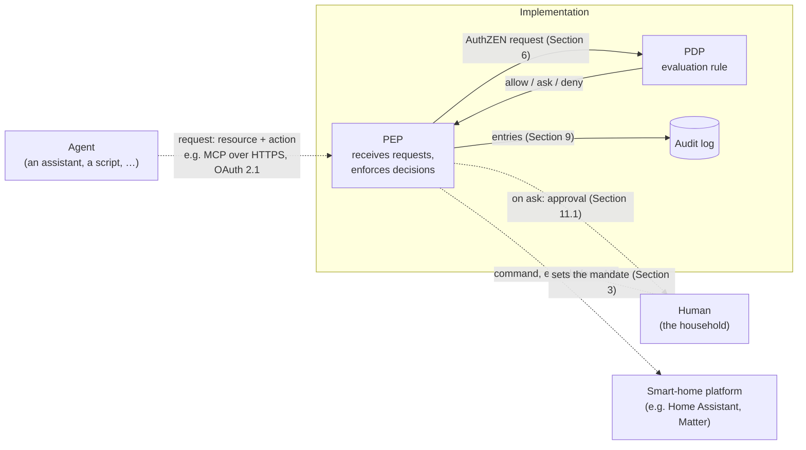

<!-- SPDX-License-Identifier: CC-BY-4.0 -->

# Home-Mandate Specification v0 (Draft)

Status: **Working draft**. From `v0.1.0` on, the v0 formats are frozen; incompatible changes
then require a new major version (Section 14).
License of this document: CC BY 4.0 (`LICENSE-docs`). Schema, examples, conformance cases and
code: Apache 2.0 (`LICENSE`).
Reference evaluator: the code in this repository. Changes are listed in the Changelog at the end.

The key words "MUST", "MUST NOT", "SHOULD", "SHOULD NOT" and "MAY" in this document are to be
interpreted as described in BCP 14 (RFC 2119, RFC 8174) when, and only when, they appear in
all capitals.

## 1. Goal

A vendor-neutral format that describes **what a software agent may do on behalf of a
household**, and an evaluation rule that yields the same result in every implementation. The
specification builds on existing standards and defines only what is missing:

| Purpose | Standard |
|---|---|
| Decision interface | OpenID AuthZEN Authorization API 1.0 |
| Transport of the mandate in the OAuth flow | Rich Authorization Requests (RFC 9396), `authorization_details` |
| Signatures | JSON Web Signature (RFC 7515) with EdDSA (RFC 8037) or ES256, keys as JWK (RFC 7517) |
| Agent identity | OAuth 2.1 client ID (for MCP: Client ID Metadata Document) |
| Device vocabulary | own categories (`vocabulary/v0.json`); informative mappings to platforms in `profiles/` |

Newly defined are: the mandate data model, the third decision `ask`, conditions,
protection classes and the evaluation rule.

### 1.1 Overview (informative)

An agent never talks to a device directly. It sends its request to the implementation,
which decides with the household's mandate and only then passes a command on to the
smart-home platform. A human sets the mandate and confirms what the mandate leaves to a
human.



Solid lines are interfaces this specification defines. Dashed lines are left to the
implementation: the specification states what must hold there, not how it is achieved
(Section 11).

- **Agent → PEP.** This specification does not prescribe the protocol in which an agent
  sends its requests. It fixes what the agent may contribute (only the resource and the
  action, Section 4) and how the agent is named (`agent.client_id`, Section 3.3). The
  reference implementation for Home Assistant offers the Model Context Protocol (MCP): the
  agent calls tools over HTTPS and signs in with OAuth 2.1; its OAuth client ID is the
  agent identifier. Other implementations may offer a different interface.
- **PEP → PDP.** The PEP asks the PDP for a decision in the form of AuthZEN (Section 6).
  Both can run in one process; an implementation of the class `pdp` (Section 8.1) offers
  the interface over HTTP.
- **PEP → platform.** The PEP talks to the platform through the platform's own API. It
  takes category, areas and critical marking from its own resource directory, never from
  the agent (Section 4). The profiles in `profiles/` relate platform devices to the
  vocabulary (informative).
- **Human.** The household chooses the mandate (Sections 3 and 3.5), confirms `ask`
  decisions (Section 11.1) and can revoke a mandate or stop all agents at once
  (Section 11.3). How a confirmation reaches a human (an app, a notification, a dashboard)
  is left open.
- **Audit log.** Every decision and every change to a mandate is recorded (Section 9).

A mandate that leaves the implementation, for example between an issuer and a separate
PDP, travels signed (Section 7).

## 2. Terminology

- **Principal:** the household or person on whose behalf the agent acts.
- **Agent:** software that requests actions, identified by its OAuth client ID.
- **Resource:** a single device or entity, named by an identifier from the resource
  directory of the implementation.
- **Resource directory:** what the implementation knows about the resources of the
  household: for each identifier its category and, optionally, its areas (Section 3.4).
- **Action:** what is to be done with the resource, taken from the vocabulary of its category.
- **Decision:** `allow` (execute immediately), `ask` (a human must confirm), `deny` (reject).
- **PDP (policy decision point):** the part of an implementation that evaluates a request
  against the mandates (Section 4) and returns the decision.
- **PEP (policy enforcement point):** the part of an implementation that receives the
  agent's requests, asks the PDP and enforces the decision: it passes allowed commands on
  to the platform, obtains approvals and keeps the audit log (Sections 9 and 11).
- **Audit mode:** a mandate with `enforce: false` is tried, not enforced: its rules are
  evaluated and recorded, but a denial by the rules of an action that is not critical does
  not stop the agent; where a rule asks for a confirmation, a human still confirms
  (Section 4.6).
- **Template:** a mandate draft that an implementation stores and from which it creates
  mandates. This version defines no format for templates; the audit log records changes to
  them (Section 9.2).

## 3. Data model

Machine-readable: `schema/mandate-v0.schema.json`. The schemas in `schema/` are normative;
this text and the schemas MUST agree, and any contradiction is an error in the
specification.

**Patterns.** A `pattern` in the schemas applies to the entire string: a string matches only
if the pattern matches from its first to its last character. In particular, a trailing line
feed is not ignored. Regular expression dialects differ (ECMA-262, RE2, PCRE and others), so
the schemas use only constructs that mean the same in all of them: literal ASCII characters,
explicit character classes and ranges, groups, alternation, quantifiers, and `^` and `$` as
the first and last character. They do not use `\s`, `\d`, `\w`, `\b`, a bare `.`, flags or
lookarounds. An implementation MAY use any regular expression engine or none, as long as it
accepts exactly the strings the patterns describe.

Summary:

```
Mandate
├── type          "https://home-mandate.org/mandate/v0"
├── id            unique ID
├── name?         displayed text for interfaces, see Section 3.1 item 8
├── principal     "household:<id>" or "person:<id>"
├── agent         { client_id, display_name }   client_id: see Section 3.3
├── enforce?      only false: audit mode (Section 4.6); absent: enforced
├── rules[]       rule
│   ├── id
│   ├── resource  selector: entity_id | category | area (at least one) or any: true alone
│   │             entity_id and area are opaque identifiers, see Section 3.4
│   ├── actions[] actions from the vocabulary or "*"
│   ├── decision  allow | ask | deny
│   ├── note?     displayed text for interfaces, see Section 3.1 item 8
│   ├── conditions? { time_window, weekdays }
│   ├── constraints? { <parameter>: { min, max } or { one_of } }   only with allow, see Section 4.5
│   ├── approval?   { timeout, approvers }   only with ask
│   └── allow_critical?  true, required for allow on critical actions; not together with "*"
├── default       always "deny" in v0
├── approval      default for ask: { timeout, approvers }
├── limits        { max_actions_per_hour }
├── valid_from, expires?
├── issuer?, version?   only together, see Section 3.5
├── audience?     the verifier the mandate is for; required in a signed mandate, see Section 3.5
└── created_by, created_at
```

### 3.1 Validity of a mandate

A mandate is valid if it conforms to the schema **and** additionally:

0. all fields with `format: date-time` are valid RFC 3339 timestamps with an offset
   (implementations MUST validate `format`, not merely treat it as an annotation), written
   with an upper-case `T` and either `Z` or a numeric offset. Not permitted are: leap seconds
   (`:60`), more than 9 fractional digits, the year `0000` and the offset `-00:00`.
   Timestamps are compared as points in time with nanosecond precision;
1. it is I-JSON as defined in RFC 7493: valid UTF-8, no lone surrogates (e.g. a
   standalone `\ud800`), no JSON object with a duplicate key, exactly one JSON value;
2. all rule `id`s within the mandate are distinct;
3. for every `time_window`, start and end are distinct;
4. every action of a rule is `"*"` or belongs to the vocabulary:
   - if the rule's `resource` names a category from Section 5, to that category's
     vocabulary (e.g. `unlock` with `category: light` is invalid);
   - if it names no category, to the vocabulary of at least one category from Section 5.
     A misspelled action (`unlokc`) therefore never yields a valid rule that silently
     matches nothing. Actions of an extension can only be used together with the
     extension category;
   - if it names an extension category, the actions are not checked: whether a mandate
     is valid MUST NOT depend on which extensions an implementation knows. Rules for an
     extension that the implementation does not know never match (Section 4);
5. it is at most 262 144 bytes (256 KiB) in size, counted in the UTF-8 encoding of the
   document as it is received or stored, before canonicalization. The same mandate can
   therefore be valid in its compact form and too large with added white space; a
   verifier of a signed mandate counts its canonical payload (Section 7.1). Lengths of
   strings in the schemas (`maxLength`, `minLength`) count Unicode code points, not bytes
   and not UTF-16 code units;
6. `expires`, if present, is later than `valid_from`;
7. every `approval.timeout` is between 10 seconds and 1 hour (both inclusive). A timeout
   has the form `PT[nH][nM][nS]` with at least one component, in this order, each `n` a
   decimal number of 1 to 5 digits (`PT2M`, `PT1M30S`, `PT1H`). Its value is the sum of the
   components. Different spellings of the same duration are different mandates with
   different digests;
8. `agent.display_name`, `created_by`, all `approvers`, `name` and every rule's `note` are
   **displayed text**: they are shown to humans, for example in an approval request, and
   MUST NOT be able to mislead them. `name` (1 to 64 code points) names the mandate and
   `note` (1 to 200) explains a rule, so that an interface or a confirmation can show
   something readable next to `id` and `rule_id`; neither is part of the evaluation. A
   displayed text
   - contains no code point listed under `forbidden` in
     `data/forbidden-codepoints-v0.json`. The list is normative and fixed; it was derived
     from Unicode 17.0.0 and contains the general categories Cc, Cf, Zl, Zp, Co and Cs
     (control and format characters, bidirectional controls, line and paragraph
     separators, private use, surrogates), the properties Default_Ignorable_Code_Point
     (invisible characters), White_Space except U+0020, and Noncharacter_Code_Point, and
     the blank characters U+2800 and U+FFFC; not on it are variation selectors and the
     two joiners;
   - does not begin or end with a space (U+0020), the only white space permitted;
   - does not begin with a code point listed under `not_first` (combining marks and
     variation selectors, which need a character before them);
   - contains the joiners U+200C (zero width non-joiner) and U+200D (zero width joiner)
     only between two other code points: not first, not last, and not directly after
     another joiner. Persian, Indic scripts and emoji sequences need them.

   Implementations MUST use the list, not the character tables of their runtime, so that
   validity does not change with a Unicode version. The rule cannot prevent look-alike
   letters from different scripts (homoglyphs); user interfaces SHOULD therefore show the
   `client_id` together with the `display_name`.

9. a rule with `allow_critical` lists its actions; it does not contain `"*"`. Whoever
   permits critical actions without an approval request names them, so that a later
   vocabulary cannot add to them silently.

10. `constraints` appear only in rules with `decision: allow` that list their actions
    (no `"*"`). For every constraint, `min` is not greater than `max`, and for **every**
    action of the rule, the named parameter is a parameter of the action that the
    constraint fits: in the vocabulary of the rule's category or, if the rule names no
    category, in at least one category from Section 5. A constraint fits a parameter if
    it gives `min` or `max` only for an integer parameter, and if every value of its
    `one_of` has the type of the parameter and, for a string parameter with permitted
    values, is one of them, compared exactly and case-sensitive (Section 4.5). Rules for
    an extension category are not checked. A constraint on a `deny` or `ask` rule would
    fail open, because a request without the parameter would not match the rule;
    therefore it is invalid.

11. `enforce`, if present, is `false` (audit mode, Section 4.6). A mandate that enforces
    has no `enforce` member: `true` would be a second form of the same mandate with a
    different digest, and is invalid. `enforce` is a member of the mandate, not of a rule.

All numbers in a mandate are integers whose magnitude is at most 2^53 − 1; the schema
permits nothing else.

Implementations MAY reject JSON input with a nesting depth greater than 32 before
validating it against the schema; valid mandates never reach this depth.

Implementations MUST reject invalid mandates when they are stored. If an invalid mandate is
nevertheless evaluated, the result MUST be `deny`.

Revocation of a mandate is not a field of the mandate but a state that the
implementation maintains and passes to the evaluation (Section 11.3).

Requirements in this document are written with the key words of BCP 14. Where a rule of
the data model, the evaluation or the audit log is stated as a fact ("the result is
`deny`", "seconds are truncated"), it is part of the definition and every conforming
implementation behaves that way.

### 3.2 Digest of a mandate

Each version of a mandate is uniquely identified by its digest:

```
digest = "sha256:" + hex(SHA-256(JCS(mandate)))
```

- `JCS` is the canonical JSON form defined in RFC 8785: sorted keys, no whitespace,
  a fixed representation of strings and numbers.
- The digest is computed over the valid mandate (Section 3.1), not over the stored
  bytes. Key order and whitespace therefore do not change the digest; any change in
  content does.
- `hex` produces lowercase letters, 64 characters.

In the audit log (Section 9), the digest refers to the version on which the decision was
based, without writing the content of the mandate to the audit log.

`enforce` is part of the content: a mandate in audit mode and the same mandate without
`enforce` have different digests, so that switching audit mode on or off is a new version
(Section 4.6) and every audit entry names the version it was decided under.

Numbers are canonicalized by their value: `10`, `10.0` and `1e1` are the same number and
yield the same digest. Because the only numbers in mandates and audit log entries are
integers, an implementation needs no floating-point serialization for the canonical form:
an integer is written in decimal notation without fraction and exponent.

### 3.3 Agent identifier

`agent.client_id` identifies the agent. It is printable ASCII, at most 512 characters, and
has one of two forms:

- an **https URL** with a lower-case host, optionally a port, a path and optionally a
  query; without userinfo (`user@`) and without a fragment (`#…`). This is the form of an
  OAuth Client ID Metadata Document URL;
- any **other URI**: a scheme of 1 to 32 characters from `a–z 0–9 + . -` that begins with
  a letter, `:`, and 1 to 256 characters from
  `A–Z a–z 0–9 . _ ~ : / -`, for example an identifier assigned by the implementation
  (`<namespace>:<id>`), a DID (`did:web:agent.example`), a SPIFFE ID
  (`spiffe://example.org/agents/voice`) or a URN. The scheme `http` is not permitted.

Neither form contains a dot segment (`/./` or `/../`). Percent-encoding is not decoded:
`%2E%2E` is three characters like any others, not a dot segment. Identifiers are compared
exactly per character, without normalization: two identifiers that differ in any character
identify different agents. How an implementation authenticates the agent behind an
identifier is outside this specification.

### 3.4 Resource and area identifiers

`entity_id` and `area` are **opaque identifiers**: 1 to 255 (`entity_id`) or 1 to 64 (`area`)
printable ASCII characters without space (U+0021 to U+007E). The specification gives them no
structure. Whatever names a platform uses can be used directly, for example
`light.living_room`, `Kitchen_Light`, `1/2/3`, `0x00000000000004D2/1`, a UUID or a URN; a
platform whose names contain other characters maps them, for example by percent-encoding.

Identifiers are compared exactly per character, without normalization and case-sensitive:
`Kitchen_Light` and `kitchen_light` are different resources.

Implementations SHOULD use identifiers that do not change when a human renames a device.
If the identifier of a resource changes, rules that name the old identifier no longer
match: an `allow` rule stops allowing, but a `deny` or `ask` rule stops restricting, and a
broader `allow` rule may then apply. The same holds when an area of a resource changes
or is removed, or when a resource moves to another area. Implementations MUST therefore
tell the household which mandates are affected when an identifier or an area that a rule
names changes or disappears, or when a resource leaves or enters such an area; this
covers every area in the resource's set of areas. They SHOULD express restrictions by
category or by identifier, not by area alone.

**Areas** are the grouping this version knows. The resource directory gives each resource
a **set of areas**: 0 to 16 area identifiers, each following the rules for `area` above,
without duplicates and without order. The set holds the room of the resource and every
location above it (for example `garage`, `ground_floor`, `home`), or several rooms side
by side where the platform places a resource in more than one. What a platform calls
room, zone, floor or group can be mapped to areas. A resource without an area has an
empty set. A rule still names exactly one `area`; it matches if that area is in the
resource's set (Section 4, step 2). `approvers` and `created_by` are identifiers from
the user management of the implementation, 1 to 128 characters each, and have no meaning
outside it; a mandate
that moves to another implementation needs them replaced, or, in a signed mandate, whose
payload cannot be changed, confirmed by a human of the household (Section 3.5).

### 3.5 Issuer and version

A mandate MAY name who issued it and which version it is:

- `issuer`: a URI with the same form as `agent.client_id` (Section 3.3), compared exactly.
- `version`: an integer of at least 1. Among the mandates with the same `id` from the same
  issuer, every change gets a higher version than every earlier one.

Both appear together or not at all. The digest (Section 3.2) says *which* version a
document is; it does not say which of two documents is newer. Without a version, an older
and more generous mandate with a valid digest cannot be told from the current one.

A mandate MAY also name the verifier it is for: `audience`, a URI with the same form as
`agent.client_id`, the identifier under which the issuer knows the implementation that is
to accept the mandate. A signed mandate MUST carry it, and a verifier accepts a signed
mandate only for its own `audience` (Section 7.1): an issuer that signs for many
households with one key could otherwise have a mandate for one of them accepted by
another whose principal and agent happen to carry the same names.

An implementation that holds a mandate under an `id` and is offered a replacement with
that `id` accepts it only if (**succession**) the offered mandate names the same agent
(`agent.client_id`) and the same `principal`, and

1. the stored mandate has no `version`, or
2. the offered mandate has the same `issuer` and a `version` greater than the stored one.

For this rule, an implementation *holds* a mandate as long as it remembers one that took
effect under the `id`, also after that mandate was revoked, removed (Section 11.3), expired
or deleted; item 1 applies only if no mandate with a `version` ever took effect under the
`id`. A mandate under an `id` the implementation does not hold is not a successor; it takes
effect at once unless it switches audit mode on or names unknown `approvers` (below). A
mandate without `version` never replaces one that has a version, and an older version is
not accepted while the newer one is known (rollback). This protection is local state: an
implementation MUST keep the highest `version` that took effect for an `issuer` and `id`
for as long as an older version could still be valid, and it MUST treat a restore from a
backup like the arrival of mandates from outside. A
revocation is local as well: a signed mandate stays verifiable until it expires, so a
revoked mandate MUST NOT be accepted again by way of its signature. A mandate from outside
that is not accepted, for succession or for any other reason, is recorded with
`mandate.rejected` (Section 9.2).

**Accepted is not in effect.** An accepted successor takes effect at once only if it
*narrows* the stored mandate or leaves it as it is. It narrows if it differs from the
stored version only in some of these ways: an `allow` rule is removed; a `deny` rule is
added; an `ask` rule without its own `approval` is added; `expires` is added or moved
earlier; `valid_from` is moved later; `limits.max_actions_per_hour` is lowered; audit mode
is switched off; `issuer`, `version`, `created_by` and `created_at` differ. Every other
difference is a **weakening**: a changed or added `allow` rule; a changed or removed `deny`
or `ask` rule; an added `ask` rule with its own `approval`; a changed `approval`, `name` or
`agent.display_name`; an `audience` added or changed; `expires` removed or moved later;
`valid_from` moved earlier; a higher rate limit; or audit mode switched on (below). Rules
are compared as wholes: a rule counts as changed when any of its members differs, `note`
included, so a rule tightened in place (a constraint added, `allow_critical` removed) needs
a confirmation too; an issuer narrows without one by removing the rule or adding a `deny`.
An added `ask` rule without its own `approval` narrows because it lets the agent ask for
more, never do more, and the approvers stay those of the mandate. A weakening successor,
and every successor of a mandate that the household revoked, MUST NOT take effect before a
human of the household has confirmed exactly this version (Section 11.6 item 4):
succession and the signature make it acceptable, not adopted, and until the confirmation
the stored mandate stays as it is, revoked if it was revoked. The issuer thus cannot expand
what an agent may do, change what a human reads, or undo a revocation, without a human.
The version the succession rule compares against is that of the mandate that took effect
or is remembered, never that of a waiting proposal; a successor that arrives while one
waits and is accepted (any version above the stored one) replaces the waiting proposal,
which is discarded (`mandate.discarded`, `cause: superseded`, Section 9.2).

The `approvers` of a mandate from outside are identifiers the issuer chose (Section 3.4).
A signed mandate whose `approvers` are not all approvers the implementation knows
(Section 11.1) takes effect only after a human of the household confirmed it as well, so
that whoever signs a mandate does not decide who confirms the agent's requests.

**Audit mode.** A mandate that switches audit mode on MUST NOT take effect until a human
of the household has confirmed it explicitly (Section 11.6 item 4), like a weakening. It
switches audit mode on if it has `enforce: false` (Section 4.6) and no mandate with the
same `id` in audit mode is in force: the stored mandate enforces, or it is not in force
because it is revoked, expired, not yet valid or invalid, or there is none. A mandate that
arrives without a predecessor in force, a restore from a backup included, therefore counts
as arriving from outside. The confirmation is bound to the digest (Section 3.2) of exactly
the version that is adopted; any other version needs its own. Every approver of the
mandate MUST be notified when such a mandate is proposed and when it takes effect; the
proposal is recorded with `mandate.proposed`, and a proposal that does not take effect
with `mandate.discarded` (Section 9.2). A replacement that switches audit mode off needs no
confirmation.

An issuer can end the sequence of an `id` by issuing the highest possible version; the
mandate then needs a new `id`. A mandate that leaves the implementation that
created it, signed per Section 7, MUST carry `issuer` and `version`.

## 4. Evaluation rule

Input: mandate, resource (entity ID, category, set of areas, and whether the directory marks it as
critical), action, optionally parameters of the action (Section 4.5), point in time,
household time zone, status of the mandate (`active` or `revoked`). Which mandate is evaluated is determined by Section 4.3.

**Origin of inputs:** The PEP MUST determine the category, the areas and the critical marking from its own resource
directory, the point in time from its own clock, the time zone from the household
configuration and the status from its own mandate management. It MUST NOT take any of these
from the agent; only the requested resource and action originate from the agent.

The PEP MUST resolve the resource the agent names to the identifier under which its
directory knows it, and pass that identifier to the evaluation. Because identifiers are
compared exactly (Section 3.4), passing the agent's spelling unchanged would let a
different spelling of the same device slip past a rule. A resource the directory does not
contain has no category; the result is `deny` with `unknown_resource`.

0. Pre-check, each case → `deny`:
   - the mandate is invalid (Section 3.1);
   - the request is invalid: the entity ID is missing or does not match the pattern of
     `entity_id` in the schema, an area of the resource does not match the pattern of
     `area`, the resource has more than 16 areas or the same area twice,
     a parameter is neither an integer of magnitude at most 2^53 − 1 nor a string of 1 to
     64 printable ASCII characters without space, a parameter that the action declares in
     the vocabulary of the resource's category has another type, lies outside the range
     of an integer parameter or, for a string with permitted values, is another value
     (Section 4.5), the point in time or the time zone is
     invalid or unknown, or the status is neither `active` nor `revoked`;
   - the category is missing: the resource is not in the directory of the PEP;
   - the category is neither listed in Section 5 nor an extension whose vocabulary
     the implementation knows;
   - the action does not belong to the vocabulary of the resource's category.
1. If the mandate is revoked, not yet valid or expired → `deny`.
   It is valid for points in time `t` with `valid_from ≤ t < expires` (without `expires`:
   `valid_from ≤ t`). Points in time are compared, not clock times.
2. Collect all rules whose `resource` matches the resource **and** whose `actions` contain the
   action **and** whose `conditions` are satisfied at the point in time **and** whose
   `constraints` are satisfied by the parameters (Section 4.5).
   - `resource` matches if **all** specified fields match
     (e.g. `category: light` and `area: living_room` = lights in the living room).
     `area` matches if it is in the resource's set of areas; a resource without areas
     matches no rule that names an `area`.
     `any: true` matches every resource. Comparison is exact per character, case-sensitive
     and without normalization.
   - `"*"` in `actions` contains every action, including critical ones.
   - `read` is an action in its own right. Write permissions do not include read permissions.
3. No rule found → `default` (`deny`).
4. Otherwise the **most restrictive** decision wins: `deny` over `ask` over `allow`.
5. Protection class: If the action is **critical** and the result is `allow`, but
   not **every** one of the matching `allow` rules carries `allow_critical: true` → the result becomes `ask`.
   For non-critical actions, `allow_critical` has no effect. An action is critical if
   - the vocabulary marks it as critical (Section 5), or
   - the resource directory marks the **resource** as critical and the action is not `read`.

   The marking of a resource lets a household protect what the vocabulary cannot know: a
   switch that drives a door opener, a ground-floor window, a heater. It can only add
   protection. An implementation SHOULD let the household mark resources as critical.
6. Audit mode: if the mandate carries `enforce: false`, the result of step 3 or 4 is
   `deny` and the action is not critical (step 5), the result is **not enforced**
   (Section 4.6). It stays `deny`. If one of the matching rules of step 2 decides `ask`,
   the request still needs a confirmation before it is executed: the result **requires a
   confirmation** and carries the approval settings per Section 4.1.

The rule is deliberately simple: whoever allows something broadly and denies individual items
gets the denial. Whoever sets something broadly to `ask` and allows individual items gets `ask`.
When in doubt, the safer side always wins, in audit mode as well: a `deny` that is not
enforced never takes away a confirmation that a matching `ask` rule asks for.

`limits` are not part of the evaluation. The PEP enforces the rate limit (Section 11.2).

### 4.1 Result

In addition to the decision, the evaluation returns:

- **`reason`:** exactly one reason code. If several reasons apply, the first one in
  the following order applies:

  | Code | Decision | Meaning |
  |---|---|---|
  | `no_mandate` | deny | no mandate selected for the agent and the principal (Section 4.3); not for a subject no mandate could name, which is `invalid_request` |
  | `ambiguous_mandate` | deny | several mandates for the agent and the principal (Section 4.3) |
  | `invalid_mandate` | deny | mandate invalid (Section 3.1) |
  | `invalid_request` | deny | request invalid (step 0, second item), or the subject of the request names no agent or no valid principal (Sections 4.3, 6) |
  | `unknown_resource` | deny | resource not in the directory of the PEP (no category) |
  | `unknown_category` | deny | category neither in Section 5 nor a known extension |
  | `unknown_action` | deny | action not in the category's vocabulary |
  | `revoked` | deny | mandate revoked (step 1); or, from the selection and before any evaluation, in the place of `no_mandate`: the agent and principal have only revoked mandates (Section 4.3) |
  | `not_yet_valid` | deny | point in time before `valid_from` |
  | `expired` | deny | point in time at or after `expires` |
  | `no_match` | deny | no rule matches, `default` |
  | `critical_demotion` | ask | `allow` became `ask` per step 5 |
  | `rule` | allow, ask, deny | decision of a rule per step 4 |

- **`mandate_digest`:** digest of the evaluated mandate (Section 3.2); absent for
  `no_mandate`, `ambiguous_mandate` and `invalid_mandate`, and for a `revoked` that the
  selection returns unless it names exactly one mandate (Section 4.3).
- **`rule_id`:** the first rule in document order that carries the final decision.
  For step 5, this is the first matching `allow` rule without `allow_critical`.
  For the pre-check, step 1 and step 3, there is no `rule_id`.
- **Approval settings** (only for `ask` and for a result that requires a confirmation): the
  `approval` of the first matching `ask` rule in document order that has its own
  `approval`, otherwise the `approval` of the mandate.
- **`enforced`:** `false` if the result is a `deny` that is not enforced (step 6,
  Section 4.6); then `reason` is `no_match` or `rule`. Every other result is enforced and
  has no `enforced`.
- **`confirm`:** `true` if the result is a `deny` that is not enforced and requires a
  confirmation (step 6, Section 4.6); then `enforced` is `false` and `reason` is `rule`.
  Every other result has no `confirm`; for an `ask` the confirmation follows from the
  decision.

### 4.2 Conditions

All conditions of a rule MUST be satisfied. They are checked in **household local
time**: the point in time is converted to the household's time zone.

- The time zone is an identifier from the IANA time zone database, exact per character and
  case-sensitive: `UTC` or the form `Area/Location` (e.g. `Europe/Berlin`,
  `America/Argentina/Buenos_Aires`, `Etc/GMT+9`), where each part begins with an uppercase letter
  and contains only `A–Z`, `a–z`, `0–9`, `_`, `-`, `+`; at most 64 characters.
  Other names (including `Local`, `localtime`, `GMT` or abbreviations such as `CET`) and names that the
  implementation does not know result in `invalid_request`. Some time zone libraries match
  names without regard to case; an implementation that uses one MUST compare the spelling
  itself (`Europe/BERLIN` is not a name of the database). Names of this form that the
  database defines as links to another zone (such as `US/Eastern`) are permitted.
  The rules of a zone change with the release of the database; implementations SHOULD keep
  it current, and two implementations can differ for points in time that a newer release
  treats differently.
- If no time zone is given, the offset with which the point in time is expressed applies.
  A PEP SHOULD always pass the household time zone; without it, whoever chooses the offset
  of the point in time chooses the local time.
- For the comparison, the hour and minute of local time are used; seconds and fractions are
  truncated (23:58:59 is 23:58).

- `time_window`: `"HH:MM-HH:MM"`, minute precision, start inclusive, end exclusive.
  `"06:00-22:00"` matches 06:00 through 21:59. If the start is greater than the end, the
  window spans midnight: `"22:00-06:00"` matches from 22:00 and before 06:00.
  During daylight saving time transitions, the clock time displayed in the household counts;
  an hour that occurs twice matches both times.
- `weekdays`: list of `mon` … `sun`. The weekday of the point in time in local time is
  decisive, including for windows spanning midnight (Friday 22:00 to Saturday 02:00 with
  `weekdays: ["fri"]` matches only until midnight).

### 4.3 Selection of the mandate

An implementation can store several mandates. Which one is evaluated for a request is
determined by the agent (`agent.client_id`) and the principal of the request, both compared
exactly. `household:x` and `person:x` are different principals; nothing is inherited from
one to the other. The PEP determines the principal; it does not take it from the agent. A
request that names no agent, or whose principal does not match the pattern of `principal`
in the schema, is `deny` with `invalid_request` before any mandate is selected, so that
`no_mandate` and `ambiguous_mandate` do not arise for a subject no mandate could name
(Section 6).

1. Candidates are the stored mandates of the agent and the principal that are not revoked.
   A stored document that is not a valid mandate (Section 3.1) is a candidate as well: for
   the agent and principal it names in `agent.client_id` and `principal`, read without
   further validation, or, if these cannot be read (the document is not I-JSON or lacks
   them), for every agent and principal, so that it is never ignored silently.
2. No candidate → `deny` with `no_mandate`; but if revoked documents are stored for the
   agent and principal (attributed as in step 1), `deny` with `revoked`. A revoked mandate
   is never evaluated; the result names it (`mandate_digest`, and `selected` in the test
   interface) if exactly one revoked document is stored for them and it is a valid mandate,
   and names none otherwise. The log then shows that the agent's mandate was revoked, not
   that it never had one (Section 11.3).
3. Of the candidates, those are *current* that are valid at the point in time
   (`valid_from ≤ t < expires`); an invalid document always counts as current.
   - exactly one current candidate → it is evaluated (Section 4);
   - several current candidates → `deny` with `ambiguous_mandate`. No mandate wins, and
     mandates are never combined;
   - no current candidate: if there is exactly one candidate, it is evaluated and yields
     `not_yet_valid` or `expired`; otherwise `deny` with `no_mandate`.

An agent can therefore have mandates that follow one another in time, but never two at
the same time. Implementations SHOULD refuse to store a mandate whose validity period
overlaps with another mandate of the same agent and principal that is not revoked.

A stored document becomes invalid without anyone storing an invalid mandate: the
specification became stricter between versions, an extension vocabulary the mandate relies
on changed, or the storage was damaged. Implementations MUST reject invalid mandates when
they are stored (Section 3.1) and SHOULD show the household every stored document that is
no longer a valid mandate, because it denies every request of its agent.

### 4.4 Requests for several resources

The evaluation always concerns exactly one resource and one action. If an agent addresses
several resources at once (an area, a group, a list), the PEP resolves them with its
directory and evaluates each resource separately. Unless the PEP documents otherwise, the
request is executed only if every single evaluation permits it: one `deny` denies the
whole request, and one `ask` requires a confirmation that names all resources concerned. A
`deny` that is not enforced (Section 4.6) counts as permitting here, and as an `ask` if it
requires a confirmation; it is recorded as such, every resource as its own `decision`
entry, and the entries of one request SHOULD carry the same `request.group` (Section 9.1).
The agent is never told which of the resources were not enforced (Section 11.6).
The PEP MUST execute such a request on exactly the resources it evaluated, naming each of
them to the platform (for example as a list of identifiers), never the area, group or list
it resolved them from: the platform would resolve that again on its own, and a resource
added in the meantime would be acted on without an evaluation. This is the same as for
parameters, whose evaluated values are the ones executed (Section 4.5).

A confirmation for such a request covers exactly the set of resources the PEP resolved
and showed (Section 11.1 item 2). Before the execution the PEP resolves the request again;
if the set differs in any way (a resource added, removed or replaced), nothing is
executed, not even for the resources that were confirmed, and executing the new set needs
a new request and a new confirmation (Section 11.1 item 6).

A resource whose activation acts on other resources (a scene, a script, a group that the
platform executes itself) is evaluated as the resource it is; this is why `scene.activate`
and `script.run` are critical.

### 4.5 Parameters and constraints

Some actions carry a value: a temperature, a position, a volume, a mode. The vocabulary
names these **parameters** per action, each with its type (Section 5). A parameter is

- an **integer** in the unit the vocabulary gives it. The units are chosen fine enough
  that no fraction is needed (`temperature` is in hundredths of a degree Celsius, 21.5 °C
  is `2150`); there are no fractions anywhere, and the magnitude is at most 2^53 − 1. The
  vocabulary can give an integer parameter a **range** (`brightness` 0 to 100, both
  inclusive); no value outside it is valid then. `temperature` has no range;
- or a **string** of 1 to 64 printable ASCII characters without space (U+0021 to U+007E),
  the rules of an area (Section 3.4). Strings are compared exactly per character,
  case-sensitive and without normalization: `heat` and `Heat` are different values. The
  vocabulary can list the **permitted values** of a string parameter, as it does for
  `mode`; no other value is valid then.

The PEP derives the parameters from the request of the agent and expresses each in the
type and unit of its parameter in the vocabulary. It MUST execute exactly the values that were evaluated: whatever
it sends to the platform MUST NOT set a constrained quantity to another value, by rounding
or through a second, platform-specific parameter for the same quantity. A value that
cannot be expressed as an integer in the unit, or as one of the permitted values of a
string parameter, or that lies outside the range of an integer parameter, makes the
request invalid: the PEP refuses the request, and never leaves the parameter out or
evaluates without it. The type is part of the value: a
request whose parameter has another type than the vocabulary declares for the action
(the integer `4` for `mode`, the string `"50"` for `brightness`) is invalid as well
(Section 4, step 0). A parameter that the action does not declare is checked only for
being an integer or a string.

A quantity can have a parameter per unit: a temperature is `temperature` in hundredths of
a degree Celsius or `temperature_f` in hundredths of a degree Fahrenheit (70 °F is `7000`;
it is no integer in `temperature`, 21.111… °C). The PEP derives exactly one of them for a
request, the one in the unit in which the platform expresses the value; it never converts
into the other unit. A rule that constrains the other parameter does not match the
request, and a rule that constrains both matches no request a PEP derives this way.

A constraint has one of two forms:

- a **range** for an integer parameter: `min`, `max` or both. A limit that is not given
  does not restrict;
- a **list** of permitted values for an integer or a string parameter: `one_of` with 1 to
  32 distinct values of the parameter's type. It does not appear together with `min` or
  `max`.

A rule with `constraints` matches only if the request carries **every** named parameter
and each value `v` satisfies its constraint: `min ≤ v ≤ max` for a range; for a list, `v`
equals one of the values exactly (an integer never equals a string). A request without
the parameter does not match the rule. Parameters that no constraint names do not
influence the evaluation.

```json
{ "id": "r-heating", "resource": { "category": "climate" }, "actions": ["set_temperature"],
  "decision": "allow", "constraints": { "temperature": { "min": 1600, "max": 2300 } } }
{ "id": "r-heating-modes", "resource": { "category": "climate" }, "actions": ["set_mode"],
  "decision": "allow", "constraints": { "mode": { "one_of": ["heat", "auto"] } } }
```

The second rule lets the agent switch the heating to `heat` or `auto`, but never `off`.

A constraint may name values outside the range that the vocabulary gives an integer
parameter: a `one_of` value, a `min` or a `max` beyond it is valid in a mandate. Such a
value never matches, because a request with it is invalid; `{"min": 0, "max": 500}` on
`brightness` permits the same requests as no limits at all.

Constraints narrow an `allow`. Whoever wants a confirmation for values outside the limits
adds an `ask` rule for the same action without constraints; `ask` then wins inside the
limits as well, so the usual form is: `allow` with constraints, and nothing else, which
denies everything outside.

### 4.6 Audit mode

A household that tries a new mandate can first let it run in **audit mode**: the rules are
evaluated and every decision is recorded, but a denial by the rules does not stop the
agent. The audit log then shows what the mandate would deny before it does. A mandate is
in audit mode if it carries `"enforce": false`; without the member, it enforces. `enforce`
has no other value (Section 3.1 item 11).

In audit mode exactly one kind of result is not enforced: a `deny` that results from the
rules of the mandate, that is `no_match` (step 3) or a matching `deny` rule
(`reason: rule`, step 4), for an action that is **not critical** (step 5). The evaluation
returns it as `deny` with `enforced: false` (Section 4.1). The decision stays `deny`, so
that the audit log records truthfully what the mandate says. Everything else is enforced
as in a mandate without `enforce`:

- a `deny` of a critical action, whether no rule matches or a `deny` rule does: audit mode
  never unlocks a door, opens a gate or takes a snapshot that the mandate does not permit,
  and a resource the directory marks as critical stays protected in every action except
  `read`;
- `ask`, including `critical_demotion`: a human still confirms (Section 11.1), also when a
  `deny` rule matches the same request. The `deny` wins and is not enforced, but the
  result **requires a confirmation** (`confirm: true`, step 6): without the `deny` rules
  the request would be an `ask`, and a stricter rule must not leave it with less
  protection. The confirmation also shows whether the household wants the `deny`;
- `allow`: unchanged;
- every `deny` before the rules: an invalid mandate, an invalid request, an unknown
  resource, category or action, a revoked mandate and one that is not yet valid or has
  expired (steps 0 and 1), as well as `no_mandate` and `ambiguous_mandate` (Section 4.3);
- every denial outside the evaluation: the rate limit, the emergency stop, the
  authentication of the agent, and an approval that was not given (Section 11).

The PEP executes a request whose result is not enforced as it executes an `allow`, and
one that requires a confirmation only after a confirmation, as it executes an `ask`
(Section 11.6). What the evaluation does not decide stays as it is: the PEP executes
exactly the parameters that were evaluated (Section 4.5), the request counts towards the
rate limit (Section 11.2), and a confirmed request is evaluated again before it is
executed: a `deny` prevents the execution of a confirmed `ask` in audit mode as well, and
of a confirmed `deny` with `confirm: true` every result except `allow`, `ask` and another
`deny` with `confirm: true` (Section 11.1 item 6).

Audit mode belongs to the mandate, not to the implementation: one mandate can be tried
while the others enforce. Switching it on or off is a change to the mandate with a new
digest (Section 3.2), recorded with `mandate.updated` (Section 9.2). Switching it on
weakens the mandate: it takes effect only after a human of the household has confirmed it
explicitly, and every approver is notified (Sections 3.5 and 11.6). Switching it off
strengthens the mandate and needs no confirmation.

## 5. Vocabulary v0

Machine-readable and normative: `vocabulary/v0.json` (format:
`schema/vocabulary-v0.schema.json`). The table shows its content.

| Category | Actions | Critical |
|---|---|---|
| `light` | read, turn_on, turn_off, set | – |
| `switch` | read, turn_on, turn_off | – |
| `climate` | read, set_temperature, set_mode | – |
| `cover` | read, open, close, stop, set_position | – |
| `gate` | read, open, close | open |
| `lock` | read, lock, unlock, open | unlock, open |
| `alarm` | read, arm, disarm | disarm |
| `camera` | read, snapshot | snapshot |
| `media` | read, turn_on, turn_off, play, pause, set_volume | – |
| `sensor` | read | – |
| `scene` | read, activate | activate |
| `script` | read, run | run |
| `other` | read, set | set |

Parameters (Section 4.5):

| Action | Parameter | Type | Unit | Range or permitted values |
|---|---|---|---|---|
| `light.set` | `brightness` | integer | percent | 0 to 100 |
| `climate.set_temperature` | `temperature` | integer | 0.01 degree Celsius | – |
| `climate.set_temperature` | `temperature_f` | integer | 0.01 degree Fahrenheit | – |
| `climate.set_mode` | `mode` | string | – | `off`, `auto`, `cool`, `heat`, `emergency_heat`, `precooling`, `fan_only`, `dry`, `sleep` |
| `cover.set_position` | `position` | integer | percent open | 0 to 100 |
| `media.set_volume` | `volume` | integer | percent | 0 to 100 |

The permitted values of `mode` are the values of the attribute SystemMode of the Matter
Thermostat cluster, in lower case with underscores: what the system as a whole does, not
a preset such as `eco` or `away`. How the modes of a platform map to them is described in
the profiles (informative). A value outside the list makes the request invalid
(Section 4.5).

`scene.activate`, `script.run` and `other.set` are critical because scenes, scripts and
unknown entities can have arbitrary consequences, including opening doors. What else is
critical in a particular household (a switch on a door opener, a ground-floor window) the
household marks in the resource directory (Section 4, step 5).

How an implementation assigns its resources to categories is its own matter and part of
its resource directory. A resource that fits no other category belongs to `other`.
`profiles/` contains informative mappings for individual platforms; they are not part of
the specification, and a platform without a profile is not at a disadvantage.

The `id` of this vocabulary, `https://home-mandate.org/vocabulary/v0`, belongs to the v0
formats (Section 14): a mandate of `https://home-mandate.org/mandate/v0` is validated
against it (Section 3.1 item 4), and a request is evaluated against it (Section 4). Its
`version` names the state of the file and changes with every change to it; the Changelog
lists the changes. A new version under this `id` only adds (Section 14): a mandate that was
valid stays valid, a rule that lists its actions means the same actions, and a request
keeps its result unless that result was a `deny` of step 0 for an unknown category or
action or for an invalid parameter value. An implementation uses the newest version it
knows, for the evaluation as for the verification of an audit log (Section 9.1), and
SHOULD record it in every `decision` entry whose evaluation used a vocabulary
(`vocabulary`, Section 9.1), so that a decision stays reproducible after an update
(Section 9.2).

### 5.1 Extensions

Extensions for other kinds of resources receive their own namespaces, e.g.
`paperless:document` with `read`, `tag`, `delete`. The namespace and the name after the
colon have at most 32 characters each, in a mandate as in a vocabulary file. An extension
defines its vocabulary and its critical actions in a file of the same format as
`vocabulary/v0.json`, with its own `id` and `version`. It declares the `type` of every
parameter: `integer` with a `unit`, or `string`, optionally with 1 to 32 permitted
`values`, as many as a `one_of` can list. A vocabulary never changes under the same `id`
and `version`, and a new version under the same `id` SHOULD only add, as Section 14
requires of `vocabulary/v0.json`: an extension that removes or renames an action, changes
a critical marking or narrows a parameter publishes the result under a new `id`. Otherwise
requests that were allowed are denied, or an action runs without the confirmation it had.
If an implementation does not know the vocabulary of an extension, every request for a
resource of that category is `deny`. A registry of extensions does not exist yet.

## 6. AuthZEN mapping

The PEP queries the PDP in accordance with AuthZEN Authorization API 1.0:

```json
POST /access/v1/evaluation
{
  "subject":  { "type": "agent", "id": "https://example-agent.local/client.json",
                "properties": { "principal": "household:hm-7f3a" } },
  "action":   { "name": "unlock" },
  "resource": { "type": "lock", "id": "lock.front_door",
                "properties": { "areas": ["hallway", "ground_floor"], "critical": false } },
  "context":  { "time": "2026-10-12T21:14:03+02:00", "timezone": "Europe/Berlin" }
}
```

AuthZEN only knows `true` or `false`. The third decision is conveyed in the response
context:

```json
{ "decision": false,
  "context": { "outcome": "ask", "reason": "rule", "rule_id": "r-locks",
               "approval_timeout": "PT2M", "approvers": ["user-1"],
               "mandate_id": "m-voice-assistant", "mandate_digest": "sha256:9f2c…" } }
```

`reason` is REQUIRED, as are `mandate_id` (the `id` of the evaluated mandate, or of the
revoked mandate the result names, Section 4.3) and
`mandate_digest` unless Section 4.1 says the digest is absent: a PEP with a separate PDP
records both in the audit entry (Section 9.1) and need not resolve the `id` from the
digest. `rule_id` is included when Section 4.1 provides for it. For `outcome: ask`, `approval_timeout` and
`approvers` (the approval settings per Section 4.1) are REQUIRED, so that a PEP can obtain
the confirmation without knowing the mandate. `enforced: false` is REQUIRED for a `deny`
that is not enforced (audit mode, Section 4.6) and absent otherwise:

```json
{ "decision": false,
  "context": { "outcome": "deny", "reason": "no_match", "enforced": false,
               "mandate_id": "m-trial", "mandate_digest": "sha256:83d0…" } }
```

`confirm: true` is REQUIRED for a `deny` that is not enforced and requires a confirmation
(Section 4.1), together with `approval_timeout` and `approvers`, and absent otherwise:

```json
{ "decision": false,
  "context": { "outcome": "deny", "reason": "rule", "rule_id": "r-no-kids-room",
               "enforced": false, "confirm": true,
               "approval_timeout": "PT1M", "approvers": ["parent-1"],
               "mandate_id": "m-trial", "mandate_digest": "sha256:5b1e…" } }
```

Field mapping:

| AuthZEN | Input per Section 4 |
|---|---|
| `subject.id` | `agent.client_id`; together with `subject.properties.principal`, selects the mandate |
| `resource.id` | entity ID |
| `resource.type` | category |
| `resource.properties.areas` | set of areas, as an array (Section 3.4) |
| `resource.properties.critical` | whether the directory marks the resource as critical (Section 4 step 5): a boolean; absent is `false` |
| `action.name` | action |
| `action.properties` | parameters (Section 4.5): an object of parameter names and values, each a JSON integer or string |
| `context.time` | point in time |
| `context.timezone` | household time zone, an IANA name (Section 4.2); absent: the offset of `context.time` applies |

The PDP does not use `resource.type`, `resource.properties` and `context` without
verification, but in accordance with Section 4 "Origin of inputs": they come from the
directory, the clock and the household configuration, never from the agent. A PDP that
holds the directory, the clock and the household configuration itself ignores
`resource.type`, `resource.properties` and `context` and uses its own (as in the test
interface, Section 10.3). The mandate is selected
per Section 4.3; if there is none for the agent and principal, the result is `deny` with
`reason: no_mandate`, or `revoked` if they have only revoked mandates; `mandate_id` and
`mandate_digest` then name the revoked mandate if it is exactly one valid one.

- `outcome: allow` → `decision: true`
- `outcome: ask` → `decision: false`; the PEP MUST obtain a confirmation per Section 11.1 and
  MUST NOT execute the action unless the response is positive
- `outcome: deny` → `decision: false`; with `enforced: false`, the PEP executes the action
  as in Section 11.6, and with `confirm: true` as well only after a confirmation per
  Section 11.1

A PEP that does not know `ask` automatically treats the response as a denial, and a PEP
that does not know `enforced` enforces the denial. The extension is thus
backward-compatible and safe. A PEP that executes a `deny` with `enforced: false` MUST also
know `confirm`, because it may only execute one with `confirm: true` after a confirmation.

**Subject.** A request whose `subject.type` is not `agent`, whose `subject.id` is missing or
empty, or whose `subject.properties.principal` is missing or does not match the pattern of
`principal` in the mandate schema is answered with `deny` and `invalid_request` before any
mandate is selected (Section 4.3); `mandate_id` and `mandate_digest` are absent. Two PDPs
therefore answer alike whether or not a mandate exists for such a subject.

**Trust between PEP and PDP.** The PDP decides on the basis of the resource directory, the
clock, the household time zone and the mandate status. Whoever holds these is part of the
trusted side. If PEP and PDP are separate components, exactly one of them holds the
directory, and both MUST know which. The connection between them MUST be authenticated in
both directions and protected against modification; a PDP MUST NOT answer callers it has
not authenticated, and it MUST NOT be reachable by agents. A PDP that does not hold the
directory itself takes `resource.type`, `resource.properties`, `context.time` and
`context.timezone` from the authenticated PEP, and only from it.

## 7. Signed mandates and transport

As long as a mandate stays inside the implementation that stores and evaluates it, it
needs no signature. A mandate that travels (between an issuer and a PDP, between
implementations, or in an OAuth flow) is signed, so that the receiver can tell who
issued it and that it was not changed.

### 7.1 Signed mandate

A **signed mandate** is a JSON Web Signature in compact serialization (RFC 7515):

```
BASE64URL(header) "." BASE64URL(JCS(mandate)) "." BASE64URL(signature)
```

- The payload is the canonical form of the mandate (Section 3.2), byte for byte. A verifier
  MUST reject a payload that is not canonical; one mandate thus has exactly one payload.
- The mandate carries `issuer`, `version` and `audience` (Section 3.5) and `expires`
  (RECOMMENDED at most one year ahead): a signed mandate stays verifiable until it expires,
  so one without an expiry would be valid forever once the verifier's memory of versions
  is lost.
- The protected header has exactly two members: `alg` and `kid`. `alg` is `EdDSA` with
  Ed25519 (RFC 8037) or `ES256`. Every implementation that verifies signed mandates MUST
  support `EdDSA` and MAY support `ES256`. Any other algorithm (in particular `none`) and
  any other header member (such as `crit`, `b64`, `jwk`, `jku`, `x5c`) make the signed
  mandate invalid: a key is never taken from the signed object itself.
- `kid` is 1 to 64 characters from `A–Z a–z 0–9 . _ -` and names a key of the issuer.
- A signed object has exactly one spelling. The three segments are base64url without
  padding and without any other character (no line breaks); the names of the header
  members are case-sensitive; of the two values of `s` that verify for an ES256
  signature, only the lower one (`s` ≤ n/2) is accepted, and signers produce it; and for
  EdDSA, `S` is less than the group order `L`, and `R` and the public key are canonically
  encoded (RFC 8032 sections 5.1.3 and 5.1.7; here: the encoded y-coordinate is less than
  p = 2^255 − 19), because libraries differ on what else they accept. `alg` MUST match the
  type of the key `kid` names: `EdDSA` an Ed25519 key, `ES256` a P-256 key. A verifier
  MUST reject everything else, even if the signature would verify.
- Keys that sign mandates MUST NOT be used to sign checkpoints (Section 9.5), and vice
  versa.

A verifier accepts a signed mandate only if

1. it holds public keys that it trusts **for the issuer the mandate names**, and the
   signature verifies with the key `kid` among them; the mandate's `audience` is the
   verifier's own identifier; and it has decided, by its own configuration, that this
   issuer may issue mandates for the `principal` and the agent the mandate names. A key
   that is trusted for one household MUST NOT be accepted for another;
2. the payload is canonical and a valid mandate (Section 3.1);
3. succession holds against what the verifier has stored (Section 3.5).

A signed mandate that fails one of these is not accepted and is recorded with
`mandate.rejected` and its `cause` (Sections 9.1 and 9.2). One that passes is accepted;
whether it takes effect at once or only after a human confirmed it is decided by
Section 3.5 (a weakening, a revoked predecessor, audit mode, unknown `approvers`).

A verifier MUST NOT take keys for an issuer from a location that an unverified mandate
names, such as a URL in its payload: the mapping from issuer to keys is configured before
any mandate is verified. A verifier remembers by which `kid` it accepted each stored
mandate; when it stops trusting a key (`issuer.changed`, Section 9.2), every mandate it
accepted only by that key MUST lose its effect or be confirmed again by a human, because a
key that was compromised may have signed it.

How a verifier comes to trust the keys of an issuer is outside this specification
(configuration, pairing, a JWK Set under the issuer's URL, …). Keys are exchanged as JWK or
JWK Set (RFC 7517): `{"kty":"OKP","crv":"Ed25519","x":…}` or
`{"kty":"EC","crv":"P-256","x":…,"y":…}`, each with a `kid`. An issuer that becomes
trusted or stops being trusted, and every key of an issuer that is added or removed, is
recorded with `issuer.changed` (Section 9.2): which mandates a verifier accepts depends on
it.

The algorithms are fixed per version of the specification. The prefix of a digest
(`sha256:`) and the `alg` of a signature name the algorithm, so that a later version can
add others without changing the format.

### 7.2 OAuth flow (informative)

A mandate can be represented as an `authorization_details` object (RFC 9396) with
`type: "https://home-mandate.org/mandate/v0"`, e.g. in token introspection or when an agent
proposes a desired mandate at sign-in. The human always chooses the mandate; a proposal by
the agent is only a pre-filled default and is never evaluated. Where the object leaves the
party that issued it, the signed form of Section 7.1 is used.

## 8. Conformance and certification

`conformance/cases-v0.json` contains the cases: mandate + request + expected decision.
Paths to mandates are relative to the root directory of this repository. The collection grows
with every version; every bug found is first added as a case.

Fields of a case:

| Field | Required | Meaning |
|---|---|---|
| `id` | yes | unique identifier |
| `mandate` / `mandate_inline` | one of them | path to the mandate, or the mandate inline in the case |
| `resource` | yes | `entity_id`, `category`, `areas` (an array, Section 3.4) of the resource as the PEP resolved it, and optionally `critical: true` if the directory marks it as critical; without `category` the directory does not contain it |
| `action` | yes | requested action |
| `parameters` | no | parameters of the action (Section 4.5), each an integer or a string; a value that is neither (a fraction, for example) stands for a request the PEP cannot express, the expected result is then `invalid_request` |
| `time` | yes | point in time per RFC 3339 |
| `timezone` | no | household time zone (IANA); if absent, the offset in `time` applies |
| `revoked` | no | `true`: status `revoked`; if the field is absent or `false`: status `active` |
| `expected` | yes | `allow`, `ask` or `deny` |
| `reason` | yes | expected reason code per Section 4.1 |
| `rule_id` | no | expected `rule_id` per Section 4.1; if the field is absent, it is not checked; `null` means: none |
| `approval_timeout` | no | expected `timeout` of the approval settings for `ask` and for a result that requires a confirmation |
| `enforced` | no | `false`: the expected result is a `deny` that is not enforced (Section 4.6); absent or `true`: the result is enforced, and an implementation that reports `enforced: false` fails the case |
| `confirm` | no | `true`: the expected result is a `deny` that is not enforced and requires a confirmation (Section 4.1); absent or `false`: it requires none, and an implementation that reports `confirm: true` fails the case |
| `why` | no | explanation for humans |

`conformance/invalid-v0.json` contains mandates that are invalid per Section 3.1 and
MUST be rejected (`mandate_inline`, or `mandate_raw` as a string if the
error cannot be represented as a JSON object, such as duplicate keys).

`conformance/selection-v0.json` contains cases for Section 4.3: `mandates` (the stored
mandates, each as `mandate_inline` with an optional `revoked`), `subject` (`client_id` and
`principal` of the request), the request as in `cases-v0.json`, `selected` (the `id` of the
mandate that is evaluated, or of the revoked mandate the result names, Section 4.3 step 2,
else `null`) and the expected `expected`, `reason` and optionally
`rule_id`, `approval_timeout`, `enforced` and `confirm`, as in `cases-v0.json`.

`conformance/succession-v0.json` contains cases for Section 3.5: `stored` and `offered`
(two valid mandates), optionally `stored_revoked` (the stored mandate is revoked),
`expected` (`accept` or `reject`) and, with `accept`, optionally `confirm: true`: the
successor takes effect only after a human confirmed it.

`conformance/signed-v0.json` contains cases for Section 7.1: `jws` (the signed mandate),
`keys` (path to the JWK Set the verifier trusts), `issuer` (the issuer the keys are trusted
for), `expected` (`valid` or `invalid`) and, for `valid`, the `digest` of the mandate. The
verifier under test counts as `hm-verifier:conf-0001`, the `audience` of the cases. The
keys in `conformance/keys/` are test keys whose private parts are public.

`conformance/digest-v0.json` contains, under `cases`, mandates (`mandate`, `mandate_inline` or
`mandate_raw`) with their expected digest `digest` (Section 3.2).

`conformance/audit-v0.json` contains, under `logs`, audit logs: `entries` (the entries in
file order), `expected` (`valid` or `invalid`), for `invalid` the expected position
`broken_at` (Section 9.4) and optionally `entry_digests` (the digest of each entry, for
debugging). Instead of `entries`, a log can be given as `jsonl`: the exchange format
(Section 9.4) as one string, for cases about line separators. With `keys` (path to a JWK
Set) the signatures of checkpoints are verified (Section 9.5), optionally against the
expected `log_id`; `anchored` is then the expected `seq` up to which a verified checkpoint
covers the log.

In addition to `cases` or `logs` respectively, every file has a `description`; every case has a
unique `id` and optionally `why`.

The format of each conformance file is itself described by a JSON Schema in
`conformance/schema/`, so that the files can be read and checked without the code in this
repository. `conformance/manifest.json` lists every machine-readable file of the
specification (schemas, examples, conformance files) with the SHA-256 of its bytes and, for
conformance files, the number of cases. A test report SHOULD name the manifest it was
produced with, so that it states exactly which cases were run.

### 8.1 Conformance classes

Not every implementation does everything. An evaluator library has no HTTP endpoint; a
verification tool for audit logs evaluates nothing. An implementation therefore conforms to
one or more **classes**, and it conforms to a class of a version if it passes all cases of
that class in that version.

| Class | What it does | Cases |
|---|---|---|
| `evaluator` | validates mandates, computes digests, evaluates requests (Sections 3 and 4) | `cases-v0.json`, `invalid-v0.json`, `digest-v0.json` |
| `selection` | selects the mandate among several (Section 4.3) | `selection-v0.json` |
| `signatures` | verifies signed mandates and succession (Sections 3.5 and 7) | `signed-v0.json`, `succession-v0.json` |
| `audit` | verifies the hash chain of audit logs, the `log_id` of their checkpoints, and computes entry digests (Sections 9.4, 9.5 condition 4 without keys) | logs in `audit-v0.json` without `keys` |
| `audit-anchored` | additionally verifies checkpoints (Section 9.5) | logs in `audit-v0.json` with `keys` |
| `pdp` | answers AuthZEN requests from its own mandate store and resource directory (Sections 4.3 and 6) | the cases of `cases-v0.json` whose mandate is valid and not revoked, and the cases of `selection-v0.json` whose mandates are valid, over HTTP. A PDP never evaluates a revoked mandate (Section 4.3): the `revoked` cases of `cases-v0.json` test the order of the reasons in direct evaluation; the `revoked` of a PDP is covered by the selection cases |

`evaluator` is the basis: an implementation that claims any conformance to the
evaluation conforms to it. The obligations of the PEP (Section 11: approval, rate limit,
revocation) cannot be tested from outside in this version; an implementation states for
each item of Section 11 how it meets it.

A claim of conformance names the version (the tag of this repository), the classes and
the manifest (`conformance/manifest.json`, by its SHA-256). The report of the test tool
contains all three and can be published. A formal certification program will follow only
once the specification is frozen.

### 8.2 Ways of testing

1. **Library:** Implementations in Go can embed the reference code of this repository or
   test their own code against the cases directly.
2. **Test tool:** `mandate-conformance` (in `cmd/`) plays the cases against any
   implementation through the test interface of Section 10, independent of language and
   vendor, and writes a machine-readable report.

## 9. Audit log

Every implementation MUST maintain an audit log that shows **which agent did what, when, on the
basis of which configuration**. The format and the hash chain are fixed so that
audit logs of different implementations can be verified with the same tools.
Machine-readable: `schema/audit-v0.schema.json`.

### 9.1 Entries

Each entry is a JSON object with `type: "https://home-mandate.org/audit/v0"` and:

| Field | Contents |
|---|---|
| `id` | UUIDv7 (RFC 9562) |
| `seq` | sequential number in the audit log, starting at 1, without gaps. Read by its value: `1`, `1.0` and `1e0` are the same number; writers SHOULD use the plain form |
| `recorded_at` | point in time of the entry (RFC 3339) |
| `event` | event type (Section 9.2) |
| `principal` | principal |
| `prev` | digest of the previous entry (Section 9.4); `null` for the first entry |

Depending on the event, the following are added:

| Field | Contents |
|---|---|
| `actor` | who triggered a change: `kind` (`user`, `agent`, `system`) and `id` |
| `agent` | `client_id`, optionally `display_name` |
| `request` | input to the evaluation: `resource` (`entity_id`, optionally `category`, `areas` as in Section 3.4 and `critical`), `action`, `time`, optionally `parameters` (each an integer or a string, Section 4.5), `timezone` and `revoked`; optionally `group`, a UUID (RFC 9562, lower case) that is the same in every `decision` entry of one request for several resources (Section 4.4) and appears in the entries of no other request |
| `mandate` | `id` and `digest`. `previous_digest`, different from `digest`: required for `mandate.updated`, the version replaced; for `mandate.proposed` the version the implementation held when it recorded the proposal, in force or not (Section 3.5), absent if it held none; a `mandate.discarded` repeats the `digest` and `previous_digest` of its proposal (Section 11.6 item 4); absent with every other event. For `mandate.removed`, `digest` is that of the last version the implementation held; for `mandate.proposed` and `mandate.discarded`, `digest` is that of the proposed version. `cause`, required with `mandate.discarded` and `mandate.rejected` and absent otherwise: for `mandate.discarded` why the proposal did not take effect (`rejected`: a human declined it, `superseded`: another version took effect or a later proposal replaced it, `revoked`: the mandate was revoked, `expired`: the proposed version expired first); for `mandate.rejected` why a mandate from outside was not accepted (`invalid`: not a valid mandate or not canonical, or a signed mandate without `audience` or `expires`, Sections 3.1 and 7.1; `signature`: the signature does not verify, or the header or `kid` is not acceptable; `untrusted_issuer`: no trusted key for the issuer, the issuer may not issue for this principal or agent, or the mandate names another `audience`; `succession`: Section 3.5, a rollback included; `unsupported`: the implementation does not offer what the mandate needs, such as audit mode, Section 11.6, or a format major it does not support, Section 14). With `mandate.rejected`, `digest` is present if the document was a JSON object (Section 3.2) and `id` if it named one; if nothing could be read, the object has only `cause` |
| `vocabulary` | the vocabulary the evaluation used for the category of the resource (Section 5): `id` and `version` as in its file. Only with `decision` and `evaluation`, and not with `reason` `unknown_resource` or `unknown_category`: no vocabulary was used. For a category of Section 5, `id` is `https://home-mandate.org/vocabulary/v0`; for an extension category, the `id` of the extension (Section 5.1). The schema cannot see the vocabulary; a verifier MUST reject any other `id` for a category of Section 5, the `id` of Section 5 for an extension category and, for an extension whose vocabulary it knows, any `id` other than that vocabulary's, and an entry that violates this is invalid |
| `evaluation` | result per Section 4.1: `decision`, `reason`, `rule_id`, `approval_timeout` (the timeout of the approval settings; required for `ask` and with `confirm`, absent otherwise), `enforced` (only `false`, Section 4.6) and `confirm` (only `true`, with `enforced`) |
| `approval` | outcome of an approval request: `outcome` (`approved`, `rejected`, `timeout`, `invalid_response`, `cancelled`), `at`, `by` (who responded; required for `approved`, `rejected` and `invalid_response`, optional for `timeout`, where it names an approver whose answer arrived after the timeout, absent for `cancelled`), optionally `via` (the channel the answer came through, an implementation-defined lowercase code such as `push` or `ui`; only together with `by`); `cause` (why the request ended without an answer: `withdrawn`, `revoked`, `emergency_stop`, `interrupted`, Section 11.1) only with `cancelled` and required there |
| `result` | `status`: `executed`, `denied` (with `denied_by`: `mandate`, `approval`, `rate_limit`, `emergency_stop`, `authentication`) or `failed` (with `error`, a code consisting of lowercase letters, digits and `_`); `denied_by` only with `denied`; `error` is required with `failed`, MAY give the cause of a `denied` and never appears with `executed`; optionally `duration_ms`; optionally `count` (Section 11.2) |
| `truncated` | `up_to_seq`, `last_digest` (Section 9.4) |
| `exported` | `from_seq`, `to_seq`: the range of entries an export contained (Section 13), with `from_seq` ≤ `to_seq` < the entry's own `seq`. Only with `log.exported`, optional there: without it, the export contained all entries before this one |
| `checkpoint` | `log_id`, `signature` (Section 9.5); the signature also covers the entry's `recorded_at` |
| `directory` | change to the resource directory (Section 11.4): `change` (`added`, `removed`, `critical_marked`, `critical_unmarked`, `category_changed`, `areas_changed`, `renamed`, `rename_applied`, `rename_dismissed`) and `entity_id`, an identifier per Section 3.4. With `renamed`, `rename_applied` and `rename_dismissed` also `previous_entity_id`, different from `entity_id`: for `renamed`, `entity_id` is the new and `previous_entity_id` the former identifier; for `rename_applied` (a human took the rename over into the mandates) and `rename_dismissed`, `entity_id` is the current identifier and `previous_entity_id` the former one that was resolved, one entry per former identifier. With `category_changed` also `previous_category` and `category`, different from each other; with `areas_changed` also `previous_areas` and `areas`, two different sets; with `added` and `removed` optionally `category` and `areas`, the resource as it was added or last known. `category` is a category of Section 5 or an extension category, `areas` a set of up to 16 areas per Section 3.4, empty for a resource without an area. Only with `directory.changed` |
| `template` | change to a template (Section 2): `change` (`stored`: created or changed, `removed`, `hidden`: no longer offered or accepted for creating mandates without being removed, `shown`: offered and accepted again), `name` (1 to 64 characters) and `digest`; for `stored` the digest of the new content, for `removed` that of the last content, for `hidden` and `shown` optionally that of the current content. `previous_digest` only for `stored` and only if the template had content before, different from `digest`. Digests are computed as in Section 3.2 over the template as the implementation stores it. Only with `template.changed` |
| `approver` | change to the humans whom the implementation lets answer approval requests (Section 11.1): `change` (`added`, `removed`) and `id` (1 to 128 characters), the identifier of the approver in the user management, as in `approval.by`. Only with `approver.changed` |
| `issuer` | change to the issuers the implementation trusts and to their keys (Section 7.1): `change` (`trusted`, `untrusted`, `key_added`, `key_removed`), `issuer` (as a mandate names it, Section 3.5, recorded as given) and, only with `key_added` and `key_removed`, `kid` (as in Section 7.1), required there. Only with `issuer.changed` |
| `config` | change to a setting that affects every evaluation or the anchoring of the log: `setting` (`timezone`: the household time zone, Section 4.2; `clock_check`: whether the implementation denies requests while it believes its clock is wrong, Section 11.4; `checkpoint_key`: the key that signs checkpoints, Section 9.5), `value` (the IANA name, `on` or `off`, or the `kid` as in Section 7.1; 1 to 64 printable ASCII characters without space) and `previous_value` (same form, different from `value`) if the setting had a value before. Only with `config.changed` |

`request` records the input to the evaluation as the PEP determined it, also when the
evaluation found it invalid (`invalid_request`). Identifiers in it are therefore limited only
in length and number, not in their characters; Section 3.4 applies to mandates and to valid
requests. Input that the log cannot record (a longer identifier, more than 16 areas or areas
that repeat, more than 16 parameters, a parameter value that is neither an integer nor a
string of the form of Section 4.5) is not a request: the PEP rejects it at its interface
before any evaluation (with MCP, for example, as invalid parameters).

For `decision`, the following additionally applies:

- `executed` only with `evaluation` and `mandate`, and only if `evaluation.decision` is
  `allow`, `ask` with `approval.outcome: approved`, or `deny` with
  `evaluation.enforced: false`, and then with `evaluation.confirm: true` only with
  `approval.outcome: approved`;
- if `evaluation.decision` is `deny`, then `result` is `denied` with `denied_by: mandate`,
  unless `evaluation.enforced` is `false`: then `result` is `executed` or `failed`
  (audit mode, Section 11.6), and with `evaluation.confirm: true` the `result` can be
  anything an `ask` can have;
- `evaluation.enforced` appears only in `decision` entries with `mandate` and `request`,
  only as `false`, and only with `evaluation.decision: deny` and `reason` `no_match` or
  `rule`. An `allow` or an `ask` is never marked: an allow is executed anyway, and an
  `ask` is asked in audit mode as well;
- `evaluation.confirm` appears only as `true` and only with `evaluation.enforced: false`
  and `reason: rule`: the `deny` was not enforced, and a human was asked first because a
  matching rule decides `ask` (Section 4.6). An `approval` object appears only with
  `evaluation.decision: ask` or with `evaluation.confirm: true`;
- with `evaluation.enforced: false`, `request.resource` names the `category` and
  `critical` (`true` or `false`, so that the marking cannot be left out), and the action
  is not critical: the resource is not marked `critical` unless the action is `read`,
  and the action is in the vocabulary of the category and not critical there (Section 5).
  The schema cannot see the vocabulary; a verifier MUST check it for the categories of
  Section 5 and for every extension whose vocabulary it knows, and an entry that violates
  it is invalid. A verifier without the vocabulary of an extension cannot
  tell which actions of that extension are critical, and cannot reject such an entry; a
  relying party that needs the check gives the verifier the vocabularies of the
  extensions the implementation uses;
- a confirmed `ask` that is not executed because the evaluation before the execution gave
  a `deny`, enforced or not (Section 11.1 item 6), is recorded with the `evaluation` that
  was confirmed (`ask`, without `enforced`), `approval.outcome: approved` and `result`
  `denied` with `denied_by: mandate`; the same holds for a confirmed `deny` with
  `confirm: true` whose evaluation before the execution gave a `deny` without
  `confirm: true`, recorded with the `evaluation` that was confirmed (`deny`,
  `enforced: false`, `confirm: true`). With `confirm: true`, `denied_by: mandate` appears
  only so, or with `approval.outcome: cancelled` and `cause: revoked` (Section 11.6
  item 1);
- `evaluation.reason` belongs to `evaluation.decision` as in the table of Section 4.1
  (`allow` only with `rule`, `ask` only with `rule` or `critical_demotion`);
- a denial with `denied_by: approval` carries the `approval` object if a request was
  made: answered, timed out or cancelled. It has none if no request was made: no approver
  could be reached, or the agent already had too many requests waiting (Section 11.1);
- `approval.outcome: cancelled` only with `result.status: denied`, and with the `denied_by`
  that matches its `cause`: `withdrawn` and `interrupted` with `approval`, `revoked` with
  `authentication` (the agent was revoked) or `mandate` (only its mandate was), and
  `emergency_stop` with `emergency_stop`. A request that a revocation or an emergency stop
  ended while it was waiting is recorded with this outcome, not without an `approval`
  object.

A `log.truncated` or `log.exported` entry has an `actor` of kind `user` or `system`; an
agent never deletes or exports entries. The same holds for `directory.changed`,
`template.changed`, `approver.changed`, `issuer.changed`, `config.changed`,
`mandate.removed`, `agent.removed`, `mandate.proposed`, `mandate.discarded` and
`mandate.rejected`: an agent never changes the directory, a template, who may answer
approval requests, which issuers are trusted or a setting, never removes a mandate or an
agent, and never proposes, discards or delivers a mandate (`system` stands for the
implementation itself or for a mandate an issuer delivered, Section 7). An
`agent.reconnected` and an `emergency_stop.released` entry have an `actor` of kind
`user`: only a human reconnects an agent or releases the emergency stop (Section 11.3). A
`mandate.created` or `mandate.updated` entry has an `actor` of kind `user` or `system`
(`system` for a mandate an issuer delivered, Section 7): the human chooses the mandate,
never the agent (Section 7.2). An agent can withdraw, but not grant: it MAY appear as the
`actor` of `mandate.revoked` (its own mandate), `agent.revoked` (itself) and
`emergency_stop.activated`, if the implementation lets it.

`actor.id`, `agent.display_name`, `approval.by`, `template.name` and `approver.id` are
displayed text; Section 3.1 item 8
applies to them, and an entry that violates it is invalid.

Entries MUST NOT contain tokens, nonces, credentials or the content of a mandate or of a
template.

### 9.2 Events

| `event` | Required | When |
|---|---|---|
| `decision` | yes | every request from an authenticated agent, even if it is rejected before evaluation (e.g. rate limit, emergency stop) |
| `mandate.created`, `mandate.updated`, `mandate.revoked` | yes | every change to a mandate, with old and new digest |
| `agent.registered`, `agent.revoked` | yes | admission and revocation of an agent |
| `emergency_stop.activated`, `emergency_stop.released` | yes | emergency stop, if the implementation has one |
| `log.truncated` | yes | before deleting old entries (Section 9.4) |
| `log.checkpoint` | no | signed statement about the log so far (Section 9.5) |
| `log.exported` | yes, if the implementation exports the log (Section 13) | every export |
| `directory.changed` | yes, if the implementation tracks the change in question: the critical marking, renamed resources, resources added or removed, a changed category or set of areas | every such change to the directory, and every rename a human resolves (Section 11.4) |
| `template.changed` | yes, if the implementation lets humans change templates | every template stored, removed, hidden or shown again |
| `approver.changed` | yes, if the implementation keeps its own list of humans who may answer approval requests | every approver added to or removed from that list (Section 11.1) |
| `issuer.changed` | yes, if the implementation accepts signed mandates (Section 7) | every issuer that becomes trusted or stops being trusted, and every key of an issuer added or removed (Section 7.1) |
| `config.changed` | yes | every change to the household time zone, to the clock check (Section 11.4) and to the key that signs checkpoints (Section 9.5) |
| `mandate.removed`, `agent.removed` | yes, if the implementation removes revoked mandates or agents | every revoked mandate or agent removed from the implementation's lists (Section 11.3) |
| `mandate.proposed`, `mandate.discarded` | yes, if the implementation offers audit mode or accepts mandates from outside | every mandate that waits for a confirmation before it takes effect (Section 3.5: audit mode, a weakening, a revoked predecessor, unknown `approvers`), and every such proposal that does not take effect, each with the digest of the proposed version and, if one is stored, that of the stored version (Section 11.6 item 4) |
| `mandate.rejected` | yes, if the implementation accepts mandates from outside (Sections 3.5 and 7) | every mandate from outside that was not accepted: invalid, not verifiable, from an untrusted issuer, against succession or unsupported |
| `agent.reconnected` | yes, if the implementation lets humans reconnect agents | every existing agent that receives new credentials instead of being admitted anew (Section 11.3) |
| `auth.rejected` | no | rejected sign-in or invalid token |

For `decision`, `evaluation` matches the result that the evaluation (Section 4)
returns for `request` and the version `mandate.digest` under the vocabulary that
`vocabulary` names, including `enforced`, `confirm` and `approval_timeout`. This makes
every decision reproducible, also after the implementation has updated its vocabulary
(Section 14); an implementation SHOULD therefore record `vocabulary` (Section 9.1). Without
it, the decision is reproducible under the newest version the implementation knew at the
time of the decision.

The rate limit and the emergency stop are defined in Sections 11.2 and 11.3. Denials are
logged with `denied_by: rate_limit` or `emergency_stop` respectively, and the emergency stop
with the `emergency_stop.*` events.

### 9.3 Retention

- Each mandate version MUST be retained at least as long as entries that refer to its
  digest.
- How long entries are retained is determined by the implementation. Only the oldest entries
  MAY be deleted (Section 9.4).

### 9.4 Hash chain and verification

- Digest of an entry: `"sha256:" + hex(SHA-256(JCS(entry)))`, computed over the
  complete entry including `prev`.
- The `prev` of each entry is the digest of its predecessor; for the entry with `seq` 1,
  `prev` is `null`.
- Before the entries up to and including `seq` n are deleted, a `log.truncated` entry
  with `truncated: { up_to_seq: n, last_digest: <digest of entry n> }` is appended.
- Exchange format: JSON Lines, UTF-8, in ascending `seq` order. Lines are separated by
  U+000A (line feed) and by nothing else: readers MUST NOT split at any other character,
  such as U+2028 inside a string. Every line is exactly one entry; white space that JSON
  permits around a value, including a carriage return before the line feed, is ignored. A
  line feed after the last entry is optional. A byte order mark is not permitted, and
  neither is a line that contains no JSON value (empty, or white space only); such a line
  counts as an entry that violates the schema.
- An entry is at most 65 536 bytes: in the exchange format the line without its line feed
  and without a carriage return before it, white space around the value included. A longer
  entry is not read; it counts as an entry that violates the schema.

An audit log is **valid** if, in file order:

1. every entry conforms to the schema and to the rules of Section 9.1 that the schema
   cannot express (displayed text, a former value that differs from the current one,
   `enforced` against the vocabulary and `vocabulary` against the category), and the
   `up_to_seq` of a `log.truncated` entry is
   smaller than the entry's own `seq`;
2. the first entry either has `seq` 1, or a later `log.truncated` entry with
   `up_to_seq` = `seq` − 1 and `last_digest` = `prev` of the first entry is present;
3. every subsequent entry has the `seq` of its predecessor plus 1 and its `prev` is the
   predecessor's digest.

If an audit log is invalid, verification reports `broken_at`, determined condition by
condition in the order given:

- if any entry violates condition 1, the `seq` of the first such entry in file order, even
  if an earlier entry violates condition 2 or 3;
- otherwise, if condition 2 is violated, the `seq` of the first entry;
- otherwise the `seq` of the first entry in file order that violates condition 3 (and then
  condition 4 of Section 9.5).

If the entry that `broken_at` names has no `seq` that can be read as an integer (it is
longer than permitted, it is not I-JSON, it is not a JSON object, or its `seq` is missing,
not an integer or of a magnitude of 2^53 or more),
`broken_at` is `0`.

An audit log without entries is valid. Verification reports the number of entries, because
an empty log proves nothing: a log that was emptied looks the same.

**What the chain proves, and what not.** The chain is neither keyed nor signed. It shows
that the entries of a log are consistent with one another: a change, a gap or a reordering
in the middle breaks it. It does **not** show that the log is the one the implementation
wrote. Whoever can write the log can

- remove the most recent entries or change the last one;
- recompute every digest from any entry onwards;
- replace the whole log with a new one that starts at `seq` 1;
- delete a prefix and append a matching `log.truncated` entry.

A valid chain is therefore evidence only together with an anchor outside the log:
a checkpoint (Section 9.5), or a copy of the log or of its latest digest kept where the
writer of the log cannot change it.

### 9.5 Checkpoints

A checkpoint anchors the log: a signed statement that the log with a certain identifier
had a certain entry at a certain position. The key that signs it MUST NOT be available to
whoever can merely write the log file; the public key is kept outside the log.

A checkpoint is an entry with `event: log.checkpoint` and

```
checkpoint: { "log_id": <UUID of the log>, "signature": <JWS> }
```

It covers the log up to and including its predecessor: the entry with `seq` − 1, whose
digest is the checkpoint's `prev`. A checkpoint therefore never has `seq` 1.

- `log_id` is a UUID in lower case that the implementation chooses once per audit log.
  Every checkpoint of a log carries the same `log_id`; two logs never share one.
- `signature` is a JWS in compact serialization with **detached payload**
  (RFC 7515 appendix F, `header..signature`), with the header and algorithms of
  Section 7.1. The payload is the canonical form (RFC 8785) of

  ```json
  { "type": "https://home-mandate.org/audit-checkpoint/v0",
    "log_id": <log_id>, "seq": <seq of the checkpoint entry − 1>, "digest": <prev of the checkpoint entry>,
    "at": <recorded_at of the checkpoint entry> }
  ```

  `at` is the `recorded_at` of the checkpoint entry, character for character. The
  signature thus covers when the checkpoint was made, not only what it covers; a verifier
  builds the payload from the entry, so nothing is repeated in `checkpoint`.

Verification (Section 9.4) gains a fourth condition, checked after the chain:

4. all checkpoints carry the same `log_id`, whether or not the verifier was given keys;
   and, if the verifier was given the public keys of the log, the `log_id` is the expected
   one (if the verifier expects one) and every checkpoint's signature verifies with one of
   these keys. `broken_at` is the `seq` of the first checkpoint that violates this.

A verifier that was given keys additionally reports

- up to which `seq` the log is **anchored**: the position covered by the last checkpoint,
  `0` if the log has no checkpoint whose signature verifies. Entries after it are
  consistent but not anchored;
- the `seq` of the first entry present, and, if the beginning of the log was deleted,
  whether the `log.truncated` entry that accounts for it is itself anchored (its `seq` is
  not greater than the anchored `seq`). A `log.truncated` entry after the last checkpoint
  can have been written by anyone who can write the log.

Without keys, the signatures are not checked and nothing is anchored. An implementation
MUST therefore write a checkpoint directly after every `log.truncated` entry, and a
relying party SHOULD give the verifier the `log_id` it expects: without it, the log of
another household signed with the same key would verify.

A change of the key that signs checkpoints is recorded with `config.changed` (Section 9.2)
in the log it signs.

What a checkpoint adds: a log that was rewritten or replaced no longer matches the
checkpoints signed before, nobody without the key can sign new ones, and the time a
checkpoint names is part of what it signs. What it does not add: it does not prevent the removal of entries after the last checkpoint, and a verifier
that does not know how far the log should reach cannot tell that the log and its last
checkpoints were removed together. Implementations SHOULD write a checkpoint at regular
intervals, and a party that relies on the log SHOULD keep the `log_id` and the highest
anchored `seq` it has seen.

## 10. Test interface

So that an implementation in any language and of any shape can be tested, the test
interface has two bindings. They are equivalent in what a passed case means; an
implementation offers the one that fits it. Neither is needed in operation.

### 10.1 Safety

The test interface lets its caller choose the mandates, the directory and the clock. An
implementation MUST NOT offer it in operation: not in a release build, or only after an
explicit start option that is off by default and that the implementation reports clearly.
State set through it MUST NOT mix with the household's real mandates and audit log.

### 10.2 Process binding

The implementation provides a program (a **harness**) that reads requests from its
standard input and writes responses to its standard output: one JSON object per line
(UTF-8, separated by line feed), one response for every request, in order. It needs no
network and no server. The harness ends when its input ends.

Mandates, audit entries and logs are passed as JSON **text inside a string**, so that they
arrive byte for byte (duplicate keys, number spellings and line separators are part of the
cases).

| `op` | Request members | Response members |
|---|---|---|
| `capabilities` | – | `name`, `version`, `ops` (the operations offered) |
| `validate` | `mandate` | `valid`; `digest` if valid |
| `evaluate` | `mandate`, `request` | `decision`, `reason`, `rule_id` if Section 4.1 provides one, `approval_timeout` and `approvers` for `ask` and for a result that requires a confirmation, `mandate_digest` unless absent per Section 4.1, `enforced: false` for a `deny` that is not enforced (Section 4.6), `confirm: true` for one that requires a confirmation |
| `select` | `mandates` (each `mandate`, optional `revoked`), `subject` (`client_id`, `principal`), `request` | as `evaluate`, plus `selected` (the `id` of the selected mandate, or of the revoked mandate the result names, Section 4.3) if there is one |
| `succession` | `stored`, `offered`, optionally `stored_revoked` | `accept`; with `accept`, `confirm: true` if the successor takes effect only after a human confirmed it (Section 3.5) |
| `verify_signed` | `jws`, `issuer`, `keys` (a JWK Set trusted for the issuer) | `valid`; `digest` if valid |
| `verify_audit` | `entries` (array of entry texts) or `jsonl` (the exchange format); optionally `keys` and `log_id` | `valid`, `entries` (their number); `broken_at` if invalid; `anchored` if valid and `keys` were given |
| `entry_digest` | `entry` | `digest` |

`request` is the input of the evaluation as the PEP determines it: `resource`
(`entity_id`, optionally `category`, `areas` (an array), `critical`), `action`, optionally `parameters`
(an object of names and values, each a JSON number or string), `time`, optionally `timezone`
and `revoked`. A `time` that is no RFC 3339 timestamp or a parameter that is neither an
integer nor a string yields `deny` with `invalid_request`. A string is never read as a
number: `"50"` is the string `50`. For `select`, a `subject` whose `client_id` is empty or
whose `principal` does not match the pattern of `principal` yields `deny` with
`invalid_request` and no `selected` (Section 6). A request that cannot be expressed yields
`invalid_request` after the selection (Section 4.1: `no_mandate`, `revoked` from the
selection, `ambiguous_mandate` and `invalid_mandate` come first), with `selected` and
`mandate_digest` when a mandate is
selected; a point in time that is not readable selects only a sole candidate (Section 4.3
step 3), several candidates cannot be told apart.

A request with a member that this section does not define is malformed and is answered with
an `error`, so that a former member name (such as `area`) is never evaluated as if it were
absent. For an operation it does not offer, the harness answers `{"error": "unsupported"}`; the
cases of that operation then count as not passed for their class. Any other `error` is a
failed case. Every request can carry `id`, the identifier of the case, for diagnostics.

```
→ {"op":"evaluate","id":"c02","mandate":"{…}","request":{"resource":{"entity_id":"lock.front_door","category":"lock","areas":["hallway","ground_floor"]},"action":"unlock","time":"2026-10-12T19:00:00+02:00"}}
← {"decision":"ask","reason":"rule","rule_id":"r-locks","approval_timeout":"PT2M","approvers":["user-1"],"mandate_digest":"sha256:…"}
```

### 10.3 HTTP binding

For the class `pdp`. The implementation offers its AuthZEN endpoint (Section 6) and one
additional **control resource** at a URL of its choice. Before every case the test tool
sets the complete state with

```
PUT <control>
{ "mandates":  [ { "mandate": "<JSON text>", "revoked": false } ],
  "directory": [ { "entity_id": "…", "category": "…", "areas": [ "…" ], "critical": false } ],
  "time": "2026-10-12T19:00:00+02:00", "timezone": "Europe/Berlin" }
```

which replaces everything set before: the stored mandates with their status, the resource
directory, the point in time the PDP uses as its clock, and the household time zone
(absent: the offset of `time` applies). The answer is a 2xx status. Then the tool sends the
request of the case to `POST <authzen>/access/v1/evaluation` with `subject` (type `agent`,
`id`, `properties.principal`), `action` (`name`, `properties` for parameters) and
`resource.id` only: category, areas, the critical marking and the time zone come from the
state the control resource set, so `resource.type`, `resource.properties` and `context`
are not sent. It compares `decision` and, in the response context, `outcome`, `reason`,
`rule_id`, `approval_timeout`, `enforced`, `confirm` and `mandate_id`: against `selected`
of a selection case, and against the `id` of the stored mandate of an evaluation case.

The tool sends the HTTP headers it was given (for example `Authorization`) with every
request; the control resource SHOULD require authentication even in a test build.

### 10.4 Test tool

`mandate-conformance -exec <command>` uses the process binding,
`mandate-conformance -authzen <url> -control <url>` the HTTP binding. The tool contains the
cases of its version. Its report (`-report`) is a JSON object with `spec`, `manifest` (the
SHA-256 of `conformance/manifest.json`), `binding`, `implementation`, per class the number
of cases passed, failed and skipped and whether the implementation conforms, and the list
of failed cases with what was expected and what was received. `cmd/mandate-harness` is the
harness of the reference code and an example for implementers.

`implementation` names the implementation (`name`) and its release (`version`, for example
`1.4.2`), not the version of the formats, which is in `spec`. Over the process binding the
implementation names itself (`capabilities`); over the HTTP binding the tool takes both
from `-name` and `-version`.

## 11. Obligations of the PEP

The evaluation (Section 4) is a pure function. This section defines what an implementation
does around it. It states properties, not mechanisms: how a confirmation reaches a human,
which algorithm limits the rate and how the parts of an implementation talk to each other
is left open.

### 11.1 Approval

If the result of the evaluation is `ask`, or a `deny` that is not enforced and requires a
confirmation (`confirm: true`, Section 4.6), the PEP obtains a confirmation from a human
before it executes the action. What follows holds for both.

1. **Who.** A confirmation counts only if it comes from one of the `approvers` of the
   approval settings (Section 4.1), authenticated by the implementation. One approver
   suffices. An approver that the user management no longer knows does not count. If no
   approver can be reached, the result is `deny`.
2. **What is confirmed.** A confirmation is bound to exactly one request: the agent, the
   resource (for a request for several resources, the set the PEP resolved, Section 4.4),
   the action, its parameters and the `mandate_digest` of the evaluation. It MUST NOT be
   used for any other request, and the human MUST be shown what they confirm: the agent
   (`display_name` and `client_id`), the resource or every resource of the set, the action
   and the parameters. For a `deny` that is not enforced, the human SHOULD also be shown
   that the mandate in audit mode would deny the request, and by which rule: their answer
   then also says whether the household wants the `deny`. The agent is not told
   (Section 11.6 item 2).
   Text supplied by the agent (a reason, for example) MUST be recognizable as such.
3. **Once.** A confirmation permits exactly one execution. A second use, a replay or a
   forged confirmation MUST be rejected; implementations use a value that cannot be
   guessed and accept it once.
4. **Independent of the agent.** The confirmation MUST reach the PEP on a path that the
   requesting agent does not control. An agent MUST NOT be able to deliver, relay or answer
   a confirmation, its own or another agent's. A voice assistant that asks "shall I
   unlock?" and reports the answer itself is not a confirmation.
5. **In time.** No answer within the `timeout` of the approval settings → `deny`
   (`timeout`). A rejection or an answer that is invalid (wrong person, wrong value,
   malformed) → `deny`. A request that ends earlier without an answer: item 8.
   The execution follows the confirmation without delay; a confirmation that is older
   than `timeout` when the action would be executed has expired.
6. **Evaluated again.** After the confirmation and immediately before the execution, the
   PEP evaluates the request again. The action is executed only if the result is not
   `deny` and the `mandate_digest` is the one that was confirmed; a `deny` that is not
   enforced (Section 4.6) prevents the execution as well, and the request is recorded as
   denied by the mandate with the `ask` that was confirmed (Section 9.1). If what was
   confirmed was itself a `deny` that is not enforced (`confirm: true`), the action is
   executed only if the result is `allow`, `ask` or again a `deny` with `confirm: true`;
   any other `deny`, enforced or not, prevents the execution, and the request is recorded
   as denied by the mandate with the evaluation that was confirmed. A mandate that
   was revoked, changed or has expired in the meantime, a time window that has closed and
   an emergency stop all prevail over the confirmation. For a request for several
   resources, the PEP resolves it again and executes only if the set is the one that was
   confirmed (Section 4.4); otherwise nothing is executed and the entry is `failed`, with
   the RECOMMENDED `error` `resources_changed`.
7. **Limited.** The number of approval requests of one agent that wait for an answer at
   the same time MUST be limited (RECOMMENDED: 2). A request beyond the limit is `deny`
   without asking anyone. Requests that lead to `ask` count towards the rate limit
   (Section 11.2). Both protect the approvers from being worn down by repeated requests.
8. **Ended without an answer.** A request also ends before its timeout when the agent
   withdraws it, when the agent or its mandate is revoked, when the emergency stop is
   activated, or when the process that made it stops. The action is then not executed, and
   the outcome is `cancelled` with that `cause` (`withdrawn`, `revoked`, `emergency_stop`,
   `interrupted`). An agent MAY withdraw its own request; withdrawing is no answer and
   cannot lead to an execution (item 4). `cancelled` is only for a request nobody had
   answered: if an answer was accepted before the end, the outcome is that answer
   (`approved`, `rejected`, `invalid_response`), and a confirmed action that is then not
   executed is denied as in item 6. A mandate that is changed or expires while a request
   waits does not end the request; item 6 decides at the execution.
9. **Not across a restart.** An approval request does not survive the end of the process
   that made it. After a restart the implementation MUST NOT execute an action for a
   request that was waiting, and MUST NOT reopen such a request or accept an answer to
   it; it records every such request with `cancelled` and `cause: interrupted`, as soon as
   it can, with `approval.at` the time it determined that the request had ended. If the execution of a confirmed action was under way when the process ended and
   its effect is unknown, the action MUST NOT be repeated; the entry is `failed` with
   `error: outcome_unknown` (RECOMMENDED code). An implementation therefore keeps enough
   state outside the process to tell these cases apart.
10. **The state that was shown.** An implementation that shows the human the state of the
   resource together with the request SHOULD execute only if the state is still the one
   shown. Otherwise the action is not executed and the entry is `failed`, with the
   RECOMMENDED `error` `already_in_state` if the state the action leads to has already
   been reached, and `state_changed` in any other case. This keeps a confirmation from
   acting twice, for example when an agent repeated a request because its own client gave
   up waiting and both requests were confirmed.
11. **What the resource can do.** An implementation that knows that the resource cannot
   carry out the action (for example because the platform reports the features of a
   device) SHOULD NOT ask anyone for it: a confirmation of an action that cannot happen
   only teaches people to confirm without reading. It then executes nothing, and the
   entry is `failed`, with the RECOMMENDED `error` `not_supported` and without an
   `approval`. It SHOULD tell an agent whose mandate allows it to `read` the resource
   which of the actions its mandate does not deny the resource can carry out, and SHOULD
   NOT tell any other agent more than that the resource cannot carry out this one
   (Section 13). An implementation that does not know what the resource can do asks as
   before.

**MCP elicitation (informative).** Item 4 names no mechanism. For an agent that uses MCP:

- **URL mode elicitation** (MCP `2025-11-25` and later) can be such a path. The person
  confirms on a page the PEP serves, the client opens it so that neither the client nor
  the model can see the page, and the PEP verifies who confirms. It satisfies item 4 when
  the PEP checks that the person who confirms is one of the approvers (item 1) and binds
  the page to exactly one request (items 2 and 3).
- **Form mode elicitation** is not a confirmation in the sense of item 4. The answer
  passes through the agent's client, and the PEP cannot tell whether a person gave it.
- In both cases the person asked is whoever sits at the client, not necessarily an
  approver. A PEP still needs a path to the approvers, for agents without a person at the
  client.

Every outcome is recorded in the audit log (Section 9.1) with `approval.outcome`, who
answered and, optionally, through which channel; a cancelled request with its `cause`.

An implementation MAY keep a list of the humans who can answer approval requests, for
example to offer them as `approvers` of a new mandate. Adding someone to that list or
removing them from it is recorded with `approver.changed` (Section 9.2). A change to the
`approvers` of a mandate is a change to the mandate (`mandate.updated`).

### 11.2 Rate limit

`limits.max_actions_per_hour` (N) bounds how often an agent can make the implementation
act or decide.

- In every period of 3600 seconds, at most N requests of the agent under the mandate
  reach the evaluation. The count belongs to the mandate (`id`), not to a version of it:
  a new version does not reset it. Further requests are denied without evaluation
  (`denied_by: rate_limit`).
- Every request of the authenticated agent counts, whatever the action and whatever the
  result: `read`, requests that are denied and requests that lead to `ask`. Requests
  denied by the rate limit itself or by the emergency stop do not count.
- The bound is normative, the algorithm is not. A sliding window meets it; a token bucket
  that is full after an idle period does not, because it lets up to 2N requests pass
  within one hour.
- The count SHOULD survive a restart of the implementation; otherwise a crash resets the
  limit.
- A change of N applies to the next request.

So that an agent cannot fill the audit log with denials, consecutive requests of one agent
that the rate limit denies MAY be recorded as a single `decision` entry whose
`result.count` is the number of requests it stands for; `request` then describes the first
of them.

### 11.3 Revocation, emergency stop, removal and reconnection

- A revocation of a mandate or of an agent takes effect with the next evaluation: no
  request that is evaluated after the revocation was recorded is permitted. An
  implementation MUST NOT cache decisions beyond a request. Requests of an agent whose only
  mandates are revoked are denied with `revoked` (Section 4.3), so that the log shows the
  revocation. A successor of a revoked mandate that arrives from outside is accepted by
  the succession rule but takes effect only after a human confirmed it (Section 3.5).
- Approval requests of the agent that are waiting end with `deny` when the mandate or the
  agent is revoked, recorded with `approval.outcome: cancelled` and `cause: revoked`
  (Section 11.1 item 8); Section 11.1 item 6 covers a confirmation that arrives at the
  same moment.
- An emergency stop is optional. If an implementation has one, then while it is active
  every request of every agent is denied without evaluation
  (`denied_by: emergency_stop`), waiting approval requests end with `deny` (`cancelled`,
  `cause: emergency_stop`, Section 11.1 item 8), and activating
  and releasing it are recorded (`emergency_stop.*`). Only a human can release it.
- An implementation MAY let a human remove a revoked mandate or a revoked agent from its
  lists, and MAY remove them on its own under a rule the household configured, for example
  once the audit log no longer holds entries about them. Only what is revoked is removed: an implementation
  MUST NOT remove a mandate or an agent that is not revoked. An implementation that offers
  revoking and removing in one step records `mandate.revoked` or `agent.revoked` before
  `mandate.removed` or `agent.removed`. Removing an agent does not remove its mandates; an
  implementation that removes them together with the agent records a `mandate.removed` for
  each, after revoking those that are not yet revoked. Every removal is recorded
  (`mandate.removed`, `agent.removed`; Section 9.2). A removed mandate or agent stays
  revoked and never becomes active again.
- Removal does not delete audit entries and does not weaken the protection against
  rollback: mandate versions are kept as long as entries refer to their digest
  (Section 9.3), and the highest `version` accepted for an `issuer` and `id` is kept as
  Section 3.5 requires, so that an older version of a removed mandate is never accepted
  again. Beyond that, an implementation MAY delete the data of a removed mandate or agent.
- An implementation MAY let a human reconnect an agent whose credentials it withdrew
  without revoking the agent, for example when an emergency stop invalidated every token:
  it issues new credentials to the existing agent instead of admitting it as a new one. The
  agent keeps its `agent.client_id`, its mandates and its history; withdrawn credentials
  stay invalid. Only an agent that is not revoked is reconnected, and only by a human:
  an implementation MUST NOT reconnect an agent on its own, for example because a new
  sign-in comes from the same OAuth client, which several agents can share. The
  reconnection is recorded with `agent.reconnected` and the human who chose it as `actor`
  (Section 9.2); a change to the agent's mandates made at the same time is a
  `mandate.updated`.

### 11.4 Clock and directory

The validity period, time windows and the audit log depend on the clock of the PEP, the
evaluation on its resource directory. An implementation SHOULD synchronize its clock and
SHOULD deny requests while it has reason to believe the clock is wrong (for example a time
before the newest entry of its audit log). Changes to the directory are covered by
Section 3.4. Changes that affect the evaluation (the critical marking, renamed resources, a
resource added or removed, a changed category or set of areas) are recorded with
`directory.changed` (Section 9.2), as far as the implementation tracks them. A change of the
household time zone, and switching the check of the clock off or on, are recorded with
`config.changed` (Section 9.2): every time window and every validity period depends on
them.

When a resource is renamed, an implementation SHOULD keep applying the rules that name its
former identifier to it, together with the rules that name the new one, and take the
stricter decision (Section 4, most restrictive wins) until a human resolves the rename:
takes it over into the mandates or dismisses it. A rename then fails closed.

### 11.5 Telling the agent its limits

An implementation MAY tell an agent the limits of its own mandate, so that it can choose
a value that will be allowed instead of trying: for a resource and an action, the
constraints (Section 4.5) of the `allow` rules that match apart from their constraints,
for example after a request denied with `no_match` or in a list of what the agent may do.
It states them in the unit in which the agent gives the value. When it does:

- It MUST NOT name limits for a resource whose `read` the agent's mandate denies, limits
  of another agent's mandate, or anything of a `deny` or `ask` rule. Limits never reveal
  more than the values the agent could try anyway.
- It MUST NOT name limits that cannot apply: a constraint on a parameter the PEP never
  derives for the resource (a temperature in the other unit, Section 4.5).
- It SHOULD NOT name limits where rules on a former identifier of a renamed resource
  (Section 11.4) still apply: they can decide more strictly than the limits say.

The limits inform; they decide nothing. Every request is evaluated as in Section 4.

Audit mode (Section 4.6) is not part of what an agent is told. An implementation MUST NOT
tell an agent that its mandate is in audit mode or that a request was not enforced, and
the limits it names are those of the `allow` rules, as without audit mode (Section 11.6).

### 11.6 Audit mode

An implementation that offers audit mode (Section 4.6); item 4 applies to every
implementation that accepts mandates from outside (Section 7), whether or not it offers
audit mode:

1. **Executes** a request whose result is not enforced (`enforced: false`) as it executes
   an `allow`, with every obligation that applies to an `allow`, and records a `decision`
   entry whose `evaluation` is the result as returned, including `enforced: false`, with
   `result.status` `executed` or `failed` (Section 9.1). If the result requires a
   confirmation (`confirm: true`), it executes the request only as it executes a confirmed
   `ask`, with every obligation of Section 11.1, and the entry records the outcome of the
   approval request as for an `ask`. It never records a request whose result is not
   enforced as denied by the mandate, except a confirmed one that the evaluation before the
   execution denied (Section 11.1 item 6) or one whose mandate was revoked while it waited
   (Section 11.1 item 8), and it never executes a `deny` that is enforced.
2. **Tells the agent nothing.** The agent receives the same response as for an `allow` of
   the same request, or, if the result requires a confirmation, as for an `ask`: no hint of
   the audit mode, of the denial or of the rule. An agent
   that learned which of its requests the mandate will deny could use the trial to act
   before audit mode ends, or adapt its requests to the trial.
3. **Shows audit mode to the household.** Wherever an implementation shows a mandate or a
   list of mandates, it MUST show clearly that a mandate in audit mode does not enforce
   its denials, and it SHOULD say so before such a mandate is stored or audit mode is
   switched on. It SHOULD let the household see the requests that were not enforced (the
   entries with `enforced: false`), so that the trial ends with a decision. Switching
   audit mode on or off is a change to the mandate and is recorded with `mandate.updated`
   and the actor (Section 9.2); no event of its own is needed, because the digest names
   the version, and the implementation keeps every version an entry refers to
   (Section 9.3). It SHOULD warn wherever it shows such a mandate if a resource the
   directory marks as critical can be read under it: `read` is never critical, so audit
   mode does not protect what such a resource shows (Section 13).
4. **Lets audit mode be switched on, and a mandate weakened from outside, only by a
   human.** A mandate that switches audit mode on (Section 3.5: no mandate with its `id` in
   audit mode is in force, which includes a mandate arriving from outside or restored from
   a backup), and likewise a successor that weakens the stored mandate, follows a revoked
   one or names `approvers` the implementation does not know (Section 3.5), MUST NOT take
   effect before a human of the household has confirmed it explicitly, in the user
   interface of the implementation and on a path the agent does not control (Section 11.1
   item 4). The confirmation names the digest of exactly the version that is adopted and
   counts for no other; a signed successor is not adopted automatically. What follows
   about proposals applies to every such mandate, not only to audit mode. The
   implementation MUST notify every approver of the mandate when such a mandate is
   proposed, while it waits for the confirmation, and again when the mandate takes effect.
   It MUST record the proposal with
   `mandate.proposed`, with the digest of the proposed version as `digest` and that of the
   stored version, if there is one, as `previous_digest`. A proposal that does not take
   effect, because a human declined it, another version took effect or replaced it, the
   mandate was revoked or the proposed version expired, it MUST record with
   `mandate.discarded`, with the same `digest` and `previous_digest` as the proposal and
   with that `cause` (Section 9.1). The confirmation is recorded as
   `mandate.updated`, or as `mandate.created` if no version was stored, with the same
   `digest` and `previous_digest` as the proposal; these two name the proposal that was
   confirmed, so the entry needs no member of its own for it. Switching audit mode off
   takes effect without a confirmation.

An implementation is not required to offer audit mode. One that does not MUST refuse to
store a mandate with `enforce: false` instead of storing it and enforcing it, so that the
household never believes a mandate is being tried while it enforces, or the reverse.

## 12. Security considerations

### 12.1 What the specification protects

Assets: the physical security of the home (locks, gates, alarm), the privacy of its
inhabitants (cameras, presence, habits) and the integrity of the record of what agents did.

### 12.2 Attackers

| Attacker | What the specification does | What remains |
|---|---|---|
| **Agent that is malicious or was manipulated** (prompt injection through a website, an e-mail, a document) | The decision is made outside the agent. Default `deny`, most restrictive rule wins, critical actions need `allow_critical` or a human (Section 4). The agent supplies only the resource and the action; category, areas, time and status come from the PEP. Rate limit and a limit on waiting approval requests (Section 11) | Everything the mandate allows, the agent can do. A mandate with a broad `allow` is a broad permission. An automation or a rule on the platform that reacts to an allowed action on a harmless-looking resource (a switch, a virtual datapoint) does what the household would not let the agent do directly; the PEP sees only the switch. Such a resource is marked critical (Section 12.4) |
| **Agent that tries to obtain a confirmation** | The confirmation is bound to one request, used once, comes from a named approver on a path the agent does not control, and the request is evaluated again afterwards (Section 11.1) | A human who confirms without reading. The implementation MUST show what is confirmed; it cannot make the human read |
| **Agent that imitates a trusted name** | Displayed text carries no invisible, blank or direction-changing characters and no white space other than the space (Section 3.1 item 8); identifiers are ASCII and compared exactly (Sections 3.3, 3.4) | Look-alike letters and names, stacked combining marks, characters that a font does not have. Interfaces SHOULD show the `client_id` next to the `display_name` |
| **Member of the household who may change the resource directory** but not the mandates | Implementations MUST report mandates affected by a renamed resource or a changed area (Section 3.4); rules that name a former identifier keep applying to a renamed resource until a human resolves the rename (Section 11.4); changes to the critical marking and renames are recorded, and so are added or removed resources and changed categories or areas, as far as the implementation tracks them (Section 9.2) | Rules by `area` stop restricting when a resource leaves the area. Restrictions SHOULD name the category or the resource. Setting a critical mark only adds protection, removing one lowers it; the audit log shows who did it, it does not prevent it |
| **Attacker who can write the audit log** | Hash chain; checkpoints signed with a key the attacker does not have; verification reports how far the log is anchored and whether a deleted beginning is covered by an anchored `log.truncated` (Sections 9.4, 9.5) | Entries after the last checkpoint, and a beginning deleted with a `log.truncated` written after it. Removal of the end of the log together with its last checkpoints, unless the relying party remembers how far the log reached. Without checkpoints, the chain proves consistency only |
| **Attacker who replays an old mandate** | `version` and succession (Section 3.5); signature of the issuer (Section 7); a signed mandate expires and names its `audience`, so it is not replayed at another verifier (Sections 3.5, 7.1) | Mandates without `version` are not ordered. The protection is the receiver's memory of the highest version; a receiver that lost it (new installation, restored backup) accepts an old signed mandate until it expires |
| **Compromised or rotated issuer key** | Keys are configured, never fetched from a location a mandate names; the verifier remembers by which key it accepted a mandate, and a mandate accepted only by a key that is no longer trusted loses its effect or is confirmed again; a weakening successor needs a human (Sections 3.5, 7.1); every change of trust is recorded (Section 9.2) | Until the key is withdrawn, the attacker can issue narrowing successors and new mandates for the audience, within what the configuration lets the issuer issue; a new mandate takes effect without a human unless it is in audit mode or names unknown `approvers` |
| **Issuer that is trusted for something else** | A verifier decides per issuer for which principals and agents it may issue mandates (Section 7.1); a replacement keeps agent and principal, and a replacement that weakens the mandate or follows a revoked one takes effect only after a human confirmed it (Section 3.5); every change to the trusted issuers and their keys is recorded (`issuer.changed`, Section 9.2) | The specification does not define how this trust is configured |
| **Attacker between PEP and PDP** | The connection MUST be authenticated in both directions; the PDP MUST NOT be reachable by agents (Section 6) | The specification does not define the mechanism |
| **Whoever can change a mandate and switches it to audit mode** (a member of the household, a manipulated user interface, an issuer) | Critical actions, `ask` and every denial outside the rules stay enforced (Section 4.6). Switching audit mode on takes effect only after a human of the household confirmed it explicitly, also for a signed successor, and every approver is notified (Sections 3.5, 11.6). The switch is a new version with a new digest, recorded with `mandate.updated` and its actor (Sections 3.2, 9.2), and implementations MUST show audit mode wherever they show mandates (Section 11.6). In a signed mandate, `enforce` is covered by the signature (Section 7); a verifier rejects an audit entry that claims an unenforced deny of a critical action (Section 9.1) | In audit mode the agent can do every action that is not critical, including `read` of cameras and presence sensors, without asking unless a rule sets it to `ask`. Whoever can change mandates could also write a broad `allow`; audit mode gives no more power, but it looks harmless. A human who confirms without reading; the confirmation and the notice make the switch visible, they do not prevent it |
| **Agent with a path past the PEP** (another credential for the platform, for example an MCP tool that talks to the platform with its own API token, or the right to create or change scripts, automations or rules) | Nothing. The evaluation covers only the requests that reach the PEP (Section 12.3, the only path) | Whatever the agent can do on that path, no mandate limits. A script or an automation it writes can scan the network, load programs or unlock the front door |
| **Compromised PEP** | Nothing. The PEP executes; a PEP that ignores a `deny` cannot be stopped by a format | – |

### 12.3 Assumptions

The evaluation is only as trustworthy as its inputs. A conforming implementation relies on:

- **the resource directory**: it assigns category, areas and the critical marking. A wrong
  category makes the wrong vocabulary and the wrong rules apply, a wrong set of areas the
  wrong rules by `area`;
- **the clock**: validity periods and time windows depend on it (Section 11.4);
- **the user management**: it decides who an approver is and authenticates the person;
- **the approval channel**: it reaches the approver and nobody else can answer on it;
- **the authentication of the agent**: the specification assumes that the agent behind
  a `client_id` was authenticated; how is outside its scope;
- **the only path**: the agent reaches the platform only through the PEP. It holds no other
  credential for the platform (an API token, a user account) and cannot create or change
  what executes on the platform: scripts, automations, rules, scenes, adapters,
  integrations, code. Whatever the agent can do past the PEP, no mandate limits;
- **the keys**: of issuers (Section 7) and of the audit log (Section 9.5).

### 12.4 Advice for implementers

- **Broad mandates.** `{"any": true}` with `"*"` and no `expires` is valid. Interfaces
  SHOULD warn before such a mandate is stored, SHOULD require a separate confirmation for
  every rule with `allow_critical`, and SHOULD suggest an `expires` for mandates that allow
  critical actions without approval. `"*"` also contains every action that a later version
  of the vocabulary adds (Section 14), and a non-critical one runs without a confirmation;
  a household that wants a closed list names the actions, and interfaces SHOULD say so.
- **Indirect effects.** A resource can act on others: a switch on a door opener, a scene
  that unlocks. The vocabulary cannot know this; the critical marking of the resource
  (Section 4, step 5) is the means for it.
- **Automations that react.** An automation or a rule on the platform (a Home Assistant
  automation, a Node-RED flow, an n8n workflow) can react to a harmless-looking resource,
  a switch or a virtual datapoint, and unlock a door. An allowed command to the switch
  then starts what the household would not let the agent run directly; the PEP sees only
  the switch. A resource that automations react to SHOULD be marked critical. The critical
  marking relies on the household knowing which resources these are, so where the platform
  can tell which automations or rules react to a resource, implementations SHOULD show it
  to the household and suggest marking the resource critical. openHAB, for example,
  returns the triggers of every rule through its REST API, among them a command to an Item
  and a change of its state.
- **Platform configuration.** Writing scripts, automations, rules, scenes or integrations
  is not an action on a resource, and no mandate limits what such code does once it runs
  (Section 12.3, the only path). Implementations SHOULD NOT offer tools that write platform
  configuration through the PEP. One that does MUST keep them outside the mandate model and
  MUST NOT let a mandate `allow` them. A request for configuration is an action outside the
  vocabulary and therefore `deny` (Sections 4 and 5.1).
- **The PEP's own credential.** The credential with which the PEP acts on the platform
  SHOULD be as restricted as the platform allows (a restricted user or profile), so that the
  platform itself refuses configuration changes and the mandate narrows down what remains.
  The agent MUST NOT receive this credential.
- **Reading is not harmless.** `read` is never critical, but presence sensors, door
  contacts and cameras reveal who is at home. Mandates SHOULD allow `read` per category,
  not for `any`.
- **Parameters.** Only parameters of the vocabulary can be constrained. Whatever else a
  platform accepts with a command passes unchecked; a PEP SHOULD forward only what it has
  evaluated (Section 4.5).
- **Mapped values.** Where a profile maps several values of a platform to one permitted
  value (Home Assistant `heat_cool` and `auto` both to `auto`), a rule that permits the
  value permits all of them. Interfaces SHOULD show the household which platform values a
  permitted value stands for.
- **Renamed resources.** A `deny` or `ask` rule that names the former identifier of a
  renamed resource no longer protects it, and a broader `allow` rule may apply instead.
  Applying the rules of both identifiers until a human resolves the rename keeps the
  protection (Section 11.4).
- **Audit mode.** A mandate in audit mode permits every action that is not critical,
  without a confirmation unless a matching rule decides `ask` (Section 4.6).
  Interfaces SHOULD suggest a short `expires` for it, SHOULD remind the household of a
  mandate that stays in audit mode for long, and SHOULD show the requests that were not
  enforced, so that they become rules or audit mode is switched off. What must stay
  protected during a trial is marked critical in the directory (Section 4, step 5).
- **Size and time.** Implementations SHOULD bound the size of inputs before parsing them
  (Section 3.1 item 5, nesting depth) and SHOULD verify signatures and schemas before any
  further processing.

## 13. Privacy considerations

The audit log records who caused which device to do what and when. It is a record of the
behavior of the people in a household and MUST be protected like the devices themselves.

- **Minimization.** Entries contain identifiers, not content: no tokens, no mandate text
  (Section 9.1), and no state that a `read` returned. Implementations SHOULD NOT add
  free text.
- **Retention.** How long entries are kept is up to the implementation and SHOULD be
  configurable by the household. The chain permits deletion from the oldest end
  (`log.truncated`); a checkpoint SHOULD precede it.
- **Persons.** `actor.id`, `approval.by` and `approver.id` name people. Implementations
  SHOULD use identifiers from their user management rather than names, so that a person's
  name does not have to be removed from a chained log. Removing the data of a single person
  from the middle of a log is not possible without breaking the chain; this version offers
  no remedy other than retention limits.
- **Export.** An exported log leaves the protection of the implementation. Exports SHOULD
  be created only by a human and are recorded with `log.exported` (Section 9.2), with the
  range of entries they contained.
- **Agents.** What an agent learns through `read` leaves the household with the agent.
  A mandate is also a decision about which data an agent may see.
- **Features.** What a resource can carry out is information about it, often about its
  model. An agent learns it only as far as it may `read` the resource (Section 11.1
  item 11); an agent that probes actions on resources it may not read learns little, and
  every probe counts against its rate limit, is recorded, and is executed or asked for
  whenever the resource can carry it out.
- **Audit mode.** `read` is never critical, so a mandate in audit mode lets the agent read
  whatever it asks for, unless a rule sets the `read` to `ask` (Section 4.6). A household that tries a mandate SHOULD be told that
  the agent can see more during the trial than the mandate will permit afterwards.

## 14. Versions and compatibility

- **Formats.** This section covers three formats: the mandate
  (`https://home-mandate.org/mandate/v0`), the audit entry
  (`https://home-mandate.org/audit/v0`) and the audit checkpoint
  (`https://home-mandate.org/audit-checkpoint/v0`, the signed payload of Section 9.5). The
  `type` of each names its major version. The identifiers are identifiers, not addresses
  that must resolve.
- **Releases.** Releases of this repository are tagged (`v0.1.0`, …). An implementation
  states which tag it conforms to, and `conformance/manifest.json` identifies the exact
  cases.
- **Freeze.** The v0 formats are frozen from `v0.1.0`, the first release of this
  specification without a pre-release suffix. From then on, an incompatible change to a
  format MUST NOT be made under its existing `type`; it requires a new `type` with the next
  major version (e.g. `https://home-mandate.org/mandate/v1`). A document that is valid
  under a released format stays valid, and is evaluated the same way, in every later
  release.
- **Incompatible.** A change is incompatible if a document that was valid becomes invalid,
  or if a valid document is evaluated differently: a different result of the evaluation
  rule (Section 4), except a result that replaces a `deny` of step 0 for an unknown
  category or action or for an invalid parameter value (bullet **Vocabulary**), a
  different result of succession (Section 3.5), a different digest (Sections 3.2, 9.4),
  or a different outcome of the verification of an audit log (Sections 9.4, 9.5). A change
  that only makes documents valid that were invalid before, such as a new optional member
  or a new audit event, is compatible; it is listed in the Changelog and keeps the `type`.
- **Mixed data.** Once a newer major of a format exists, data of both majors exist side by
  side:
  - An implementation that supports a newer major MUST still read the documents of the
    older majors it supported before, and MUST write new audit entries and checkpoints in
    the newest major it supports. An audit log is not rewritten; it continues in the newer
    major.
  - A verifier MUST accept an audit log whose earlier entries carry an older major than
    its later entries, provided every entry conforms to the schema of its own `type` and
    the chain (Section 9.4) holds across the change. An entry of an older major after an
    entry of a newer major makes the log invalid. A checkpoint is verified with the payload
    `type` that belongs to the major of the checkpoint entry.
  - A mandate moves to a newer format only by succession (Section 3.5): its issuer issues
    the same `id` with a higher `version` in the newer format. A stored or signed mandate
    MUST NOT be rewritten into another format, because its digest, its signature and the
    audit entries that refer to it would no longer match.
- **Until v0.1.0.** The pre-releases (`v0.1.0-alpha.1`, …) are not covered by the freeze:
  until `v0.1.0`, the v0 formats can still change incompatibly under the same `type`, and
  the vocabulary under the same `id`. Every such change is listed in the Changelog together
  with what happens to documents that were valid before.
- **Unknown members.** Mandates and audit entries have no extension points: a member
  that the schema does not define makes the document invalid. This is deliberate. An
  implementation that silently ignored a restriction it does not know would allow more
  than the household intended.
- **Consequence.** A newer mandate that uses a member an older implementation does not
  know, or a newer major, is invalid there and denies everything. Implementations SHOULD
  therefore state which version they support before a mandate is transferred to them, and
  issuers SHOULD NOT use members or majors the receiver does not support.
- **Vocabulary.** The vocabulary of the v0 formats is `vocabulary/v0.json` with the `id`
  `https://home-mandate.org/vocabulary/v0` (Section 5). The `id` belongs to the format
  major: a new major of the mandate format comes with a new vocabulary `id`, and a new
  version under the same `id` does not require a new `type`. Its `version` changes with every
  change to the file. Because the vocabulary decides which mandates are valid (Section 3.1
  item 4) and how requests are evaluated (Section 4), the freeze covers it: from `v0.1.0`,
  a new version under this `id` MUST only add. Compatible, and therefore permitted in a new
  version, are a new category, a new action of a category, critical or not, a new permitted
  value of a string parameter and a wider range of an integer parameter: they make mandates
  valid that were invalid, give a result to requests that were a `deny` with
  `unknown_category`, `unknown_action` or `invalid_request`, and change nothing else (a rule
  with `"*"` includes a new action, Section 12.4; a rule with `allow_critical` names its
  actions, Section 3.1 item 9). Incompatible, and therefore only under a new `id` with a new
  major of the formats, are removing or renaming a category or an action, changing whether
  an existing action is critical (removing the marking lets an `allow` run without the
  confirmation it had; adding it changes the result of valid mandates and the verification
  of audit logs, Section 9.1), declaring a parameter that an action did not have (a request
  that carried it was evaluated without it and is now checked, Section 4.5), and removing a
  parameter or changing its type, unit, range or permitted values so that a request that
  was valid becomes invalid. A verifier whose vocabulary is older than the one an entry
  names cannot check a `deny` that was not enforced for an action it does not know, and
  rejects the entry as it rejects a member it does not know (Section 9.1). Extensions carry
  their own `id` and `version` (Section 5.1) and SHOULD follow the same rule.
- **Test material.** The `$id`s of the conformance schemas
  (`https://home-mandate.org/conformance/v0/…`) identify test material, not formats, and
  change independently of this section.

## Changelog

### Unreleased

Renamed: the specification formerly published as mandate-spec is now the **Home-Mandate
Specification**; repository `github.com/home-mandate/spec`, Go module
`github.com/home-mandate/spec`, root package `spec`. Versions start again at
`v0.1.0-alpha.1`. The releases of mandate-spec (up to `v0.2.0-alpha.5`) remain available
from the Go module proxy under the module path `github.com/mandate-spec/mandate-spec`; their
changes are listed below.

Audit mode (Sections 2, 3, 3.1, 3.2, 3.5, 4, 4.1, 4.4, 4.6, 6, 8, 9.1, 9.2, 9.4, 10, 11,
12, 13):
- New optional member `enforce` of the mandate, only ever `false` (`true`, a string, a
  number or `null` are invalid, and a rule has no `enforce`). A mandate with
  `enforce: false` is in audit mode: a `deny` that results from its rules (`no_match` or a
  `deny` rule) for an action that is not critical is evaluated and recorded but not
  enforced; the PEP executes the request as if it were allowed. Critical actions, `ask`,
  `allow`, every denial before the rules (invalid mandate or request, unknown resource,
  category or action, revoked, not yet valid, expired) and every denial outside the
  evaluation (rate limit, emergency stop, authentication, approval) are enforced as
  before. The mandate `type` stays `https://home-mandate.org/mandate/v0`. Compatible:
  every mandate that was valid stays valid, is evaluated the same way and keeps its
  digest.
- The result of the evaluation carries `enforced: false` for such a `deny`; the decision
  stays `deny`. In AuthZEN it is a member of the response context (Section 6); a PEP that
  does not know it enforces the denial. In the test interface it is a member of the
  `evaluate` and `select` response and compared over HTTP (Section 10); the conformance
  cases have the new field `enforced`.
- Audit entry: `evaluation.enforced` (only `false`, only for a `decision` with
  `evaluation.decision: deny` and reason `no_match` or `rule`); only with it may a `deny`
  be `executed` or `failed`, and it is never `denied` unless it also carries `confirm`
  (see "Audit mode and `ask`" below). The audit `type` stays
  `https://home-mandate.org/audit/v0`. Compatible for logs: every entry that was valid
  stays valid. A verifier that does not know the member rejects a log that contains it
  (Section 14, unknown members).
- With `evaluation.enforced: false`, an entry names `request` with the `category` of the
  resource; it is invalid for a resource marked `critical` (except for `read`), and a
  verifier MUST reject it for an action that is critical in the vocabulary or not in it
  (Sections 9.1, 9.4); `request.resource.critical` is then required, `true` or `false`, so
  that the marking cannot be left out. The reference verifier (`audit`) checks this
  against vocabulary v0 and against extension vocabularies it is given
  (`audit.Options.Vocabularies`, `audit.VerifyWith`, `audit.VerifyJSONLinesWith`); without
  the vocabulary of an extension, a verifier cannot check its critical actions.
- Obligations of the PEP (Section 11.6): the agent is told nothing about audit mode, nor
  which resources of a request for several were not enforced (Section 4.4);
  implementations MUST show audit mode wherever they show mandates and SHOULD warn when a
  resource marked critical can be read under it; switching it is a `mandate.updated`. An
  implementation that does not offer audit mode MUST refuse to store a mandate with
  `enforce: false`.
- Switching audit mode on (a mandate with `enforce: false` while no mandate with its `id`
  in audit mode is valid, active and in force, which includes a predecessor that is
  revoked, expired or not yet valid, a mandate from outside and a restore from a backup)
  MUST be confirmed explicitly by a human of the household before it takes effect, also
  for a signed successor. The confirmation is bound to the digest of the version that is
  adopted. Every approver MUST be notified when the switch is proposed and when it takes
  effect (Sections 3.5, 4.6, 11.6). Switching it off needs no confirmation.
- A confirmed `ask` is not executed if the evaluation before the execution yields any
  `deny`, enforced or not; it is recorded with the confirmed `ask`, `approved` and
  `denied_by: mandate` (Sections 9.1, 11.1 item 6).
- Conformance cases `c174`–`c192` (new mandate `conformance/mandates/audit-mode.json`),
  `i144`–`i148`, `d43`–`d44`, `a111`–`a125`.
- Reference evaluator (Go): `Result.NotEnforced`, `Mandate.Enforce` and
  `EntersAuditMode` (whether adopting a mandate switches audit mode on, compared with the
  stored mandate only if it is valid, active and in force).

Permitted values and string parameters (Sections 3, 3.1, 3.2, 4, 4.5, 5, 6, 8, 9.1, 10, 12):
- A parameter is an integer or a string. The vocabulary declares the type of every
  parameter (`type`: `integer` with a `unit`, or `string`, optionally with permitted
  `values`); strings follow the rules of an area: 1 to 64 printable ASCII characters
  without space, compared exactly and case-sensitive. There are still no fractions.
  Incompatible for extension vocabularies (before `v0.1.0`): they must declare the `type`
  of every parameter and list at most 32 permitted values; mandates stay valid.
- New constraint `one_of`: a list of 1 to 32 distinct permitted values of the parameter's
  type, for integer and string parameters; not together with `min` or `max`, which exist
  only for integer parameters. A rule with `one_of` matches only if the request carries
  the parameter with one of the values. A constraint that does not fit the declared type,
  or a string value outside the permitted values of the vocabulary, makes the mandate
  invalid (Section 3.1 item 10). Every mandate that was valid stays valid: a constraint
  with `min` or `max` on a parameter of the vocabulary was on an integer before as well.
- `climate.set_mode` gets the string parameter `mode` with the permitted values of the
  Matter Thermostat SystemMode: `off`, `auto`, `cool`, `heat`, `emergency_heat`,
  `precooling`, `fan_only`, `dry`, `sleep`. A household can now allow heating modes but
  never `off`. The vocabulary keeps `v0`: it changes before the formats are frozen with
  `v0.1.0`. `other.set` stays critical and without parameters.
- A request is invalid (`invalid_request`) if a parameter is neither an integer nor such a
  string, if a parameter the action declares has another type (`"50"` for `brightness`,
  `4` for `mode`), if a string is not among the permitted values, or if an integer lies
  outside the range of the vocabulary (`brightness`, `position` and `volume` 0 to 100;
  `temperature` and `temperature_f` have none). Before, the range was informative, and
  `brightness: 101` was evaluated like any other value. Constraints beyond the range stay
  valid but never match. Before, `set_mode`
  had no parameters, and a PEP could pass any value without effect.
- In the test interface (Section 10), in AuthZEN (`action.properties`) and in the audit
  entry (`request.parameters`), a parameter value is a JSON integer or, new, a JSON
  string. Incompatible: a string is never read as a number; the harness of the reference code
  formerly accepted `"50"` as the integer 50. The audit `type` stays
  `https://home-mandate.org/audit/v0`: the change comes before the formats are frozen.
  The audit log `a37` carries a boolean instead of the string `"40"` (a string is now a
  valid value) and is chained anew; its expected result is unchanged.
- Numbers are read by their exact value: a fraction is never rounded to an integer, however
  small it is (`50.00000000000000000001`, `1e-400`). The reference code formerly read
  request parameters through floating point and took such values for integers.
- Conformance cases `c152`–`c173` (new mandate `conformance/mandates/one-of.json`),
  `i129`–`i143`, `d41`–`d42`, `a109`–`a110`.
- Profiles: Home Assistant and Matter map their climate modes to the values of `mode`;
  Home Assistant `heat_cool` and `auto` both map to `auto` (Section 12.4).
- Reference evaluator (Go), before `v0.1.0`: `Request.Parameters` is a
  `map[string]Value`; `Value` is an integer or a string (`IntegerValue`, `StringValue`)
  and reads and writes itself as JSON; `Limit.OneOf` holds the permitted values of a
  constraint.

Sets of areas (Sections 1.1, 2, 3.4, 4, 6, 8, 9.1, 10, 12):
- A resource has a set of 0 to 16 areas instead of at most one: its room and every
  location above it (for example garage, ground floor, home), or several rooms side by
  side. A rule still names exactly one `area` and matches if that area is in the set; the
  mandate format does not change, and every mandate that was valid stays valid. A request
  with more than 16 areas, the same area twice or an area that is no identifier is
  invalid (`invalid_request`). The duty to report affected mandates covers every area in
  the set.
- Incompatible: in the request of the test interface, in the directory of the HTTP binding,
  in AuthZEN (`resource.properties.areas`) and in the audit entry
  (`request.resource.areas`), `area` (a string) became `areas` (an array). An audit entry
  with `request.resource.area` is invalid. The audit `type` stays
  `https://home-mandate.org/audit/v0`: the change comes before the formats are frozen
  with `v0.1.0`. The audit logs in `conformance/audit-v0.json` carry `areas` and are
  chained anew; every expected result is unchanged.
- Conformance cases `c140`–`c151` (new mandate `conformance/mandates/areas.json`) and
  `a106`–`a108`.
- Test interface (Section 10): a request with a member the section does not define is
  malformed, so that a former `area` is not evaluated as if it were absent.

Temperatures in degrees Fahrenheit (Sections 4.5, 5):
- New parameter `temperature_f` of `climate.set_temperature` in hundredths of a degree
  Fahrenheit, next to `temperature` in hundredths of a degree Celsius, so that households
  whose platform uses °F can constrain temperatures exactly. The PEP derives exactly one of
  the two, in the platform's unit, and never converts. Compatible for implementations that
  load the vocabulary: a constraint on `temperature_f` was invalid before. The vocabulary keeps `v0`: the parameter is added
  before the formats are frozen with `v0.1.0`; from then on Section 5.1 holds without
  exception. Conformance cases `c133`–`c139`, `i128`.
- Section 4.5 says plainly that a value that cannot be expressed as an integer in the unit
  makes the PEP refuse the request; it never leaves the parameter out.
- Section 11.5 (new): a PEP MAY tell an agent the limits of its own mandate (the
  constraints of the `allow` rules that match apart from them, in the agent's units), but
  never for a resource the agent may not read, of another mandate, of `deny` or `ask`
  rules, in a unit it never derives, or while rules on a former identifier still apply.
  The reference evaluator (Go) offers `Mandate.Limits` for it; it decides nothing.

Overview (Sections 1.1 and 2, informative, no change to any rule):
- Section 1.1 (new) shows in a diagram how agent, implementation (PEP, PDP, audit log),
  smart-home platform and human work together, which of these interfaces the specification
  defines and which it leaves open. It names MCP as the agent interface of the reference
  implementation, as an example.
- Section 2 defines PDP and PEP.

The only path to the platform (Sections 12.2, 12.3, 12.4, text only, no change to any rule
or format):
- Section 12.3: new assumption that the agent reaches the platform only through the PEP,
  holds no other credential for it and cannot create or change scripts, automations, rules
  or other code that executes on it. Section 12.2: new row for an agent with a path past
  the PEP.
- Sections 12.2 and 12.4: automations and rules that react to a harmless-looking resource;
  such a resource is marked critical, and interfaces show the household which resources
  automations react to where the platform can tell (openHAB as the example).
- Section 12.4: no tools that write platform configuration through the PEP (a request for
  configuration is `deny`); the PEP's own platform credential is as restricted as the
  platform allows and never given to the agent.

MCP elicitation (Section 11.1, informative, no change to any rule):
- Note after the list of Section 11.1: URL mode elicitation (MCP `2025-11-25` and later)
  can be a confirmation path in the sense of item 4 when the PEP checks that the person who
  confirms is an approver and binds the page to exactly one request; form mode elicitation
  cannot, because the answer passes through the agent's client. In both cases a PEP still
  needs a path to the approvers.

Confirmations for several resources (Sections 4.4, 11.1):
- A confirmation for a request that the PEP resolves into several resources covers exactly
  the resolved set; the human is shown every resource of it (Section 11.1 item 2).
- Before the execution the PEP resolves the request again and executes only if the set is
  unchanged; a resource added, removed or replaced in the meantime prevents the execution
  for the whole set, also when the mandate is unchanged and every resource still evaluates
  to `ask` or `allow` (Section 11.1 item 6). New RECOMMENDED code `resources_changed`
  (`failed`). No change to any format.
- The PEP executes a request for several resources on exactly the resources it evaluated
  and names each of them to the platform, never the area, group or list it resolved them
  from, so that the platform cannot add a resource that was not evaluated (Section 4.4).

Versions (Section 14, rewritten):
- The v0 formats (mandate, audit entry, audit checkpoint) are frozen from `v0.1.0`, the first
  release without a pre-release suffix. After that, every incompatible change requires a new
  `type` with the next major version; a document that was valid stays valid and is
  evaluated the same way. Until `v0.1.0`, incompatible changes remain possible and are
  listed here.
- Defined what is incompatible: a valid document becomes invalid, or a valid document is
  evaluated differently (result, succession, digest, verification of an audit log).
- Rule for mixed data: implementations read the older major and write the newer one; a
  verifier accepts an audit log whose earlier entries carry an older major; mandates move
  to a newer format only by succession and are never rewritten.
- The vocabulary (Section 5.1) and the `$id`s of the conformance schemas are versioned
  independently of the formats.

Incompatible:
- `type` of mandates, audit entries and checkpoints and the schema `$id` moved from
  `https://mandate-spec.org/…` to `https://home-mandate.org/…`, e.g.
  `https://home-mandate.org/mandate/v0`. Mandates with the old identifier are invalid
  (conformance case `i127`). Data model and evaluation are otherwise unchanged.
- Because the `type` is part of every digest and signed payload, all digests, audit chains,
  checkpoint signatures and signed mandates in `conformance/` are new. Cases that are
  invalid on purpose keep their defect.

New:
- Audit log: event `template.changed` with the member `template` records changes to
  templates, the stored mandate drafts from which an implementation creates mandates
  (Section 2): stored, removed, hidden and shown again, with the name and digests but never
  the content. Event `approver.changed` with the member `approver` records humans added to
  or removed from the implementation's list of approvers (Section 11.1). Both have an actor
  of kind `user` or `system`; `template.name` and `approver.id` are displayed text, and a
  `previous_digest` equal to `digest` makes an entry invalid (Sections 9.1, 9.2).
  Compatible for logs: every entry that was valid remains valid. A verifier that does not
  know the events rejects a log that contains them (Section 14, unknown members).
  Conformance cases `a58`–`a76` in `conformance/audit-v0.json`.
- Audit log: events `mandate.removed` and `agent.removed` record that a revoked mandate or
  a revoked agent was removed from the implementation's lists, with the existing members
  `mandate` (`id` and the digest of the last version) and `agent`; their `actor` is of kind
  `user` or `system`. Event `agent.reconnected` with the member `agent` records that a
  human gave new credentials to an existing agent that is not revoked, for example after an
  emergency stop; its `actor` is of kind `user` (Sections 9.1, 9.2, 11.3). Only revoked
  mandates and agents are removed; removal deletes no audit entries and keeps the
  protection against rollback (Section 3.5).
  Compatible for logs: every entry that was valid remains valid. A verifier that does not
  know the events rejects a log that contains them (Section 14, unknown members).
  Conformance cases `a77`–`a88` in `conformance/audit-v0.json`.
- Approval requests that end without an answer before their timeout: new outcome
  `cancelled` with the member `approval.cause` (`withdrawn` by the agent, `revoked`,
  `emergency_stop`, `interrupted` by the end of the process), only with
  `result.status: denied` and the `denied_by` matching the cause; nobody answered, so no
  `by` (Sections 9.1, 11.1 items 8 and 9). A request that a revocation or an emergency stop
  ends is recorded with this outcome instead of without an `approval` object. After a
  restart no waiting request is executed, reopened or answered; an execution whose effect
  is unknown is not repeated (`failed`, RECOMMENDED `error: outcome_unknown`). New
  RECOMMENDED codes `already_in_state` and `state_changed` for a confirmed action that is
  not executed because the state shown to the human no longer holds (Section 11.1 item 10).
  Compatible for logs: every entry that was valid remains valid. A verifier that does not
  know the outcome rejects a log that contains it (Section 14, unknown members).
  Conformance cases `a89`–`a105` in `conformance/audit-v0.json`.

Actions the resource cannot carry out (Section 11.1 item 11): an implementation that knows
that a resource cannot carry out the action SHOULD NOT ask anyone for it; the entry is
`failed` with the new RECOMMENDED code `not_supported` and without an `approval`. Which
actions the resource can carry out is told only to an agent that may `read` it (Section 13,
new item on features). No change
to the evaluation, to the vocabulary or to the format of mandates and logs. The profile for
Home Assistant names where the features of an entity come from.

Conformance cases (no change to any rule or format):
- Areas: `c193`–`c199` (an area of 64 characters, the edge characters `!` and `~`, U+007F,
  non-ASCII, an empty area, `Home` next to `home`, a set in another order); two rules added
  to `conformance/mandates/areas.json`.
- Parameters: `c200`–`c209`, `c212`, `c213` (2^53 and 2^53 − 1, the spelling `5e1`, the values of `mode`
  that `one_of` does not list, a constraint beyond the range of the vocabulary), `d45`–`d48`
  and `i149` (`one_of` with 32 values, a string value of 64 characters, `min`/`max` beyond
  the range, `one_of` for `mode` in a rule without category).
- Audit mode: `c210`, `c211` (new mandate `conformance/mandates/audit-mode-critical.json`:
  a `deny` rule on a resource marked critical), `s20` (selection; the selection cases accept
  `enforced` as the evaluation cases do), `v13`, `v14` (succession switching audit mode on
  and off), `a127`–`a129`.
- Selection with a set of areas: `s21`. Audit log: `a126` (`not_supported`, Section 11.1
  item 11), `a130`–`a133` (16 and 0 areas, a fraction and an empty string as parameter).

What `request` records (Section 9.1, text only, no change to any rule or format):
- `request` records the input to the evaluation as the PEP determined it, also when the
  evaluation found it invalid (`invalid_request`); identifiers in it are limited in length
  and number, not in their characters, as the schema has always had it.
- Input that the log cannot record (a longer identifier, more than 16 areas or areas that
  repeat, more than 16 parameters, a parameter value that is neither an integer nor a
  string of the form of Section 4.5) is not a request: the PEP rejects it at its interface
  before any evaluation. Conformance cases `a134` (valid, an identifier with a space) and
  `a135` (invalid, an `entity_id` of 256 characters).

Audit mode and `ask` (Sections 4, 4.1, 4.4, 4.6, 6, 8, 9.1, 10, 11.1, 11.6, 12, 13; issue #59):
- In audit mode, a `deny` rule that wins over a matching `ask` rule no longer takes the
  confirmation away. The `deny` stays the decision and is not enforced, but the result
  **requires a confirmation**: it carries `confirm: true` and the approval settings of the
  `ask` (Section 4.1), and the PEP executes it only after a confirmation, as an `ask`
  (Sections 4.6, 11.1, 11.6). Before, such a request was executed without asking anyone,
  while the same request without the `deny` rule needed a confirmation. A `deny` without a
  matching `ask` rule is executed without a confirmation as before; critical actions are
  enforced as before.
- New member `confirm` (only `true`, only with `enforced: false` and `reason: rule`) of
  the result of the evaluation, of the AuthZEN response context (Section 6, REQUIRED there
  together with `approval_timeout` and `approvers`), of the `evaluate` and `select`
  responses of the test interface and of the conformance cases (Sections 8, 10), and of
  `evaluation` in the audit log (Section 9.1). A PEP that executes a `deny` with
  `enforced: false` MUST know `confirm`; one that does not know `enforced` still enforces
  every `deny`. Implementations that already offer audit mode MUST add `confirm`, or
  they execute such a request without asking anyone.
- Audit entry: an `approval` object appears with `evaluation.decision: ask` or with
  `evaluation.confirm: true`. With `confirm: true`, `executed` requires
  `approval.outcome: approved`, and the `result` can be anything an `ask` can have; without
  it, a `deny` with `enforced: false` is still only `executed` or `failed`. Every entry
  that was valid stays valid.
- Before the execution (Section 11.1 item 6), a confirmed request with `confirm: true` is
  executed only if the evaluation then gives `allow`, `ask` or again a `deny` with
  `confirm: true`, so that a time window that has closed prevails as for an `ask`; a
  confirmed `ask` is still not executed after any `deny`. In the audit log,
  `denied_by: mandate` with `confirm: true` requires an approved or a revoked request. The human who confirms SHOULD be shown that the
  mandate in audit mode would deny the request, and by which rule (Section 11.1 item 2);
  the agent is not told.
- Conformance cases `c214`–`c223` (new mandate `conformance/mandates/audit-mode-ask.json`),
  `s22` (the selection cases accept `approval_timeout` and `confirm`), `a136` (valid: every
  outcome of an approval request with `confirm: true`) and `a137`–`a145` (invalid).
- Reference evaluator (Go): `Result.Confirm`; `Result.Approval` is also set with it.

Acceptance and selection (Sections 3, 3.4, 3.5, 4.1, 4.3, 6, 7.1, 8, 8.1, 9.1, 9.2, 10.2,
11.3, 11.6, 12.2; issues #76, #79, #80, #81):
- Selection (#76): an agent whose only mandates are revoked is denied with `revoked`, not
  `no_mandate`; the result names the revoked mandate if it is exactly one valid one. An
  invalid stored document is a candidate for the agent and principal it names, or for every
  agent and principal if these cannot be read. Section 4.3 says how a stored document
  becomes invalid and that the household is shown such documents. The class `pdp` runs the
  evaluation cases whose mandate is not revoked; its `revoked` is tested by the selection
  cases. Incompatible for the classes `selection` and `pdp` (before `v0.1.0`): `s07`
  changes.
- Succession (#79): the stored mandate of the succession rule includes one that is
  remembered after revocation, removal or expiry; the highest version is updated when a
  mandate takes effect, and a later successor replaces a waiting proposal.
- Accepted is not in effect (#80): a successor that does not merely narrow the stored
  mandate (defined in Section 3.5), one that follows a revoked mandate, and a signed mandate
  with `approvers` the implementation does not know take effect only after a human
  confirmed them, as audit mode did. The `succession` operation of the process binding
  answers `confirm: true` for such a successor; cases carry `stored_revoked` and `confirm`.
  The reference code offers `NeedsConfirmation` and `Narrows`.
- Signed mandates (#81): `audience`, an optional member of the mandate with the form of
  `agent.client_id`, required in a signed mandate together with `expires`; a verifier
  accepts a signed mandate only for its own audience, never fetches keys from a location a
  mandate names, and withdraws the effect of mandates accepted by a key it stops trusting.
  Incompatible for the class `signatures` (before `v0.1.0`): the signed cases are
  regenerated from a mandate with `audience` and `expires`; a mandate that uses `audience`
  is invalid for an implementation of an earlier pre-release (Section 14, unknown members).
- Conformance cases `s07` (changed), `s24`–`s28`, `v01` and `v09` (the offered mandate keeps
  the rate limit), `v13` (`confirm`), `v15`–`v23`, `g01`–`g21` (regenerated), `g22`, `g23`,
  `d51`, `i156`, `i157`.

AuthZEN mapping completed, optional mandate members, signed checkpoint time, further audit
events, EdDSA canonicality (Sections 3, 3.1, 4.1, 4.3, 6, 7.1, 9.1, 9.2, 9.5, 10.2, 10.3,
11.4, 12.2; issues #77, #82, #83, #93):
- AuthZEN (#77): `resource.properties.critical` and `context.timezone` carry the critical
  marking and the household time zone to a PDP that does not hold the directory; the
  response context carries `mandate_id` next to `mandate_digest`; a subject whose `type` is
  not `agent`, whose `id` is missing or whose `principal` does not match the pattern is
  `invalid_request` before any mandate is selected, also in the `select` operation of the
  process binding. The test tool compares `mandate_id`. Incompatible for the classes
  `selection` and `pdp` (before `v0.1.0`): such a subject was `no_mandate`.
- Mandate (#82): optional `name` (1 to 64 code points) and per rule `note` (1 to 200), both
  displayed text, not part of the evaluation. A mandate that uses them is invalid for an
  implementation of an earlier pre-release (Section 14, unknown members).
- Checkpoint (#82): the signed payload gains `at`, the `recorded_at` of the checkpoint
  entry. Incompatible for logs (before `v0.1.0`): checkpoints signed before do not verify.
- Audit log (#83): events `issuer.changed` (member `issuer`: `trusted`, `untrusted`,
  `key_added`, `key_removed`, with `kid` for the keys) and `config.changed` (member
  `config`: `timezone`, `clock_check`, `checkpoint_key`, with `value` and
  `previous_value`). Compatible for logs: only entries that were invalid become valid; a
  verifier that does not know the events rejects a log that contains them. The reference
  verifier checks that `previous_value` differs from `value`.
- Signatures (#93): for EdDSA, `S` < `L` and canonical encodings of `R` and of the public
  key; `alg` must match the key type. The text states what the reference already did; the
  reference now also rejects an Ed25519 public key that is not canonically encoded.
- Conformance cases `d50`, `i152`–`i155`, `s23`, `g19`–`g21`, `a194`–`a202`; `a39`–`a44`,
  `a46`–`a49` and `a147` re-signed with the time in the payload; the selection cases that
  select no mandate now say `selected: null`, so that the HTTP binding checks that
  `mandate_id` is absent.

Proposals name the version they would replace (Sections 9.1, 9.2, 11.6; issue #53):
- `mandate.previous_digest` is allowed with `mandate.proposed` and `mandate.discarded`: the
  digest of the version the implementation held when it recorded the proposal, present
  whenever there was one; a `mandate.discarded` repeats it. A proposal named only the
  proposed version, so a reader had to search the log for the version in force at the time.
- Section 11.6 item 4 now requires (MUST) an implementation that offers audit mode to record
  proposals and discards, as the table in Section 9.2 already did, and says how the
  confirmation is linked to the proposal: the `mandate.updated` (or `mandate.created`, if no
  version was stored) carries the same `digest` and `previous_digest`; no member of its own.
- Compatible for logs: only entries that were invalid become valid.
- Conformance cases `a190`–`a193`; `a157` reworded.

New audit events (Sections 3.5, 4.4, 7.1, 9.1, 9.2, 11.4, 11.6, 13; issues #53, #73):
- `log.exported`, with optional `exported` (`from_seq`, `to_seq`): Section 13 asked for
  exports to be recorded, but no event existed for it.
- `directory.change` gains `added`, `removed`, `category_changed` (`previous_category`,
  `category`) and `areas_changed` (`previous_areas`, `areas`). A resource that enters the
  scope of a rule, a category that changes the vocabulary that applies and a set of areas
  that changes which rules match were not recordable.
- `mandate.proposed` and `mandate.discarded` (with `mandate.cause`): a mandate that would
  switch audit mode on and waits for a confirmation, and a proposal that does not take
  effect. Only the moment it took effect was recorded (#53). Added to `audit/v0` now rather
  than to a later audit version: after the freeze, every new event needs a new `type`.
- `mandate.rejected` (with `mandate.cause`, and `mandate.id` and `digest` as far as the
  document could be read): a mandate from outside that was not accepted. The protection
  against rollback and forged signatures left no trace in the log.
- `request.group`, optional: connects the `decision` entries of one request for several
  resources.
- Compatible: only entries that were invalid become valid; a verifier that does not know an
  event or a member rejects a log that contains it (Section 14, unknown members). The
  reference verifier checks `from_seq` ≤ `to_seq` < `seq`, and that `category` and `areas`
  differ from their former values.
- Conformance cases `a170`–`a189`.

The vocabulary is bound to the formats (Sections 5, 5.1, 9.1, 9.2, 12.4, 14; issue #71):
- The vocabulary `https://home-mandate.org/vocabulary/v0` belongs to the v0 formats, and
  the freeze covers it: from `v0.1.0`, a new version under this `id` only adds (a new
  category, a new action, a new permitted value, a wider range). Removing or renaming a
  category or an action, changing a critical marking or narrowing a parameter needs a new
  `id` with a new major of the formats. Before, Section 14 said only that the vocabulary is
  versioned independently and never changes under the same `id` and `version`; nothing said
  what a new version may change, although a removed action would have made valid mandates
  invalid and a removed marking would have run an action without its confirmation. No
  change to any document: `vocabulary/v0.json` is unchanged and its `version` stays `v0`.
- An implementation evaluates and verifies with the newest vocabulary version it knows.
  Until `v0.1.0`, the vocabulary can still change incompatibly, like the formats.
- Audit entry: new optional member `vocabulary` (`id`, `version`) of a `decision` entry
  with `evaluation`, the vocabulary the evaluation used. For a category of Section 5 the
  `id` is that of v0, for an extension category that of the extension; the reference
  verifier checks it, and with the vocabularies of extensions it checks their `id` too
  (an extension vocabulary without `id` is now rejected). Absent with `unknown_resource`
  and `unknown_category`. Compatible: only entries that were invalid become valid; a
  verifier that does not know the member rejects a log that contains it (Section 14,
  unknown members). Implementations SHOULD record it, so that a decision stays
  reproducible after a vocabulary update.
- Text only: `"*"` includes the actions a later version adds (Section 12.4); extensions
  SHOULD follow the same rule (Section 5.1).
- Conformance cases `a161`–`a169`.

Schemas and formats in detail (Sections 3.1, 3.3, 3.4, 5.1, 9.1):
- Audit entry: `emergency_stop.released` has an `actor` of kind `user`; `mandate.created`
  and `mandate.updated` have one of kind `user` or `system`. The text already said that only
  a human releases the emergency stop and that the human chooses the mandate; the schema
  permitted `agent`. Incompatible for logs (before `v0.1.0`). Agents may still revoke their
  own mandate or themselves and activate the emergency stop.
- Audit entry: `mandate.previous_digest` appears only with `mandate.updated` (later also
  with `mandate.proposed` and `mandate.discarded`, see "Proposals name the version they
  would replace" above) and differs from `digest`, as for templates. Incompatible for logs
  (before `v0.1.0`).
- Audit entry: `evaluation.approval_timeout` is required for `ask` and with `confirm`, and
  absent otherwise. Section 9.2 already required the entry to match the evaluation;
  the schema did not check it. Incompatible for logs (before `v0.1.0`).
- Identifiers of humans have up to 128 characters everywhere: `approvers` in a mandate,
  `approval.by` and `approver.id` in the audit entry had 64, while `created_by` and
  `actor.id` had 128. Compatible: only documents that were invalid become valid.
- An extension category in a mandate has at most 32 characters before and after the colon,
  as in a vocabulary file. Incompatible for mandates (before `v0.1.0`): a rule for a longer
  category could never match.
- Text only: the size limit of a mandate counts the document as received, before
  canonicalization, as the reference code always did; the forms of `agent.client_id` and
  `issuer` name the scheme length and the query the schema permits, and that percent-encoded
  dots are not dot segments; `approval.by` with `timeout` names an approver whose answer came
  too late.
- Conformance cases `a153`–`a160`, `i150`, `i151`, `d49`.

Verification of audit logs (Sections 8.1, 9.4, 9.5):
- `broken_at` is determined condition by condition: a schema violation anywhere in the log
  comes before a wrong start or a broken chain, even if the chain breaks at an earlier
  entry. Before, the text also called it "the first entry in file order", which allowed two
  readings; the reference verifier has always reported the schema violation.
- `broken_at` is `0` for an entry without a `seq` that can be read as an integer, and
  `anchored` is `0` for a log without a verified checkpoint, as the conformance cases already
  expected.
- An entry is at most 65 536 bytes, as the reference verifier already required; a line of
  white space only is an entry that violates the schema like an empty line.
- New rule: the `up_to_seq` of a `log.truncated` entry is smaller than the entry's own
  `seq`. Incompatible for logs (before `v0.1.0`): an entry that names itself or a later
  entry as deleted made the log invalid nowhere before; no implementation writes one.
- All checkpoints of a log carry the same `log_id` also when no keys are given; the class
  `audit` covers this check, as the reference verifier already did.
- Conformance cases `a146`–`a152` in `conformance/audit-v0.json`.

Conformance report (Section 10.4, no change to any rule or format; issue #65):
- `implementation.version` is the release of the implementation, not the version of the
  formats. Before, the reference harness reported `v0`; it now reports its release.
- Over the HTTP binding the test tool takes `implementation` from the new options `-name`
  and `-version`; before, it stayed empty, because the HTTP binding has no
  `capabilities`.

### History as mandate-spec

#### mandate-spec v0.2.0-alpha.1 to v0.2.0-alpha.5

Incompatible; mandates that were valid before can become invalid, and an invalid mandate
denies every request. Implementations SHOULD check their stored mandates before they update:
- `agent.client_id` (new Section 3.3): https URLs need a lower-case host and a path and
  must not contain userinfo, a fragment, white space or non-ASCII characters; no dot
  segments. Newly permitted: other URIs such as `did:…`, `spiffe://…`, `urn:…`.
  Identifiers of the form `<namespace>:<id>` remain valid.
- Timestamps: at most 9 fractional digits; the year `0000` and the offset `-00:00` are
  invalid (Section 3.1 item 0).
- `entity_id` and `area` are opaque identifiers (new Section 3.4): printable ASCII without
  space, up to 255 and 64 characters, compared exactly. Every identifier that was valid
  before remains valid. The evaluation no longer rejects a request because of the form of
  an identifier; the PEP MUST resolve the requested resource in its directory (Section 4).
- A resource without category is `deny` with the new reason code `unknown_resource`
  instead of `invalid_request` (Section 4.1).
- A rule without category may only use actions that some category of the vocabulary has
  (Section 3.1 item 4); before, such actions were not checked.
- `scene.activate` is critical (Section 5): an `allow` rule without `allow_critical` now
  yields `ask`.
- `allow_critical` together with `"*"` is invalid (Section 3.1 item 9).
- "No mandate for the agent and principal" is `deny` with the new reason code `no_mandate`
  instead of `invalid_mandate`; several mandates at the same time are `ambiguous_mandate`
  (Sections 4.1, 4.3 and 6).
- Audit log: `denied_by` only with `denied`, no `error` with `executed`;
  `evaluation.reason` must belong to `evaluation.decision`; `log.truncated` only by a user
  or the system (Section 9.1).
- Displayed text (Section 3.1 item 8): fixed code point list
  `data/forbidden-codepoints-v0.json` instead of the Unicode categories of the runtime;
  additionally forbidden are private-use and invisible (default ignorable) characters and
  characters, blank characters, noncharacters, every white space other than U+0020, a
  space at the start or end and a combining mark at the start; newly permitted are ZWNJ
  and ZWJ between other characters. The rule now also applies to `actor.id`, `agent.display_name` and
  `approval.by` in the audit log.

Clarified, each with new conformance cases:
- Patterns apply to the entire string and use only a portable subset of regular
  expressions (Section 3).
- `approval.timeout`: hours are permitted (`PT1H`); at most 5 digits per component
  (Section 3.1 item 7).
- Numbers are read by their value: digest of a mandate (Section 3.2) and `seq` in the audit
  log (Section 9.1).
- Time zones: links of the time zone database such as `US/Eastern` are permitted
  (Section 4.2).
- Exchange format of the audit log: line feed as the only separator, no byte order mark, no
  empty lines (Section 9.4). `conformance/audit-v0.json` has the new field `jsonl` for it.

New:
- Conformance classes (Section 8.1): `evaluator`, `selection`, `signatures`, `audit`,
  `audit-anchored`, `pdp`.
- Test interface (Section 10) with a process binding (JSON lines over standard input and
  output, no network) and an HTTP binding for PDPs; test tool `cmd/mandate-conformance`
  with a machine-readable report and `cmd/mandate-harness` as the harness of the
  reference code.
- Sections 12 to 14: security considerations with the attackers and assumptions, privacy
  considerations, versions and compatibility. More requirements are stated with the key
  words of BCP 14.
- Mandates can carry `issuer` and `version`; succession protects against rollback
  (Section 3.5, `conformance/succession-v0.json`).
- Signed mandates: compact JWS over the canonical form with EdDSA or ES256, with exactly
  one accepted spelling; Section 7 is normative now (`conformance/signed-v0.json`).
- Checkpoints anchor the audit log: event `log.checkpoint` with a `log_id` and a detached
  JWS over the position and digest of the log (Section 9.5); verification with keys reports
  up to which `seq` the log is anchored.
- Section 11, obligations of the PEP: approval (binding, single use, independence from the
  agent, re-evaluation, limits), rate limit (at most N requests in every period of 3600
  seconds, every request counts), revocation and emergency stop, clock.
- AuthZEN: `approvers` in the response context for `ask`; trust between PEP and PDP
  (Section 6).
- Audit log: `result.count` for combined rate limit denials; verification reports the
  number of entries; Section 9.4 states what the hash chain proves and what not.
- Critical resources: the resource directory can mark a resource as critical; then every
  action except `read` is critical (Section 4, step 5). New optional input `critical` of
  the evaluation, in the conformance cases and in `request.resource` of the audit log.
- Parameters and constraints (Section 4.5, Section 3.1 item 10): an `allow` rule can limit
  integer parameters of an action (`temperature`, `position`, `volume`, `brightness`);
  the vocabulary names the parameters and their units. New optional input `parameters`
  of the evaluation, in the conformance cases, in `action.properties` of the AuthZEN
  request and in `request.parameters` of the audit log.
- Selection of the mandate (Section 4.3) with `conformance/selection-v0.json`; requests for
  several resources (Section 4.4).
- `vocabulary/v0.json`: the vocabulary of Section 5 as a normative file, with
  `schema/vocabulary-v0.schema.json`; the same format for extensions (Section 5.1).
- `profiles/`: informative mappings of platforms to the vocabulary. The Home Assistant and
  Matter columns left the table in Section 5.
- Conformance cases with identifiers in the style of several platforms
  (`conformance/mandates/identifiers.json`).
- Reference code: `displaytext.Check`, `evaluator.Approval.Duration`,
  `evaluator.SelectAndEvaluate`, `evaluator.Resource.Critical`,
  `evaluator.Request.Parameters`, package `ratelimit` (a limiter that meets the bound
  of Section 11.2), `audit.VerifyJSONLines` reads the log as a stream, package `jws`,
  `evaluator.Sign`, `evaluator.ParseSigned`, `evaluator.CheckSuccessor`,
  `audit.SignCheckpoint`, `audit.VerifyAnchored`.
- `conformance/schema/`: JSON Schemas of the conformance files; `conformance/manifest.json`:
  all machine-readable files with SHA-256 and number of cases (Section 8).
- `LICENSE` (Apache 2.0), `LICENSE-docs` (CC BY 4.0), `SECURITY.md`, `CONTRIBUTING.md`.
- Audit log: optional `approval.via`, the channel an answer came through (Section 9.1),
  so that a log shows whether a person confirmed on a phone or in a user interface.
  Conformance cases `a11`–`a13` in `conformance/audit-v0.json`.
- Reference evaluator: `IsCritical` exposes the critical actions of the vocabulary
  (Section 5); anything outside the vocabulary counts as critical.
- Audit log: event `directory.changed` with the member `directory` records changes to the
  resource directory that affect the evaluation: the critical marking, renamed resources
  and how a human resolved a rename (Sections 9.1, 9.2 and 11.4). Required for
  implementations that let humans change the critical marking or track renamed resources.
  Compatible for logs: every entry that was valid remains valid. A verifier that does not
  know the event rejects a log that contains it (Section 14, unknown members). Conformance
  cases `a50`–`a57` in `conformance/audit-v0.json`.
- Examples in English: `examples/*.json` use English display names, device identifiers and
  areas, and so do the conformance cases on them. Their digests change: `d01`–`d03`, `d06`
  and `d08` in `conformance/digest-v0.json`. The audit vectors keep their mandate digest,
  which is only data there.

#### mandate-spec v0.1.0-alpha.1

Incompatible:
- `type` and schema `$id` moved to the neutral domain:
  `https://mandate-spec.org/mandate/v0`. Name of the specification: mandate-spec.
- New validity rules for mandates (Section 3.1): `format: date-time` is validated,
  no leap seconds, I-JSON, unique rule IDs, `time_window` with distinct start
  and end, actions matching the category, at most 256 KiB, `expires` after `valid_from`,
  approval timeout 10 s to 1 h, no control or format characters in displayed texts.
- `agent.client_id`: https URL or `<namespace>:<id>` instead of the product-specific
  prefix `hm-client:` (existing `hm-client:` IDs remain valid).
- Request: the entity ID is required and must match the pattern, as must the area; the status
  of the mandate is required (`active` or `revoked`).
- The schemas are normative.

Clarified (Section 4), each with new conformance cases:
- Pre-check: unknown category, action outside the vocabulary, invalid time specification
  or invalid mandate → `deny`.
- Validity period `valid_from ≤ t < expires`; revocation as an input to the evaluation.
- Local time via the household time zone; time window start inclusive, end
  exclusive; weekday of the point in time; behavior during daylight saving time transitions.
- `rule_id` and approval settings in the result (Section 4.1).
- `limits` are not part of the evaluation.
- Extensions without a known vocabulary → `deny`.
- Origin of inputs: category, area, time, time zone and status come from the PEP,
  never from the agent; comparison exact per character and case-sensitive.
- Time zones: only `UTC` or IANA identifiers of the form `Area/Location`; seconds are
  truncated.
- AuthZEN mapping of the fields (Section 6); the Home Assistant and Matter columns in the
  vocabulary are informative.
- Audit log: required fields per event, `executed` only after a permitting decision,
  `broken_at` also on schema violations (Section 9).

New:
- Digest of a mandate (Section 3.2), reason codes (Section 4.1), both
  required in the AuthZEN response context (Section 6).
- Audit log with a fixed format and hash chain (Section 9, `schema/audit-v0.schema.json`).
- Schema: time fields additionally with `pattern`.

Conformance cases: new fields `reason` (required), `timezone`, `revoked`, `rule_id`,
`approval_timeout`; new files `conformance/invalid-v0.json`, `conformance/digest-v0.json`,
`conformance/audit-v0.json`; test mandates under `conformance/mandates/`.
